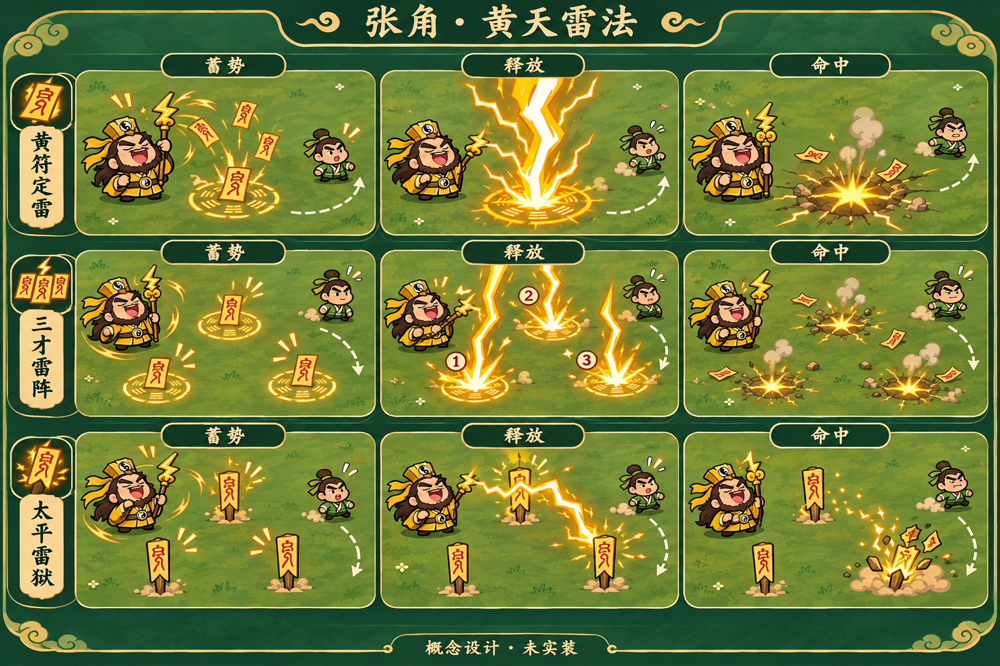
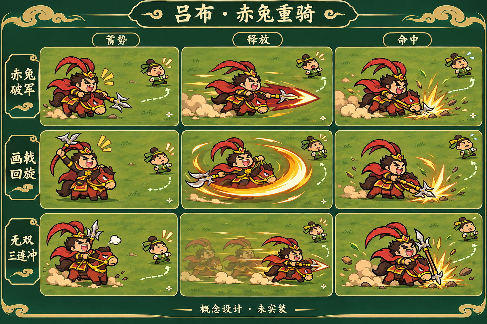
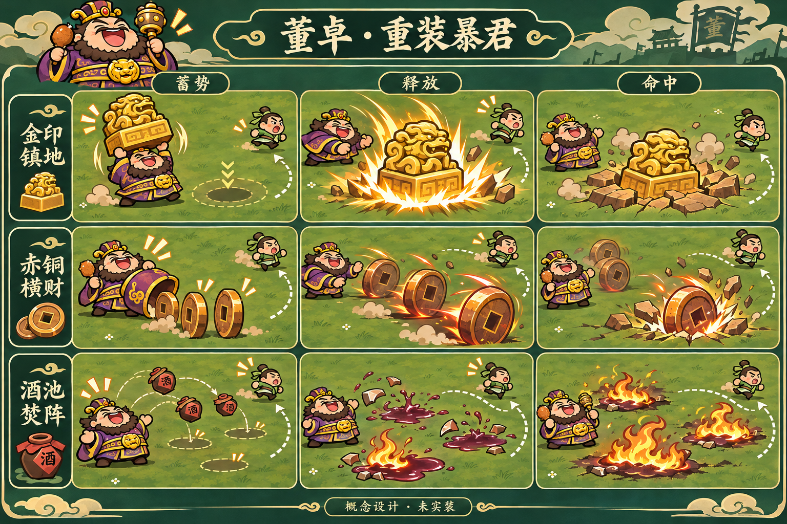
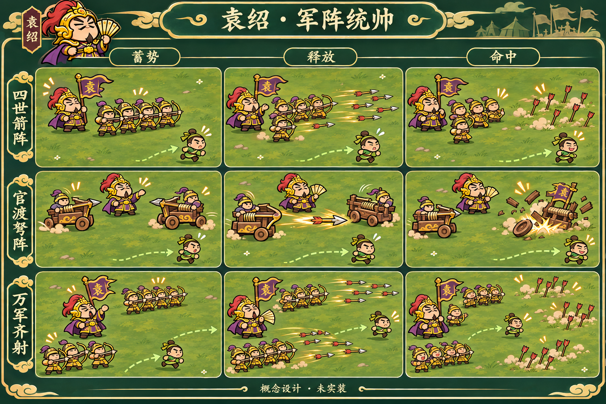
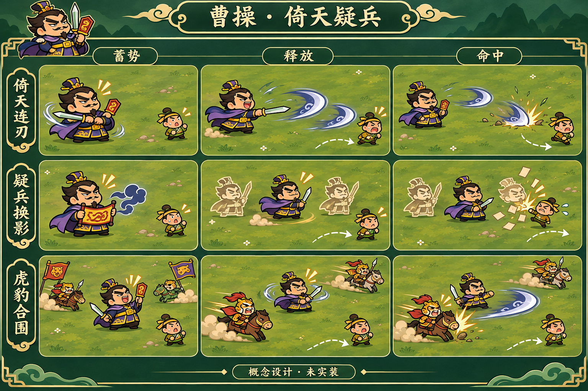
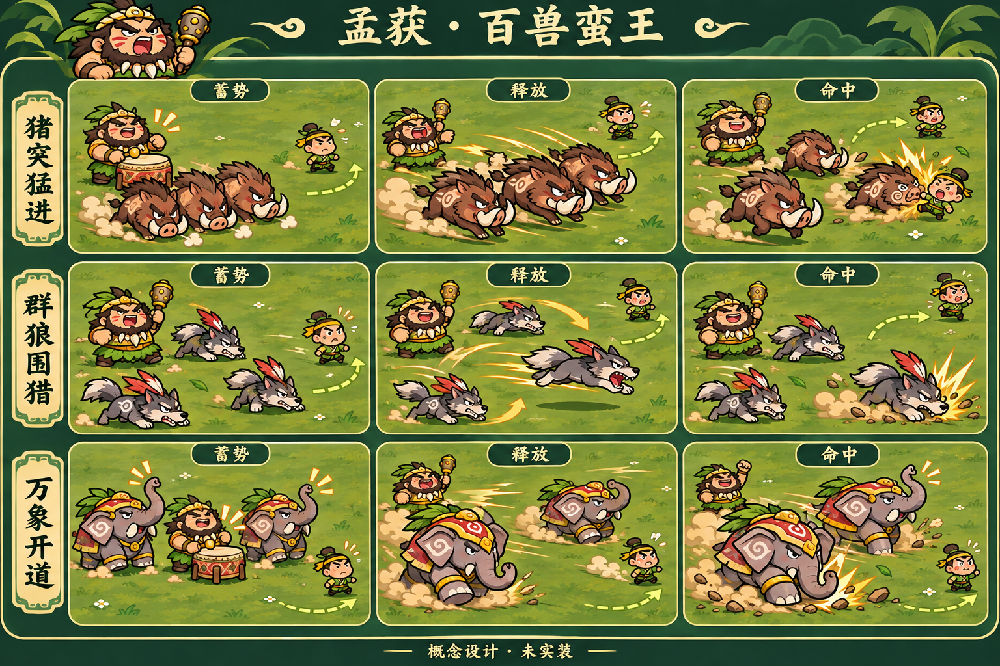
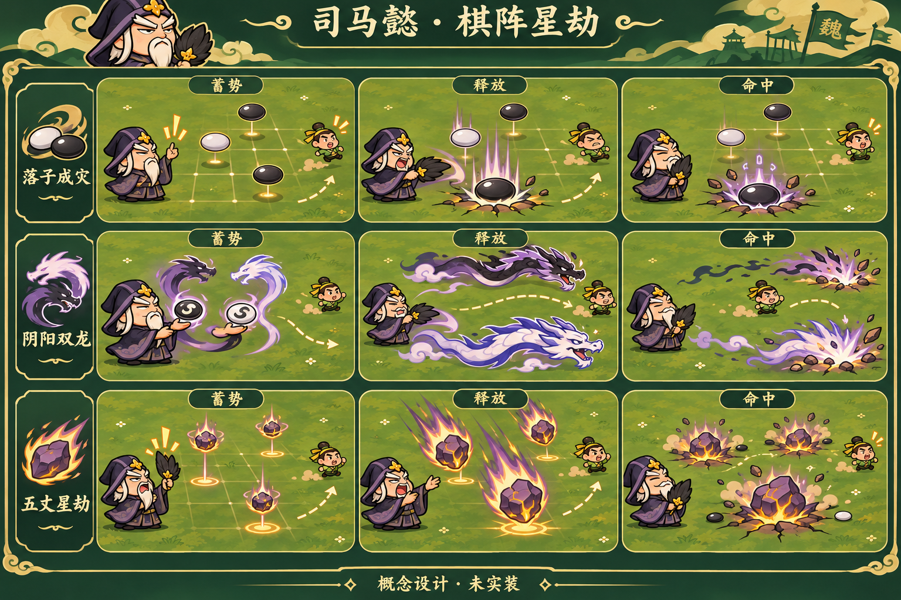

# 七位Boss技能设计稿

七位、21招已按用户确认的吕布标准全部实装，并整理为七章。当前[实现与验收](../../../docs/seven-bosses.md)及[真实Cocos预览](../../reviews/bosses/README.md)优先；本目录保留原始美术方向，图片仍是**概念设计**，不是实机截图或运行素材。

每张图按行展示三招、按列展示蓄势→释放→命中。保持小脚豆Q版、棕色粗描边、手绘平涂和草地战场，使用当前Boss图集建立人物身份。虚线走位箭头和阶段编号只用于讲解，不是拟加入战斗的HUD。分批攻击在静态图中并列出现，实际按文档时序错峰释放。

详细范围、半血阶段、冷却建议、伤害与预算约束见[七Boss提案](../../../docs/design/01-campaign-and-bosses.md#boss-ten-proposal)。所有实际碰撞与出口需在后续实现时按手机尺度验证，概念图不代表已完成平衡或手机验收。

| Boss | 三招 | 核心特色 |
| --- | --- | --- |
| [张角](01-zhangjiao.png) | 黄符定雷／三才雷阵／太平雷狱 | 定点雷法、错峰雷阵、可拆解雷链 |
| [吕布](02-lvbu.png) | 赤兔破军／画戟回旋／无双三连冲 | 直线冲锋、厚重戟刃、三段折返 |
| [董卓](03-dongzhuo.png) | 金印镇地／赤铜横财／酒池焚阵 | 重印砸地、滚动铜钱、酒坛火池 |
| [袁绍](04-yuanshao.png) | 四世箭阵／官渡弩阵／万军齐射 | 弓兵齐射、可拆弩车、移动缺口箭墙 |
| [曹操](05-caocao.png) | 倚天连刃／疑兵换影／虎豹合围 | 错拍剑气、纸影佯攻、虎豹骑夹击 |
| [孟获](06-menghuo.png) | 猪突猛进／群狼围猎／万象开道 | 野猪直冲、狼群包抄、战象重踏 |
| [司马懿](07-simayi.png) | 落子成灾／阴阳双龙／五丈星劫 | 棋子落点、阴阳游龙、星石坠落 |

## 张角 · 黄天雷法

黄符定雷 → 三才雷阵 → 太平雷狱。定点雷法、错峰雷阵、可拆解雷链。

## 吕布 · 赤兔重骑

赤兔破军 → 画戟回旋 → 无双三连冲。直线冲锋、厚重戟刃、三段折返。

## 董卓 · 重装暴君

金印镇地 → 赤铜横财 → 酒池焚阵。重印砸地、滚动铜钱、酒坛火池。

## 袁绍 · 军阵统帅

四世箭阵 → 官渡弩阵 → 万军齐射。弓兵齐射、可拆弩车、移动缺口箭墙。

## 曹操 · 倚天疑兵

倚天连刃 → 疑兵换影 → 虎豹合围。错拍剑气、纸影佯攻、虎豹骑夹击。

## 孟获 · 百兽蛮王

猪突猛进 → 群狼围猎 → 万象开道。野猪直冲、狼群包抄、战象重踏。

## 司马懿 · 棋阵星劫

落子成灾 → 阴阳双龙 → 五丈星劫。棋子落点、阴阳游龙、星石坠落。

## 来源和交接

- 生成方式：本轮通过内置 `image_gen.imagegen` 按独立资产生成，每位一张，1536×1024。没有导入运行资源目录，概念图不会增加微信发布包。
- 完整生成提示：[prompts.json](prompts.json)；来源、目标文件、尺寸和SHA-256：[manifest.json](manifest.json)。
- 原始人物身份参考：[人物源图](../../runtime-v4/sources/bosses.png)；吕布坐骑参考：[坐骑源图](../../runtime-v4/sources/boss-mounts.png)。对应旧静态运行图集已退出assets，当前动作素材见runtime-bosses与runtime-lvbu。
- 刃光参考：[横扫六合批准方向](../sweep-v5.1/01-golden-cleave.png)。每位技能沿用实体主体、动作蓄势、接触反馈和快速收尾，不用统一扇形框代替。
- 后续若实施，需要拆分角色动作、主特效和命中素材，按世界单位重新制作；不能裁切整张概念图当作技能动画。21招共用现有全场预算和受击保护，Boss战保留小兵与连续援军。
