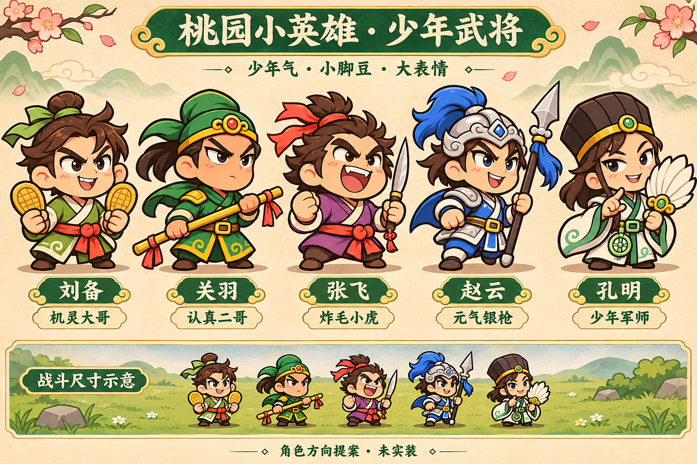

# 五英雄少年形象提案

用户希望以少年形象贴合“桃园小英雄”，当前只出设计稿，尚未确认采用，不修改游戏角色、UI、头像、动画或代码。

保留小脚豆、暖棕描边、鲜明平涂和五人原武器。去掉成人胡须与老成神态，强化少年发型、眼神和动作；刘备机灵、关羽认真、张飞炸毛豪爽、赵云元气英勇、孔明聪明狡黠。下方仅为战斗尺寸概念示意，不是引擎实机截图。

这一稿关羽采用普通暖肤色；若继续深化，需评审是否恢复淡朱红面色以强化身份。投产时仍须按实际头部宽100/小脚豆短袍检查细节密度，不能直接把整张设计板切图当战斗动画。

使用内置imagegen生成，完整提示与参考路径见[prompt.json](prompt.json)。运行时角色仍为现行版本；确认后才同步战斗头袍分层/睁闭眼/选人展示/头像/胜败/Loading和品牌头像。
