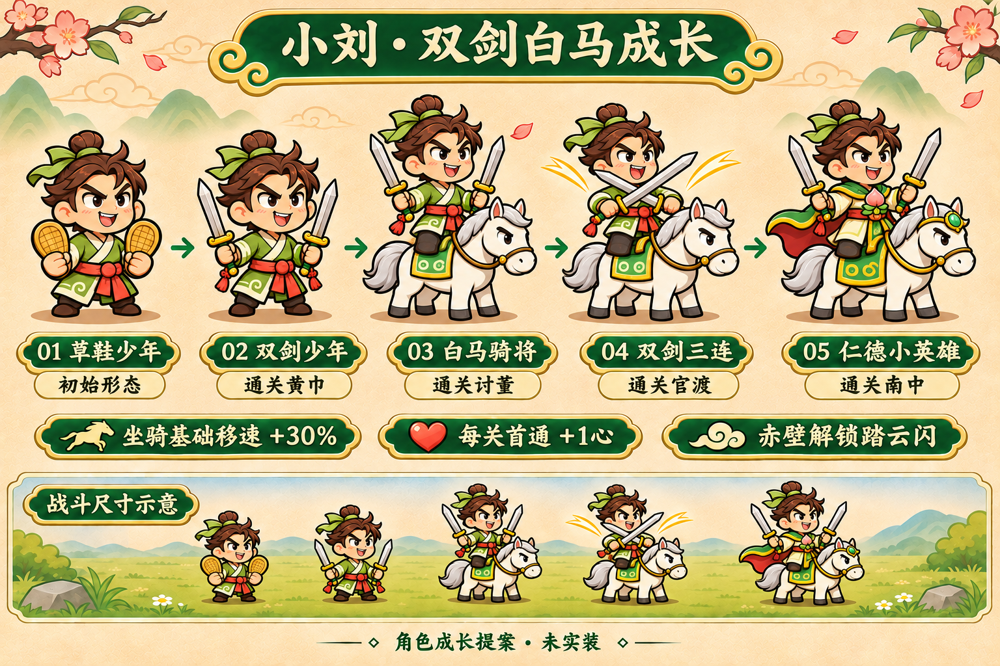
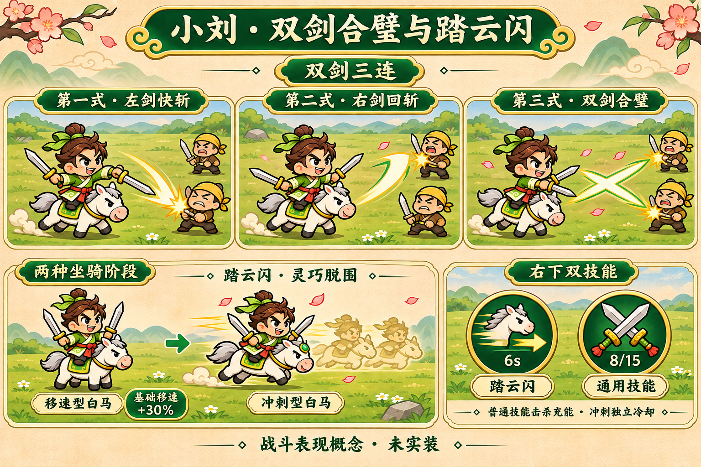

# 小刘：双股剑与白马：已批准成长方向

本目录保留最新内置imagegen方向板，完整提示及来源见[prompts.json](prompts.json)。用户已授权并在v9实现；实际资源见art/runtime-growth，工程截图/自动连招GIF见art/reviews/hero-growth。

左右手各一把双股剑，共占一槽；短尖马耳/银白鬃尾/灰蹄白马。左斩→右斩→交叉X剑气；固定踏云闪。 每英雄首通每关+1心，S01本命、S02坐骑+30%、S03三连、S04固定冲刺6秒、S05最终短甲、S06留名。最终形象不是每关细微换装。

这是概念板，不是运行截图或可直接裁切动画；运行分层、参数、实际差异与验证以[实现说明](../../../docs/hero-growth-proposal.md)为准。自由通用技能图标只是槽位示意，不锁定某英雄专属技能。
