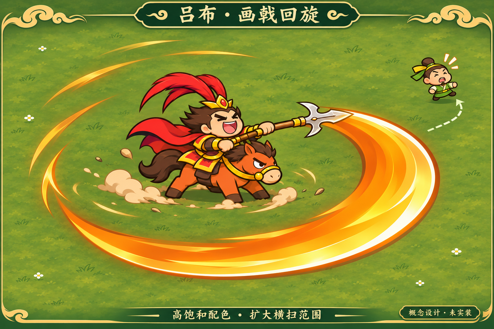

# 吕布：高饱和配色与扩大横扫

用户已确认采用，v6.5接入高饱和配色与R300横扫。以下图像仍为原始美术概念，不是实机截图。

配色由v6.4的浅暖色调整为鲜红羽缨/披风、亮金铠甲、赤橙马身，保留干净暖棕描边与简化Q版造型，不恢复厚重黑暗部。

画戟回旋已由半径185→300（约1.62倍），300°主扫保留缺口；厚实体金刃与物理戟尖连接，短拖尾、中央留白、后弧在身后/前弧在身前。图像为透视美术表达，不能直接当作碰撞范围、已实装效果或手机性能证据。实现已同步扩大可读预告与真实刃轨，起手1秒、保留后方缺口；平台验证范围见docs/lvbu-red-hare.md。

由内置imagegen生成，完整提示和参考见[prompt.json](prompt.json)。当前代码为v6.5、横扫半径300。
