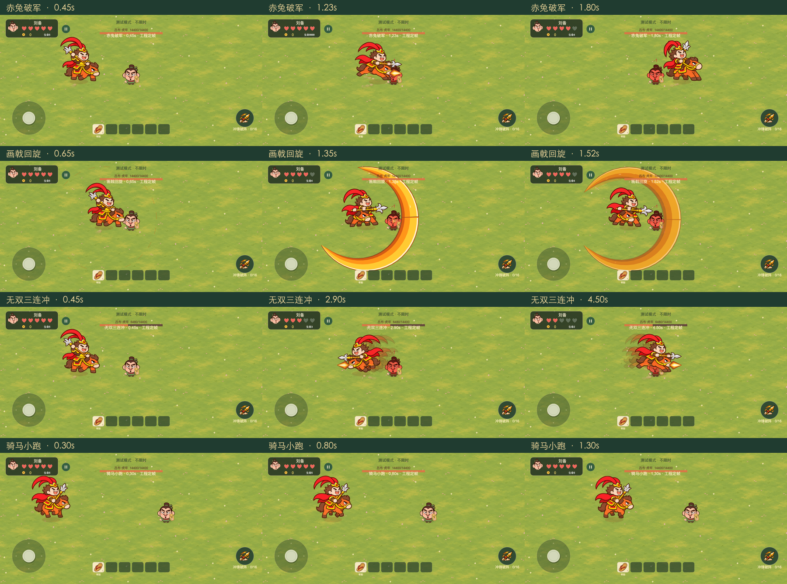

# 吕布三招实装预览

版本`chronicles-v6.5-lvbu-gold-sweep`。这是实际Cocos WebGL渲染的独立工程布景，不是概念插画、正常游玩录像或iOS帧率证据。

- [骑马小跑动画](骑马小跑.gif)
- [赤兔破军动画](赤兔破军.gif)
- [画戟回旋动画](画戟回旋.gif)
- [无双三连冲动画](无双三连冲.gif)

GIF由12fps工程定帧合成，展示真实调度/碰撞/动作与绘制，非连续录屏。首领与角色的生命变化来自隔离布景里的真实受伤入口，不计正式存档或战绩。逐帧数据、异常和恢复结果见[validation.json](validation.json)；机制与预算见[实现说明](../../../docs/lvbu-red-hare.md)。

采集入口`node scripts/capture-lvbu-review.mjs --motion`，需先构建`config/build-camp-review.json`，使用独立Chrome profile/本地8766与9336端口，不连接用户浏览器。夹具只从菜单安装，结束恢复菜单并检查存档未变，120秒watchdog兜底。

微信构建已生成；微信运行画面与iOS原设备验收以validation中的平台字段为准，不把独立浏览器帧写成微信截图。

本版保留独立四步小跑，采用鲜红/亮金/赤橙配色及R300大横扫。微信构建已完成，按用户要求直接生成二维码由手机测试，不等待桌面解锁；iOS结果待用户反馈。
