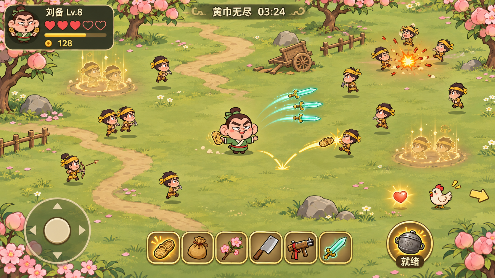
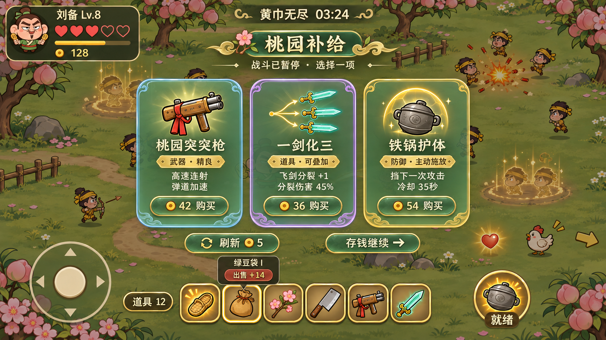
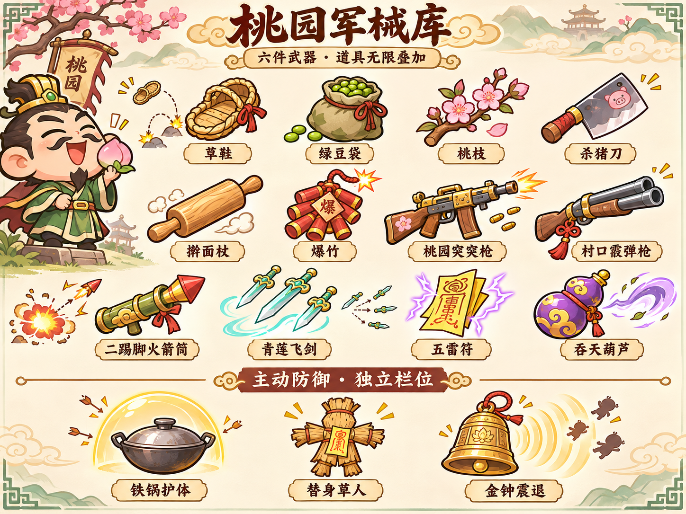
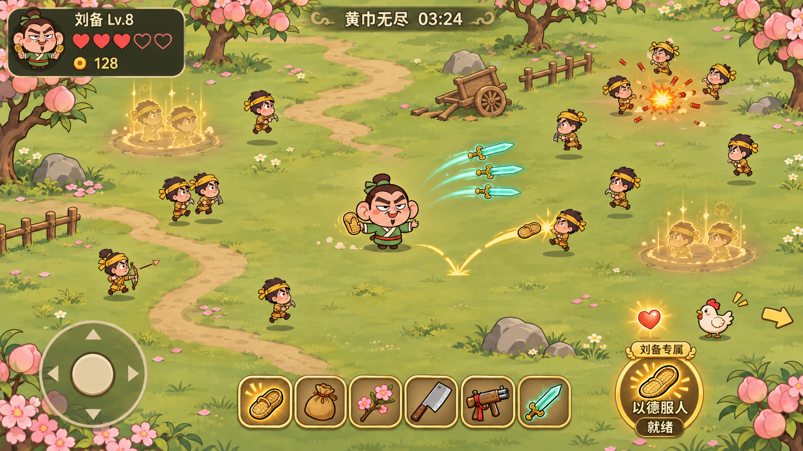
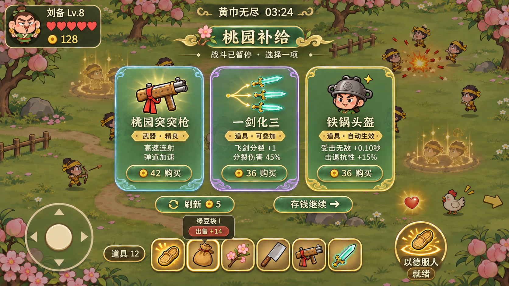
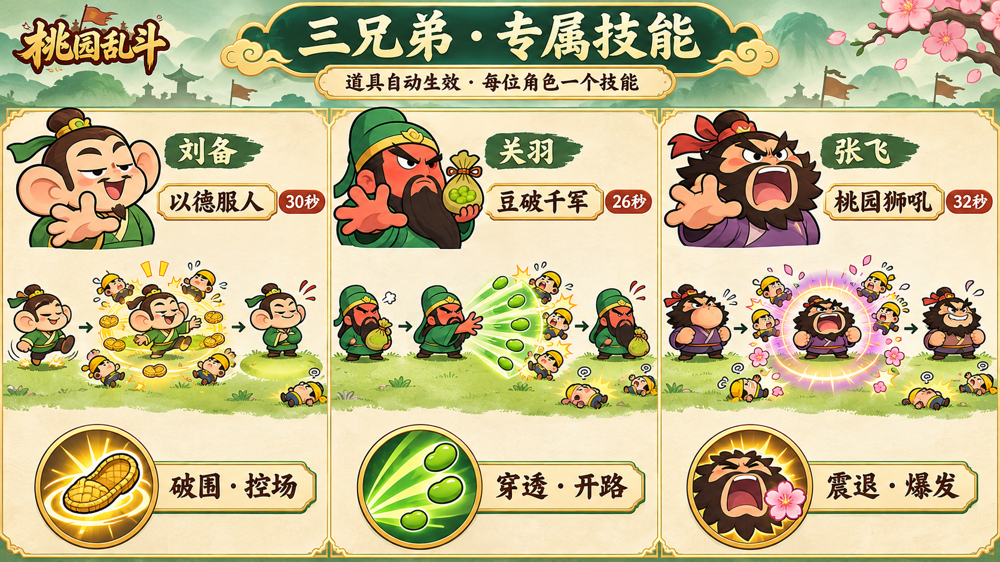

# 桃园乱斗 · 大地图与军械升级方案 v2.1

**状态：v2.1设计评审稿，等待确认后实施。日期：2026-11-12。**

本次修订：保留已认可画风；48种自动生效道具；主动按钮改为人物专属技能；移除左上角经验条，保留姓名旁Lv.等级。v2中的可装备主动防御方案作废。

飞书图文版：https://www.feishu.cn/docx/LhGid0n41ojlJWxc6KfcuPL7n7b

本稿只定义玩法、美术与验收标准。新增图片均为概念设计，不代表游戏已实现。保留现有“20秒热身 → 无限生存”“五颗心”“每30秒付费三选一、每90秒大强化”。本轮重新设计空间、补给与装备成长，不修改现有游戏代码，也不重新发布游戏。

## 1. 这次要解决什么

现状：场地只是一屏，敌人追到中央后挤成一团；环境缺少目标；补给像跳到另一个页面；武器强弱和攻击形态差别不足。

新版目标：玩家一边在桃园乡野走位，一边寻找回血动物；敌人通过可读的出生动作进入战场；暂停时仍看得到刚才的包围局面；武器能从草鞋、菜刀一路升级到突突枪、飞剑、落雷，且购买后立即看到变化。

| 核心规则 | 新版约定 |
|---|---|
| 两关 | 第一关20秒热身，第二关无限生存 |
| 生命 | 五心固定，一次有效受击掉一心，1.2秒受击无敌 |
| 地图 | 约4000×2250设计单位，约默认视野横纵各3倍、面积9倍 |
| 摄像机 | 跟随角色，UI固定在屏幕上 |
| 武器 | 恰好六个槽位；可出售、替换、合成、升阶 |
| 道具 | 无装备格限制，无总数或“每种最多3件”限制；重复产生叠加收益 |
| 专属技能 | 每位人物固定一个技能，右下角唯一主动按钮；有冷却，不占武器位，不能购买或换装 |
| 补给 | 每30秒半透明弹窗三选一；每次最多买一项，允许跳过 |
| 大强化 | 每90秒替代当次普通补给，改变攻击方式 |

道具全部自动生效，负责角色、武器及专属技能的属性成长；右下角仅释放人物天生技能。没有可购买的主动防御装备、技能切换栏或额外操作按钮。

## 2. 大地图：桃园乡野

### 2.1 尺寸和镜头

以1334×750设计视野为参照，地图约4000×2250。不同手机看到的宽度可不同，地图世界尺寸保持一致。角色移速约230单位/秒，从中部到边界约5—9秒，便于探索且不会长时间赶路。

镜头采用小范围死区跟随：角色在屏幕中央约28%宽、20%高区域内移动时，镜头尽量稳定；走出后平滑跟随，追随延迟目标约0.12—0.18秒。在地图边缘镜头停止，角色可以继续走到世界边界。地图边界用矮篱笆、山石、河岸表现，不使用黑墙或屏幕框。

世界坐标承载角色、敌人、动物、金币、心和弹道；头像、五心、计时、摇杆和专属技能按钮使用屏幕坐标。屏幕边缘不再阻挡投射物，武器按真实射程消失。

### 2.2 地貌和导航

同一张地图划分桃林、村道、菜地、营地四种轻主题，以小径和植被颜色区分。不拆为四关，不新增加载入口。

首版地面开阔可通行。树木、推车、矮篱笆主要在装饰带，避免复杂寻路；少数有碰撞的石头必须有清晰轮廓，不能形成死角或只有敌人能走的窄路。前景树冠在角色或危险物体经过时淡化。

战斗HUD只保留头像/名字等级、五心、金币、时间；不显示经验条。初版不做常驻大地图。鸡、心等补给目标距离镜头边缘较近时，显示小型边缘指示，接近后隐藏；优先级为危险预警高于回血目标高于装饰提示。

### 2.3 防止“大地图变成一直逃跑”

敌人持续围绕玩家附近投入预算，无法靠跑出一屏甩掉全部敌潮。远处普通敌人超过约1400单位、持续8秒不可见时可进入远距离简化更新；若要转移，必须取消原实体，再在合法位置重新完整播放出生预告，绝不能把活敌人瞬移到玩家附近。张角、精英、正在攻击的敌人不得通过此规则转移。

敌人不会因离开镜头重置生命或重复掉落。世界内同时战斗敌人数先以80为目标，地图扩大不直接按面积把敌人数乘9。

## 3. 任意位置刷怪：随机、有预告、可躲开

### 3.1 采样规则

整张可通行地图都允许成为出生地点，使用权重保持遭遇密度：

| 分布 | 权重 | 用途 |
|---|---:|---|
| 角色周边环带，约260—900单位 | 60% | 维持清晰的包围压力 |
| 角色行进方向前方，约600—1200单位 | 25% | 鼓励转向和选择路线 |
| 全地图可通行区域 | 15% | 让世界其他区域也有随机遭遇 |

这些是采样权重，不是只能在三条固定圆环刷怪。所有采样都必须通过安全距离、通行性和空间检查。出生中心距角色至少260单位，中心之间至少64单位；不放在石头里、回血物体上或地图外。位置连续10次不合格时取消本次投入，不强行贴脸刷怪。

骑兵至少在距玩家420单位外出生；首领至少550单位。屏内可以出生，但必须完整预告。刷怪数仍受原难度预算约束，不因全地图随机而额外加怪。

### 3.2 出生动画

普通兵约0.9秒：前0.3秒地面灰金尘圈和小旗影 → 0.3—0.75秒剪影从尘土中跑入/显形 → 最后0.15秒轮廓恢复实体。骑兵约1.1秒，首领约1.5秒，有更明显的旗帜与脚步/咒印提示。

预告阶段不造成接触伤害、不攻击、不挡角色移动，也不能被提前击杀。显形完成后另有0.2秒行动缓冲，之后才进入正常AI。玩家走到出生点时只需离开，不会被未显形实体卡住。动画在补给和暂停时一起冻结。

出生效果采用灰土、淡金虚线，不能使用与张角攻击相同的红色实心危险圈。镜头内同时突出显示的出生点以4处为目标，其余在屏外或延后投入，避免满屏发光。

## 4. 动物和回血：走位中的小目标

### 4.1 动物目录

| 动物 | 外形 | 行为 | 击败表现 | 掉落 |
|---|---|---|---|---|
| 桃园小鸡 | 白身红冠、短脚、圆滚滚 | 啄地闲逛，受惊后短距离逃跑 | 羽毛和尘团，动物跑远消失 | 一颗生命心 |
| 偷菜兔 | 奶白、长耳、抱一片菜叶 | 小幅跳跃，受击后换方向 | 菜叶飞起，烟团淡出 | 一颗生命心 |
| 小福猪 | 粉色圆身、小红绳 | 移动较慢，偶尔拱地 | 打滚、星星和烟团 | 一颗生命心 |

表现保持搞笑，无血腥。首版三种动物掉落价值相同，避免玩家为了稀有度而绕远追逐。动物不攻击、不造成碰撞伤害，也不占敌兵80名预算。

### 4.2 刷新和生命

无限关首只在25—40秒随机出现，之后每45—65秒随机检查刷新。场上最多2只动物，最多2颗未拾取的心。动物通常在距玩家250—550单位的可到达地面出现，并播放0.5秒草丛摇动/轻烟动画；不与敌兵出生点重叠。离开视野仍保留世界位置。

动物存活约25秒，离场前3秒做回头/脚印提示，不突然闪退。生命以当前普通兵生命约40%为起点校准，目标为同阶段常规主武器1—3次命中，不能成长为难打的肉盾。动物不提供击杀成长/金币，不计入依赖“杀敌”的叠层，防止回血目标变成经济刷取点。

自动攻击优先处理约180单位内的直接威胁；没有近身威胁时可攻击武器范围内动物。低于满心时提高动物在同距离目标中的优先级，角色不需要新增瞄准按钮。

### 4.3 生命心拾取

击败动物100%掉落一颗心，落地约0.25秒后可拾取。心悬浮呼吸、淡红外光，视觉尺寸约22—28单位；金币保持金色，避免混淆。

心的吸附半径建议90单位，金币仍为240—360：回血需要有意识地靠近，不能从屏幕另一侧直接自动补满。接触/吸附到角色后恢复一颗完整的心，最多五心，播放一颗空心点亮和简短恢复音。

满心时不吸收、不消耗心，保留20秒，最后5秒缓慢闪烁。不会变成第六心。心不被补给面板的“自动回收金币”一起收走，也不能在暂停期间过期。每个掉落只结算一次。

### 4.4 与商店补心的关系

商店肉包保留为昂贵、立即恢复的保底，动物是需要走位争取的机会。肉包仍每60秒最多成功购买一次。首轮目标是玩家通过动物每分钟实际恢复约0.5—0.9心，肉包约0—0.5心；统计的是实际吃到的数量，不能只看生成数量。若恢复导致生存时间过长，优先调整动物刷新间隔、停留时间和获取风险，不增大单次受击伤害。

## 5. 半透明三选一弹窗

### 5.1 视觉方向

沿用卡通三国人物和暖色场景，弹窗改为“墨绿半透明底＋细金边＋清晰大图标”。背后战斗场景保留；抛弃整页切换到纸张商城的做法。

| 元素 | 约定 |
|---|---|
| 全屏遮罩 | 黑绿底，不透明度约28%—35% |
| 卡片背景 | 墨绿底，不透明度约78%—86%，可隐约看到场景 |
| 卡片区 | 宽约屏幕65%—72%，高度约55%—62%；小屏自适应放大 |
| 标题 | “桃园补给”或“天命强化”，下面仅一行“战斗已暂停 · 选择一项” |
| 内容 | 品类/品质、物品大图、名称、最多两条核心效果、价格 |
| 按钮 | “购买/替换/升阶”，金币不足明确置灰 |
| 底部 | 刷新5、存钱继续、六武器栏、道具总数入口；右下保留角色技能图标，暂停期间禁用 |

正文与背景必须有足够对比，卡片可以较深，但卡片间隙和外侧必须清楚看到被冻结的敌人和技能。不使用全屏实时模糊作为设计前提。

### 5.2 暂停与恢复

到补给时先回收金币，再冻结战斗。摄像机、敌人、弹丸、受击状态、动物、出生动画、地面技能及掉落寿命全部冻结；生存计时停止。弹窗外不响应移动，点击外侧不关闭，不能误碰导致继续。

购买一项后面板关闭，出现简短的获得反馈和1.2秒准备保护，再恢复战斗。场景和敌人坐标不重置。原有补给后8秒缓和出兵保留。

### 5.3 六武器管理

点底部某个武器槽，出现小型详情浮层：名称、品质、主要效果、出售金额。出售按钮和购买按钮分开，单次轻点选中，明确点“出售”才执行，无需再弹第二层确认。

卖武器不占本次补给的购买次数，卖后可立即买一件；同一件只可结算一次，金币和空槽实时更新。至少保留一把武器，最后一把的出售按钮禁用。

满六格购买新武器时，先点“替换”，高亮六格，选择旧武器后显示“卖出旧武器 +X，购入新武器 −Y，余额Z”，最终一次确认原子完成。余额不足、取消、切后台均不扣款、不丢装备。这个流程同时保证用户可以不先卖空槽就比较新旧武器。

合成/出售/替换后只修正失效的报价，不免费重抽整组三卡。升阶报价绑定武器实例和目标品质，避免合成后用旧价格买更高一级。

## 6. 武器和道具正式分家

### 6.1 武器：六件，决定攻击方式

武器有独立攻击间隔、射程、伤害、品质、弹道和触发特性。可重复装备同名武器，占独立槽位，独立输出。普通/精良/稀有/传说四级，品质颜色沿用灰、蓝、紫、金红。

第一版改用较平缓的伤害倍率1/1.35/1.8/2.4，攻击间隔倍率1/.96/.92/.88。高品质可以强化本武器标志性机制，不给所有武器同时堆所有特效。

初始白色武器相对当前弱输出整体上调，目标约1.6—2.0倍有效输出。现代与修仙武器不是单纯碾压草鞋：武器价格、射程、覆盖、爆发、控制和实际命中率形成差别，任何初始武器都应能通过升级和专属道具继续使用。

### 6.2 道具：不占格，可无限累计

移除道具总格数、单种最多3件以及固定头/腰/背/脚的装备限制。人物外观只展示最近几件有辨识度的装饰，全部效果都生效，不把无限道具全挂在身上。

数值类重复道具持续叠加，采用收益递减。例如每件辣椒名义首件伤害+18%，第n件累计加成为 `0.18*n/(1+0.08*(n-1))`：1件18%、3件约47%、6件约77%、12件约115%。任何件数均可继续买，下一件仍有正收益；卡片直接显示这次实际从多少变多少。

机制类道具也允许重复：第一件解锁效果，后续增强伤害、触发频率或覆盖，而不是无限生成分裂数量。射程、移速、同时弹体数等物理/可读性上限达到后，后续重复转为相关伤害收益，并明确告知，不能花钱买到零效果。

人物专属技能随选人自动获得，无需购买，不能被商店武器或道具替换。技能相关道具只提高技能伤害、覆盖、冷却效率等属性，全部自动生效。

## 7. 十二把武器：首轮参数和攻击稿要求

以下为普通品质、无人物/道具加成的调试起点。间隔指一轮攻击的间隔；多发武器每轮所有弹体合计结算。数值需要以标准敌群测试，不能只按单体面板DPS排强弱。

| 武器 | 基础伤害/轮 | 间隔 | 射程 | 价格系数 | 核心攻击与视觉 |
|---|---:|---:|---:|---:|---|
| 草鞋 | 10 | 0.60秒 | 360 | 1.0 | 飞鞋旋转、短金轨迹、较强击退；精准点杀/控场 |
| 绿豆袋 | 4 | 0.26秒 | 410 | 1.0 | 左手持袋、另一手连射，基础穿透一人；命中少量绿粒 |
| 桃枝 | 16 | 1.00秒 | 360 | 1.0 | 桃花弹、半径70爆开，外圈伤害55%；粉色短花瓣 |
| 杀猪刀 | 10 | 0.42秒 | 135 | 1.0 | 短弧快砍，多目标命中；不离手，轻微顿帧 |
| 擀面杖 | 22 | 0.95秒 | 155 | 1.1 | 大扇面横扫与强击退，米黄短弧，不全屏震动 |
| 爆竹 | 26 | 1.45秒 | 390 | 1.2 | 抛物线小爆竹，半径100；清脆爆裂、少量火星 |
| 桃园突突枪 | 3 | 0.12秒 | 460 | 1.4 | 木托黄铜、红绳，短枪口火光、快直线弹道、少量弹壳 |
| 村口霰弹枪 | 每轮5粒×5 | 0.90秒 | 300 | 1.4 | 短扇形散弹，近距离清群；同目标最多吃4粒 |
| 二踢脚火箭筒 | 48 | 2.00秒 | 500 | 1.6 | 粗短火箭、细烟尾、半径125爆炸，外圈55%；慢速爆发 |
| 青莲飞剑 | 每轮3剑×6 | 0.80秒 | 430 | 1.5 | 扇形三剑短时追踪，同目标每轮最多两剑；青色轻剑影 |
| 五雷符 | 28 | 1.25秒 | 390 | 1.5 | 选定目标短落雷，最多跳向2名敌人，跳跃伤害50%；紫金折线 |
| 吞天葫芦 | 每轮6次×3 | 1.60秒 | 240 | 1.5 | 每轮吸风0.6秒，近距离轻聚怪；首领只受伤不被拉走 |

基础武器已有的穿透、范围、跳跃也服从统一触发协议。葫芦不把敌人拉到角色碰撞圈，最近停在角色外70单位；否则“聚怪”会变成强制受击。

初始武器仍从草鞋、绿豆袋、桃枝、杀猪刀选一把。现代/修仙武器在无限关普通补给中逐步出现：0—60秒先展示突突枪/霰弹枪，60秒后开放飞剑/五雷符，120秒后加入火箭筒/葫芦。首次出现只是机会，不强迫更换初始武器。

## 8. 四十八种道具：角色与武器属性成长

### 8.1 分类与购买规则

首版完整设计48种，六类各8种。所有道具自动生效，不占六武器格、不设置道具总格数、不限制同名购买次数。常规属性直接生效，机制型道具增强已持有武器的攻击属性，不新增需要点击的释放能力。

表内为首件基础效果，百分比伤害、攻速等均加入对应加法池，而非每次独立乘算。定价用补给基础价B的倍数；品质用于表现强度与出现频率，不是随机抽到就必然更好。A为数值递减叠加，M为机制数量有上限、后续转强度，U为有可读性边界的属性、达到边界后转换明确收益。

### 8.2 输出属性（8种）

| 编号 | 道具 | 首件属性 | 价格 | 叠加 |
|---|---|---|---:|---|
| A01 | 暴脾气辣椒 | 所有武器伤害+18% | 1.0B | A |
| A02 | 打鸡血头带 | 武器攻速+15% | 1.0B | A |
| A03 | 眼疾手快 | 暴击率+5个百分点 | 1.1B | U：暴击率最高80%，后续转暴伤 |
| A04 | 祖传狠劲 | 暴击伤害倍率+0.15 | 1.0B | A |
| A05 | 临阵磨刀 | 每次有效命中伤害基础值+1 | 1.0B | A：高频武器按攻击系数折算 |
| A06 | 专打大个 | 对精英和首领伤害+18% | 1.0B | A |
| A07 | 趁热打铁 | 对生命低于30%的敌人伤害+20% | 1.0B | A |
| A08 | 近朱者赤 | 距角色180内的敌人受到武器伤害+15% | 1.0B | A |

“基础值+1”不允许使0.12秒突突枪获得远高于慢武器的收益：武器设定附伤系数，按基础攻击间隔/0.8折算（上下限0.15—1.5），散弹再分摊到每轮弹粒。预览显示该武器实际提升。

### 8.3 生存与移动属性（8种）

| 编号 | 道具 | 首件属性 | 价格 | 叠加 |
|---|---|---|---:|---|
| B01 | 草编鞋垫 | 移动速度+6% | 1.0B | U：总移速加成软上限50%，超出转击退强度 |
| B02 | 铁锅头盔 | 受击无敌时长+0.10秒、击退抗性+15% | 1.3B | U：基础1.2秒，最多1.8秒，后续转击退抗性 |
| B03 | 稳如老狗 | 自身被击退距离减少15% | 0.9B | U：抗性最多60%，后续转武器击退 |
| B04 | 风骚小碎步 | 角色受击碰撞半径减少3% | 1.3B | U：最多缩小12%，之后转移速/击退收益 |
| B05 | 脚底抹油 | 受击后的加速幅度+10%，基础持续1秒 | 1.0B | A：无新按钮，持续效果不叠触发次数 |
| B06 | 临危不乱 | 受击后加速持续时间+0.25秒 | 0.9B | U：最长2.5秒，后续转加速幅度 |
| B07 | 远远抱心 | 生命心吸附半径+25单位 | 0.9B | U：最高180，后续转动物目标伤害 |
| B08 | 追鸡高手 | 对动物伤害+25% | 0.8B | A：不提高动物刷新和掉落数量 |

所有人物基础拥有“有效受击后移速+10%，持续1秒”，B05/B06分别增强幅度和持续时间，单独购买也有效。

不增加生命上限，不提供小数心减伤、主动护盾或随机闪避。五心与受击一心规则不变。受击无敌为真正扣心后的保护，不能在未受伤时自动生成永久无敌。

### 8.4 经济与拾取属性（8种）

| 编号 | 道具 | 首件属性 | 价格 | 叠加 |
|---|---|---|---:|---|
| C01 | 招财钱袋 | 金币掉落收入+10% | 1.0B | A：按小数余数累积 |
| C02 | 钱来！ | 金币吸附半径+40单位 | 0.9B | U：最高360，之后转金币收入 |
| C03 | 军饷借条 | 每次30秒补给军饷+2 | 1.2B | A：不按持有金币计复利 |
| C04 | 老板熟人 | 武器购买价格降低5% | 1.2B | U：最高20%，后续转对应武器伤害 |
| C05 | 货比三家 | 每次补给第一次刷新价格降低1金币 | 0.9B | U：最低1金币，之后转军饷 |
| C06 | 回收行家 | 武器出售返还率+5个百分点 | 1.0B | U：最高60%，之后转军饷；禁止买卖套利 |
| C07 | 热心桃符 | 地面生命心保留时间+5秒 | 0.8B | U：最长40秒，之后转心吸附范围/动物伤害 |
| C08 | 肉包熟客 | 恢复消耗品价格降低10% | 0.9B | U：最高30%，后续转生命心保留/动物伤害 |

商店肉包是购买时立即恢复一颗心的消耗品，单独标记“恢复”，不占这48种永久增益名额，也不需要在战斗中主动释放。

### 8.5 弹道与远程属性（8种）

| 编号 | 道具 | 首件属性 | 价格 | 叠加 |
|---|---|---|---:|---|
| D01 | 顺风快递 | 远程弹道速度+25% | 1.0B | U：基础的2倍后转远程伤害 |
| D02 | 千里眼 | 远程射程+12% | 1.0B | U：最高基础的1.6倍，后续转伤害 |
| D03 | 穿云签 | 适配直线弹体额外穿透1人，后续伤害70% | 1.3B | M：额外3次后提高穿透伤害 |
| D04 | 一鞋两响 | 草鞋增加一次60%伤害弹射 | 1.3B | M：最多额外3次，之后提高弹射伤害 |
| D05 | 一剑化三 | 飞剑末段增加一支45%伤害分裂剑 | 1.4B | M：最多额外3支，之后提高分裂伤害 |
| D06 | 豆不白打 | 绿豆穿透后的伤害衰减减少10个百分点 | 1.1B | U：最高保留100%，后续转绿豆伤害 |
| D07 | 稳手红绳 | 枪械散布角降低10% | 1.0B | U：最低原始50%，后续转枪械伤害；霰弹仍保留扇形 |
| D08 | 剑随心动 | 飞剑转向速度+20% | 1.0B | U：最高基础2倍，后续转飞剑伤害 |

### 8.6 近战与范围属性（8种）

| 编号 | 道具 | 首件属性 | 价格 | 叠加 |
|---|---|---|---:|---|
| E01 | 伸长胳膊 | 近战攻击距离+12% | 1.0B | U：最高基础1.6倍，后续转近战伤害 |
| E02 | 横扫乡里 | 近战攻击扇角+15度 | 1.1B | U：最高220度，后续转近战伤害 |
| E03 | 鞋底加厚 | 武器击退强度+20% | 1.0B | U：最高基础2倍，后续转伤害 |
| E04 | 火药加料 | 爆炸半径+15% | 1.1B | U：最高基础1.8倍，后续转爆炸伤害 |
| E05 | 震天响 | 爆炸外圈伤害+10个百分点 | 1.1B | U：外圈最高100%，后续转爆炸伤害 |
| E06 | 连环桃签 | 桃枝击杀产生一次60%伤害次生爆炸 | 1.4B | M：不递归；重复提高次生伤害/半径 |
| E07 | 雷来！ | 五雷符额外跳跃一个目标 | 1.3B | M：整轮最多5目标，之后提高雷伤 |
| E08 | 葫芦收紧 | 葫芦吸引强度+20% | 1.0B | U：不拉进角色70范围、不拉首领；上限后转持续伤害 |

### 8.7 专属与技能属性（8种）

| 编号 | 道具 | 首件属性 | 价格 | 叠加 |
|---|---|---|---:|---|
| F01 | 老刘的鞋油 | 草鞋伤害+20% | 1.0B | A，持有草鞋时出现 |
| F02 | 关二爷秘豆 | 绿豆袋攻速+18% | 1.0B | A，持有绿豆袋时出现 |
| F03 | 桃园道行 | 桃枝伤害+18%、弹速+10% | 1.1B | A/U，持有桃枝时出现 |
| F04 | 杀猪熟练工 | 杀猪刀每第三刀伤害+40% | 1.1B | A，计数按武器实例独立 |
| F05 | 加长弹匣 | 突突枪攻速+15%、子弹速度+10% | 1.1B | A/U，无换弹操作 |
| F06 | 青莲剑穗 | 飞剑伤害+18% | 1.0B | A，持有飞剑时出现 |
| F07 | 桃园真传 | 人物专属技能伤害+18% | 1.1B | A，不改变技能所属人物 |
| F08 | 回气丹 | 人物技能冷却恢复速度+12% | 1.3B | U：有效冷却最低原始55%，之后转技能伤害 |

### 8.8 无限叠加、抽取适配和显示

A类累计收益采用 `首件效果*n/(1+k*(n-1))`，伤害k建议0.08、攻速k建议0.12；不同来源同一属性加入加法池，再处理全局边界。商店预览显示“已持有n → n+1”和此次真实变化，不能仍写第1件名义收益。

M/U类达到数量/物理上限后，明确展示“数量已满，本次改为××伤害+Y%”；存在多层转换时，最终都能落到可继续正增长的适配伤害或军饷，不能形成零收益购买。统计显示收集总件数与不同种类数，行囊按六类分页/筛选，不画固定数量空格。

道具池按当前武器与技能过滤，卖掉唯一适配武器后不继续出无用专属道具，已购道具保留，未来买回该武器重新生效。右下专属技能不在商品池。常规三卡优先为“适配进攻/机制或专属/生存经济”，至少一项买得起且有收益；机制型道具不能在未持有对应武器时强行出现。

## 9. 三位角色专属技能：唯一主动按钮

### 9.1 共同操作与成长

选人即获得固定技能，不购买、不占武器格、不提供替换技能。右下按钮图标与人物绑定：刘备草鞋震环、关羽豆浪、张飞怒吼桃花。点击立即释放，自动选择方向/目标，不拖拽瞄准；保持原有自由触点摇杆。

定义P为施法时六件已装备武器的“单体基础每秒伤害”合计，包含品质、攻击增益、期望暴击，不包含范围多目标、弹射分裂、技能临时增益与其他次生伤害。散弹和飞剑按单目标命中上限计算。技能伤害乘专属技能伤害加成，并在施法瞬间快照。这样不同武器流派均可带动技能，避免取最大单发导致火箭筒独占优势，也不直接套用某把武器的全部被动特效。

| 人物 | 技能 | 基础冷却 | 战术定位 |
|---|---|---:|---|
| 刘备 | 以德服人 | 30秒 | 破围、推开、短时保命 |
| 关羽 | 豆破千军 | 26秒 | 定向贯穿、清出逃生路 |
| 张飞 | 桃园狮吼 | 32秒 | 近身震退、区域爆发 |

### 9.2 刘备：以德服人

0.12秒抬手跺脚，夸张大耳朵跟着一抖；八只金色草鞋沿周身向外形成短震环。范围约240单位，最多12名敌人，每名只受一次 `0.8P` 技能伤害，普通兵推开约180单位并硬直0.5秒。距角色150内的敌方普通箭矢被拍散；张角落雷区域不被消除。施法最初0.35秒为明确闪避保护，不回血、不增加心上限。之后2秒移速+15%。

骑兵在已承诺冲锋时只受到减弱的推力，不被横向瞬移；精英硬直减半，张角只受伤不位移、不硬控。表现为金色短鞋影、一圈碎尘和集中一次“啪！”，避免八声叠加。角色没有装备草鞋时照样能释放，是角色招牌能力。

### 9.3 关羽：豆破千军

左手始终握绿豆袋，右手抡出一道约75度、长度520单位的青绿豆浪。优先朝最近的威胁密集方向，搜索附近最多3个候选朝向，按扇区敌数选定；无目标时按最近移动朝向释放。每名敌人一次 `1.4P` 伤害，最多12目标，技能豆浪不按普通弹体的穿透次数消失。

前180范围普通敌人轻推100单位，形成一条前方出口；不提供持续无敌，不清屏背后敌人。0.12秒提气后约0.4秒内命中，关羽可继续移动。青绿豆影、短扇面亮线和一串干脆豆击声，命中结束立即淡出。它是明确的开路爆发，按技能结算，不能触发绿豆额外豆雨或无穷穿透收益。

### 9.4 张飞：桃园狮吼

0.18秒鼓腮吸气，黑胡子抖动，发出短促“喝！”；以角色为中心260单位的金紫声波造成一次 `1.1P` 伤害，最多16目标，普通敌人震退约150单位。随后在施法时选定的附近两处敌群落下小桃花爆点（各半径85、延迟0.35秒），造成 `0.35P` 伤害；同一敌人最多吃一个桃花爆点，总伤害上限 `1.45P`。

声波提供空间，延迟桃花补输出。能清掉角色130范围内的普通箭矢，不取消首领地面技能；不额外回复生命。花瓣数量克制，声波迅速扩散淡出，敌方红色预警始终显示在上层。即使未装备桃枝，仍保留张飞桃园主题。

### 9.5 冷却、公平和生命周期

技能首次开局就绪，热身到无限关时重置为就绪，方便新关第一次破围。冷却从成功施法时开始，只按正式模拟战斗时间推进；补给、暂停、切后台、恢复倒数全部冻结。死亡、重开和换人物清空旧技能状态。

回气丹采用恢复速度属性H：`有效冷却 = 基础冷却/(1+H)`，最低基础55%。不同冷却增益相加，不做每件独立乘算。按钮用灰色扇形与整数秒显示冷却，就绪时短呼吸一次，不常驻强闪光。重复连点不能重复施法；冷却中的按键只做轻反馈，不缓存自动释放。

技能击杀正常给金币与角色成长，但技能不触发武器的分裂、弹射、击杀爆炸、豆雨和其他技能；道具的“武器伤害”不重复二次放大已经进入P的伤害，只有“专属技能伤害”另乘一次。无敌/格挡不是道具新增主动能力；只在刘备技能规定的短窗口或正常受击保护期内生效。

### 9.6 左上角与等级

头像、姓名Lv.n、五颗心和金币保留，经验条连同底槽完全移除，缩短左上面板高度。等级作为自动杀敌成长保留：不弹升级面板、不显示经验百分比，只在升级时短暂显示“Lv.+1”，属性自动小幅成长。现有每级伤害+3个百分点、最高30级作为初始调试基准；行囊/属性详情可查看当前等级收益。原有经验获取道具从新版商品池移除，不让玩家围绕看不到的进度条消费。

## 10. 六槽下的经济与战力曲线

### 10.1 出售与交易

基础价格仍以 `min(80,round(28*1.035^补给次数))` 为起点，再乘武器类型和品质系数。普通/精良/稀有/传说购买系数建议1/1.6/2.5/4。永久道具定价按第8节的基础价系数；机制道具约1.2—1.6倍。人物专属技能免费随角色解锁，不售卖。

出售按该武器实例的累计实际付费投入40%取整，不按当前通胀价格退款，避免低价买入后等涨价套利。初始赠送武器的退款使用固定低额基准（例如6金币）。合成后的投入等于两件投入之和；免费升阶不凭空增加投入；出售后不退道具、不移除已叠加的属性。

满槽替换时只结算一次净支出。三选一购买次数在成功购入时消耗，卖出、查看、取消和免费合成均不消耗次数。

### 10.2 新曲线起点

地图变大、动物回血、人物专属技能和新武器会提高容错与输出，不能直接沿用旧曲线后就假定平衡。建议先将普通白武器输出增强，敌潮使用独立新基准，之后通过实际击杀和受击数据调试。

无限关普通步兵起始生命由旧12提高到约18；热身仍保持6生命，确保20秒轻松。前8分钟生命倍率仍为每分钟1.16，之后1.22；每秒预算先从1.6开始，每分钟1.10倍，上限4.0。特殊兵成本仍为步兵1/远程1.5/骑兵3/张角20。到上限后通过精英比例、走位事件提升压力，不能无限加对象数或将普通兵移速提到追不上就必死。

| 时间 | 普通兵生命约值 | 投入预算/秒 | 参考构筑有效输出，进入无限关=1 | 设计体验 |
|---|---:|---:|---:|---|
| 0分钟 | 18 | 1.60 | 1.0 | 明显比热身紧张，已有两武器 |
| 2分钟 | 24 | 1.94 | 1.9 | 第一次现代/修仙组合开始成形 |
| 4分钟 | 33 | 2.34 | 3.2 | 六武器和第一套机制形成爽期 |
| 6分钟 | 44 | 2.83 | 5.0 | 动物补血和人物技能开始影响路线 |
| 8分钟 | 59 | 3.43 | 7.0 | 输出与包围重新接近临界 |
| 10分钟 | 88 | 4.00 | 9.0 | 强构筑与走位共同支撑纪录 |

输出指数是需要用实测构筑达到的目标，不是暗中按时间送属性，也不依据玩家买到强卡偷偷加怪。回血目标不直接换算成输出指数，另行统计每分钟实际恢复、技能避险和受击。

每次有效进攻购买目标让当前清怪能力提升约12%—25%，大强化适配构筑约25%—45%。武器从两把补至六把的数量收益与道具收益分开计算，避免早期叠加过快、后期买了没有感知。

### 10.3 调试指标

专属技能额外统计平均冷却利用率、每次技能击杀、技能后3秒受击率，以及不同武器混搭下P的计算一致性。技能全部按冷却释放时，对正常清怪的平均贡献先控制在约10%—20%；强道具构筑可提高，但不让玩家必须卡冷却连点才能生存。

- 单武器：同等级单体、5目标散群、10目标密群的有效DPS、过量伤害和实际命中率。
- 生存：每分钟受击/恢复/技能使用及避险、死亡时是否有可达逃生路线、追动物导致受击比例。
- 经济：每次补给收入、可买选项数、出售/替换频率、存钱跳过占比、购买后10秒清怪变化。
- 节奏：热身通过率、2/4/6/8分钟存活比例；新手中位2—4分钟、熟练5—8分钟作为校准目标，不作为已验证结果。
- 随机公平：同一角色不同种子表现差异；不匹配道具率、被迫买零收益卡次数目标均为0。

## 11. 战斗表现与手机可读性

以“动作/弹体清楚 → 命中确认 → 小范围反馈”为顺序。现代武器用短枪口火光和少量弹壳，修仙武器用短剑影/折线雷，基础草鞋保留啪声和击退。每类武器的出手与命中音色不同，密集攻击进行限频。

己方远程轨迹以青、金、浅粉为主；张角和敌方危险以红橙轮廓为主。友方特效在敌方危险圈下层，敌人攻击轮廓不得被爆炸遮住。

初始性能预算：80活动敌人、2动物、160己方弹体、60敌方弹体、20并发短爆炸/命中特效。超预算时先简化装饰粒子、合并同批表现和限制视觉副本，不悄悄删掉已经付费获得的攻击伤害。分裂和雷链通过固定目标数量、空间查询与批次去重控制计算量。

地面使用可复用小块、少量装饰图集和按视野显示，不制作一张4000×2250巨幅底图。半透明弹窗只做普通混合，首版不依赖实时高斯模糊。性能验收以目标手机测试为准，设计图的光效强度不等于必须逐像素实现。

## 12. 当前设计稿与美术规则

本次保留v2已认可的桃园乡野、Q版小脚豆人物、墨绿半透明卡片与细金边；不更换整体画风。

当前以第15节v2.1修订图为准：新版战斗HUD移除经验条，右下是刘备“以德服人”；新版补给第三张为自动生效“铁锅头盔”；三兄弟技能板展示各自的释放与命中形态。

第14节旧图作为版本存档保留，其中经验条、铁锅主动按钮和“三种主动防御”已失效。12武器美术方向继续沿用，但图鉴底部旧防御栏不再作为可装备系统。

正式界面数值和文字由程序排版，概念图只确认视觉方向。摇杆仍按触点生成，道具收藏不画固定数量空格。

## 13. 确认后的实施与验收顺序

| 阶段 | 交付 | 核心验收 |
|---|---|---|
| A | 世界坐标、镜头、地形、出生动画 | 多屏移动；随机出生有完整预告；镜头不带动HUD |
| B | 半透明补给、六武器交易、无限道具行囊 | 购买/出售/替换不重复扣款；无主动道具；六槽始终成立 |
| C | 动物、生命心、无经验条HUD | 五心上限；满心不浪费；不显示经验条；等级自动成长 |
| D | 12武器、48道具、三人物技能 | 数值/机制适配；技能与武器独立；只有一个技能按钮；冷却冻结正确 |
| E | 数值与真机性能、微信构建 | 长局无对象失控；次生效果不递归；真实编译验证 |

本轮仍停留在设计评审，不修改游戏代码。已确认的美术方向保持；待确认48道具范围、三位人物的技能效果与冷却后，再进入实现。

## 14. v2旧版设计稿（存档）

以下三稿使用内置 image_gen 生成，仅作为待确认的美术与界面方向。完整提示词保存于 `art/concepts/survival-v2/prompts.json`。

### 14.1 世界战斗稿

### 14.2 半透明补给与出售入口

### 14.3 十二武器与三种防御

## 15. v2.1修订设计稿

以下图片使用内置image_gen编辑/生成，完整提示词见 `art/concepts/survival-v2-1/prompts.json`。

### 15.1 无经验条战斗HUD与人物技能

### 15.2 全自动道具补给

### 15.3 三兄弟专属技能

