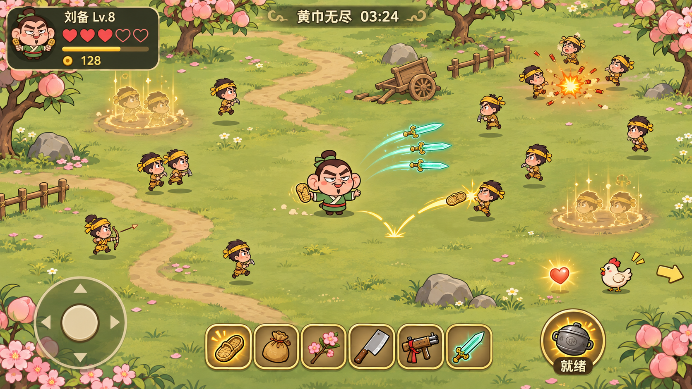
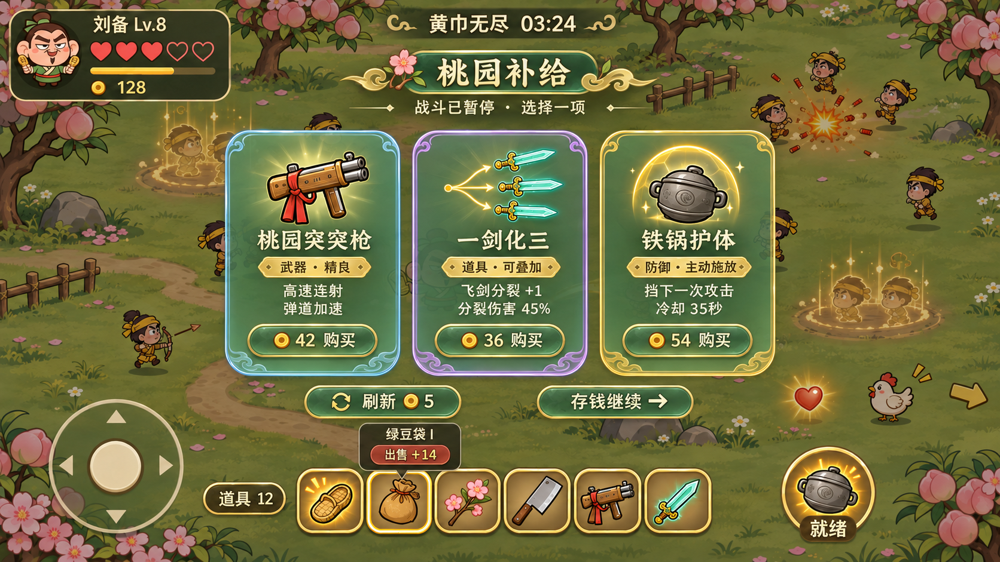
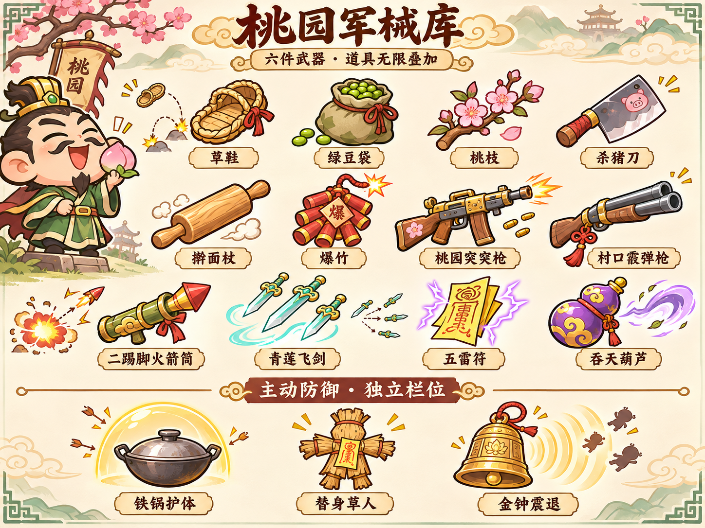

# 桃园乱斗 · 大地图与军械升级方案 v2

**状态：设计评审稿，等待确认后实施。日期：2026-11-12。**

飞书图文版：https://www.feishu.cn/docx/LhGid0n41ojlJWxc6KfcuPL7n7b

本稿只定义玩法、美术与验收标准。新增图片均为概念设计，不代表游戏已实现。保留现有“20秒热身 → 无限生存”“五颗心”“每30秒付费三选一、每90秒大强化”。本轮重新设计空间、补给与装备成长，不修改现有游戏代码，也不重新发布游戏。

## 1. 这次要解决什么

现状：场地只是一屏，敌人追到中央后挤成一团；环境缺少目标；补给像跳到另一个页面；武器强弱和攻击形态差别不足。

新版目标：玩家一边在桃园乡野走位，一边寻找回血动物；敌人通过可读的出生动作进入战场；暂停时仍看得到刚才的包围局面；武器能从草鞋、菜刀一路升级到突突枪、飞剑、落雷，且购买后立即看到变化。

| 核心规则 | 新版约定 |
|---|---|
| 两关 | 第一关20秒热身，第二关无限生存 |
| 生命 | 五心固定，一次有效受击掉一心，1.2秒受击无敌 |
| 地图 | 约4000×2250设计单位，约默认视野横纵各3倍、面积9倍 |
| 摄像机 | 跟随角色，UI固定在屏幕上 |
| 武器 | 恰好六个槽位；可出售、替换、合成、升阶 |
| 道具 | 无装备格限制，无总数或“每种最多3件”限制；重复产生叠加收益 |
| 防御 | 建议独立一个主动防御栏，不占六武器槽；同一时间装备一种主动技能 |
| 补给 | 每30秒半透明弹窗三选一；每次最多买一项，允许跳过 |
| 大强化 | 每90秒替代当次普通补给，改变攻击方式 |

主动防御独立栏属于本稿建议，需随整体方案确认。它的作用是给玩家一次主动自救机会，保持六把武器的输出空间。

## 2. 大地图：桃园乡野

### 2.1 尺寸和镜头

以1334×750设计视野为参照，地图约4000×2250。不同手机看到的宽度可不同，地图世界尺寸保持一致。角色移速约230单位/秒，从中部到边界约5—9秒，便于探索且不会长时间赶路。

镜头采用小范围死区跟随：角色在屏幕中央约28%宽、20%高区域内移动时，镜头尽量稳定；走出后平滑跟随，追随延迟目标约0.12—0.18秒。在地图边缘镜头停止，角色可以继续走到世界边界。地图边界用矮篱笆、山石、河岸表现，不使用黑墙或屏幕框。

世界坐标承载角色、敌人、动物、金币、心和弹道；头像、五心、计时、摇杆和防御按钮使用屏幕坐标。屏幕边缘不再阻挡投射物，武器按真实射程消失。

### 2.2 地貌和导航

同一张地图划分桃林、村道、菜地、营地四种轻主题，以小径和植被颜色区分。不拆为四关，不新增加载入口。

首版地面开阔可通行。树木、推车、矮篱笆主要在装饰带，避免复杂寻路；少数有碰撞的石头必须有清晰轮廓，不能形成死角或只有敌人能走的窄路。前景树冠在角色或危险物体经过时淡化。

战斗HUD只保留头像/名字等级、五心、经验、金币、时间。初版不做常驻大地图。鸡、心等补给目标距离镜头边缘较近时，显示小型边缘指示，接近后隐藏；优先级为危险预警高于回血目标高于装饰提示。

### 2.3 防止“大地图变成一直逃跑”

敌人持续围绕玩家附近投入预算，无法靠跑出一屏甩掉全部敌潮。远处普通敌人超过约1400单位、持续8秒不可见时可进入远距离简化更新；若要转移，必须取消原实体，再在合法位置重新完整播放出生预告，绝不能把活敌人瞬移到玩家附近。张角、精英、正在攻击的敌人不得通过此规则转移。

敌人不会因离开镜头重置生命或重复掉落。世界内同时战斗敌人数先以80为目标，地图扩大不直接按面积把敌人数乘9。

## 3. 任意位置刷怪：随机、有预告、可躲开

### 3.1 采样规则

整张可通行地图都允许成为出生地点，使用权重保持遭遇密度：

| 分布 | 权重 | 用途 |
|---|---:|---|
| 角色周边环带，约260—900单位 | 60% | 维持清晰的包围压力 |
| 角色行进方向前方，约600—1200单位 | 25% | 鼓励转向和选择路线 |
| 全地图可通行区域 | 15% | 让世界其他区域也有随机遭遇 |

这些是采样权重，不是只能在三条固定圆环刷怪。所有采样都必须通过安全距离、通行性和空间检查。出生中心距角色至少260单位，中心之间至少64单位；不放在石头里、回血物体上或地图外。位置连续10次不合格时取消本次投入，不强行贴脸刷怪。

骑兵至少在距玩家420单位外出生；首领至少550单位。屏内可以出生，但必须完整预告。刷怪数仍受原难度预算约束，不因全地图随机而额外加怪。

### 3.2 出生动画

普通兵约0.9秒：前0.3秒地面灰金尘圈和小旗影 → 0.3—0.75秒剪影从尘土中跑入/显形 → 最后0.15秒轮廓恢复实体。骑兵约1.1秒，首领约1.5秒，有更明显的旗帜与脚步/咒印提示。

预告阶段不造成接触伤害、不攻击、不挡角色移动，也不能被提前击杀。显形完成后另有0.2秒行动缓冲，之后才进入正常AI。玩家走到出生点时只需离开，不会被未显形实体卡住。动画在补给和暂停时一起冻结。

出生效果采用灰土、淡金虚线，不能使用与张角攻击相同的红色实心危险圈。镜头内同时突出显示的出生点以4处为目标，其余在屏外或延后投入，避免满屏发光。

## 4. 动物和回血：走位中的小目标

### 4.1 动物目录

| 动物 | 外形 | 行为 | 击败表现 | 掉落 |
|---|---|---|---|---|
| 桃园小鸡 | 白身红冠、短脚、圆滚滚 | 啄地闲逛，受惊后短距离逃跑 | 羽毛和尘团，动物跑远消失 | 一颗生命心 |
| 偷菜兔 | 奶白、长耳、抱一片菜叶 | 小幅跳跃，受击后换方向 | 菜叶飞起，烟团淡出 | 一颗生命心 |
| 小福猪 | 粉色圆身、小红绳 | 移动较慢，偶尔拱地 | 打滚、星星和烟团 | 一颗生命心 |

表现保持搞笑，无血腥。首版三种动物掉落价值相同，避免玩家为了稀有度而绕远追逐。动物不攻击、不造成碰撞伤害，也不占敌兵80名预算。

### 4.2 刷新和生命

无限关首只在25—40秒随机出现，之后每45—65秒随机检查刷新。场上最多2只动物，最多2颗未拾取的心。动物通常在距玩家250—550单位的可到达地面出现，并播放0.5秒草丛摇动/轻烟动画；不与敌兵出生点重叠。离开视野仍保留世界位置。

动物存活约25秒，离场前3秒做回头/脚印提示，不突然闪退。生命以当前普通兵生命约40%为起点校准，目标为同阶段常规主武器1—3次命中，不能成长为难打的肉盾。动物不提供普通击杀经验/金币，不计入依赖“杀敌”的叠层，防止回血目标变成经济刷取点。

自动攻击优先处理约180单位内的直接威胁；没有近身威胁时可攻击武器范围内动物。低于满心时提高动物在同距离目标中的优先级，角色不需要新增瞄准按钮。

### 4.3 生命心拾取

击败动物100%掉落一颗心，落地约0.25秒后可拾取。心悬浮呼吸、淡红外光，视觉尺寸约22—28单位；金币保持金色，避免混淆。

心的吸附半径建议90单位，金币仍为240—360：回血需要有意识地靠近，不能从屏幕另一侧直接自动补满。接触/吸附到角色后恢复一颗完整的心，最多五心，播放一颗空心点亮和简短恢复音。

满心时不吸收、不消耗心，保留20秒，最后5秒缓慢闪烁。不会变成第六心。心不被补给面板的“自动回收金币”一起收走，也不能在暂停期间过期。每个掉落只结算一次。

### 4.4 与商店补心的关系

商店肉包保留为昂贵、立即恢复的保底，动物是需要走位争取的机会。肉包仍每60秒最多成功购买一次。首轮目标是玩家通过动物每分钟实际恢复约0.5—0.9心，肉包约0—0.5心；统计的是实际吃到的数量，不能只看生成数量。若恢复导致生存时间过长，优先调整动物刷新间隔、停留时间和获取风险，不增大单次受击伤害。

## 5. 半透明三选一弹窗

### 5.1 视觉方向

沿用卡通三国人物和暖色场景，弹窗改为“墨绿半透明底＋细金边＋清晰大图标”。背后战斗场景保留；抛弃整页切换到纸张商城的做法。

| 元素 | 约定 |
|---|---|
| 全屏遮罩 | 黑绿底，不透明度约28%—35% |
| 卡片背景 | 墨绿底，不透明度约78%—86%，可隐约看到场景 |
| 卡片区 | 宽约屏幕65%—72%，高度约55%—62%；小屏自适应放大 |
| 标题 | “桃园补给”或“天命强化”，下面仅一行“战斗已暂停 · 选择一项” |
| 内容 | 品类/品质、物品大图、名称、最多两条核心效果、价格 |
| 按钮 | “购买/替换/升阶”，金币不足明确置灰 |
| 底部 | 刷新5、存钱继续、六武器栏、道具总数入口 |

正文与背景必须有足够对比，卡片可以较深，但卡片间隙和外侧必须清楚看到被冻结的敌人和技能。不使用全屏实时模糊作为设计前提。

### 5.2 暂停与恢复

到补给时先回收金币，再冻结战斗。摄像机、敌人、弹丸、受击状态、动物、出生动画、地面技能及掉落寿命全部冻结；生存计时停止。弹窗外不响应移动，点击外侧不关闭，不能误碰导致继续。

购买一项后面板关闭，出现简短的获得反馈和1.2秒准备保护，再恢复战斗。场景和敌人坐标不重置。原有补给后8秒缓和出兵保留。

### 5.3 六武器管理

点底部某个武器槽，出现小型详情浮层：名称、品质、主要效果、出售金额。出售按钮和购买按钮分开，单次轻点选中，明确点“出售”才执行，无需再弹第二层确认。

卖武器不占本次补给的购买次数，卖后可立即买一件；同一件只可结算一次，金币和空槽实时更新。至少保留一把武器，最后一把的出售按钮禁用。

满六格购买新武器时，先点“替换”，高亮六格，选择旧武器后显示“卖出旧武器 +X，购入新武器 −Y，余额Z”，最终一次确认原子完成。余额不足、取消、切后台均不扣款、不丢装备。这个流程同时保证用户可以不先卖空槽就比较新旧武器。

合成/出售/替换后只修正失效的报价，不免费重抽整组三卡。升阶报价绑定武器实例和目标品质，避免合成后用旧价格买更高一级。

## 6. 武器和道具正式分家

### 6.1 武器：六件，决定攻击方式

武器有独立攻击间隔、射程、伤害、品质、弹道和触发特性。可重复装备同名武器，占独立槽位，独立输出。普通/精良/稀有/传说四级，品质颜色沿用灰、蓝、紫、金红。

第一版改用较平缓的伤害倍率1/1.35/1.8/2.4，攻击间隔倍率1/.96/.92/.88。高品质可以强化本武器标志性机制，不给所有武器同时堆所有特效。

初始白色武器相对当前弱输出整体上调，目标约1.6—2.0倍有效输出。现代与修仙武器不是单纯碾压草鞋：武器价格、射程、覆盖、爆发、控制和实际命中率形成差别，任何初始武器都应能通过升级和专属道具继续使用。

### 6.2 道具：不占格，可无限累计

移除道具总格数、单种最多3件以及固定头/腰/背/脚的装备限制。人物外观只展示最近几件有辨识度的装饰，全部效果都生效，不把无限道具全挂在身上。

数值类重复道具持续叠加，采用收益递减。例如每件辣椒名义首件伤害+18%，第n件累计加成为 `0.18*n/(1+0.08*(n-1))`：1件18%、3件约47%、6件约77%、12件约115%。任何件数均可继续买，下一件仍有正收益；卡片直接显示这次实际从多少变多少。

机制类道具也允许重复：第一件解锁效果，后续增强伤害、触发频率或覆盖，而不是无限生成分裂数量。射程、移速、同时弹体数等物理/可读性上限达到后，后续重复转为相关伤害收益，并明确告知，不能花钱买到零效果。

主动防御道具买第一件解锁/装备，重复同名提升技能强度或冷却效率，不增加按钮和防御槽。买不同种类时先预览并选择是否切换；已获得技能收藏保留，可在补给中切换，切换不刷新冷却。

## 7. 十二把武器：首轮参数和攻击稿要求

以下为普通品质、无人物/道具加成的调试起点。间隔指一轮攻击的间隔；多发武器每轮所有弹体合计结算。数值需要以标准敌群测试，不能只按单体面板DPS排强弱。

| 武器 | 基础伤害/轮 | 间隔 | 射程 | 价格系数 | 核心攻击与视觉 |
|---|---:|---:|---:|---:|---|
| 草鞋 | 10 | 0.60秒 | 360 | 1.0 | 飞鞋旋转、短金轨迹、较强击退；精准点杀/控场 |
| 绿豆袋 | 4 | 0.26秒 | 410 | 1.0 | 左手持袋、另一手连射，基础穿透一人；命中少量绿粒 |
| 桃枝 | 16 | 1.00秒 | 360 | 1.0 | 桃花弹、半径70爆开，外圈伤害55%；粉色短花瓣 |
| 杀猪刀 | 10 | 0.42秒 | 135 | 1.0 | 短弧快砍，多目标命中；不离手，轻微顿帧 |
| 擀面杖 | 22 | 0.95秒 | 155 | 1.1 | 大扇面横扫与强击退，米黄短弧，不全屏震动 |
| 爆竹 | 26 | 1.45秒 | 390 | 1.2 | 抛物线小爆竹，半径100；清脆爆裂、少量火星 |
| 桃园突突枪 | 3 | 0.12秒 | 460 | 1.4 | 木托黄铜、红绳，短枪口火光、快直线弹道、少量弹壳 |
| 村口霰弹枪 | 每轮5粒×5 | 0.90秒 | 300 | 1.4 | 短扇形散弹，近距离清群；同目标最多吃4粒 |
| 二踢脚火箭筒 | 48 | 2.00秒 | 500 | 1.6 | 粗短火箭、细烟尾、半径125爆炸，外圈55%；慢速爆发 |
| 青莲飞剑 | 每轮3剑×6 | 0.80秒 | 430 | 1.5 | 扇形三剑短时追踪，同目标每轮最多两剑；青色轻剑影 |
| 五雷符 | 28 | 1.25秒 | 390 | 1.5 | 选定目标短落雷，最多跳向2名敌人，跳跃伤害50%；紫金折线 |
| 吞天葫芦 | 每轮6次×3 | 1.60秒 | 240 | 1.5 | 每轮吸风0.6秒，近距离轻聚怪；首领只受伤不被拉走 |

基础武器已有的穿透、范围、跳跃也服从统一触发协议。葫芦不把敌人拉到角色碰撞圈，最近停在角色外70单位；否则“聚怪”会变成强制受击。

初始武器仍从草鞋、绿豆袋、桃枝、杀猪刀选一把。现代/修仙武器在无限关普通补给中逐步出现：0—60秒先展示突突枪/霰弹枪，60秒后开放飞剑/五雷符，120秒后加入火箭筒/葫芦。首次出现只是机会，不强迫更换初始武器。

## 8. 机制道具：让下一次购买看得出来

| 道具 | 首次效果 | 重复购买 | 约束 |
|---|---|---|---|
| 一剑化三 | 飞剑末段分裂增加一支，分裂伤害45% | 分裂数量先升至总共3支，之后增加分裂伤害 | 次生弹体不能再分裂 |
| 一鞋两响 | 草鞋命中后额外弹射一次，伤害60% | 弹射先升至总共3次，之后提高弹射伤害 | 同一目标不反复弹射 |
| 火药加料 | 爆炸半径+15%、爆炸伤害+10% | 两者收益递减 | 不重复引爆同一弹体 |
| 顺风快递 | 弹道速度+25%，并略增远程射程 | 加速递减，达到可读上限后转伤害 | 实际加速，不能变成更密集的全屏拖尾 |
| 穿云签 | 直线弹体额外穿透1人，后续伤害70% | 穿透最多额外3人，之后提高后续伤害 | 单弹同目标只命中一次 |
| 雷来！ | 五雷符增加一次跳跃 | 先增加至最多总共5目标，之后提高跳跃伤害 | 雷链不触发另一雷链 |
| 桃花连环 | 桃枝击杀触发一次小爆炸，伤害60% | 提高次生伤害与范围 | 次生击杀不继续引爆 |
| 钱来！ | 更大吸金范围、收入增加 | 范围到360后，后续重复继续增加收入 | 经济采用小数余数累积 |

额外命中、弹射、分裂、爆炸统一标记“主攻击/次生攻击”。次生攻击默认不触发分裂、弹射、击杀爆炸；暴击、穿透衰减、击退规则在卡片说明中保持一致。同一攻击批次的范围效果每个目标只结算一次。

普通补给至少有一项直接改善当前构筑的进攻选项。道具不再因买满3件从池中永久消失；但选择池会抑制连续重复，防止三张卡都是同一属性。

## 9. 三种主动防御

| 装备 | 主动效果 | 基础冷却 | 操作反馈 |
|---|---|---:|---|
| 铁锅护体 | 生成2.5秒护体状态，期间挡下一次攻击后消失 | 35秒 | 铁锅“铛”一声，金弧碎开；不恢复心 |
| 替身草人 | 在原地放草人，角色向当前移动方向短闪约100单位，闪避约0.45秒 | 40秒 | 纸片和短残影；无移动输入时沿最近朝向 |
| 金钟震退 | 推开约180范围内普通敌人并清除范围内敌方弹丸 | 30秒 | 一次向外的金色声波；首领不强制位移 |

防御使用右下一个独立按钮，移动摇杆仍按触点生成，按钮区域不启动摇杆。技能可在移动中单指或另一指点击，按钮显示冷却扇形与秒数。所有防御免伤均视为成功格挡/闪避，不算“受到一次伤害”；格挡失败后仍按一心受击。

重复同名防御道具的冷却降低采用递减，最低不低于初始冷却的60%；达到后后续改为增强持续时间/震退覆盖，并在预览中显示。切换技能继承剩余冷却比例，不能靠补给切换免费连放。

为保持简单，初版不开三个防御按钮、不加入武器手动瞄准。是否需要自动防御作为辅助选项，留到真机体验后决定，不作为首版默认机制。

## 10. 六槽下的经济与战力曲线

### 10.1 出售与交易

基础价格仍以 `min(80,round(28*1.035^补给次数))` 为起点，再乘武器类型和品质系数。普通/精良/稀有/传说购买系数建议1/1.6/2.5/4。主动防御首件约1.8倍基础价，机制道具约1.2—1.6倍。

出售按该武器实例的累计实际付费投入40%取整，不按当前通胀价格退款，避免低价买入后等涨价套利。初始赠送武器的退款使用固定低额基准（例如6金币）。合成后的投入等于两件投入之和；免费升阶不凭空增加投入；出售后不退道具、不移除已叠加的属性。

满槽替换时只结算一次净支出。三选一购买次数在成功购入时消耗，卖出、查看、取消和免费合成均不消耗次数。

### 10.2 新曲线起点

地图变大、动物回血、防御按钮和新武器会提高容错与输出，不能直接沿用旧曲线后就假定平衡。建议先将普通白武器输出增强，敌潮使用独立新基准，之后通过实际击杀和受击数据调试。

无限关普通步兵起始生命由旧12提高到约18；热身仍保持6生命，确保20秒轻松。前8分钟生命倍率仍为每分钟1.16，之后1.22；每秒预算先从1.6开始，每分钟1.10倍，上限4.0。特殊兵成本仍为步兵1/远程1.5/骑兵3/张角20。到上限后通过精英比例、走位事件提升压力，不能无限加对象数或将普通兵移速提到追不上就必死。

| 时间 | 普通兵生命约值 | 投入预算/秒 | 参考构筑有效输出，进入无限关=1 | 设计体验 |
|---|---:|---:|---:|---|
| 0分钟 | 18 | 1.60 | 1.0 | 明显比热身紧张，已有两武器 |
| 2分钟 | 24 | 1.94 | 1.9 | 第一次现代/修仙组合开始成形 |
| 4分钟 | 33 | 2.34 | 3.2 | 六武器和第一套机制形成爽期 |
| 6分钟 | 44 | 2.83 | 5.0 | 动物补血和主动防御开始影响路线 |
| 8分钟 | 59 | 3.43 | 7.0 | 输出与包围重新接近临界 |
| 10分钟 | 88 | 4.00 | 9.0 | 强构筑与走位共同支撑纪录 |

输出指数是需要用实测构筑达到的目标，不是暗中按时间送属性，也不依据玩家买到强卡偷偷加怪。回血目标不直接换算成输出指数，另行统计每分钟实际恢复、格挡和受击。

每次有效进攻购买目标让当前清怪能力提升约12%—25%，大强化适配构筑约25%—45%。武器从两把补至六把的数量收益与道具收益分开计算，避免早期叠加过快、后期买了没有感知。

### 10.3 调试指标

- 单武器：同等级单体、5目标散群、10目标密群的有效DPS、过量伤害和实际命中率。
- 生存：每分钟受击/恢复/格挡、死亡时是否有可达逃生路线、追动物导致受击比例。
- 经济：每次补给收入、可买选项数、出售/替换频率、存钱跳过占比、购买后10秒清怪变化。
- 节奏：热身通过率、2/4/6/8分钟存活比例；新手中位2—4分钟、熟练5—8分钟作为校准目标，不作为已验证结果。
- 随机公平：同一角色不同种子表现差异；不匹配道具率、被迫买零收益卡次数目标均为0。

## 11. 战斗表现与手机可读性

以“动作/弹体清楚 → 命中确认 → 小范围反馈”为顺序。现代武器用短枪口火光和少量弹壳，修仙武器用短剑影/折线雷，基础草鞋保留啪声和击退。每类武器的出手与命中音色不同，密集攻击进行限频。

己方远程轨迹以青、金、浅粉为主；张角和敌方危险以红橙轮廓为主。友方特效在敌方危险圈下层，敌人攻击轮廓不得被爆炸遮住。

初始性能预算：80活动敌人、2动物、160己方弹体、60敌方弹体、20并发短爆炸/命中特效。超预算时先简化装饰粒子、合并同批表现和限制视觉副本，不悄悄删掉已经付费获得的攻击伤害。分裂和雷链通过固定目标数量、空间查询与批次去重控制计算量。

地面使用可复用小块、少量装饰图集和按视野显示，不制作一张4000×2250巨幅底图。半透明弹窗只做普通混合，首版不依赖实时高斯模糊。性能验收以目标手机测试为准，设计图的光效强度不等于必须逐像素实现。

## 12. 设计稿阅读说明

1. **01 世界战斗稿**：确认场景层次、角色比例、刷怪预告、动物/生命心、现代与飞剑混搭、六槽和防御按钮。
2. **02 半透明补给稿**：确认仍能看清战场的透明度、三卡信息层级、出售入口及武器/道具/防御区别。
3. **03 军械图鉴稿**：确认12武器与3防御道具的统一搞笑风格，现代装备也用木托、黄铜、红绳与三国角色协调。

概念图内文字、数值和槽位若与正文有细小偏差，以本稿规则为准；正式UI文字由程序排版。摇杆在图中显示仅为说明位置，实际仍按触点生成。

## 13. 确认后实施与验收顺序

| 阶段 | 交付 | 核心验收 |
|---|---|---|
| A | 世界坐标/镜头/地形/出生动画 | 角色能跨多屏移动；所有兵种不贴脸闪现；镜头不带动HUD |
| B | 半透明补给与交易 | 三选一完整冻结战斗；卖/换/升阶不丢钱、不丢装备；六槽始终成立 |
| C | 动物与生命掉落 | 五心上限、满心不浪费、暂停不计寿命、拾取一次生效 |
| D | 12武器、机制叠加、3防御 | 不同武器可辨认；无限道具持续有效；次生攻击不递归 |
| E | 数值、真机性能与微信构建 | 长局无对象失控；测试通过；主包及分包合规；微信工具真实编译验证 |

本轮等待确认的重点：大地图场景方向、半透明卡片风格、现代/修仙武器混搭、独立一个防御按钮、道具无限累计但特效数量有明确上限。确认后才进入代码和资源实现。

## 14. 概念设计稿

以下三稿使用内置 image_gen 生成，仅作为待确认的美术与界面方向。完整提示词保存于 `art/concepts/survival-v2/prompts.json`。

### 14.1 世界战斗稿

### 14.2 半透明补给与出售入口

### 14.3 十二武器与三种防御

