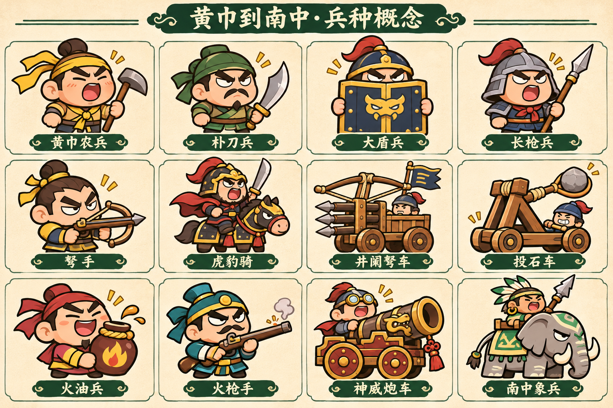

# 02 敌兵图鉴：40类机制兵种

> 40类资源与战斗逻辑已实装，正背面＋分层动作；本表同步当前数值，精确代码与验收边界见07。所有敌方一次有效攻击伤害均为**1颗心**，没有偷偷改成重兵扣两心或持续毒扣心。

## 数值口径

“标准生命／移速”为统一标准演练的基础值；“首章参考HP”为该兵首次出现章节、该章第1战段的生命倍率结果，不含该章第2/3段的1.04/1.08微调。图鉴有“标准值／本章值”切换，不能把一张表同时写成二者。

所有攻击周期是**一次开始到下一次开始的最短总周期**，不是只写动作结束后的冷却。前摇包括在周期内；弓手1.29秒与骑兵3.67秒由现版前摇、动作/收招与冷却相加得到。射程单位与设计高度750一致；支援单位攻击距0表示该技能不直接造成伤害。器械射程很远，但落点必须可见且给足移动时间。

### A. 完整数值面板

| ID／兵种 | 类别 | 首登章 | 标准HP | 首章参考HP | 标准移速 | 攻击／触发距 | 总周期秒 | 前摇秒 | 威胁点 |
| --- | --- | --- | --- | --- | --- | --- | --- | --- | --- |
| E01 黄巾农兵 | 步兵 | C01 | 24 | 24 | 108 | 70 | 1.30–1.55 | 0.32 | 1 |
| E02 朴刀兵 | 步兵 | C03 | 32 | 92 | 122 | 65 | 1.15 | 0.28 | 1.1 |
| E03 长枪兵 | 步兵 | C02 | 42 | 80 | 105 | 145 | 1.8 | 0.45 | 1.4 |
| E04 大盾兵 | 防御 | C02 | 84 | 160 | 76 | 65 | 2.0 | 0.5 | 2.2 |
| E05 双刀斥候 | 步兵 | C05 | 28 | 144 | 145 | 60 | 1.4 | 0.25 | 1.6 |
| E06 重斧兵 | 重装 | C03 | 96 | 275 | 82 | 100 | 2.8 | 0.75 | 2.5 |
| E07 巨锤兵 | 重装 | C12 | 140 | 2380 | 70 | 130 | 3.6 | 0.9 | 3.1 |
| E08 戟卫 | 重装 | C04 | 120 | 477 | 85 | 175 | 2.6 | 0.65 | 2.8 |
| E09 旗手 | 支援 | C03 | 62 | 177 | 90 | 0 | 4.0 | 0.7 | 1.8 |
| E10 军医 | 支援 | C11 | 48 | 725 | 86 | 0 | 4.0 | 0.6 | 1.9 |
| E11 弓手 | 远程 | C01 | 22 | 22 | 94 | 430 | 1.29 | 0.18 | 1.25 |
| E12 弩手 | 远程 | C04 | 30 | 119 | 86 | 460 | 2.0 | 0.5 | 1.6 |
| E13 连弩手 | 远程 | C06 | 38 | 249 | 82 | 460 | 3.0 | 0.65 | 2.2 |
| E14 重弩手 | 远程 | C10 | 64 | 845 | 70 | 650 | 3.8 | 0.9 | 2.5 |
| E15 投矛手 | 远程 | C11 | 38 | 574 | 105 | 350 | 2.0 | 0.45 | 1.6 |
| E16 标枪兵 | 远程 | C05 | 54 | 277 | 110 | 380 | 2.3 | 0.6 | 2.0 |
| E17 飞刀兵 | 远程 | C09 | 36 | 416 | 124 | 310 | 1.7 | 0.35 | 1.8 |
| E18 飞斧手 | 远程 | C12 | 64 | 1088 | 90 | 340 | 2.7 | 0.65 | 2.3 |
| E19 轻骑兵 | 骑兵 | C01 | 110 | 110 | 118 | 260 | 3.67 | 0.45 | 2.5 |
| E20 重骑兵 | 骑兵 | C02 | 190 | 362 | 92 | 300 | 4.6 | 0.65 | 3.5 |
| E21 虎豹骑 | 骑兵 | C08 | 160 | 1541 | 132 | 300 | 4.2 | 0.65 | 3.5 |
| E22 弓骑 | 骑兵 | C08 | 100 | 963 | 120 | 420 | 3.0 | 0.45 | 3.0 |
| E23 西凉骑射 | 骑兵 | C05 | 120 | 616 | 126 | 430 | 3.6 | 0.65 | 3.2 |
| E24 狼骑 | 骑兵 | C12 | 88 | 1496 | 138 | 240 | 4.1 | 0.7 | 3.0 |
| E25 南中象兵 | 重骑 | C15 | 320 | 6979 | 62 | 330 | 5.0 | 0.95 | 5.0 |
| E26 南中蛮兵 | 步兵 | C14 | 60 | 1213 | 104 | 100 | 1.7 | 0.4 | 1.7 |
| E27 藤甲兵 | 防御 | C15 | 150 | 3271 | 88 | 75 | 2.0 | 0.5 | 2.8 |
| E28 吹箭兵 | 远程 | C14 | 34 | 687 | 100 | 360 | 2.5 | 0.5 | 1.8 |
| E29 火油兵 | 火器 | C07 | 58 | 462 | 82 | 380 | 4.0 | 0.8 | 2.6 |
| E30 纵火兵 | 火器 | C07 | 44 | 350 | 104 | 200 | 3.5 | 0.6 | 2.0 |
| E31 火枪手 | 架空火器 | C10 | 46 | 607 | 84 | 520 | 3.0 | 0.7 | 2.4 |
| E32 三眼铳兵 | 架空火器 | C13 | 62 | 1170 | 72 | 410 | 3.6 | 0.8 | 2.8 |
| E33 爆破兵 | 火器 | C13 | 68 | 1284 | 80 | 360 | 4.5 | 0.8 | 2.8 |
| E34 爆竹运兵 | 火器 | C13 | 42 | 793 | 108 | 90 | 一次性 | 0.9 | 1.8 |
| E35 井阑弩车 | 器械 | C04 | 156 | 620 | 62 | 680 | 2.6 | 0.75 | 4.0 |
| E36 投石车 | 器械 | C06 | 180 | 1180 | 35 | 780 | 5.0 | 0.95 | 4.5 |
| E37 神威炮车 | 架空器械 | C10 | 200 | 2641 | 40 | 720 | 4.8 | 0.95 | 5.0 |
| E38 抛油车 | 器械 | C09 | 170 | 1966 | 30 | 650 | 5.6 | 0.95 | 4.5 |
| E39 黄巾道士 | 术士 | C01 | 90 | 90 | 72 | 600 | 3.8 | 0.9 | 3.0 |
| E40 军师 | 术士 | C16 | 108 | 2499 | 64 | 600 | 5.2 | 1.0 | 3.8 |

### B. 攻击、收益与弱点

金币是每次击杀的基础收益；经验列仅保留旧实现字段作对照，v4不启用升级／隐藏经验换币，玩家图鉴不显示经验字段。v4已停用gainXp与隐藏经验换币，不能暗中重复发收益；收入道具只作用于金币，不额外提高刷新数量。建筑式模型仍是敌人，可攻击、会死亡，不作为地图障碍。

| ID／兵种 | 金币／经验 | 完整攻击机制 | 识别与应对 |
| --- | --- | --- | --- |
| E01 黄巾农兵 | 1／1 | 镰刀／锄头两外观；单次扇斩；第0段HP6 | 绕背／范围近战；黄巾结和农具识别 |
| E02 朴刀兵 | 1／1 | 前跨35后短刀110°，一次伤害 | 小步侧移；短刀配布帽 |
| E03 长枪兵 | 2／1 | 窄直刺宽45，锁向后不追踪 | 从侧面穿过；长枪轮廓 |
| E04 大盾兵 | 3／2 | 前方120°减伤40%，侧后无减伤；不反伤 | 绕背／爆炸；门板盾与露眼 |
| E05 双刀斥候 | 2／1 | 每2.8秒横移70；横移0.3秒不攻击 | 扇形／追踪；双短刃和轻帽 |
| E06 重斧兵 | 3／2 | R100砸击，收招0.65秒 | 等重斧落下后贴近 |
| E07 巨锤兵 | 4／3 | R130地裂，预告0.9秒，只有爆发一段伤害 | 提前离圈；巨圆锤 |
| E08 戟卫 | 4／3 | 140°横扫，背面是安全区 | 绕背；小型戟翼 |
| E09 旗手 | 3／2 | R180友军移速＋10%，同种光环不叠；不加强Boss | 优先击杀；高旗低身 |
| E10 军医 | 3／2 | 治疗R200内最多3名普通兵，各回复4%最大HP；不治Boss／器械 | 先打军医；药箱与葫芦标 |
| E11 弓手 | 2／2 | 单箭，弹速330；没有瞄准线；沿用现版0.18＋0.16＋0.95秒周期 | 横移，靠近压迫；弯弓 |
| E12 弩手 | 2／2 | 单矢，弹速420；装填露出胸口 | 趁装填近身；横臂弩 |
| E13 连弩手 | 3／2 | 3矢，每0.13秒一支，弹速380，射击角度在开射时锁定 | 连续侧移，不只躲第一箭 |
| E14 重弩手 | 3／3 | 单支亮矢，弹速560；弩机发光蓄力，不铺长瞄准线 | 大幅横移；大弩与撑脚 |
| E15 投矛手 | 2／2 | 单矛，弹速360，蓄势后锁角 | 横移；矛束背筒 |
| E16 标枪兵 | 3／2 | 双矛±10°，弹速390；同轮对玩家仍最多扣一心 | 从扇口外侧绕，不迎面冲 |
| E17 飞刀兵 | 2／2 | 3刀扇射，弹速420，夹角各15° | 走近扇形外缘；腰间飞刀 |
| E18 飞斧手 | 3／2 | 一斧飞行310；落地后消失，不暗中回旋再伤 | 先横移再近身；双斧大刃 |
| E19 轻骑兵 | 4／4 | 触发距260，冲锋540×0.62秒，收招0.4，冷却2.2；沿用现版 | 侧向避让；不显示冲锋路径 |
| E20 重骑兵 | 5／4 | 冲锋480×0.75秒；常态35%击退，冲锋中10% | 侧绕，不硬顶；厚马铠 |
| E21 虎豹骑 | 5／4 | 冲锋580×0.60秒；与其他骑兵共享同时2只冲锋上限 | 预留转向空间；黑甲红缨 |
| E22 弓骑 | 4／3 | 绕行射3支并列箭，弹速350，不额外冲锋 | 压向一侧；小马与弓组合 |
| E23 西凉骑射 | 4／3 | 短移120后射两箭，间隔0.2，弹速380；短移不碰撞伤害 | 观察落脚点；蓝灰头巾 |
| E24 狼骑 | 4／3 | 冲锋620×0.45秒，同屏最多1只；战术架空兵种 | 离开正面；狼形小坐骑 |
| E25 南中象兵 | 7／5 | 冲锋420×0.9秒，落脚R100；两段共用一次受击保护 | 提前横移；最多1头，不把体积做成道路障碍 |
| E26 南中蛮兵 | 2／2 | 宽木棒120°横扫；不额外加持续中毒 | 扫角外走位；绿叶领和木棒 |
| E27 藤甲兵 | 4／3 | 物理减伤30%；受到火油／爆炸类伤害×1.25；不免疫物理 | 火油／爆竹；藤编盔甲 |
| E28 吹箭兵 | 2／2 | 单弹速300；命中1心并减速10%持续1秒，不追加毒跳伤 | 别站在吹管正面；叶面护具 |
| E29 火油兵 | 3／2 | 抛罐，落点R80预告0.8秒，火场2秒；共用受击保护 | 提前离罐点；大陶罐 |
| E30 纵火兵 | 3／2 | 近距100°火扇，预告0.6、持续0.8秒；每次最多一心 | 拉开距离；火把与短喷口 |
| E31 火枪手 | 3／2 | 一发弹速650；火绳冒烟提示，装填1.5秒；架空科技 | 横移后压近；旧式火绳枪，不是现代步枪 |
| E32 三眼铳兵 | 4／3 | 三弹50°扇射，弹速520；同轮对玩家最多一心 | 远离扇口；清楚可见三枪管 |
| E33 爆破兵 | 4／3 | 抛一弹R90，落点预告0.9秒；爆发一次 | 看地面圈；火药包 |
| E34 爆竹运兵 | 2／1 | 停步点火0.9秒后R95自爆；提前击杀则哑火，不死亡炸人 | 优先打断；背一捆超大爆竹 |
| E35 井阑弩车 | 5／4 | 3箭±10°，弹速420；慢移后驻车射击；后坐与装填可读 | 贴侧后方；小双轮木弩，操作员只露头 |
| E36 投石车 | 6／4 | 单石抛射0.8秒，R110，落点预告1.0秒 | 优先清理；轮子和抛臂，不做地图建筑 |
| E37 神威炮车 | 6／5 | 弹速340，爆炸R100；落点至少0.9秒预告；架空科技 | 贴侧面／装填期输出；铜炮红轮 |
| E38 抛油车 | 6／4 | 两罐依次投放，相隔0.5；R90、火场3秒、预告1.0 | 留意第二罐；罐架与火油桶 |
| E39 黄巾道士 | 4／3 | 单雷圈R80，预告0.85秒；首章第3战段最多1位，先教躲圈 | 离圈后回击；纸符不是首领的大道冠 |
| E40 军师 | 5／4 | 两圈R70，间距120，预告1秒；使用统一危险圈池 | 不要在两圈交界停留；小羽扇和令旗 |

## 通用体积、出生与控制规则

- 步兵/远程碰撞半径24，重装30，骑兵34，象48，器械42；Boss按其形象42～52。显示头部可大于身体碰撞，不把夸张头饰全部当不可穿过的实体。
- 普通兵出生预告0.9秒，骑兵1.1，器械/象1.2，Boss1.5；出生期无伤害、不可被攻击。重器械至少距英雄420，普通兵260，骑兵420，Boss550；不得在脚下直接刷带伤害的单位。
- 敌人接触可造成1心，但机器/远程炮弹不通过玩家就连续多判。所有伤害共用玩家受击保护；同一攻击批次最多1心。
- 普通兵击退系数1.0，重装0.55，骑兵常态0.35/冲锋0.10，象0.15，器械0.10，Boss0.06。不能让高频轻弹永久打断；击退与受击闪色分离。
- 旗手光环同类不叠；军医不治疗Boss；召唤、援军和Boss增兵都必须计入同一个投放预算与80存活阈值。没有无限召唤链。
- 盾兵前面减伤仍至少造成1点，盾不反射玩家弹幕；藤甲弱火是倍率，不要求玩家必须抽到火武器才能过关。
- 警告颜色橙红，友方特效金/青/桃粉；高亮边、符形、节奏同时传达危险，不只靠颜色。弓兵不画长瞄准线，骑兵不画长冲锋路径，炮与落雷保留地面落点预告。

## 阵营换皮矩阵

同机制同数值仅换皮：不通过头巾颜色暗中提高射速或血量。需要数值变体时另给“精锐”后缀和独立图鉴数值；不计作一个新机制骗内容量。

| 阵营 | 外观语汇 | 可复用机制ID | 使用位置 |
| --- | --- | --- | --- |
| 黄巾 | 土黄／草绿；头巾结、农具、纸符 | E01/E03/E09/E11/E15/E19/E39 | C01；后续作为余部少量复用 |
| 西凉 | 暗赤／黑铁；长缨、马铠、皮毛边 | E02/E03/E04/E06/E19/E20/E23 | C02–C05，董卓／吕布／马超段重点 |
| 袁军 | 紫金／乳白；华丽旗面、漆盾、金盔 | E02/E03/E04/E08/E09/E12/E13/E16/E35/E36 | C04/C06，强调军阵和排射 |
| 曹魏 | 靛蓝／黑红；方盔、实用黑甲、虎豹纹 | E02/E03/E04/E05/E08/E11/E12/E14/E19/E20/E21/E22/E31/E32/E35/E37 | C07/C08/C10/C13以后复用 |
| 江东 | 朱红／米白；短甲、水波纹、火油陶罐 | E02/E05/E11/E12/E17/E22/E29/E30/E34/E38 | C09/C13，水军在草地竞技场以登岸作战解释 |
| 荆益 | 墨绿／灰白；竹纹、轻甲、药箱 | E02/E03/E04/E07/E10/E11/E12/E15/E18/E33/E35 | C11–C12，不写同阵营一定是永久仇敌 |
| 南中 | 叶绿／橙棕；藤编、木器、动物小坐骑 | E05/E15/E17/E18/E24/E25/E26/E27/E28 | C14–C15，强调材质和自然战法，不把族群当笑点 |
| 魏晋后军 | 青灰／银黑；整齐冠缨、阵旗、铜机关 | E03/E04/E08/E09/E12/E13/E14/E21/E32/E35/E36/E37/E40 | C16–C17，旧兵新组合而非最后四章狂堆新机制 |

## 新兵教学与混编例子

- C04先让玩家看到一辆预告中的弩车；第1段配旧步兵，第2段加入弩手，第3段加入戟卫。三类新兵分段介绍，不能同时首次登场。
- C07先给火油落点，再加纵火兵和既有骑兵，迫使横向转向；普通火场最多3片，留另外3个危险位给首领。
- C10重弩、火枪、炮车分别在三个战段教；不在同一小安全区同时集火，器械全场最多2台。
- C15象兵＋藤甲不做火属性硬门槛：藤甲物理可打、象冲锋可躲，火油只是更高效。
- C16～17用盾弩、骑兵与军师组合复习；纯近战、远程、范围构筑各有处理路线。

40类已接入，按首登和分段编组逐步出现；实际AI回归/动作与预算见07。

五心基础受击保护沿现版1.2秒（加道具修正），全部伤害源共用；玩家图鉴伤害写“1颗心”，敌军HP写点数，避免混淆。

八阵营完整盔甲换装为后续美术项；本轮复用40类正背骨架，六卷躯干色调区分，不宣称已有八套全量皮肤。
