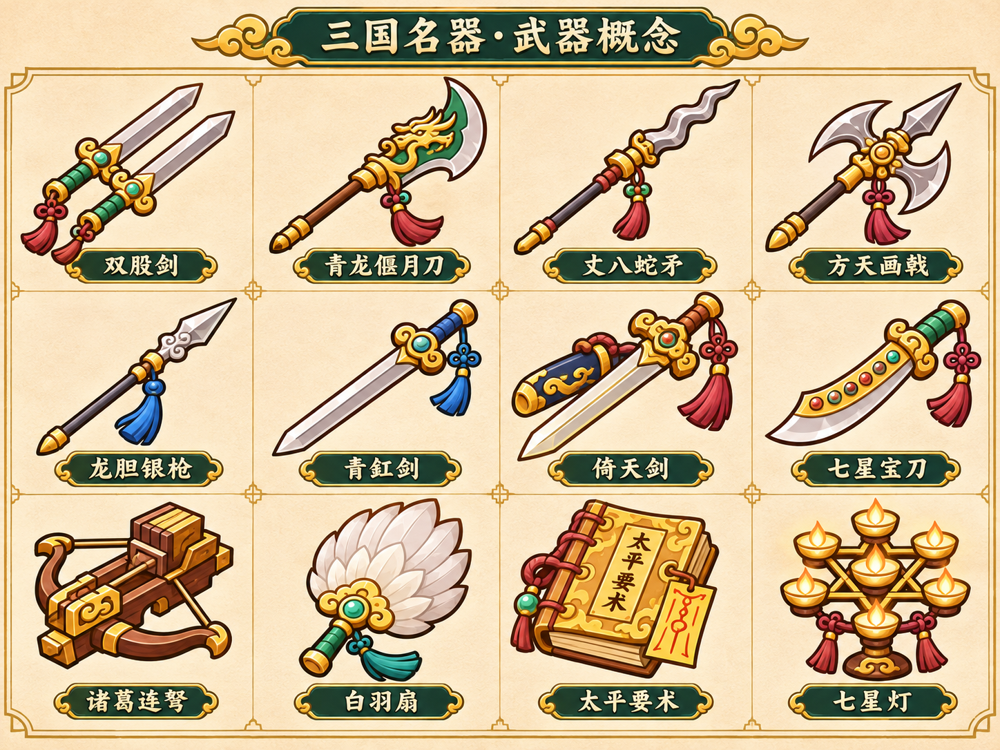

# 03 武器图鉴：36种武器、四品级

> 保留现版11种，新增25种，总计36种。全部36种已接入商店/战斗/图鉴，新增25×四品质均做真实命中工程回归。关羽仍默认扁担、张飞仍默认杀猪尖刀，不借名器扩展偷偷换掉他们的默认武器。绿豆袋、擀面杖继续移除，不回到商店池。

## 图鉴和计算口径

- 每件武器占1槽，最多6槽；同名也按实例持有。两件同名同阶可合成下一阶，白I／蓝II／紫III／红IV，不额外加“神器第五阶”。名器代表攻击身份，不等于无条件最强。
- 下表D是该品级**伤害基数**。单段普通攻击就是D；连刺／多段武器要按机制栏的系数显示“实际单段×段数”，不能只显示大号D误导。例如龙胆II每刺为`22×1.35×0.55`，一轮两刺。
- 伤害品质系数1/1.35/1.8/2.4，周期系数1/0.96/0.92/0.88。除专门写明外，品质射程为基础＋0/10/20/30；新近战射程上限280。各品质机制系数另列，不能只抬伤害不做动作变化。
- 基准DPS是单个武器位、零人物／道具／暴击加成、目标全部吃到允许命中的稳态上限；不乘全屏目标数。未计弹道丢失、回程落空或敌人离开火场。不是游戏实测输出。
- 普通暴击伤害默认1.5倍；新武器特别值：龙胆/青釭1.75、倚天1.7、七星宝刀2、古锭/双铁戟1.6。暴击率上限80%。下表暴击率均为I级基础。
- 击退是现版力参数，实际位移受敌方系数影响；锁链钩为拉力。没有远程风声代替实际命中声的回退。
- 常规近战一次有效扫击命中范围内**全部**敌人，没有额外3/5目标上限；只对二次刃波、星弹等规定命中次数。所有子弹／追斩／召唤物均不得递归触发同类新实例。

## A 现有11种基准（保留）

| ID | 武器 | 类别 | I伤害D | I周期秒 | I射程 | I扫角° | I击退 | I基准DPS | 品质机制重点 |
| --- | --- | --- | --- | --- | --- | --- | --- | --- | --- |
| W01 | 草鞋 | 远程 | 16 | 0.6 | 360 | 0 | 290 | 26.7 | 单鞋；II起弹射，四阶0/1/2/3次 |
| W02 | 扁担 | 近战 | 32 | 0.9 | 165 | 140 | 300 | 35.6 | 长横扫；四阶140/160/180/200° |
| W03 | 桃花枝 | 法术 | 26 | 1 | 360 | 0 | 180 | 26.0 | 手持桃花枝，四阶1/3/3/3瓣，同轮同敌一次 |
| W04 | 杀猪尖刀 | 近战 | 18 | 0.42 | 135 | 90 | 180 | 42.9 | 传统尖刀；90/110/130/150°，品质增加暴击 |
| W05 | 爆竹 | 法术 | 42 | 1.45 | 390 | 0 | 260 | 29.0 | 单发爆竹，半径100/115/130/150 |
| W06 | 桃园突突枪 | 远程 | 5 | 0.16 | 400 | 0 | 12 | 31.2 | 快点射；穿透0/1/1/2 |
| W07 | 村口霰弹枪 | 远程 | 8 | 0.9 | 300 | 0 | 160 | 35.6 | 五至八弹，同轮同敌最多4颗 |
| W08 | 二踢脚火箭筒 | 远程 | 78 | 2 | 500 | 0 | 330 | 39.0 | 单火箭，半径125/145/165/185 |
| W09 | 青莲飞剑 | 法术 | 16 | 0.5 | 150 | 0 | 100 | 32.0 | 3/4/5/6剑环绕，同位同敌共用接触间隔 |
| W10 | 五雷符 | 法术 | 46 | 1.25 | 390 | 0 | 130 | 36.8 | 连锁3/4/5/6目标，每目标一次 |
| W11 | 吞天葫芦 | 法术 | 5 | 1.6 | 240 | 0 | 0 | 18.8 | 6/7/8/9段，每段目标数6/6/7/8 |

### 现有11种的补充字段

价格为长线C01白I基准：现有三件初始武器按现版商店基准28，而不是源码定义中用于旧权重的12／14；其他武器按定义基础标价。四阶伤害／周期见D表，其余有升级变化的弹速／半径／暴击在下表展开，避免只给新增武器详细字段。

| ID／武器 | I/II/III/IV弹速 | I/II/III/IV半径 | 四阶暴击率 | 暴击倍率 | 基础价 |
| --- | --- | --- | --- | --- | --- |
| W01 草鞋 | 480／480／480／480 | 0／0／0／0 | 5%／5%／5%／5% | 1.5 | 28 |
| W02 扁担 | 0／0／0／0 | 0／0／0／0 | 5%／5%／5%／5% | 1.5 | 28 |
| W03 桃花枝 | 380／410.4／440.8／475 | 55／60／75／90 | 5%／5%／5%／5% | 1.5 | 16 |
| W04 杀猪尖刀 | 0／0／0／0 | 0／0／0／0 | 15%／18%／21%／25% | 2 | 28 |
| W05 爆竹 | 340／340／340／340 | 100／115／130／150 | 5%／5%／5%／5% | 1.5 | 18 |
| W06 桃园突突枪 | 1050／1050／1176／1260 | 0／0／0／0 | 5%／5%／5%／5% | 1.5 | 39 |
| W07 村口霰弹枪 | 820／820／820／820 | 0／0／0／0 | 5%／5%／5%／5% | 1.5 | 39 |
| W08 二踢脚火箭筒 | 420／453.6／495.6／546 | 125／145／165／185 | 5%／5%／5%／5% | 1.5 | 45 |
| W09 青莲飞剑 | 580／580／580／580 | 0／0／0／0 | 5%／5%／5%／5% | 1.5 | 42 |
| W10 五雷符 | 0／0／0／0 | 0／0／0／0 | 5%／5%／5%／5% | 1.5 | 42 |
| W11 吞天葫芦 | 0／0／0／0 | 0／0／0／0 | 5%／5%／5%／5% | 1.5 | 42 |

## B 新增25种完整基准

基础标价以现版第一段常规商店量级为标尺，不表示在所有章节都卖同一价格；章节通胀与品质乘数见05文档。解锁列Cnn表示**完成该章后，紧接的章间补给起**进入军械池；现有11种仍保留首章30／60秒的既有时间门槛，后续章保持开放。收录条件只表示军械池开启，不声称该Boss原本就持有这把兵器。赵云和孔明默认武器有例外：选该英雄即自带白I，其余英雄仍按章节解锁。

| ID | 武器 | 类别 | I伤害D | I周期秒 | I射程 | I角度° | I击退 | I暴击 | 弹速 | I半径 | 基础价 | 军械池解锁 | I基准DPS |
| --- | --- | --- | --- | --- | --- | --- | --- | --- | --- | --- | --- | --- | --- |
| W12 | 双股剑 | 近战 | 18 | 0.52 | 145 | 110 | 130 | 10% | 0 | 0 | 32 | C01 | 34.6 |
| W13 | 青龙偃月刀 | 近战 | 50 | 1.15 | 200 | 150 | 260 | 5% | 0 | 0 | 46 | C02 | 43.5 |
| W14 | 丈八蛇矛 | 近战 | 30 | 0.70 | 240 | 45 | 160 | 5% | 0 | 0 | 42 | C02 | 42.9 |
| W15 | 方天画戟 | 近战 | 42 | 1.10 | 210 | 160 | 220 | 5% | 0 | 0 | 48 | C02 | 38.2 |
| W16 | 龙胆银枪 | 近战 | 22 | 0.48 | 220 | 35 | 120 | 10% | 0 | 0 | 42 | C08；赵云默认例外 | 45.8 |
| W17 | 青釭剑 | 近战 | 26 | 0.58 | 155 | 100 | 100 | 10% | 0 | 0 | 40 | C08 | 44.8 |
| W18 | 倚天剑 | 近战 | 36 | 0.80 | 175 | 120 | 170 | 5% | 0 | 0 | 48 | C10 | 48.4 |
| W19 | 七星宝刀 | 近战 | 24 | 0.62 | 145 | 95 | 100 | 18% | 0 | 0 | 38 | C03 | 40.0 |
| W20 | 古锭刀 | 近战 | 46 | 1.05 | 175 | 150 | 240 | 5% | 0 | 0 | 44 | C04 | 43.8 |
| W21 | 双铁戟 | 近战 | 21 | 0.56 | 150 | 130 | 170 | 8% | 0 | 0 | 44 | C06 | 41.2 |
| W22 | 三尖刀 | 近战 | 34 | 0.85 | 195 | 135 | 190 | 5% | 0 | 0 | 42 | C04 | 40.0 |
| W23 | 铁蒺藜 | 远程 | 10 | 1.20 | 260 | 0 | 20 | 5% | 320 | 35 | 30 | C05 | 10.0 |
| W24 | 诸葛连弩 | 远程 | 8 | 0.65 | 430 | 0 | 45 | 5% | 480 | 0 | 40 | C07 | 24.6 |
| W25 | 麒麟弓 | 远程 | 30 | 0.95 | 540 | 0 | 70 | 10% | 600 | 0 | 38 | C11 | 31.6 |
| W26 | 贯石弩 | 远程 | 55 | 1.60 | 650 | 0 | 150 | 5% | 760 | 0 | 44 | C06 | 34.4 |
| W27 | 手戟 | 远程 | 22 | 0.62 | 340 | 0 | 120 | 5% | 480 | 0 | 34 | C09 | 39.0 |
| W28 | 锁链钩 | 远程 | 20 | 0.90 | 320 | 0 | 90 | 5% | 550 | 0 | 36 | C12 | 22.2 |
| W29 | 火油壶 | 法术 | 18 | 1.80 | 360 | 0 | 50 | 5% | 300 | 85 | 34 | C07 | 12.0 |
| W30 | 震天雷 | 法术 | 60 | 2.10 | 400 | 0 | 280 | 5% | 340 | 115 | 44 | C13 | 28.6 |
| W31 | 白羽扇 | 法术 | 18 | 0.75 | 380 | 0 | 150 | 5% | 380 | 0 | 34 | C07；孔明默认例外 | 24.0 |
| W32 | 太平要术 | 法术 | 38 | 1.30 | 420 | 0 | 100 | 5% | 0 | 70 | 38 | C01 | 29.2 |
| W33 | 七星灯 | 法术 | 12 | 0.50 | 160 | 0 | 35 | 5% | 0 | 0 | 46 | C16 | 24.0 |
| W34 | 八阵图 | 法术 | 25 | 1.40 | 400 | 0 | 60 | 5% | 0 | 100 | 44 | C13 | 17.9 |
| W35 | 木牛机关 | 远程 | 9 | 0.30 | 350 | 0 | 25 | 5% | 500 | 0 | 42 | C15 | 30.0 |
| W36 | 木鸢飞翼 | 远程 | 16 | 0.90 | 450 | 0 | 70 | 5% | 430 | 0 | 40 | C15 | 17.8 |

## C 新武器I→IV的机制差异

D指当前品级伤害基数；多段系数已经计入下节DPS。单轮上限属于实质规则，图鉴必须显示，不能只在内部文档里藏着。

| ID／武器 | 题材来源标签 | 完整四阶机制 |
| --- | --- | --- |
| W12 双股剑 | 演义名器 | I双剑交替单段；II弧130°；III弧150°；IV弧170°。是交替攻击，不是两剑每次各吃全额伤害。 |
| W13 青龙偃月刀 | 演义名器 | 弧150/170/190/210°；III每第3击发0.35D青龙刃波，IV0.50D，300射程、同敌一次；不递归触发。 |
| W14 丈八蛇矛 | 演义名器 | 扫角45/55/65/75°；I直刺1段；II单刺；III两刺各0.65D；IV两刺各0.75D，组内随实际攻击时长压缩，整组共用一个攻击周期。 |
| W15 方天画戟 | 演义名器 | 弧160/180/200/220°；III末尾追加0.25D追斩，IV0.40D；追斩单独一次命中集合，不触发追斩。 |
| W16 龙胆银枪 | 民间称谓／本作定名 | I单刺；II两刺各0.55D；III两刺各0.60D；IV三刺各0.45D；组内随攻速压缩间隔，窄刺范围全部敌人受伤。 |
| W17 青釭剑 | 演义名器 | 忽略护盾减伤比例20/30/40/50%；例如原减伤40%，IV后只减20%；不是额外伤害×2，不无条件穿过Boss机制。 |
| W18 倚天剑 | 演义名器 | 每第4击发300射程月牙，伤害0.30/0.40/0.50/0.65D；同敌可吃近战＋该月牙各一次；月牙不递归。 |
| W19 七星宝刀 | 演义宝刀意象 | 每第7次有效出手洒7星，每星0.12/0.16/0.20/0.25D，同敌最多2星；按武器实例计数。 |
| W20 古锭刀 | 演义兵器传统 | 对新目标第一击额外15/20/25/30%；同目标每2秒至多触发一次，持续DPS表不算该条件额外收益。 |
| W21 双铁戟 | 演义兵器传统 | 每组两扫，每扫0.55/0.60/0.65/0.70D，组内随攻速压缩间隔；两扫各对范围内全部合法敌人一次。 |
| W22 三尖刀 | 演义兵器意象 | I/II单扫；III左右各发0.20D刃片，IV0.30D；同敌最多中一片，不能把两侧刃片都算满伤。 |
| W23 铁蒺藜 | 时代器具改编 | 自动抛向最近敌人脚下；存活3秒，最多3/4/5/6枚；同敌每武器1秒一次；全场12枚上限，超限替换最旧同源陷阱。 |
| W24 诸葛连弩 | 演义机关改编 | 3/4/5/6矢逐发，0.10秒间隔，同轮同敌最多2/2/3/3矢；I穿透1，II–IV穿透2，穿透递减沿现版规则。 |
| W25 麒麟弓 | 本作弓名，不声称原著专名 | I单箭；II暴击＋3点；III双箭；IV三箭扇射；同敌每轮最多一箭，增加覆盖不三倍贴脸DPS。 |
| W26 贯石弩 | 本作器具定名 | 穿透3/4/5/6名，每后续目标伤害85%；大射程和直线清群，装填慢。 |
| W27 手戟 | 时代兵器改编 | 飞出／返回各0.55/0.60/0.65/0.70D，同敌每程一次；返回按实际路线，不瞬移必中。 |
| W28 锁链钩 | 本作机关兵器 | 单钩可连1/2/3/4目标；拉近90/105/120/135，距离小于90不再拉；Boss仅吃6%拉力，不拉入身体。 |
| W29 火油壶 | 火攻器具改编 | 火场1.2秒，于0/0.5/1.0秒各造成0.4D；半径85/95/105/115；同敌每0.5秒全队最多2次油火伤害，复制六把不能无限叠火。 |
| W30 震天雷 | 明确架空火器 | 单发，爆炸半径115/130/145/165，外圈55%伤害；直击和该爆炸共用一次上限，不再生成子炸弹。 |
| W31 白羽扇 | 军师意象改编 | 2/3/3/5片风羽扇射，同轮同敌一次；III击退＋15%，IV＋25%；不自动释放借东风技能。 |
| W32 太平要术 | 演义书卷意象 | 每轮标记1/2/3/4个不同目标，0.25秒后各落一符，R70；同敌本轮符伤与爆散最多一次。 |
| W33 七星灯 | 演义灯阵意象 | 3/4/6/7灯为表现，范围160/175/190/210；每轮同敌只受一次D伤害（I级12点），不按灯数七倍叠加。 |
| W34 八阵图 | 演义阵法意象 | 阵地1秒，进入时伤害一次；减速20/25/30/35%，Boss最多10%；每武器最多2阵、全场8阵。 |
| W35 木牛机关 | 木牛流马的战斗架空改编 | 1台1D；II两台各0.55D；III两台各0.60D；IV三台各0.45D；每轮同敌按这些系数封顶，全场最多12台。 |
| W36 木鸢飞翼 | 本作机关飞翼 | I/II一鸢，III两鸢各0.60D，IV两鸢各0.75D；可穿透4目标，单鸢同敌一次，不由飞翼再生飞翼。 |

## D 四品质数值对照

每格依次为 **伤害基数D／攻击周期秒／基准单体DPS**。I/II/III/IV顺序固定。射程＋10/阶及专门机制另看上表。数值显示保留1位小数，伤害实际按最终命中时统一取整，不在每个中间乘数处取整。

| 武器 | 白I | 蓝II | 紫III | 红IV |
| --- | --- | --- | --- | --- |
| W01 草鞋 | 16.0／0.60／26.7 | 21.6／0.58／37.5 | 28.8／0.55／52.2 | 38.4／0.53／72.7 |
| W02 扁担 | 32.0／0.90／35.6 | 43.2／0.86／50.0 | 57.6／0.83／69.6 | 76.8／0.79／97.0 |
| W03 桃花枝 | 26.0／1.00／26.0 | 35.1／0.96／36.6 | 46.8／0.92／50.9 | 62.4／0.88／70.9 |
| W04 杀猪尖刀 | 18.0／0.42／42.9 | 24.3／0.40／60.3 | 32.4／0.39／83.9 | 43.2／0.37／116.9 |
| W05 爆竹 | 42.0／1.45／29.0 | 56.7／1.39／40.7 | 75.6／1.33／56.7 | 100.8／1.28／79.0 |
| W06 桃园突突枪 | 5.0／0.16／31.2 | 6.8／0.15／43.9 | 9.0／0.15／61.1 | 12.0／0.14／85.2 |
| W07 村口霰弹枪 | 8.0／0.90／35.6 | 10.8／0.86／50.0 | 14.4／0.83／69.6 | 19.2／0.79／97.0 |
| W08 二踢脚火箭筒 | 78.0／2.00／39.0 | 105.3／1.92／54.8 | 140.4／1.84／76.3 | 187.2／1.76／106.4 |
| W09 青莲飞剑 | 16.0／0.50／32.0 | 21.6／0.48／45.0 | 28.8／0.46／62.6 | 38.4／0.44／87.3 |
| W10 五雷符 | 46.0／1.25／36.8 | 62.1／1.20／51.8 | 82.8／1.15／72.0 | 110.4／1.10／100.4 |
| W11 吞天葫芦 | 5.0／1.60／18.8 | 6.8／1.54／30.8 | 9.0／1.47／48.9 | 12.0／1.41／76.7 |
| W12 双股剑 | 18.0／0.52／34.6 | 24.3／0.50／48.7 | 32.4／0.48／67.7 | 43.2／0.46／94.4 |
| W13 青龙偃月刀 | 50.0／1.15／43.5 | 67.5／1.10／61.1 | 90.0／1.06／95.0 | 120.0／1.01／138.3 |
| W14 丈八蛇矛 | 30.0／0.70／42.9 | 40.5／0.67／60.3 | 54.0／0.64／109.0 | 72.0／0.62／175.3 |
| W15 方天画戟 | 42.0／1.10／38.2 | 56.7／1.06／53.7 | 75.6／1.01／93.4 | 100.8／0.97／145.8 |
| W16 龙胆银枪 | 22.0／0.48／45.8 | 29.7／0.46／70.9 | 39.6／0.44／107.6 | 52.8／0.42／168.8 |
| W17 青釭剑 | 26.0／0.58／44.8 | 35.1／0.56／63.0 | 46.8／0.53／87.7 | 62.4／0.51／122.3 |
| W18 倚天剑 | 36.0／0.80／48.4 | 48.6／0.77／69.6 | 64.8／0.74／99.0 | 86.4／0.70／142.7 |
| W19 七星宝刀 | 24.0／0.62／40.0 | 32.4／0.60／56.9 | 43.2／0.57／80.1 | 57.6／0.55／113.1 |
| W20 古锭刀 | 46.0／1.05／43.8 | 62.1／1.01／61.6 | 82.8／0.97／85.7 | 110.4／0.92／119.5 |
| W21 双铁戟 | 21.0／0.56／41.2 | 28.4／0.54／63.3 | 37.8／0.52／95.4 | 50.4／0.49／143.2 |
| W22 三尖刀 | 34.0／0.85／40.0 | 45.9／0.82／56.3 | 61.2／0.78／93.9 | 81.6／0.75／141.8 |
| W23 铁蒺藜 | 10.0／1.20／10.0 | 13.5／1.15／13.5 | 18.0／1.10／18.0 | 24.0／1.06／24.0 |
| W24 诸葛连弩 | 8.0／0.65／24.6 | 10.8／0.62／34.6 | 14.4／0.60／72.2 | 19.2／0.57／100.7 |
| W25 麒麟弓 | 30.0／0.95／31.6 | 40.5／0.91／44.4 | 54.0／0.87／61.8 | 72.0／0.84／86.1 |
| W26 贯石弩 | 55.0／1.60／34.4 | 74.2／1.54／48.3 | 99.0／1.47／67.3 | 132.0／1.41／93.7 |
| W27 手戟 | 22.0／0.62／39.0 | 29.7／0.60／59.9 | 39.6／0.57／90.3 | 52.8／0.55／135.5 |
| W28 锁链钩 | 20.0／0.90／22.2 | 27.0／0.86／31.2 | 36.0／0.83／43.5 | 48.0／0.79／60.6 |
| W29 火油壶 | 18.0／1.80／12.0 | 24.3／1.73／16.9 | 32.4／1.66／23.5 | 43.2／1.58／32.7 |
| W30 震天雷 | 60.0／2.10／28.6 | 81.0／2.02／40.2 | 108.0／1.93／55.9 | 144.0／1.85／77.9 |
| W31 白羽扇 | 18.0／0.75／24.0 | 24.3／0.72／33.8 | 32.4／0.69／47.0 | 43.2／0.66／65.5 |
| W32 太平要术 | 38.0／1.30／29.2 | 51.3／1.25／41.1 | 68.4／1.20／57.2 | 91.2／1.14／79.7 |
| W33 七星灯 | 12.0／0.50／24.0 | 16.2／0.48／33.8 | 21.6／0.46／47.0 | 28.8／0.44／65.5 |
| W34 八阵图 | 25.0／1.40／17.9 | 33.8／1.34／25.1 | 45.0／1.29／34.9 | 60.0／1.23／48.7 |
| W35 木牛机关 | 9.0／0.30／30.0 | 12.2／0.29／46.4 | 16.2／0.28／70.4 | 21.6／0.26／110.5 |
| W36 木鸢飞翼 | 16.0／0.90／17.8 | 21.6／0.86／25.0 | 28.8／0.83／41.7 | 38.4／0.79／72.7 |

铁蒺藜DPS按同目标每武器1秒一次上限计算，不按铺满的陷阱枚数乘算。火油壶表中是单把理想驻留输出，六把油壶受全局同敌每0.5秒2次的共享上限，不能把表数简单乘6；木牛机关12台、铁蒺藜12枚、八阵图8阵的场上硬上限均要展示，并在预算满时回收最旧同源实例。输出模型校验必须包含这些共享上限。

## 标签与构筑身份

新增标签只用于检索、商店倾向和少量道具适配，首版不额外堆六套复杂套装加成，避免与现有每2件同类别＋1固定伤害重复膨胀。

- 长柄：扁担、偃月刀、蛇矛、画戟、银枪、三尖刀；长射程与扫角，配移速／近战范围／击退。
- 刀剑：杀猪尖刀、双股剑、青釭、倚天、七星、古锭、双铁戟；连续近身打击、暴击／收招节奏。
- 弓弩：连弩、麒麟弓、贯石弩；远程平伤、穿透和弹速；同敌多弹上限清楚可查。
- 火器：爆竹、突突枪、霰弹枪、火箭、火油壶、震天雷；点射与范围分工，不能全都兼任永久定身。
- 奇术：桃花枝、飞剑、五雷符、葫芦、羽扇、太平要术、七星灯、八阵图；风／雷／花／阵的独立剪影。
- 机关：铁蒺藜、诸葛连弩、锁链钩、木牛、木鸢；工程是**标签**，仍按远程／法术三大属性之一结算，不新增第四套玩家数值。

名器外观保留兵刃轮廓，不要把所有品质都画成同一把发光棒；升级通过刃缘／小纹样／尾迹区分，红IV不常驻全屏光污染。六武器仍环绕人物，不全放手上；飞剑维持硬剑身旋转。

## 与道具和专属技能的关系

保留现有60种被动，但新武器不能天然吃到所有旧专属加成：E类近战范围适配长柄／刀剑；D类穿透适配明确有弹道者；八阵、七星灯不吃“子弹数＋1”；木牛与木鸢可吃远程攻速但须有全场实例上限。旧草鞋/桃花/扁担/尖刀专属项继续只强化自身。新增武器专属道具待首批实测后补，不在一轮设计里凭名字堆30种未经验证的叠乘。

英雄技能用当前构筑的有效单体DPS总和作标尺，必须先应用火油等共享上限；不会因多放几个装饰灯、写出“7段特效”就七倍加强技能。通用技能目前仅收录只读图鉴，不接入本表战斗触发。

## 名称准确性

方天画戟、青釭／倚天等按演义意象；龙胆银枪、麒麟弓、木鸢飞翼等明确为民间称谓或本作定名，**不声称其专名逐字见于原著**。三尖刀不写成二郎神式的“三尖两刃刀”。炮、火枪、震天雷按架空科技标记，绝不在图鉴说明中称为三国时代制式装备。出处核对见06文档。

## 新武器数值补充约定

新武器没有声明的弹速、扫角、暴击、击退在升级时保持基准；暴击倍率和特例看本节开头。麒麟弓II起暴击率13%（之后保持），不会每阶再加3点；其他新武器暴击率保持I值。范围灯阵／地面场不因“弹速”道具改变伤害频率。多段伤害基数D和实际单段的区别必须同时显示。

攻击序列总时长不得超过实际攻击周期；高攻速时按比例压缩组内间隔，最小0.04秒，并对无法完整播放的视觉连刺合帧，但保留一次组伤害上限。不得让一组还没结束就排入无限多组攻击队列。自动选择目标时，近战优先覆盖而不是只锁定一名；锁链／手戟射程按实际路径结算。

长线新武器的平伤分配：同一攻击组只领取一份按基础周期折算的固定力量／分类平伤，多刺／多弹按该组系数归一分摊；次生追斩、星弹不再次完整领取平伤。品质基础D仍按机制中的段数／系数结算，两者不能混成“每发再加整份力量”。既有霰弹／葫芦的特殊分摊沿现版，v4两条平伤入口均应用extraHitFactor归一，并以同一weaponDps函数生成输出模型。
