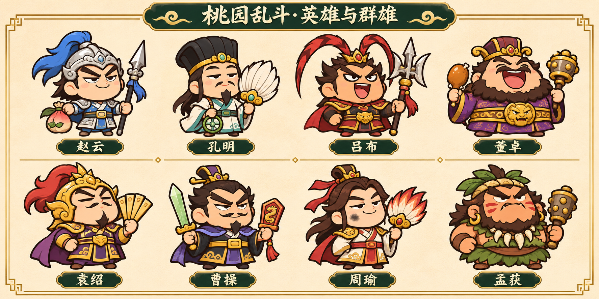

# 04 英雄、专属技能与通用技能图鉴

> 五位可选英雄已实装；赵云／孔明包含独立默认武器、眨眼/哭泣素材和专属技能。**24通用技能只加入技能图鉴，不能接入战斗、商城掉落或装备按钮。**

## 五英雄基准

五人均为5心；新英雄不靠更多心或永久攻击成长压过旧英雄。英雄自由选择、可跨剧情战役演武，不按年代锁角色。

| 英雄 | 基础移速 | 默认白I武器 | 固有定位 | 专属技能／基础CD | 状态 |
| --- | --- | --- | --- | --- | --- |
| 刘备 | 300 | 草鞋 | 拾取＋15%、武器击退＋20%的既定规则 | 以德服人／30秒 | 现有；规则保留 |
| 关羽 | 295 | 扁担 | 近战伤害＋10%、距离＋15% | 横扫千军／26秒 | 现有；不换默认偃月刀 |
| 张飞 | 290 | 杀猪尖刀 | 近战伤害＋10%、爆炸半径＋15% | 桃园狮吼／32秒 | 现有；不换默认蛇矛 |
| 赵云（子龙） | 325 | 龙胆银枪 | 实际移动时近战攻速＋10%；重在走位和直刺 | 七进七出／24秒 | 已实装，可直接选 |
| 诸葛亮（孔明） | 285 | 白羽扇 | 法术范围＋10%；专属技能冷却恢复速度＋10% | 借东风／30秒（自身特性后27.27） | 已实装，可直接选 |

赵云移动攻速判定：最近0.25秒真实位移累计≥8才生效，顶墙不算移动；仅对近战武器按加法加入现有攻速项，不新建乘法链。孔明的技能恢复加速也按现有技能急速相加，不让10%再乘多次。二人默认武器在被选择时即可拥有，其余英雄解锁其商店资格见武器图鉴。

## 技能基数S与现有三技能

`S=当前6槽武器的有效单体DPS总和×(1+技能伤害加成)`，先考虑同敌多段／共享上限，包含当前实际属性，**不乘敌人数、不按特效数量加伤害**。一次技能对Boss伤害不超过本条规定的S系数。0槽不允许进入战斗；不会拿未装备的高阶图鉴武器抬S。

- 刘备保留：R240圆周，0.8S，最多12敌，击退350；0.35秒保护、移速＋15%持续2秒，清150内敌箭。草金双鞋掌印，CD30。
- 关羽保留：距离520、约75°扇区，1.4S，最多12敌，击退100；在最近3个候选方向中自动选覆盖更好的方向。青金担龙扇浪，不恢复绿豆袋，CD26。
- 张飞保留：R260、1.1S，最多16敌、击退350、清150内敌箭；0.35秒后最多2处R85桃花追加0.35S，同敌最多一次追加，总上限1.45S。桃花狮面，CD32。

现有实际代码仍带初始武器ID进入命中修正；当前真实命中回归已覆盖该路径，仍须保留对专属二次修正的关注，不能把本设计S系数当已经消除了全部旧专属二次修正。

## 赵云·七进七出

**按一次完成一段突进与自动追刺，不要求玩家点七次。**

- 方向来自当前摇杆／键盘方向，无输入取最后移动方向；没有移动历史时朝最近合法敌人，否则面朝方向。按下立即锁向，不能自动横穿玩家没选的危险区域。
- 0.28秒沿方向最多突进330，碰地图边界提前停止，不穿出1.5倍地图。前0.35秒技能保护，和真实受击闪红分开。
- 突进路径宽100，对路径最多12名已出生敌人各造成1.1S和轻击退120；不能沿路径每帧对同敌重复结算。
- 停下后自动向最近敌人追刺三次，间隔0.18秒，长度180／宽60，每刺0.12S。**同一敌人最多吃2次追刺**，所以技能单Boss上限1.34S；没有目标时不强行补打远处Boss。
- CD24秒，从按下开始；界面只显示一个现有右下技能按钮。视觉是蓝白短枪龙、三道硬刺亮线，不生成七个永久分身或全屏白闪。
- `S=200`时，路径220伤害、每次追刺24、同Boss最多268。该例不含敌方减伤。
- 配套姿态：自信歪眉、蓝缨轻摆、短袍；站立轻眨眼和小幅点头，冲刺枪尖先动，停止后有回收。概念图的桃形包在成品应移到背侧，空手自然握拳，不让配饰占第二只武器手。

## 孔明·借东风

**一个扇形推场＋有限挡箭，突出军师控场。**

- 自动在最近3个敌军方向中选覆盖最多的120°扇区，距离420。0.25秒起扇，0.8秒内风带向前推进；该扇区已出生敌人最多12名各受1.0S一次。
- 普通兵受推力200、减速35%持续2秒；Boss仅按6%受推，减速最多10%，不打断其落雷。不是“秒清整个场地”。
- 风带扫到的敌方普通箭／矢被移除；Boss地面雷阵、火圈、石落不被吹走。不要把80支旧弹逐支反射回来制造新弹幕。
- 玩家周围出现3片小风羽，持续2秒；每片最多挡1支普通飞行物，共最多3支，挡完散去。它不是3颗额外永久心，也不挡接触／地面伤害。
- 基础CD30秒；自身特性后30/1.1＝27.27秒，叠加技能急速仍守现有最低55%原CD的下限。`S=200`时扇风200伤害，挡箭不追加伤害。
- 外观：黑纶巾、白短袍、青玉腰带、硕大白羽扇，半眯眼带一点“早就算到”的坏笑；待机手腕摇扇、眨眼，不能只用整个人左右旋转。

## 通用技能图鉴：24条，只读图鉴，未接战斗

通用技能都是候选**主动战技**，不是商城被动道具；这轮不存在实际装备位、释放入口或数值加成。未来若评审装备方式，优先替换既有单技能位，避免往战斗HUD加第二排按钮；具体装备系统不在本轮承诺中。

图鉴默认展示完整数值，灰色“暂未开放 · 仅供查看”说明状态，**没有装备／购买／战斗试放按钮**。专属技能和通用技能用二级分类隔开，专属共5条（现有3、设计2）；通用24条全部标同一预研状态。

| ID／技能 | 类别 | CD秒 | 伤害基数 | 范围／距离 | 持续／次数 | 完整效果与同敌上限 | 图标与表现方向 |
| --- | --- | --- | --- | --- | --- | --- | --- |
| G01 冲锋破阵 | 战技 | 24 | 0.80S | 330×80 | 0.28秒 | 沿当前移动方向突进；0.25秒免伤；最多12敌 | 鞋印箭头，金白短风线 |
| G02 回马一枪 | 战技 | 20 | 1.20S | 后方300×70 | 单次 | 向移动反方向直刺，最多10敌；无位移和免伤 | 向后银枪，短窄亮线 |
| G03 横扫六合 | 战技 | 28 | 1.00S | R250 | 0.4秒 | 范围最多12敌，击退300；不是额外常驻武器 | 铜色月牙斩 |
| G04 铁壁架势 | 战技 | 32 | — | 自身 | 1.5秒 | 最多抵挡2次有效伤害；到次数或时长即消失，不回血 | 两层小盾，破一层明确碎裂 |
| G05 金蝉脱壳 | 战技 | 30 | — | 220位移 | 替身2秒 | 沿移动方向闪避，留下1个引普通兵的替身；不误导Boss落圈 | 小空袍与半透明旧位置 |
| G06 声东击西 | 军略 | 24 | 0.70S | 替身爆点R150 | 诱敌3秒 | 诱饵结束爆一次；诱饵受击不产生新诱饵 | 红令旗与纸偶 |
| G07 背水一战 | 战技 | 36 | — | 自身 | 5秒 | 全伤＋25%，不扣心、不要求仅剩1心；不能和同名增伤重复叠 | 小战旗，身后短红边 |
| G08 百步穿杨 | 战技 | 25 | 0.35S | 600 | 3发 | 自动射3箭，各0.35S，同敌最多2箭＝0.70S；不是每箭整套S | 三羽箭，白色硬弹头 |
| G09 破釜沉舟 | 军略 | 38 | — | 自身 | 6秒 | 攻速＋20%；额外1次伤害抵挡仅持续3秒，不扣生命换强度 | 裂釜与金环盾 |
| G10 火烧连营 | 军略 | 32 | 0.40S | 3圈，各R80 | 1.2秒 | 三处顺次点火，每圈一次0.4S；同敌最多2圈＝0.8S | 三小火点，橙金不铺屏 |
| G11 草船借箭 | 军略 | 30 | 0.12S | 自身R130 | 2秒 | 最多挡4支敌箭，结束发最多4箭，各0.12S，同敌最多2箭；不反射原80弹 | 草船剪影与四根收箭格 |
| G12 水淹七军 | 军略 | 34 | 0.70S | R300 | 减速2秒 | 伤害一次，普通敌减速30%，Boss10%，不冲走Boss | 浅青波圈，角色脚下留白 |
| G13 奇门遁甲 | 奇术 | 40 | — | 自身R150 | 2.5秒 | 清除减速；结界共挡1次有效伤害，不是2.5秒绝对无敌 | 八角纸符薄圈 |
| G14 纸甲成兵 | 奇术 | 28 | 0.10S | 随从索敌300 | 3秒 | 3个纸兵各打2次0.10S；同一Boss最多吃3次＝0.30S；占随从预算 | 三小纸兵，不用绿豆武器外形 |
| G15 神行百变 | 战技 | 24 | — | 自身 | 4秒 | 移动速度＋30%，与现有移速加法叠加并守总上限；不自动寻路 | 羽鞋与三道轻脚印 |
| G16 净心诀 | 奇术 | 25 | — | 自身 | 2秒 | 清减速＋抵挡1次伤害；不清除地图全部危险圈 | 玉符和一层清透边 |
| G17 妙手回春 | 奇术 | 60 | — | 自身 | 立即 | 回复1心，每章最多一次；满心不能消耗CD，不增加上限 | 小桃心和药布，禁止大血池 |
| G18 八门金锁 | 奇术 | 34 | 0.60S | R220 | 2秒 | 进入圈内一次伤害，减速25%，Boss10%；同目标不按门数重复扣血 | 八门方印，淡地面层 |
| G19 雷霆万钧 | 奇术 | 36 | 0.30S | 4圈，各R60 | 依次间隔0.3秒 | 4处落雷各0.3S，同敌最多2次＝0.6S；不用4倍满额S | 紫白分叉短雷 |
| G20 星落五丈原 | 奇术 | 42 | 0.22S | 5点，各R90 | 1.6秒 | 每点0.22S，同敌最多3点＝0.66S；全局地面预算满时依次放 | 五金星，先后落下 |
| G21 暗度陈仓 | 军略 | 28 | 0.70S | 后退200／刃波380 | 0.25秒 | 沿移动反向退，0.2秒免伤，发一条0.7S窄刃波；可提前看方向 | 后脚印与向前青刃 |
| G22 万箭齐发 | 军略 | 35 | 0.08S | 120°／450 | 12箭 | 12箭各0.08S，同敌最多4箭＝0.32S，主要清群，不做Boss秒杀 | 箭扇，十二线有粗细主次 |
| G23 虎啸山林 | 战技 | 30 | 0.80S | 100°／350 | 0.6秒 | 最多12敌，普通敌击退220和硬直0.15；Boss无强制硬直 | 虎眉剪影与短黄波 |
| G24 四面楚歌 | 军略 | 38 | 0.50S | R320 | 3秒 | 伤害一次，普通敌下一次攻击周期＋20%，Boss＋10%；不能反复取消已经承诺的出手 | 四面小鼓点与声波短弧 |

通用技能表伤害列为**每主段的基数**，需要按效果栏的段数／同敌上限计算，不能把它直接当整套总伤害。例：万箭齐发S=200时每箭16，同Boss最多64；百步穿杨每箭70，同Boss最多140；星落每点44，同Boss最多132。它们分别强调清群、点杀、覆盖而非同一输出模板。

## 全技能共用约束与风险

1. 移动／闪避和免伤不是同一属性；无目标仍可使用位移，但不因撞墙退还CD。地图边界、暂停、多点触控、技能按住不连发需专项验证。
2. 抵挡是次数消耗：同一伤害事件只消耗一次；触发保护期间的重复碰撞不继续吞盾。抵挡与回血不可当作额外最大生命叠加。
3. 纸兵／木牛／分身共用随从表现预算，最多12个；诱饵不复制玩家完整六武器，不给经验金币，不递归召唤。
4. 定身／击退／攻击减速对Boss有明确豁免与上限；不恢复机关枪永久打断弓手的旧问题。已经承诺的弓箭和Boss施法继续完成。
5. 五心模型下回1心相当于最大生命20%，妙手回春因此使用60秒CD＋每章一次，而非低冷却无限吸血。通用防御技能在未来接战前必须和移动／输出技能做等价值测试。
6. 通用技能目前不参加掉落，不更改英雄强度，不加入图鉴收集数值奖励；即使查看全部24条，也不会得到攻击或最大生命成长。

赵云/孔明的常态、哭脸、睁闭眼和分层短袍已在chronicle-ui实装；孔明风羽仅移除/拦截普通兵弹体，不清Boss的地面圈或特种弹。
