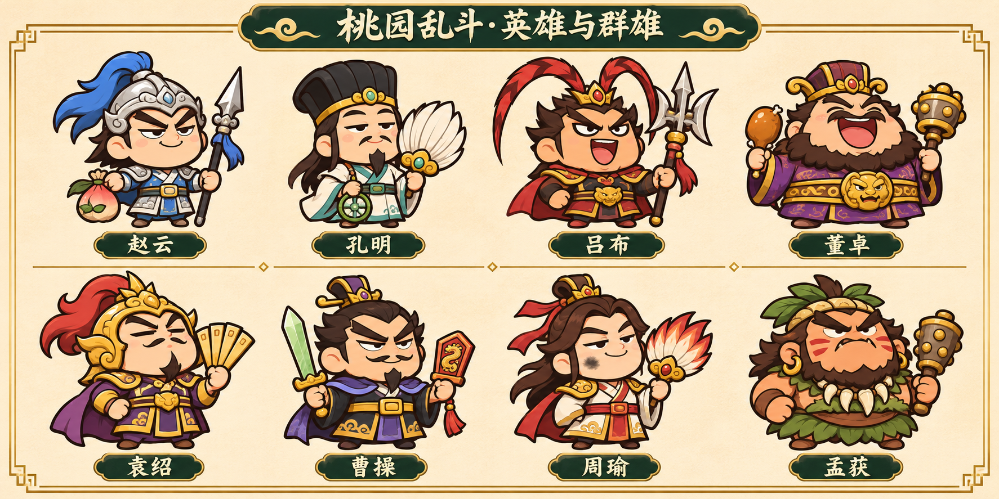
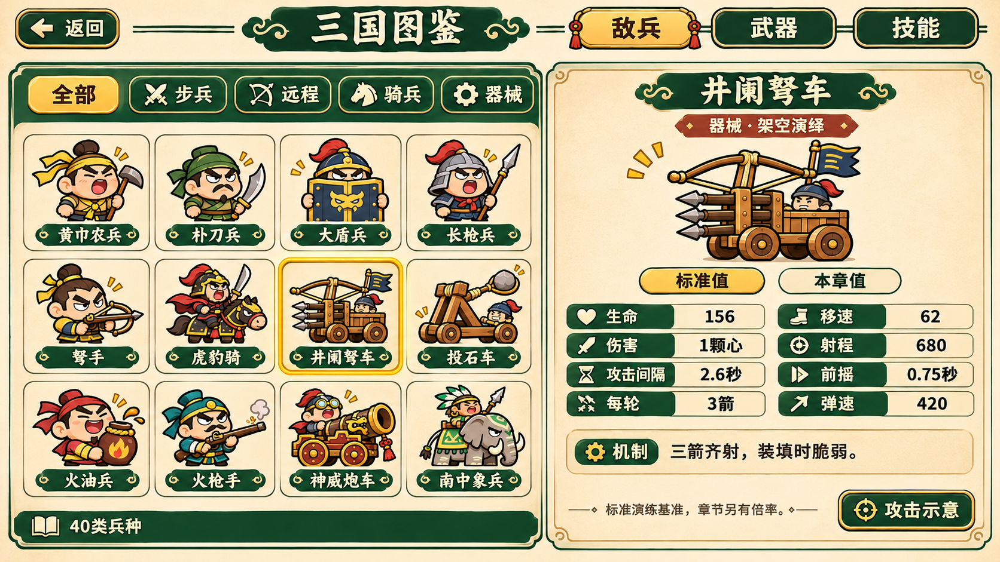

# 桃园乱斗 v4：长线战役与三国图鉴策划

**v4设计与实装｜2026-11-13｜已按后续授权完成素材和代码**

数值与实际差异以[07实装和验证](07-implementation-and-validation.md)、源码和项目skill生成表为准；原提案中的远程分卷加载、演示沙盘、图鉴收集成就等未实装项明确保留后续。

把现有张角单章扩展成可保存的“桃园演义”征程：**6卷17场首领战、40类机制兵种、36种武器、5位英雄，以及24个仅供技能图鉴查看的通用技能**。其中首领涉及14位不同人物；同机制换皮不计为新兵。目标是持续有新敌人和新构筑，保留现版移动＋自动攻击＋单专属技能的简单操作。

用户已确认每章采用**15秒第0段→三段各30秒→Boss**，章间补给、装备继承，英雄自由选。预计每卷约6～15分钟，整条征程约50～65分钟（含购物，未经真人通卷计时），已支持整备点保存继续；通关张角后才进入更多章节，Boss战中始终保留并补刷普通兵。

## 六卷路线速览

| 卷 | 主题 | 首领战顺序 |
| --- | --- | --- |
| 一 | 黄巾与群雄 | 张角 → 吕布·虎牢 → 董卓 |
| 二 | 中原逐鹿 | 袁术 → 吕布·下邳 → 袁绍 |
| 三 | 长坂赤壁 | 夏侯惇 → 曹操·长坂 → 周瑜较艺 → 曹操·赤壁 |
| 四 | 荆益较艺 | 黄忠 → 马超 |
| 五 | 江南与南中 | 陆逊 → 祝融 → 孟获 |
| 六 | 北伐对弈 | 司马懿·祁山 → 司马懿·五丈原 |

周瑜等盟友以演武较艺登场；主帅单挑、跨年代英雄与火枪／大炮明确属于本作改编。事件锚点和原著来源见06。

## 阅读顺序

| 文档 | 主要内容 |
| --- | --- |
| [01 战役、17场Boss与曲线](01-campaign-and-bosses.md) | 事件顺序、每Boss三技能、完整逐章编组、固定生命／威胁预算、保存和死亡重试 |
| [02 敌兵图鉴](02-enemy-codex.md) | 40类完整数值、前摇／弹速／成本／收益／应对、8阵营换皮、出生与控制规则 |
| [03 武器图鉴](03-weapon-codex.md) | 现有11＋新增25、四品级数值与机制、DPS口径、价格和军械池解锁 |
| [04 英雄与技能](04-heroes-and-skills.md) | 刘关张保留、赵云七进七出、孔明借东风、24通用技能详细规格 |
| [05 图鉴UI、经济与制作](05-ui-production-and-balance.md) | 首页图鉴入口、三个分区、商店投放／价格、移动端资源预算和验收路线 |
| [07 实装与验证](07-implementation-and-validation.md) | 资产、真实接入、平衡模型、包体、回归证据与尚未验收项 |
| [06 来源与决策](06-sources-and-decisions.md) | 官方／原著来源、架空边界、当前实现与设计提案区分、后续审稿点 |

## 核心取舍

- **有章节变化，不无限堆速度**：普通兵HP随章适度上涨，移速涨幅最多12%；冲锋速度、弹速、技能前摇不随流程缩短。难度依靠盾弩配合、骑兵、阵法、火攻与器械。
- **武器扩充保留身份**：偃月刀宽扫、画戟二段、银枪连刺、连弩穿透、羽扇推场、灯阵环身；品级不只变颜色。仍只有六槽，必须在覆盖、单体、控制和价格之间取舍。
- **先可成型，再有取舍**：首15秒仍只保底28金币买一把新武器；后期用家族权重和同款倾向防止36武器稀释池。商店可以全买，但金币有限。
- **五心继续简单**：任何有效攻击一心，普通兵与Boss共用保护；章末回一心，不章章自动回满。没有等级和经验条回流。
- **图鉴有数据，首页仍简洁**：首页只加小书本入口；敌兵、武器、技能三页能看标准值与章节值。通用技能只是图鉴提案，无装备或战斗接入。
- **先控制资源再扩大内容**：40机制不同时出场，共享十张紧凑图集加载；概念图留在art不进入微信包，必须守住既有预览与iOS内存预算。

## 视觉概念总览

六张图为AI生成设计概念，用于评审；代表性角色／兵种／名器已出图，未覆盖全部条目的最终动画。细小文字与完整数值以文档为准。

[英雄与群雄](../../art/concepts/chronicles-v4/01-cast.png) · [兵种概念](../../art/concepts/chronicles-v4/02-troops.png) · [名器概念](../../art/concepts/chronicles-v4/03-weapons.png)

[敌兵图鉴设计](../../art/concepts/chronicles-v4/04-enemy-codex.png) · [武器图鉴设计](../../art/concepts/chronicles-v4/05-weapon-codex.png) · [技能图鉴设计](../../art/concepts/chronicles-v4/06-skill-codex.png)

现已实装五英雄/17章/40兵/36武器；通用技能仍只读。运行素材在art/runtime-v4，六张大概念板只留文档，不进入游戏包。150条交易路径模型和工程回归已完成，尚无完整iOS通卷胜率实测。

> 后续v5已移除英雄专属主动技能，24通用技能全部开放并支持选人搭配、击杀充能；当前技能规则与数值见[通用技能v5](../common-skills-v5.md)。下列v4技能提案不再作为战斗入口。
