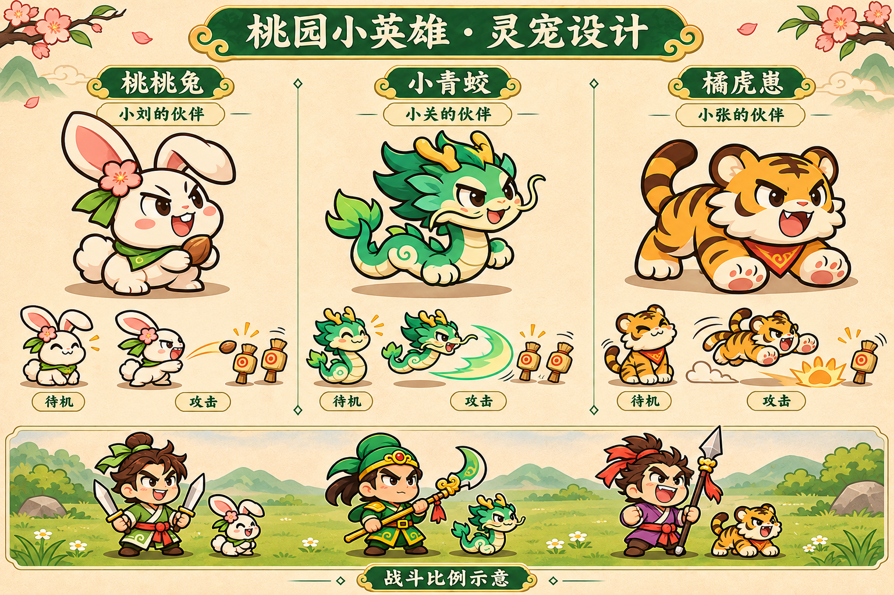

> 2026-11-18更新：下文宠物与多英雄首通武器提案已获准并实装，当前规则及验收以[实现说明](pets-and-unlocks-v917.md)为准；历史“仅提案/待确认”不再代表当前状态。

# 三少年永久成长 v9：已实装

本轮用户“开工吧”已授权实施；本说明替代此前未实装提案。三人的本命/坐骑/最终短甲和固定二技能已接入正式入口，Boss与小兵形象、敌军动作及关卡规则不变。小刘为白色马、左右手各一把双股剑，不使用驴或飞鞋作为进阶形态。

## 个人首通节点

| 时点 | 小刘 | 小关 | 小张 |
| --- | --- | --- | --- |
| 初始 | 草鞋少年 | 扁担少年 | 杀猪少年 |
| 首通S01黄巾 | 双股剑 | 青龙偃月刀 | 丈八蛇矛 |
| 首通S02讨董 | 小白马 | 小赤兔 | 圆滚黑猪 |
| 首通S03官渡 | 左斩／右斩／交叉剑气 | 横斩／反斩／青龙重斩 | 快刺／回扫／震地 |
| 首通S04赤壁 | 踏云闪 | 赤兔冲刺 | 猪突猛进 |
| 首通S05南中 | 绿白金轻袍·仁德小英雄 | 玉白翠绿轻甲·少年武圣 | 紫红金短甲·燕人小霸王 |
| 首通S06五丈原 | 桃园留名 | 桃园留名 | 桃园留名 |

每一英雄仅前两关有效首通最大生命各+1心，重复刷不叠。基础5/5/6，最终7/7/8；v9.2 HUD爱心始终单行，7心起.8倍并按需横向扩卡，暂停键右移。战斗中解锁的心数下一关／重试才成为新满血基础，本关结算仍记录本局剩余心。没有第七关。

`hero-growth.growthClears`只读取当前英雄S01起连续有效关卡记录。永久档沿用taoyuan-stage-profile-v8、版本1；现有合法通关自动体现，另一英雄不继承，旧schema4不解释为通关。读档容许11/12心记录；recordClear只在首次推进发成长，内容共享解锁仍走原差集。

## 本命与六武器槽

每局一把白I、实际投资0；未成长时仍可任选三基础武器。首通S01后用自己的进阶本命开局，武器钮打开只读成长路线，不能把共享解锁武器设为任意起手。本命被正式发现可点亮该武器图鉴，但不凭空赋予其他英雄的商店资格。

本命是EquippedWeapon.signature实例标记，不是同名武器全部强化。小刘两把剑合为一个实例／一个槽／一套周期，其他五件照常独立环绕攻击。商店普通同名副本保留原攻击模式。品质升阶与同品质合成保留标记；卖掉／替换当局失去三连，下局重建才恢复。不免费塞第二把武器；免费本命卖出退款0，升级后的真实投资正常退款。

本命成长1以上单次基础伤害乘小刘1.12／小关1.10／小张1.20，再乘`1+.06×(个人首通数−1)`；小张本命间隔另乘.82、范围最多190、基础扇角65；小刘近战范围最多220。既有英雄攻速差异、品质、道具伤害/攻速/暴击仍生效。成长不是额外叠一整把武器的输出。

成长3前是轮流单斩／横扫／快速突刺；成长3后按真实出手数循环三段，第三段1.5倍。每次招式同一目标最多一次，刘交叉的两道视觉锋共享命中集。三连替代本命原品质附加连段，不与高阶武器原第三击再次叠出多重伤害；普通商店副本保留其四品质机制。理论单体DPS按三段平均7/6倍（不含范围收益）计算。

- 刘第三击沿前方最长260、半宽42、最多3个不同目标；紧凑金白短剑锋与X剑气。
- 关第三击范围×1.15、扇角+45（最高220），区域内全体各一次；暖白金实体刀锋与短青玉龙首。
- 张第一击半宽25突刺，第二击120度回扫，第三击前方45处半径125近身震地；象牙红橙短楔、接地冲击冠与短裂纹。

命中统一走原hitEnemy→受击闪白／击退／掉落／15击杀充能链。绘图不判伤、不自行发射。攻速加成压缩同一真实攻击时钟，不能让动画排队追不上高攻速。

## 骑乘与固定二技能

坐骑基础移速+30%，不另加坐骑血条、不增受击半径；基础裸装小刘390／小关448.5／小张351。与道具同类相加：基础×(1+.30+clamp(道具移速,−.25,.5))，不会在道具结果上再乘1.3；全局减速仍后置。冲刺解锁后不再叠一份30%。

| 二技能 | 距离 | 时间 | 附加 |
| --- | --- | --- | --- |
| 踏云闪 | 420 | .28秒 | 灵巧脱围，无伤害 |
| 赤兔冲刺 | 420 | .28秒 | 定向突进，无伤害 |
| 猪突猛进 | 360 | .32秒 | CCD推开沿路普通兵，不伤害，不推/打断Boss、小Boss、战兽 |

统一6秒独立冷却、单次就绪、冲刺时短暂无敌，朝当前移动／面朝方向。右下两圆钮中心基线一致，冲刺略小且仅成长4以上显示。Q/Shift触发冲刺，Space/E仍通用技能；不占自由技能选择位。通用12技能仍15名真实普通兵重置，互不消费充能。暂停/购物冻结冲刺计时；切关/重试恢复就绪，短冲刺中不叠启动另一位移。

## 表现与资源

复用原少年头、眨眼/呼吸，骑乘隐藏小脚、抬高身体36；坐骑头向前错开25，避免挡成半人马。最终短甲仅成长5以上替换袍身，头像／失败哭脸仍保留少年身份基准肖像，不为每个阶段生成整套静态表情。胜利页用成长后的动态HeroShowcase；前两关首通展示+1心，后四关只展示对应成长节点，已获奖励不重复标新。

art/runtime-growth记录内置imagegen的完整prompt/源图和确定性加工：三种坐骑各6姿势、3件最终无头短甲；持握单剑／刀／矛为原生SVG绘成再打包，刘两手各复用一张单剑，不能两张双剑图变四把。scripts/pack-growth-art.cjs仅清alpha杂点、同排统一缩放/脚底注册、合图；一张768×512 RGBA图132987B、解码1.5MiB，同一presentation分包。没有为每个成长/品质复制全屏帧。

每英雄一个额外mount Sprite，不逐敌新增Graphics；本命轨迹复用原w.trail，冲刺复用共享g.fx，额外手剑复用现有offhand节点。graphics绘制缓存颜色/透明度；同帧命中、动画、绘图共用时间。G03横扫六合A版不变。

## 演武、验证与当前边界

演武配置新增“成长 n/6”循环按钮，可试所有形态；只替换第一槽本命、保留其他5件，刷新满心与形象，冲刺也免冷却。演武写不进正式progress/discovery；退出恢复个人真实成长。

scripts/test-hero-growth.cjs覆盖3×7成长、独立首通/重复/读档、坐骑速度、心数、升阶合成售出、三连共享命中/六槽并行、Q冲刺/暂停/免伤/推兵、演武隔离。npm test含本套测试。

scripts/capture-growth-review.mjs在独立桌面真实Cocos WebGL做21状态截图、3段自动连招GIF、六武器/冲刺与首通结算；带存档/更新循环恢复守卫，属于工程夹具，不代表真人通关或iOS帧率。实际证据见art/reviews/hero-growth，概念板在art/concepts/*-growth，仅供方向。手机平衡、画面密度和长战斗稳定性仍需扫本次二维码体验。

# 后续提案：南中首通宠物（设计，尚未接入）

2026-11-18 用户新增方向。以下不是当前v9.16运行机制，不提前改存档、战斗或奖励。生效点为**该英雄首次通关S05南中平蛮**，该英雄永久获得自己的宠物，S06及之后重打任意已解锁关卡自动带上。不同英雄需分别通关；宠物属于英雄成长，不是账号共享商店武器。旧有效S05记录可直接派生，避免老玩家再刷一次。

## 目标与共同规则

每名英雄一只，自动跟随/索敌/攻击，不占六武器槽、不占通用或冲刺技能位、不花金币、不增加操作按钮。没有宠物血条，不能成为敌方目标，不参与碰撞、受击、仇恨、阻挡弹丸、敌人分离；敌人的攻击可穿过宠物正常击中英雄。宠物不回血、不挡伤，不替玩家逃课。

外观用同款少年Q版：头大身小、暖棕细边、鲜明平涂、约英雄身高40%，不能做写实动物或高亮光球。跟随半径80–115，靠英雄侧后方，移动有小跑/跳跃/摆尾，停下会眨眼、歪头；和武器环绕层分开（宠物低位贴地、武器中高位），绝不挡脸。离开英雄160外追赶、超过320且屏外才柔和回位；菜单跟在脚边亮相，结算与主人一起开心或哭泣。

## 三只伙伴

| 主人/宠物 | 造型与性格 | 自动攻击 | 白板数值提案 | 定位与反制边界 |
| --- | --- | --- | --- | --- |
| 小刘 · 桃桃兔 | 米白胖兔、绿围巾、单耳桃花结；抱着小桃核，攻击前鼓腮 | 桃核弹：优先射最近的远程兵，否则最近敌人；实体命中后向另一敌人弹一次 | 每1.2秒一发、主伤42/弹射25、射程400/弹速640/弹射范围140；同发同敌只一次 | 稳定补远程/换目标，不穿透、不爆炸、不强控；理想单体35DPS，弹射另算20.8，方便小刘走位 |
| 小关 · 小青蛟 | 碧绿圆头小蛟、金角/短须、云朵小爪，浮地低飞；认真模仿小关蓄势 | 摇尾青刃：朝最近目标甩出短宽青刃，命中可见扇区所有敌人 | 每1.5秒、每目标54伤、半径165/140°、每挥每敌一次；最近6目标上限 | 近身清群，理想单体36DPS；无法触及远处射手、不拖拽、不重复多段判伤；短小青弧区别本命大三连 |
| 小张 · 橘虎崽 | 橘金圆头小虎、额头自然王纹、红肚兜，短腿和大肉掌；扑空会晃脑袋 | 肉掌扑击：选近处普通兵落地震一下；没有普通兵时也能打Boss | 每1.8秒、主伤60、落点R70附伤24、跳扑距离≤220；主目标不重复吃附伤；最多5目标 | 扑近/打断危险普通兵，理想单体33.3DPS；主目标普通兵额外眩晕0.25秒，同敌3秒内不重复，Boss/精英/兽群冲锋不吃晕；不提供治疗和盾 |

这三个宠物都能攻击Boss。小刘补远程、小关清围、小张小范围打断，单体目标约33–36DPS，清群收益分别用弹射数/短射程/目标上限约束，不能把总伤害按所有敌兵无限相乘。

## 强度与其他系统

- 初版固定独立宠物数值，不继承玩家攻速、攻击次数、武器品质、暴击、弹射/分裂、15击杀技能伤害、武器专属被动、本命三连；不会凭5倍攻速生成5倍宠物弹体。暂不单独升级/喂养/装备。
- 重打低关按该关缩放基础伤害：S01–S06为40/50/65/80/90/100%；减少毕业宠物碾压练手关，不随敌人数量暗增伤。只是伤害缩放，控制时长不随关卡变强。
- 伤害走真实命中/死亡入口，击杀真实普通兵正常掉币并计入15击杀充能；Boss/精英/召唤物不计。用pet来源标记，禁止触发桃花连爆、本命连段、武器暴击及“武器第3击”等专属效果；不把pet来源冒充草鞋。
- 孟获兽群实际冲锋无敌同样阻挡宠物伤害/控制；宠物可以重选其他可攻击目标，不能自动锁死在无敌象上。
- 本版减少后四关加心，宠物提供额外输出而非生存免疫。S06参考DPS390，宠物不超过约10%额外有效单体输出；真实命中/选靶分散会更低，待实际试玩校准，不能据理论DPS承诺胜率。

## 表现与性能落地边界

每英雄一张小分层或8–12帧动作，三只同图集，拟上限512×512、RGBA1MiB；资源放成长可选Bundle，取得宠物的备战/关卡准备时才请求，不扩大首关首屏。复用现有共享特效/友弹池，宠物弹至多2个、扑击/尾扫共用单一事件计时；索敌8–10Hz、位移每模拟步、画面只读。无宠物专属Graphics、刚体、独立粒子系统。暂停/购物/后台冻结，换关重试/离场清弹与攻击任务。

首通结算新增宠物肖像/名称/自动参战说明；不混在“商店可刷武器”栏。演武允许切成长展示，但正式资格不泄漏。实现前需三只同尺度素材稿＋待机/攻击实景关键帧；验证不可受击但不能挡伤、宠物击杀正确记账、六武器并存、失效目标/屏外回位/跨关清理和资源释放。

### 宠物外观初稿（2026-11-18，概念待确认）

画面展示主形象、待机/攻击姿态和与英雄的大小关系；使用内置image_gen，完整提示词及来源见art/concepts/hero-pets。尚未接入游戏，也不是连续动作帧。
