# 《桃园小英雄》全量战斗特效设计册

2026-11-20。用户已认可三张先导稿的材质和风格方向，本册将该方向扩展为133项独立设计。它们是美术概念与实施交接，不是运行素材、引擎截图或连续动画；新稿逐项待审。本轮不写战斗代码、不修改数值、不构建或发布。

## 设计目标与范围

人物保持少年Q版、暖色粗轮廓、小脚豆比例；七Boss和40兵沿用各自身份。特效以实体刃面、通透流纹、卷起浪冠、翻焰、粗细雷芯和有重量的实体道具建立质感。画面明亮、局部高光集中，攻击主体可辨、人物脸和危险缺口可见。

每张图上方为主效果峰值，下方为同一效果的三个关键阶段。本命连招下方特指第一/二/三击，不代表同一次出手结算三次。武器品质机制在逐项四档表中给出，主图只示一个代表性瞬间，不能据图猜弹数/伤害/世界半径。

| 类别 | 独立稿数 | 覆盖 |
| --- | --- | --- |
| 武器 | 36 | 全目录，含6预留；每把一稿及I–IV机制表，不开放预留资格 |
| 通用主动 | 12 | 全部现存技能，统一15真实普通兵击杀充能 |
| Boss招式 | 21 | 七Boss各三招；吕布正式小Boss仍只开两招 |
| 普通兵攻击 | 40 | 逐兵抬手/主体/接触/收招；农兵两外观同稿 |
| 本命连招/坐骑/灵宠 | 9 | 三英雄各一连招、一冲刺、一宠物攻击 |
| 通用反馈 | 8 | 受伤、出生、退场、格挡、回血、穿透弹射、桃花次生爆散、控制减速 |
| 中Boss变体 | 7 | 黄巾三将、河北戟将、虎豹先锋、象兵两招、军师两棋阵；吕布复用对应Boss稿 |

## 统一表现规则

**完整过程：动作聚能 → 主体释放 → 实际接触 → 余波回收。**

- 刀锋：实体刃面与透明尾分开，锋口最实最亮，尾部变窄、变薄，不用一圈同粗光环代替横扫。
- 弹体：头部位置与真实弹体一致，尾迹从历史运动路径生成。加速、弹射、穿透分别读得到；连续命中只在真实接触处亮起。
- 火：暗赤底、橙金翻焰、局部白芯、碎纸/碎石、薄烟分段衰减。烟不能常态遮住战场，熄火残迹明显低亮且无伤害。
- 水：连续青蓝厚水体、卷起的白浪冠、通透水裙和局部水花。前后层交错，中心留白；实际扩散前缘与命中同源。
- 雷：雷芯有粗细和分叉，地面电冠、游电、纸灰与焦痕错开结束；不能整屏蒙白。
- 法阵/实体：门印、棋子、金印有正侧面与落影；阵纹只在局部按节拍流动，安全缺口不被高亮图案填平。
- 角色：叠加短拧身、压身、手腕随动、马匹蓄势/刹停。只偏移表现层，不改变碰撞、朝向、握持关系或英雄身份。
- 受击：来自确认命中；空放无接触爆点。概念中的夸张退姿/离地轮廓不授权增加击飞、眩晕或额外伤害。
- 敌我：友方普通攻击紧凑，主动负责高潮；敌方保留薄朱红危险边和收紧刻度，Boss主体可保留金/紫/红身份。已取消的长瞄准线和冲锋路框不恢复。

## 节奏与机制保真

| 家族 | 起手 | 主体/接触 | 收尾 |
| --- | --- | --- | --- |
| 普通近战 | 在原attack内压身/收械，不能新增攻击延迟 | 瞬发伤害帧先有锋闪，运动刃尾装饰；逐角度判伤则刀锋同步扫角 | 短收尖尾、定向碎屑、回正，不多结算一次 |
| 飞行武器 | 原出手时刻短枪口/弦/符口聚能 | 主体/历史尾轨/实际接触共用位置 | 到期/碰撞立即停主体，接触碎屑短衰减 |
| 扩散/地面持续 | 原预告时钟内增加材质与阶段 | 实际半径、锁点、tick、轮次和次数上限驱动表现 | 失去判定后残迹降亮，不能假装继续有伤 |
| 增益/控制/防御 | 短而明确启动峰值 | 低亮持续身份；格挡剩余次数、控制结束按真实状态 | 到期撤印/撤星/撤流纹，不拖成永久罩 |
| 骑乘冲锋 | 原蓄势内压身/刨地/前锋聚能 | 主体头部贴真实危险位置，尾部随身后路径伸缩 | 真实刹停时向前尘翻、能量尾回收 |

现有机制优先级：实际Runtime调用 > 当前导出字段 > 旧描述文字。核对中发现E06/E07目录旧描述R100/R130与当前调用R85/R95不同，本册使用当前调用；普通E40两雷区与第六关精英三子/十字棋阵分开列稿。司马懿当前招式名为“阴阳双龙”“五丈星劫”，不沿用早期提案别名。未借本轮设计擅自修战斗或调整数值。

## 四品质与成长

I档也有完整主体/接触/收尾；II增加细边与流纹；III在真实特殊触发上强调；IV提升短高潮的轮廓和材质。不能只将白/蓝/紫/红品质色直接套满攻击，也不能为没有追加攻击的品质伪造多次命中。

逐项表数值为无英雄/道具修正的武器品质快照，实际战斗用最终Stats。三英雄本命成长覆盖对应品质额外攻击规则；商店普通副本仍走各自品质机制。其他五件环绕武器不因本命连招同时接管姿态或重复触发。

60被动与9天命依真实事件增强原效果，数值型增益不新增常驻特效；分裂/弹射/穿透/爆散等复用对应武器与8类反馈，不为每层被动新增发射器。金币拾取继续静音，音频复用现有6音效＋1音乐与分类限频，不能为每粒碎屑播放声音。

## 制作交接与性能目标

美术交付按主体、尾迹、接触、余波、地面与角色配合拆层；另给锚点、透明Alpha、尺寸、色板、帧序与时间曲线。短火焰/爆点可用局部序列帧，长弧/浪墙/剑气由连续轨迹与UV材质组织。透明纹理在浅/深六主题都检查边缘；全图概念板不直接入包。

建议公共材质最多两张1024²、当前主动一张、每位Boss一张、无尽最多两位Boss；无mipmap的RGBA纹理增量最坏约20MiB，准备峰值争取24MiB以内。这是待动态样板实测的目标，不是批准后的保证。现有武器实体形状继续复用原图集，整套133张概念图仅留文档，不参与运行加载。

保留80敌、160友弹、80敌方移动物、6危险区、4主招、280粒子及现有有界视觉池；不为每个攻击/敌人新建Graphics。替换旧表现时逐项退役，不能旧新整套双播。新增装饰片建议常态64/短峰96以内，优先级保留主体、落点和真实危险边界；远处尾屑、二级晕光、余烟先降。绘制调用增量普通20/爆发35仅为初始目标。

加载/暂停/购物/后台/死亡/重开/取消及迟到发布沿项目租约统一回收。按关/当前技能从CDN准备，预热后绑定素材，不在命中时下载/创建Canvas/生成文本纹理；伤害数字保留共享Sprite。纹理、缓冲、帧时间在跨商店长局中必须形成有界平台。现有原生JSC闪退没有据本设计被确诊或修复。

实施仍先做青龙刀、火箭筒、水淹七军、横扫六合、张角定雷、吕布冲锋六个真实Cocos动态样板，校准后全量铺开。验收包含四向/斜向、空放/实命中、坐骑/六武器、五倍攻速、双Boss、各主题、边缘/遮挡/打断与跨商店循环；原iPhone15ProMax做15/30分钟检查。静态图只能验美术，不证明60fps或手机稳定性。

## 逐项设计

以下每项均有独立稿、设计说明、机制约束、层级、源路径及实施映射。原始提示与参考在manifest.json，图像为内置image_gen产出；三张先导稿沿用用户认可版本，新稿待逐项审阅。

## 武器

### W01-sandal · 草鞋

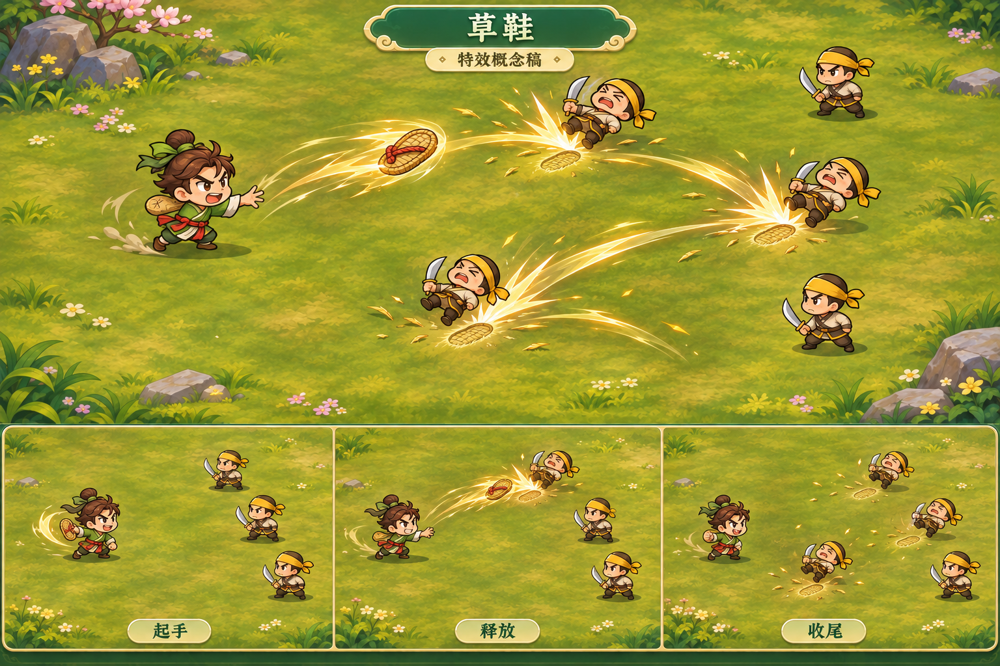

**视觉设计：** 保留红绳草鞋实体，抛出有加速感，短金纤维掠尾和轻微翻转；命中和升阶：拍击用扁平白金爆点、草屑和短鞋形压印；真实弹射时再加拐向掠尾

**材料色板：** 金属/实体：细赭金背沿 #997139 / 金白主体 #F4C56D / 象牙白锋面 #FFF5DA；黑白棋/铜印/木器保留实体本色

**动作阶段：** 起手蓄势→主体运动与真实接触→回正与余波衰减

**机制与判定：** 白I默认：投掷1只草鞋 · 弹射0次 基础射程360／扫角0°／爆散半径0。 红IV追加效果仅在真实触发时表现：投掷1只草鞋 · 弹射3次

**层级：** 地面预告/痕迹→后侧主体→人物→前侧主体/接触→敌方危险提示；脸部留白

**实现映射：** GameBootstrap实际武器出手/追加段/命中 → combat-effects与原武器trail → 公共主体/轨迹/接触层。

**源码核对：** `assets/scripts/weapons.ts`、`assets/scripts/extra-weapons.ts`、`assets/scripts/GameBootstrap.ts`。

| 品质 | 基础显示伤害 | 间隔秒 | 射程 | 爆散半径 | 实际机制 |
| --- | --- | --- | --- | --- | --- |
| 1 | 16 | 0.6 | 360 | 0 | 投掷1只草鞋 · 弹射0次 |
| 2 | 21.6 | 0.576 | 370 | 0 | 投掷1只草鞋 · 弹射1次 |
| 3 | 28.8 | 0.552 | 380 | 0 | 投掷1只草鞋 · 弹射2次 |
| 4 | 38.4 | 0.528 | 390 | 0 | 投掷1只草鞋 · 弹射3次 |

**逐项验收：** 先检查主体轮廓与原身份，再按本条真实范围/时钟检查起手、峰值、接触和收尾；范围外无伪命中、暂停不推进、清场无残影，密集叠加仍看清危险。概念透视/夸张退姿不作为判伤或新增控制依据。

### W02-pole · 扁担

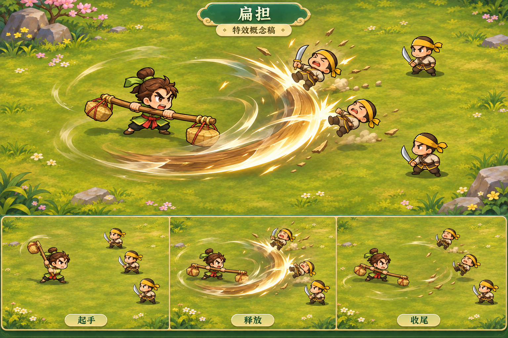

**视觉设计：** 前段木色实体影、金白薄刃扫过、短气流拖带；命中和升阶：木片/尘点向击退方向散开；高阶重击刃身更厚，仍保持木器感觉

**材料色板：** 金属/实体：细赭金背沿 #997139 / 金白主体 #F4C56D / 象牙白锋面 #FFF5DA；黑白棋/铜印/木器保留实体本色

**动作阶段：** 起手蓄势→主体运动与真实接触→回正与余波衰减

**机制与判定：** 白I默认：140°长担横扫 · 强击退 基础射程165／扫角140°／爆散半径0。 红IV追加效果仅在真实触发时表现：200°长担横扫 · 强击退

**层级：** 地面预告/痕迹→后侧主体→人物→前侧主体/接触→敌方危险提示；脸部留白

**实现映射：** GameBootstrap实际武器出手/追加段/命中 → combat-effects与原武器trail → 公共主体/轨迹/接触层。

**源码核对：** `assets/scripts/weapons.ts`、`assets/scripts/extra-weapons.ts`、`assets/scripts/GameBootstrap.ts`。

| 品质 | 基础显示伤害 | 间隔秒 | 射程 | 爆散半径 | 实际机制 |
| --- | --- | --- | --- | --- | --- |
| 1 | 32 | 0.9 | 165 | 0 | 140°长担横扫 · 强击退 |
| 2 | 43.2 | 0.864 | 175 | 0 | 160°长担横扫 · 强击退 |
| 3 | 57.6 | 0.828 | 185 | 0 | 180°长担横扫 · 强击退 |
| 4 | 76.8 | 0.792 | 195 | 0 | 200°长担横扫 · 强击退 |

**逐项验收：** 先检查主体轮廓与原身份，再按本条真实范围/时钟检查起手、峰值、接触和收尾；范围外无伪命中、暂停不推进、清场无残影，密集叠加仍看清危险。概念透视/夸张退姿不作为判伤或新增控制依据。

### W03-peach · 桃花枝

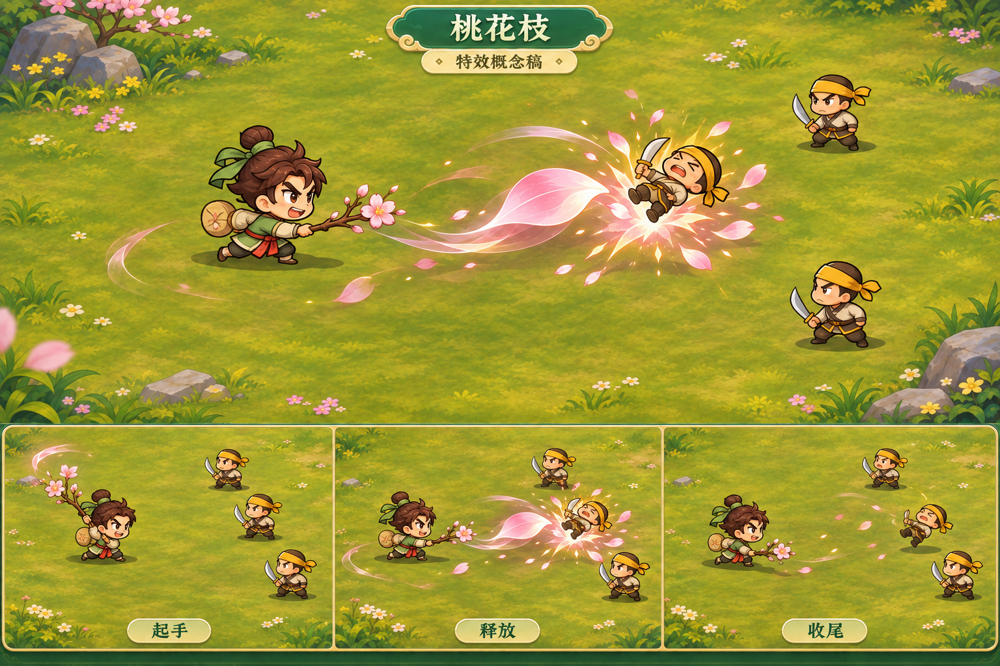

**视觉设计：** 木枝起势，粉白花瓣有卷曲薄面、柔和粉尾；命中和升阶：落点展开短桃花瓣爆散；品质真正变多瓣时按实际弹数展示

**材料色板：** 桃花：浅粉薄面 #FFC0CF / 桃红背面 #DB6C93 / 白粉高光 #FFF2E9 / 玉绿辅助 #79C493

**动作阶段：** 起手蓄势→主体运动与真实接触→回正与余波衰减

**机制与判定：** 白I默认：1片桃花 · 爆散55
同轮对同一敌人最多命中1次 基础射程360／扫角0°／爆散半径55。 红IV追加效果仅在真实触发时表现：3片桃花扇射 · 爆散90
同轮对同一敌人最多命中1次

**层级：** 地面预告/痕迹→后侧主体→人物→前侧主体/接触→敌方危险提示；脸部留白

**实现映射：** GameBootstrap实际武器出手/追加段/命中 → combat-effects与原武器trail → 公共主体/轨迹/接触层。

**源码核对：** `assets/scripts/weapons.ts`、`assets/scripts/extra-weapons.ts`、`assets/scripts/GameBootstrap.ts`。

| 品质 | 基础显示伤害 | 间隔秒 | 射程 | 爆散半径 | 实际机制 |
| --- | --- | --- | --- | --- | --- |
| 1 | 26 | 1 | 360 | 55 | 1片桃花 · 爆散55
同轮对同一敌人最多命中1次 |
| 2 | 35.1 | 0.96 | 370 | 60 | 3片桃花扇射 · 爆散60
同轮对同一敌人最多命中1次 |
| 3 | 46.8 | 0.92 | 380 | 75 | 3片桃花扇射 · 爆散75
同轮对同一敌人最多命中1次 |
| 4 | 62.4 | 0.88 | 390 | 90 | 3片桃花扇射 · 爆散90
同轮对同一敌人最多命中1次 |

**逐项验收：** 先检查主体轮廓与原身份，再按本条真实范围/时钟检查起手、峰值、接触和收尾；范围外无伪命中、暂停不推进、清场无残影，密集叠加仍看清危险。概念透视/夸张退姿不作为判伤或新增控制依据。

### W04-cleaver · 杀猪尖刀

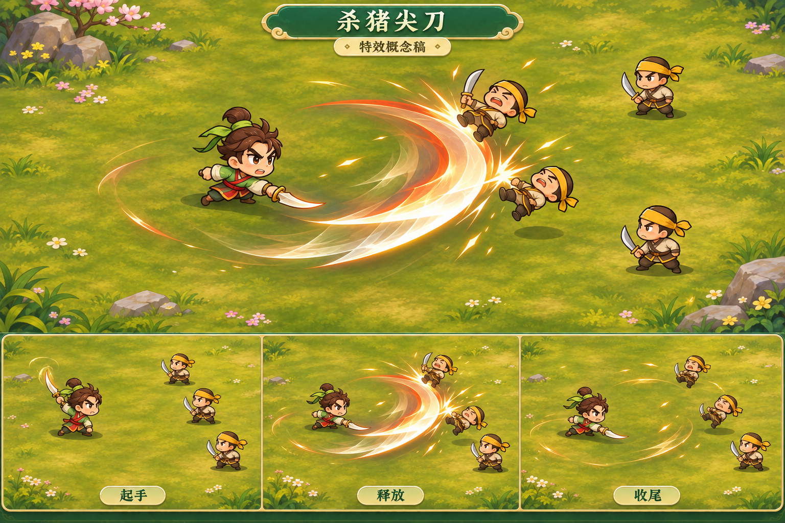

**视觉设计：** 象牙白锐利短刃，细红橙背沿，快进快收；命中和升阶：接触用窄切痕与金属星火，暴击强调爆点，不套大范围震地

**材料色板：** 火焰：低亮赤底 #8F3029 / 橙红主体 #EF5C2E / 金橙翻焰 #FFB63C / 短白热芯 #FFF6CB

**动作阶段：** 起手蓄势→主体运动与真实接触→回正与余波衰减

**机制与判定：** 白I默认：90°尖刀快斩 · 暴击15% 基础射程135／扫角90°／爆散半径0。 红IV追加效果仅在真实触发时表现：150°尖刀快斩 · 暴击25%

**层级：** 地面预告/痕迹→后侧主体→人物→前侧主体/接触→敌方危险提示；脸部留白

**实现映射：** GameBootstrap实际武器出手/追加段/命中 → combat-effects与原武器trail → 公共主体/轨迹/接触层。

**源码核对：** `assets/scripts/weapons.ts`、`assets/scripts/extra-weapons.ts`、`assets/scripts/GameBootstrap.ts`。

| 品质 | 基础显示伤害 | 间隔秒 | 射程 | 爆散半径 | 实际机制 |
| --- | --- | --- | --- | --- | --- |
| 1 | 18 | 0.42 | 135 | 0 | 90°尖刀快斩 · 暴击15% |
| 2 | 24.3 | 0.403 | 145 | 0 | 110°尖刀快斩 · 暴击18% |
| 3 | 32.4 | 0.386 | 155 | 0 | 130°尖刀快斩 · 暴击21% |
| 4 | 43.2 | 0.37 | 165 | 0 | 150°尖刀快斩 · 暴击25% |

**逐项验收：** 先检查主体轮廓与原身份，再按本条真实范围/时钟检查起手、峰值、接触和收尾；范围外无伪命中、暂停不推进、清场无残影，密集叠加仍看清危险。概念透视/夸张退姿不作为判伤或新增控制依据。

### W05-firecracker · 爆竹

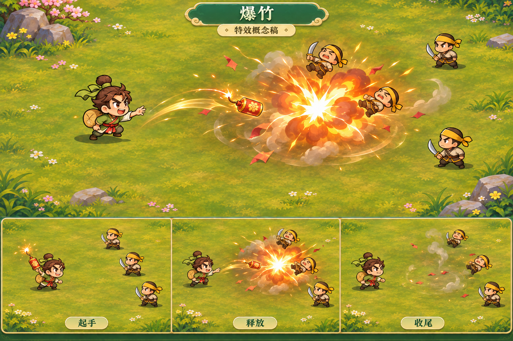

**视觉设计：** 明确爆竹本体、跳动引线、收尖火星尾；命中和升阶：白热爆芯→橙红火团→碎纸/淡烟，范围轮廓按真实爆炸半径

**材料色板：** 火焰：低亮赤底 #8F3029 / 橙红主体 #EF5C2E / 金橙翻焰 #FFB63C / 短白热芯 #FFF6CB

**动作阶段：** 起手蓄势→主体运动与真实接触→回正与余波衰减

**机制与判定：** 白I默认：单发爆竹 · 爆炸半径100 基础射程390／扫角0°／爆散半径100。 红IV追加效果仅在真实触发时表现：单发爆竹 · 爆炸半径150

**层级：** 地面预告/痕迹→后侧主体→人物→前侧主体/接触→敌方危险提示；脸部留白

**实现映射：** GameBootstrap实际武器出手/追加段/命中 → combat-effects与原武器trail → 公共主体/轨迹/接触层。

**源码核对：** `assets/scripts/weapons.ts`、`assets/scripts/extra-weapons.ts`、`assets/scripts/GameBootstrap.ts`。

| 品质 | 基础显示伤害 | 间隔秒 | 射程 | 爆散半径 | 实际机制 |
| --- | --- | --- | --- | --- | --- |
| 1 | 42 | 1.45 | 390 | 100 | 单发爆竹 · 爆炸半径100 |
| 2 | 56.7 | 1.39 | 400 | 115 | 单发爆竹 · 爆炸半径115 |
| 3 | 75.6 | 1.33 | 410 | 130 | 单发爆竹 · 爆炸半径130 |
| 4 | 101 | 1.28 | 420 | 150 | 单发爆竹 · 爆炸半径150 |

**逐项验收：** 先检查主体轮廓与原身份，再按本条真实范围/时钟检查起手、峰值、接触和收尾；范围外无伪命中、暂停不推进、清场无残影，密集叠加仍看清危险。概念透视/夸张退姿不作为判伤或新增控制依据。

### W06-smg · 桃园突突枪

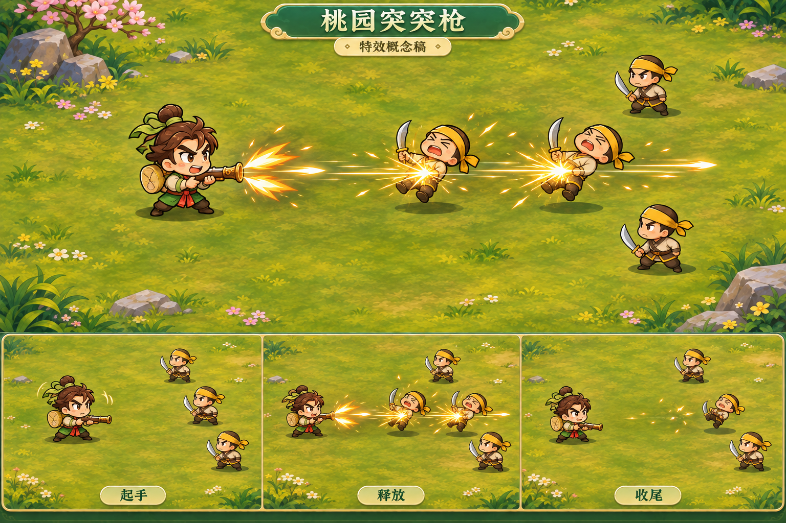

**视觉设计：** 枪口双片短焰、细金白弹芯、短曳光；命中和升阶：高频小火花按射击簇合并；品质用弹芯和真实机制区分，控制弹壳量

**材料色板：** 火焰：低亮赤底 #8F3029 / 橙红主体 #EF5C2E / 金橙翻焰 #FFB63C / 短白热芯 #FFF6CB

**动作阶段：** 起手蓄势→主体运动与真实接触→回正与余波衰减

**机制与判定：** 白I默认：快速点射 · 穿透0人 基础射程400／扫角0°／爆散半径0。 红IV追加效果仅在真实触发时表现：快速点射 · 穿透2人

**层级：** 地面预告/痕迹→后侧主体→人物→前侧主体/接触→敌方危险提示；脸部留白

**实现映射：** GameBootstrap实际武器出手/追加段/命中 → combat-effects与原武器trail → 公共主体/轨迹/接触层。

**源码核对：** `assets/scripts/weapons.ts`、`assets/scripts/extra-weapons.ts`、`assets/scripts/GameBootstrap.ts`。

| 品质 | 基础显示伤害 | 间隔秒 | 射程 | 爆散半径 | 实际机制 |
| --- | --- | --- | --- | --- | --- |
| 1 | 5 | 0.16 | 400 | 0 | 快速点射 · 穿透0人 |
| 2 | 6.75 | 0.154 | 410 | 0 | 快速点射 · 穿透1人 |
| 3 | 9 | 0.147 | 420 | 0 | 快速点射 · 穿透1人 |
| 4 | 12 | 0.141 | 430 | 0 | 快速点射 · 穿透2人 |

**逐项验收：** 先检查主体轮廓与原身份，再按本条真实范围/时钟检查起手、峰值、接触和收尾；范围外无伪命中、暂停不推进、清场无残影，密集叠加仍看清危险。概念透视/夸张退姿不作为判伤或新增控制依据。

### W07-shotgun · 村口霰弹枪

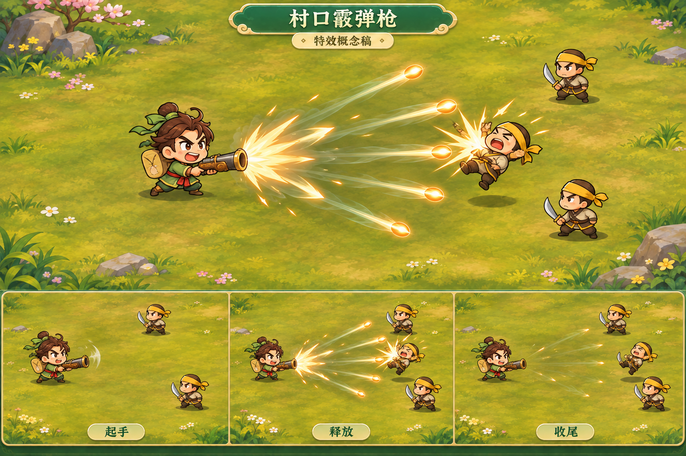

**视觉设计：** 宽而短的枪口喷发、每颗真实弹丸各自短尾；命中和升阶：一轮齐射保留清楚的散开结构，近距离命中更饱满；实际发数保持

**材料色板：** 金属/实体：细赭金背沿 #997139 / 金白主体 #F4C56D / 象牙白锋面 #FFF5DA；黑白棋/铜印/木器保留实体本色

**动作阶段：** 起手蓄势→主体运动与真实接触→回正与余波衰减

**机制与判定：** 白I默认：5发扇形散弹
同轮对同一敌人最多命中4颗 基础射程300／扫角0°／爆散半径0。 红IV追加效果仅在真实触发时表现：8发扇形散弹
同轮对同一敌人最多命中4颗

**层级：** 地面预告/痕迹→后侧主体→人物→前侧主体/接触→敌方危险提示；脸部留白

**实现映射：** GameBootstrap实际武器出手/追加段/命中 → combat-effects与原武器trail → 公共主体/轨迹/接触层。

**源码核对：** `assets/scripts/weapons.ts`、`assets/scripts/extra-weapons.ts`、`assets/scripts/GameBootstrap.ts`。

| 品质 | 基础显示伤害 | 间隔秒 | 射程 | 爆散半径 | 实际机制 |
| --- | --- | --- | --- | --- | --- |
| 1 | 8 | 0.9 | 300 | 0 | 5发扇形散弹
同轮对同一敌人最多命中4颗 |
| 2 | 10.8 | 0.864 | 310 | 0 | 6发扇形散弹
同轮对同一敌人最多命中4颗 |
| 3 | 14.4 | 0.828 | 320 | 0 | 7发扇形散弹
同轮对同一敌人最多命中4颗 |
| 4 | 19.2 | 0.792 | 330 | 0 | 8发扇形散弹
同轮对同一敌人最多命中4颗 |

**逐项验收：** 先检查主体轮廓与原身份，再按本条真实范围/时钟检查起手、峰值、接触和收尾；范围外无伪命中、暂停不推进、清场无残影，密集叠加仍看清危险。概念透视/夸张退姿不作为判伤或新增控制依据。

### W08-rocket · 二踢脚火箭筒

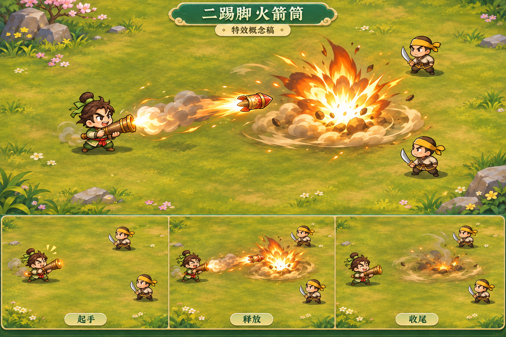

**视觉设计：** 有体积的弹头、橙白喷口、分段衰减烟尾；命中和升阶：三段爆破：爆芯、外翻焰、地面尘环；高阶只按真实范围/追加效果强化

**材料色板：** 火焰：低亮赤底 #8F3029 / 橙红主体 #EF5C2E / 金橙翻焰 #FFB63C / 短白热芯 #FFF6CB

**动作阶段：** 起手蓄势→主体运动与真实接触→回正与余波衰减

**机制与判定：** 白I默认：单发火箭 · 爆炸半径125 基础射程500／扫角0°／爆散半径125。 红IV追加效果仅在真实触发时表现：单发火箭 · 爆炸半径185

**层级：** 地面预告/痕迹→后侧主体→人物→前侧主体/接触→敌方危险提示；脸部留白

**实现映射：** GameBootstrap实际武器出手/追加段/命中 → combat-effects与原武器trail → 公共主体/轨迹/接触层。

**源码核对：** `assets/scripts/weapons.ts`、`assets/scripts/extra-weapons.ts`、`assets/scripts/GameBootstrap.ts`。

| 品质 | 基础显示伤害 | 间隔秒 | 射程 | 爆散半径 | 实际机制 |
| --- | --- | --- | --- | --- | --- |
| 1 | 78 | 2 | 500 | 125 | 单发火箭 · 爆炸半径125 |
| 2 | 105 | 1.92 | 510 | 145 | 单发火箭 · 爆炸半径145 |
| 3 | 140 | 1.84 | 520 | 165 | 单发火箭 · 爆炸半径165 |
| 4 | 187 | 1.76 | 530 | 185 | 单发火箭 · 爆炸半径185 |

**逐项验收：** 先检查主体轮廓与原身份，再按本条真实范围/时钟检查起手、峰值、接触和收尾；范围外无伪命中、暂停不推进、清场无残影，密集叠加仍看清危险。概念透视/夸张退姿不作为判伤或新增控制依据。

### W09-sword · 青莲飞剑

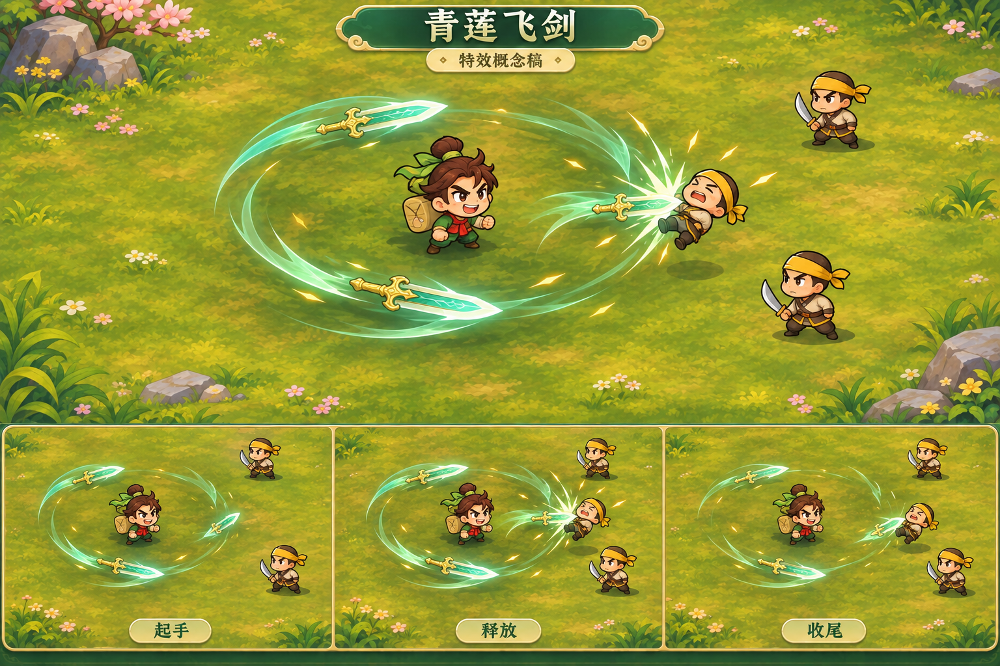

**视觉设计：** 剑体带青玉材质，运动方向上有短连续剑尾，剑尖更亮；命中和升阶：周身轨迹有前后遮挡；实际接触生成小刃爆点，避免常驻厚光环

**材料色板：** 青玉：细暗背沿 #226F6E / 实体玉青 #42CDB2 / 流纹 #A3F2D3 / 白玉锋面 #FFF9DE

**动作阶段：** 起手蓄势→主体运动与真实接触→回正与余波衰减

**机制与判定：** 白I默认：3剑常驻环绕 · 接触切割 基础射程150／扫角0°／爆散半径0。 红IV追加效果仅在真实触发时表现：6剑常驻环绕 · 接触切割

**层级：** 地面预告/痕迹→后侧主体→人物→前侧主体/接触→敌方危险提示；脸部留白

**实现映射：** GameBootstrap实际武器出手/追加段/命中 → combat-effects与原武器trail → 公共主体/轨迹/接触层。

**源码核对：** `assets/scripts/weapons.ts`、`assets/scripts/extra-weapons.ts`、`assets/scripts/GameBootstrap.ts`。

| 品质 | 基础显示伤害 | 间隔秒 | 射程 | 爆散半径 | 实际机制 |
| --- | --- | --- | --- | --- | --- |
| 1 | 16 | 0.5 | 150 | 0 | 3剑常驻环绕 · 接触切割 |
| 2 | 21.6 | 0.48 | 160 | 0 | 4剑常驻环绕 · 接触切割 |
| 3 | 28.8 | 0.46 | 170 | 0 | 5剑常驻环绕 · 接触切割 |
| 4 | 38.4 | 0.44 | 180 | 0 | 6剑常驻环绕 · 接触切割 |

**逐项验收：** 先检查主体轮廓与原身份，再按本条真实范围/时钟检查起手、峰值、接触和收尾；范围外无伪命中、暂停不推进、清场无残影，密集叠加仍看清危险。概念透视/夸张退姿不作为判伤或新增控制依据。

### W10-thunder · 五雷符

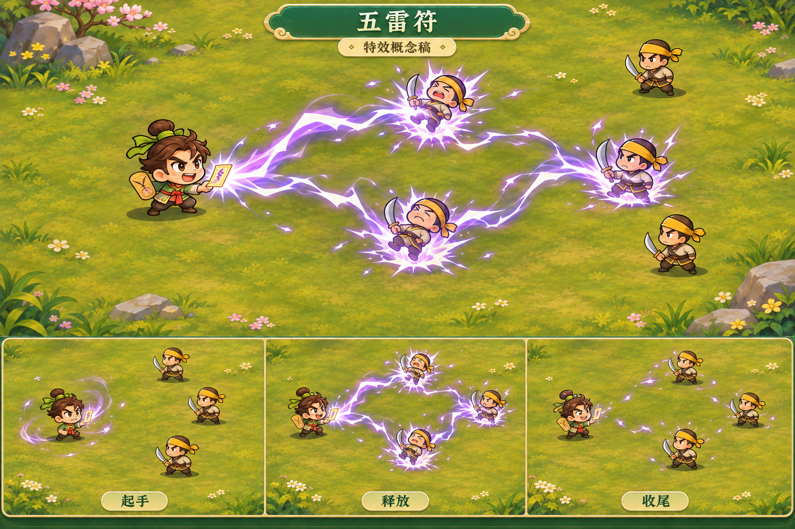

**视觉设计：** 先见符能连起目标，再见有粗细变化的紫白电弧；命中和升阶：每个真实跳链点单独电爆/短电晕；v9.16减半伤害保持

**材料色板：** 雷能：紫色背晕 #754DC2 / 紫白雷芯 #F8ECFF / 青紫短游电 #B39FFF；张角主体另用金白黄符

**动作阶段：** 起手蓄势→主体运动与真实接触→回正与余波衰减

**机制与判定：** 白I默认：连锁落雷 · 最多3个目标 基础射程390／扫角0°／爆散半径0。 红IV追加效果仅在真实触发时表现：连锁落雷 · 最多6个目标

**层级：** 地面预告/痕迹→后侧主体→人物→前侧主体/接触→敌方危险提示；脸部留白

**实现映射：** GameBootstrap实际武器出手/追加段/命中 → combat-effects与原武器trail → 公共主体/轨迹/接触层。

**源码核对：** `assets/scripts/weapons.ts`、`assets/scripts/extra-weapons.ts`、`assets/scripts/GameBootstrap.ts`。

| 品质 | 基础显示伤害 | 间隔秒 | 射程 | 爆散半径 | 实际机制 |
| --- | --- | --- | --- | --- | --- |
| 1 | 23 | 1.25 | 390 | 0 | 连锁落雷 · 最多3个目标 |
| 2 | 31.1 | 1.2 | 400 | 0 | 连锁落雷 · 最多4个目标 |
| 3 | 41.4 | 1.15 | 410 | 0 | 连锁落雷 · 最多5个目标 |
| 4 | 55.2 | 1.1 | 420 | 0 | 连锁落雷 · 最多6个目标 |

**逐项验收：** 先检查主体轮廓与原身份，再按本条真实范围/时钟检查起手、峰值、接触和收尾；范围外无伪命中、暂停不推进、清场无残影，密集叠加仍看清危险。概念透视/夸张退姿不作为判伤或新增控制依据。

### W11-gourd · 吞天葫芦

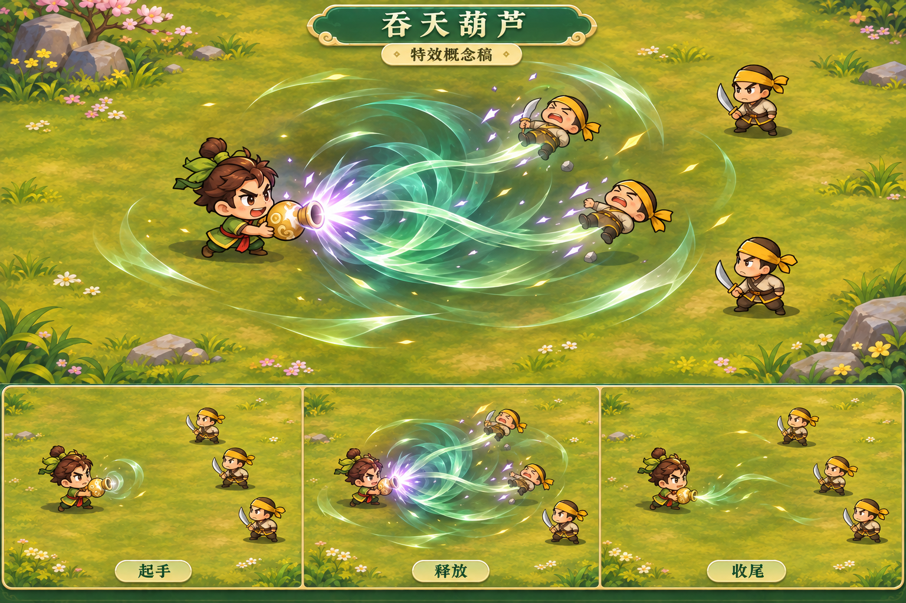

**视觉设计：** 葫芦口旋涡与收束气流，敌人到瓶口的法力带连续向内流；命中和升阶：吸入端有短紫白亮核与碎屑；按原吸附段数/目标上限，不扩大范围

**材料色板：** 金属/实体：细赭金背沿 #997139 / 金白主体 #F4C56D / 象牙白锋面 #FFF5DA；黑白棋/铜印/木器保留实体本色

**动作阶段：** 起手蓄势→主体运动与真实接触→回正与余波衰减

**机制与判定：** 白I默认：6段吸风 · 每段最多6个目标 基础射程240／扫角0°／爆散半径0。 红IV追加效果仅在真实触发时表现：9段吸风 · 每段最多8个目标

**层级：** 地面预告/痕迹→后侧主体→人物→前侧主体/接触→敌方危险提示；脸部留白

**实现映射：** GameBootstrap实际武器出手/追加段/命中 → combat-effects与原武器trail → 公共主体/轨迹/接触层。

**源码核对：** `assets/scripts/weapons.ts`、`assets/scripts/extra-weapons.ts`、`assets/scripts/GameBootstrap.ts`。

| 品质 | 基础显示伤害 | 间隔秒 | 射程 | 爆散半径 | 实际机制 |
| --- | --- | --- | --- | --- | --- |
| 1 | 5 | 1.6 | 240 | 0 | 6段吸风 · 每段最多6个目标 |
| 2 | 6.75 | 1.54 | 250 | 0 | 7段吸风 · 每段最多6个目标 |
| 3 | 9 | 1.47 | 260 | 0 | 8段吸风 · 每段最多7个目标 |
| 4 | 12 | 1.41 | 270 | 0 | 9段吸风 · 每段最多8个目标 |

**逐项验收：** 先检查主体轮廓与原身份，再按本条真实范围/时钟检查起手、峰值、接触和收尾；范围外无伪命中、暂停不推进、清场无残影，密集叠加仍看清危险。概念透视/夸张退姿不作为判伤或新增控制依据。

### W12-twin-swords · 双股剑

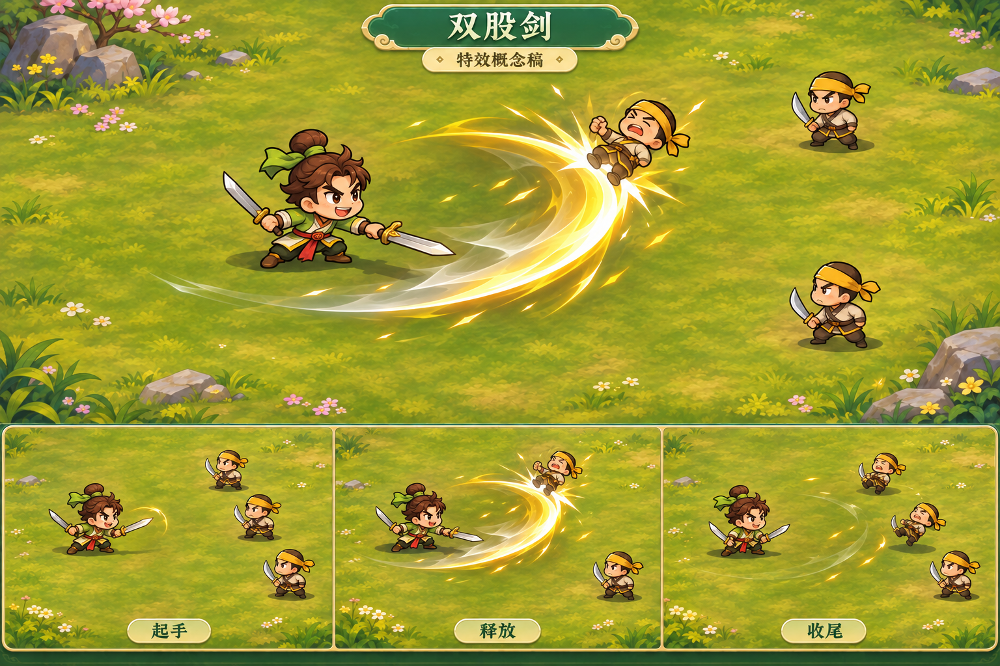

**视觉设计：** 金白交错双刃，一左一右形成清楚的两条运动轨迹；命中和升阶：成长第三击出现完整X形刃闪与短金色剑纹；仍占一个武器槽

**材料色板：** 金属/实体：细赭金背沿 #997139 / 金白主体 #F4C56D / 象牙白锋面 #FFF5DA；黑白棋/铜印/木器保留实体本色

**动作阶段：** 起手蓄势→主体运动与真实接触→回正与余波衰减

**机制与判定：** 白I默认：双剑交替，单轮1D；扫角110°，范围内全体受伤。 基础射程145／扫角110°／爆散半径0。 红IV追加效果仅在真实触发时表现：双剑交替，单轮1D；扫角170°，范围内全体受伤。

**层级：** 地面预告/痕迹→后侧主体→人物→前侧主体/接触→敌方危险提示；脸部留白

**实现映射：** GameBootstrap实际武器出手/追加段/命中 → combat-effects与原武器trail → 公共主体/轨迹/接触层。

**源码核对：** `assets/scripts/weapons.ts`、`assets/scripts/extra-weapons.ts`、`assets/scripts/GameBootstrap.ts`。

| 品质 | 基础显示伤害 | 间隔秒 | 射程 | 爆散半径 | 实际机制 |
| --- | --- | --- | --- | --- | --- |
| 1 | 18 | 0.52 | 145 | 0 | 双剑交替，单轮1D；扫角110°，范围内全体受伤。 |
| 2 | 24.3 | 0.499 | 155 | 0 | 双剑交替，单轮1D；扫角130°，范围内全体受伤。 |
| 3 | 32.4 | 0.478 | 165 | 0 | 双剑交替，单轮1D；扫角150°，范围内全体受伤。 |
| 4 | 43.2 | 0.458 | 175 | 0 | 双剑交替，单轮1D；扫角170°，范围内全体受伤。 |

**逐项验收：** 先检查主体轮廓与原身份，再按本条真实范围/时钟检查起手、峰值、接触和收尾；范围外无伪命中、暂停不推进、清场无残影，密集叠加仍看清危险。概念透视/夸张退姿不作为判伤或新增控制依据。

### W13-guandao · 青龙偃月刀

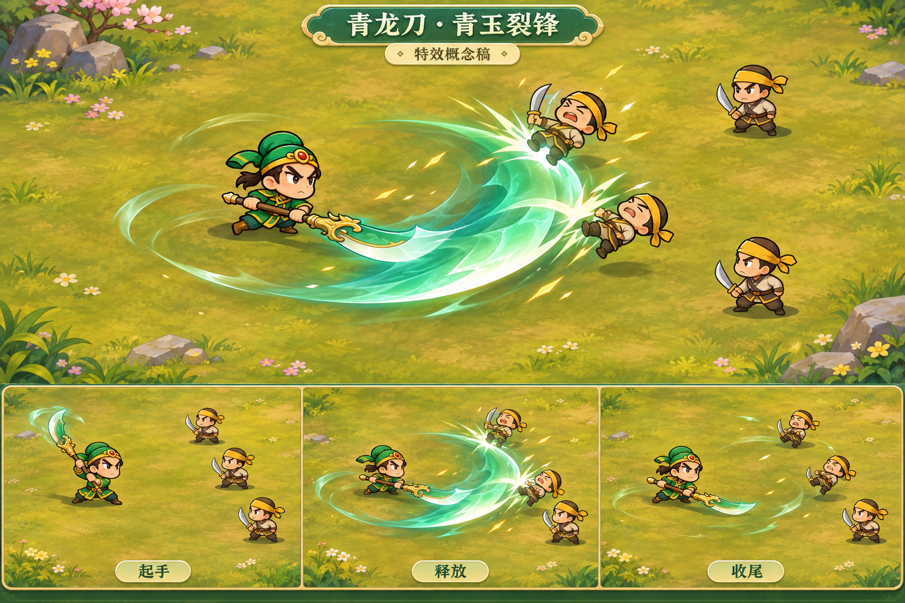

**视觉设计：** 青玉大刃身、暖白刃锋、顺运动方向的宽收尖尾迹；命中和升阶：真实重击/成长第三击带短青龙首与鳞纹散开；不让每次挥刀都常驻一条龙

**材料色板：** 青玉：细暗背沿 #226F6E / 实体玉青 #42CDB2 / 流纹 #A3F2D3 / 白玉锋面 #FFF9DE

**动作阶段：** 起手蓄势→主体运动与真实接触→回正与余波衰减

**机制与判定：** 白I默认：扫角150°；单次宽扫1D。 基础射程200／扫角150°／爆散半径0。 红IV追加效果仅在真实触发时表现：扫角210°；每第3击额外发射0.5D刃波，射程300、同敌一次。

**层级：** 地面预告/痕迹→后侧主体→人物→前侧主体/接触→敌方危险提示；脸部留白

**实现映射：** GameBootstrap实际武器出手/追加段/命中 → combat-effects与原武器trail → 公共主体/轨迹/接触层。

**源码核对：** `assets/scripts/weapons.ts`、`assets/scripts/extra-weapons.ts`、`assets/scripts/GameBootstrap.ts`。

| 品质 | 基础显示伤害 | 间隔秒 | 射程 | 爆散半径 | 实际机制 |
| --- | --- | --- | --- | --- | --- |
| 1 | 50 | 1.15 | 200 | 0 | 扫角150°；单次宽扫1D。 |
| 2 | 67.5 | 1.1 | 210 | 0 | 扫角170°；单次宽扫1D。 |
| 3 | 90 | 1.06 | 220 | 0 | 扫角190°；每第3击额外发射0.35D刃波，射程300、同敌一次。 |
| 4 | 120 | 1.01 | 230 | 0 | 扫角210°；每第3击额外发射0.5D刃波，射程300、同敌一次。 |

**逐项验收：** 先检查主体轮廓与原身份，再按本条真实范围/时钟检查起手、峰值、接触和收尾；范围外无伪命中、暂停不推进、清场无残影，密集叠加仍看清危险。概念透视/夸张退姿不作为判伤或新增控制依据。

### W14-serpent-spear · 丈八蛇矛

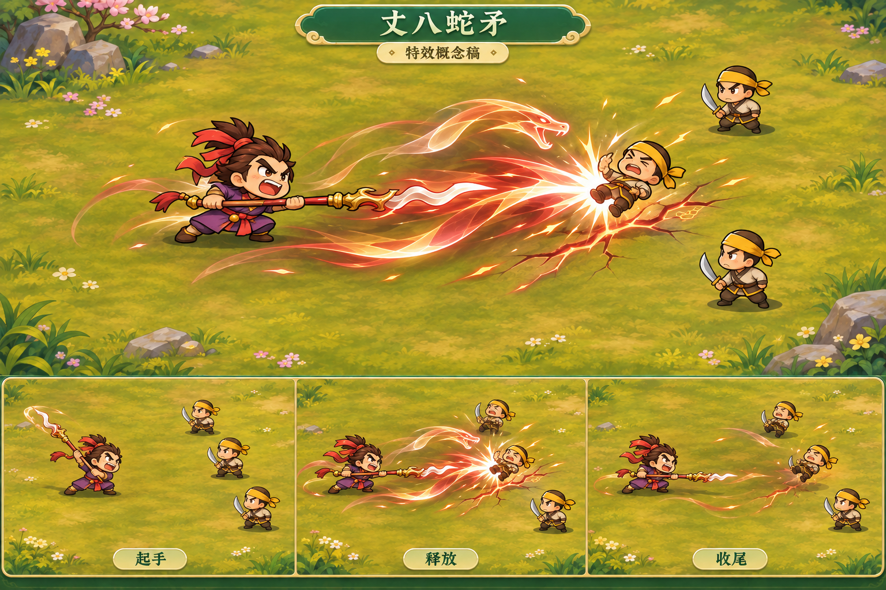

**视觉设计：** 白亮矛尖、朱红/金色窄锋，蛇形气流贴着真正刺击方向；命中和升阶：实际重段附分叉地裂/短蛇纹，命中点厚重，普通快刺保持干净

**材料色板：** 赤锋：暗朱背面 #A53331 / 鲜朱主体 #F25D47 / 金色旋纹 #FFC45E / 白热前锋 #FFF5D2

**动作阶段：** 起手蓄势→主体运动与真实接触→回正与余波衰减

**机制与判定：** 白I默认：长矛单刺1D，窄区内全体命中。 基础射程240／扫角45°／爆散半径0。 红IV追加效果仅在真实触发时表现：每轮双刺，每刺0.75D，两刺分别结算。

**层级：** 地面预告/痕迹→后侧主体→人物→前侧主体/接触→敌方危险提示；脸部留白

**实现映射：** GameBootstrap实际武器出手/追加段/命中 → combat-effects与原武器trail → 公共主体/轨迹/接触层。

**源码核对：** `assets/scripts/weapons.ts`、`assets/scripts/extra-weapons.ts`、`assets/scripts/GameBootstrap.ts`。

| 品质 | 基础显示伤害 | 间隔秒 | 射程 | 爆散半径 | 实际机制 |
| --- | --- | --- | --- | --- | --- |
| 1 | 30 | 0.7 | 240 | 0 | 长矛单刺1D，窄区内全体命中。 |
| 2 | 40.5 | 0.672 | 250 | 0 | 长矛单刺1D，窄区内全体命中。 |
| 3 | 54 | 0.644 | 260 | 0 | 每轮双刺，每刺0.65D，两刺分别结算。 |
| 4 | 72 | 0.616 | 270 | 0 | 每轮双刺，每刺0.75D，两刺分别结算。 |

**逐项验收：** 先检查主体轮廓与原身份，再按本条真实范围/时钟检查起手、峰值、接触和收尾；范围外无伪命中、暂停不推进、清场无残影，密集叠加仍看清危险。概念透视/夸张退姿不作为判伤或新增控制依据。

### W15-halberd · 方天画戟

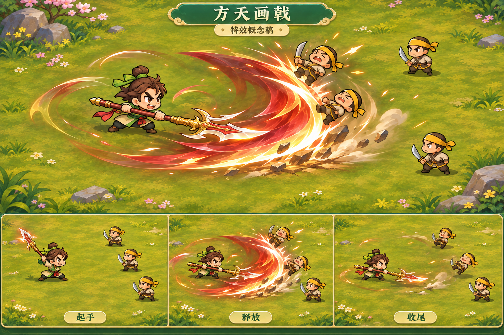

**视觉设计：** 朱红金白的大戟刃影，主刃外有短旋纹；命中和升阶：真实追加段有第二条错位戟光；重击落点有定向碎石和尘浪

**材料色板：** 赤锋：暗朱背面 #A53331 / 鲜朱主体 #F25D47 / 金色旋纹 #FFC45E / 白热前锋 #FFF5D2

**动作阶段：** 起手蓄势→主体运动与真实接触→回正与余波衰减

**机制与判定：** 白I默认：画戟宽扫1D，范围内全体受伤。 基础射程210／扫角160°／爆散半径0。 红IV追加效果仅在真实触发时表现：宽扫1D后追加0.4D追斩；追加不会再生追斩。

**层级：** 地面预告/痕迹→后侧主体→人物→前侧主体/接触→敌方危险提示；脸部留白

**实现映射：** GameBootstrap实际武器出手/追加段/命中 → combat-effects与原武器trail → 公共主体/轨迹/接触层。

**源码核对：** `assets/scripts/weapons.ts`、`assets/scripts/extra-weapons.ts`、`assets/scripts/GameBootstrap.ts`。

| 品质 | 基础显示伤害 | 间隔秒 | 射程 | 爆散半径 | 实际机制 |
| --- | --- | --- | --- | --- | --- |
| 1 | 42 | 1.1 | 210 | 0 | 画戟宽扫1D，范围内全体受伤。 |
| 2 | 56.7 | 1.06 | 220 | 0 | 画戟宽扫1D，范围内全体受伤。 |
| 3 | 75.6 | 1.01 | 230 | 0 | 宽扫1D后追加0.25D追斩；追加不会再生追斩。 |
| 4 | 101 | 0.968 | 240 | 0 | 宽扫1D后追加0.4D追斩；追加不会再生追斩。 |

**逐项验收：** 先检查主体轮廓与原身份，再按本条真实范围/时钟检查起手、峰值、接触和收尾；范围外无伪命中、暂停不推进、清场无残影，密集叠加仍看清危险。概念透视/夸张退姿不作为判伤或新增控制依据。

### W16-silver-spear · 龙胆银枪

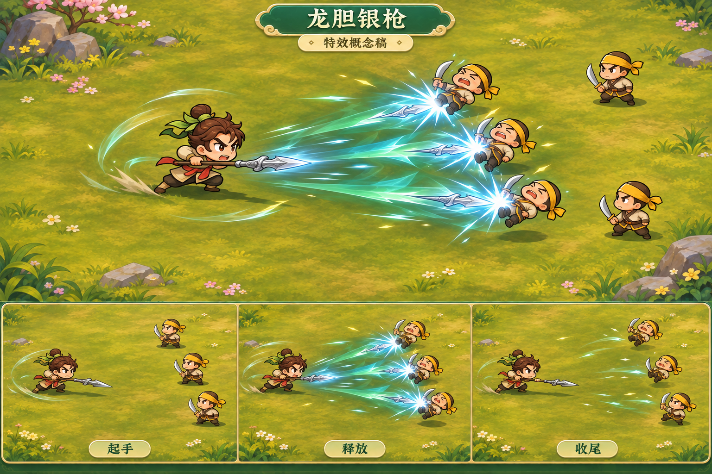

**视觉设计：** 银蓝枪锋、透明青色尖锥和短平行速度纹；命中和升阶：连刺依真实段数逐次点亮，接触用集中白蓝爆点

**材料色板：** 金属/实体：细赭金背沿 #997139 / 金白主体 #F4C56D / 象牙白锋面 #FFF5DA；黑白棋/铜印/木器保留实体本色

**动作阶段：** 起手蓄势→主体运动与真实接触→回正与余波衰减

**机制与判定：** 白I默认：每轮单刺1D。攻击组随攻速压缩，不无限排队。 基础射程220／扫角35°／爆散半径0。 红IV追加效果仅在真实触发时表现：每轮三刺，各0.45D。攻击组随攻速压缩，不无限排队。

**层级：** 地面预告/痕迹→后侧主体→人物→前侧主体/接触→敌方危险提示；脸部留白

**实现映射：** GameBootstrap实际武器出手/追加段/命中 → combat-effects与原武器trail → 公共主体/轨迹/接触层。

**源码核对：** `assets/scripts/weapons.ts`、`assets/scripts/extra-weapons.ts`、`assets/scripts/GameBootstrap.ts`。

| 品质 | 基础显示伤害 | 间隔秒 | 射程 | 爆散半径 | 实际机制 |
| --- | --- | --- | --- | --- | --- |
| 1 | 22 | 0.48 | 220 | 0 | 每轮单刺1D。攻击组随攻速压缩，不无限排队。 |
| 2 | 29.7 | 0.461 | 230 | 0 | 每轮两刺，各0.55D。攻击组随攻速压缩，不无限排队。 |
| 3 | 39.6 | 0.442 | 240 | 0 | 每轮两刺，各0.60D。攻击组随攻速压缩，不无限排队。 |
| 4 | 52.8 | 0.422 | 250 | 0 | 每轮三刺，各0.45D。攻击组随攻速压缩，不无限排队。 |

**逐项验收：** 先检查主体轮廓与原身份，再按本条真实范围/时钟检查起手、峰值、接触和收尾；范围外无伪命中、暂停不推进、清场无残影，密集叠加仍看清危险。概念透视/夸张退姿不作为判伤或新增控制依据。

### W17-qinggang · 青釭剑

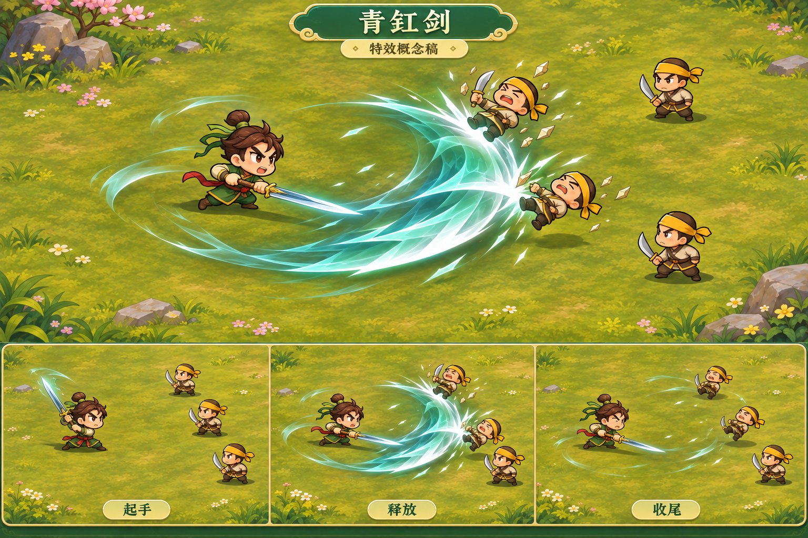

**视觉设计：** 冷青窄锋、较锐利的白色切面；命中和升阶：穿甲感通过碎甲片/尖锐接触形状体现，不额外扣甲或改伤害

**材料色板：** 金属/实体：细赭金背沿 #997139 / 金白主体 #F4C56D / 象牙白锋面 #FFF5DA；黑白棋/铜印/木器保留实体本色

**动作阶段：** 起手蓄势→主体运动与真实接触→回正与余波衰减

**机制与判定：** 白I默认：忽略盾兵减伤的20%；例如40%减伤变为32%。 基础射程155／扫角100°／爆散半径0。 红IV追加效果仅在真实触发时表现：忽略盾兵减伤的50%；例如40%减伤变为20%。

**层级：** 地面预告/痕迹→后侧主体→人物→前侧主体/接触→敌方危险提示；脸部留白

**实现映射：** GameBootstrap实际武器出手/追加段/命中 → combat-effects与原武器trail → 公共主体/轨迹/接触层。

**源码核对：** `assets/scripts/weapons.ts`、`assets/scripts/extra-weapons.ts`、`assets/scripts/GameBootstrap.ts`。

| 品质 | 基础显示伤害 | 间隔秒 | 射程 | 爆散半径 | 实际机制 |
| --- | --- | --- | --- | --- | --- |
| 1 | 26 | 0.58 | 155 | 0 | 忽略盾兵减伤的20%；例如40%减伤变为32%。 |
| 2 | 35.1 | 0.557 | 165 | 0 | 忽略盾兵减伤的30%；例如40%减伤变为28%。 |
| 3 | 46.8 | 0.534 | 175 | 0 | 忽略盾兵减伤的40%；例如40%减伤变为24%。 |
| 4 | 62.4 | 0.51 | 185 | 0 | 忽略盾兵减伤的50%；例如40%减伤变为20%。 |

**逐项验收：** 先检查主体轮廓与原身份，再按本条真实范围/时钟检查起手、峰值、接触和收尾；范围外无伪命中、暂停不推进、清场无残影，密集叠加仍看清危险。概念透视/夸张退姿不作为判伤或新增控制依据。

### W18-yitian · 倚天剑

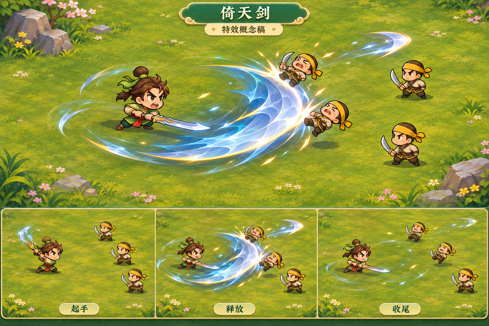

**视觉设计：** 银蓝厚剑气、窄金边，主体端部清晰收尖；命中和升阶：真正追加剑气有独立飞行主体；普通斩与远程追加明显可区分

**材料色板：** 金属/实体：细赭金背沿 #997139 / 金白主体 #F4C56D / 象牙白锋面 #FFF5DA；黑白棋/铜印/木器保留实体本色

**动作阶段：** 起手蓄势→主体运动与真实接触→回正与余波衰减

**机制与判定：** 白I默认：每第4击附加0.3D月牙，射程300；同敌可吃横扫与月牙各一次。 基础射程175／扫角120°／爆散半径0。 红IV追加效果仅在真实触发时表现：每第4击附加0.65D月牙，射程300；同敌可吃横扫与月牙各一次。

**层级：** 地面预告/痕迹→后侧主体→人物→前侧主体/接触→敌方危险提示；脸部留白

**实现映射：** GameBootstrap实际武器出手/追加段/命中 → combat-effects与原武器trail → 公共主体/轨迹/接触层。

**源码核对：** `assets/scripts/weapons.ts`、`assets/scripts/extra-weapons.ts`、`assets/scripts/GameBootstrap.ts`。

| 品质 | 基础显示伤害 | 间隔秒 | 射程 | 爆散半径 | 实际机制 |
| --- | --- | --- | --- | --- | --- |
| 1 | 36 | 0.8 | 175 | 0 | 每第4击附加0.3D月牙，射程300；同敌可吃横扫与月牙各一次。 |
| 2 | 48.6 | 0.768 | 185 | 0 | 每第4击附加0.4D月牙，射程300；同敌可吃横扫与月牙各一次。 |
| 3 | 64.8 | 0.736 | 195 | 0 | 每第4击附加0.5D月牙，射程300；同敌可吃横扫与月牙各一次。 |
| 4 | 86.4 | 0.704 | 205 | 0 | 每第4击附加0.65D月牙，射程300；同敌可吃横扫与月牙各一次。 |

**逐项验收：** 先检查主体轮廓与原身份，再按本条真实范围/时钟检查起手、峰值、接触和收尾；范围外无伪命中、暂停不推进、清场无残影，密集叠加仍看清危险。概念透视/夸张退姿不作为判伤或新增控制依据。

### W19-seven-saber · 七星宝刀

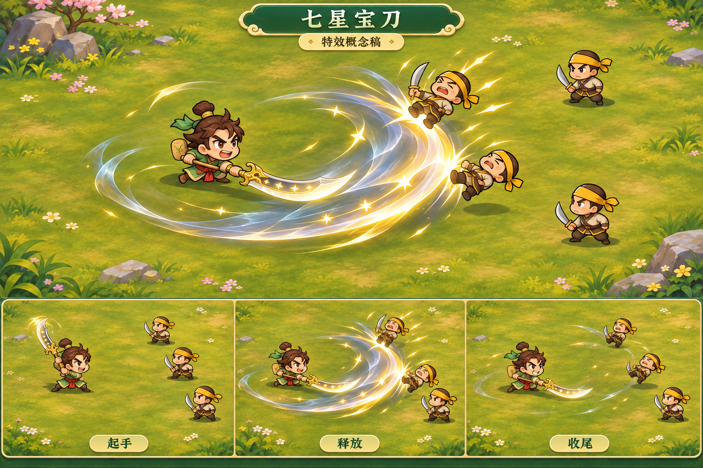

**视觉设计：** 金白刃面内嵌细小星纹，星光沿刀背流动；命中和升阶：第七次等真实触发事件才出现星芒列斩/飞刃，不逐刀满屏撒星

**材料色板：** 金属/实体：细赭金背沿 #997139 / 金白主体 #F4C56D / 象牙白锋面 #FFF5DA；黑白棋/铜印/木器保留实体本色

**动作阶段：** 起手蓄势→主体运动与真实接触→回正与余波衰减

**机制与判定：** 白I默认：每第7击洒出7星，每星0.12D；同敌最多2星。 基础射程145／扫角95°／爆散半径0。 红IV追加效果仅在真实触发时表现：每第7击洒出7星，每星0.25D；同敌最多2星。

**层级：** 地面预告/痕迹→后侧主体→人物→前侧主体/接触→敌方危险提示；脸部留白

**实现映射：** GameBootstrap实际武器出手/追加段/命中 → combat-effects与原武器trail → 公共主体/轨迹/接触层。

**源码核对：** `assets/scripts/weapons.ts`、`assets/scripts/extra-weapons.ts`、`assets/scripts/GameBootstrap.ts`。

| 品质 | 基础显示伤害 | 间隔秒 | 射程 | 爆散半径 | 实际机制 |
| --- | --- | --- | --- | --- | --- |
| 1 | 24 | 0.62 | 145 | 0 | 每第7击洒出7星，每星0.12D；同敌最多2星。 |
| 2 | 32.4 | 0.595 | 155 | 0 | 每第7击洒出7星，每星0.16D；同敌最多2星。 |
| 3 | 43.2 | 0.57 | 165 | 0 | 每第7击洒出7星，每星0.2D；同敌最多2星。 |
| 4 | 57.6 | 0.546 | 175 | 0 | 每第7击洒出7星，每星0.25D；同敌最多2星。 |

**逐项验收：** 先检查主体轮廓与原身份，再按本条真实范围/时钟检查起手、峰值、接触和收尾；范围外无伪命中、暂停不推进、清场无残影，密集叠加仍看清危险。概念透视/夸张退姿不作为判伤或新增控制依据。

### W20-ancient-saber · 古锭刀

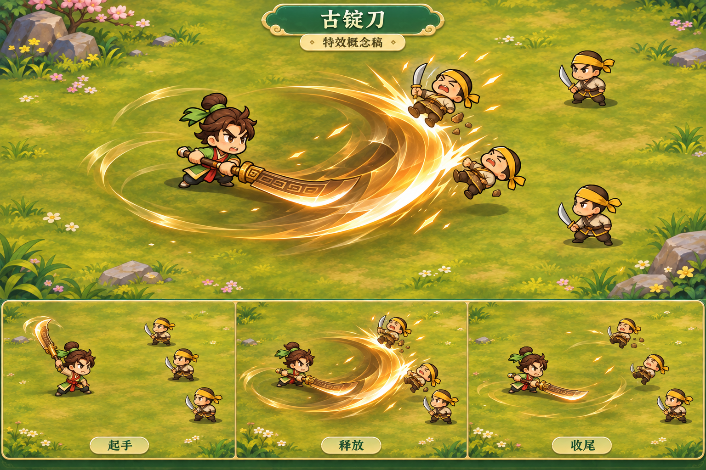

**视觉设计：** 铜金实体刀光、橙白短刃锋；命中和升阶：首击/重击使用短铜甲破裂反馈，刀面质感偏沉稳

**材料色板：** 金属/实体：细赭金背沿 #997139 / 金白主体 #F4C56D / 象牙白锋面 #FFF5DA；黑白棋/铜印/木器保留实体本色

**动作阶段：** 起手蓄势→主体运动与真实接触→回正与余波衰减

**机制与判定：** 白I默认：对同目标首击额外15%；同敌每2秒才能再次触发。 基础射程175／扫角150°／爆散半径0。 红IV追加效果仅在真实触发时表现：对同目标首击额外30%；同敌每2秒才能再次触发。

**层级：** 地面预告/痕迹→后侧主体→人物→前侧主体/接触→敌方危险提示；脸部留白

**实现映射：** GameBootstrap实际武器出手/追加段/命中 → combat-effects与原武器trail → 公共主体/轨迹/接触层。

**源码核对：** `assets/scripts/weapons.ts`、`assets/scripts/extra-weapons.ts`、`assets/scripts/GameBootstrap.ts`。

| 品质 | 基础显示伤害 | 间隔秒 | 射程 | 爆散半径 | 实际机制 |
| --- | --- | --- | --- | --- | --- |
| 1 | 46 | 1.05 | 175 | 0 | 对同目标首击额外15%；同敌每2秒才能再次触发。 |
| 2 | 62.1 | 1.01 | 185 | 0 | 对同目标首击额外20%；同敌每2秒才能再次触发。 |
| 3 | 82.8 | 0.966 | 195 | 0 | 对同目标首击额外25%；同敌每2秒才能再次触发。 |
| 4 | 110 | 0.924 | 205 | 0 | 对同目标首击额外30%；同敌每2秒才能再次触发。 |

**逐项验收：** 先检查主体轮廓与原身份，再按本条真实范围/时钟检查起手、峰值、接触和收尾；范围外无伪命中、暂停不推进、清场无残影，密集叠加仍看清危险。概念透视/夸张退姿不作为判伤或新增控制依据。

### W21-twin-halberds · 双铁戟

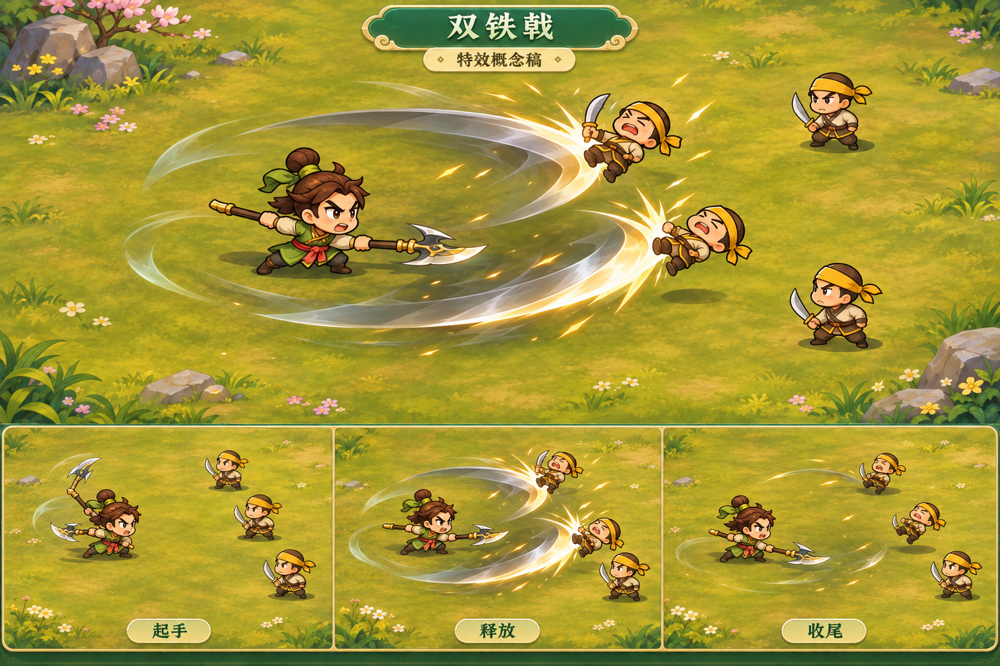

**视觉设计：** 两道有错位的铁灰金白刃光，方向与双击对应；命中和升阶：连段逐次有单独接触，尾部短而有金属重量

**材料色板：** 金属/实体：细赭金背沿 #997139 / 金白主体 #F4C56D / 象牙白锋面 #FFF5DA；黑白棋/铜印/木器保留实体本色

**动作阶段：** 起手蓄势→主体运动与真实接触→回正与余波衰减

**机制与判定：** 白I默认：每轮双扫，每扫0.55D；两扫各命中范围内全部敌人。 基础射程150／扫角130°／爆散半径0。 红IV追加效果仅在真实触发时表现：每轮双扫，每扫0.7D；两扫各命中范围内全部敌人。

**层级：** 地面预告/痕迹→后侧主体→人物→前侧主体/接触→敌方危险提示；脸部留白

**实现映射：** GameBootstrap实际武器出手/追加段/命中 → combat-effects与原武器trail → 公共主体/轨迹/接触层。

**源码核对：** `assets/scripts/weapons.ts`、`assets/scripts/extra-weapons.ts`、`assets/scripts/GameBootstrap.ts`。

| 品质 | 基础显示伤害 | 间隔秒 | 射程 | 爆散半径 | 实际机制 |
| --- | --- | --- | --- | --- | --- |
| 1 | 21 | 0.56 | 150 | 0 | 每轮双扫，每扫0.55D；两扫各命中范围内全部敌人。 |
| 2 | 28.4 | 0.538 | 160 | 0 | 每轮双扫，每扫0.6D；两扫各命中范围内全部敌人。 |
| 3 | 37.8 | 0.515 | 170 | 0 | 每轮双扫，每扫0.65D；两扫各命中范围内全部敌人。 |
| 4 | 50.4 | 0.493 | 180 | 0 | 每轮双扫，每扫0.7D；两扫各命中范围内全部敌人。 |

**逐项验收：** 先检查主体轮廓与原身份，再按本条真实范围/时钟检查起手、峰值、接触和收尾；范围外无伪命中、暂停不推进、清场无残影，密集叠加仍看清危险。概念透视/夸张退姿不作为判伤或新增控制依据。

### W22-trident · 三尖刀

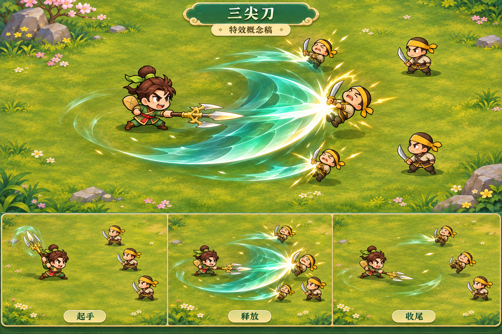

**视觉设计：** 三叉锐锋合成一个清楚的主体，背沿青金；命中和升阶：品质触发侧锋时再显示真实侧向追加，主尖接触最亮

**材料色板：** 金属/实体：细赭金背沿 #997139 / 金白主体 #F4C56D / 象牙白锋面 #FFF5DA；黑白棋/铜印/木器保留实体本色

**动作阶段：** 起手蓄势→主体运动与真实接触→回正与余波衰减

**机制与判定：** 白I默认：三尖刀单轮宽扫1D。 基础射程195／扫角135°／爆散半径0。 红IV追加效果仅在真实触发时表现：宽扫1D，另发两片0.3D侧刃；同敌最多吃一片侧刃。

**层级：** 地面预告/痕迹→后侧主体→人物→前侧主体/接触→敌方危险提示；脸部留白

**实现映射：** GameBootstrap实际武器出手/追加段/命中 → combat-effects与原武器trail → 公共主体/轨迹/接触层。

**源码核对：** `assets/scripts/weapons.ts`、`assets/scripts/extra-weapons.ts`、`assets/scripts/GameBootstrap.ts`。

| 品质 | 基础显示伤害 | 间隔秒 | 射程 | 爆散半径 | 实际机制 |
| --- | --- | --- | --- | --- | --- |
| 1 | 34 | 0.85 | 195 | 0 | 三尖刀单轮宽扫1D。 |
| 2 | 45.9 | 0.816 | 205 | 0 | 三尖刀单轮宽扫1D。 |
| 3 | 61.2 | 0.782 | 215 | 0 | 宽扫1D，另发两片0.2D侧刃；同敌最多吃一片侧刃。 |
| 4 | 81.6 | 0.748 | 225 | 0 | 宽扫1D，另发两片0.3D侧刃；同敌最多吃一片侧刃。 |

**逐项验收：** 先检查主体轮廓与原身份，再按本条真实范围/时钟检查起手、峰值、接触和收尾；范围外无伪命中、暂停不推进、清场无残影，密集叠加仍看清危险。概念透视/夸张退姿不作为判伤或新增控制依据。

### W23-caltrops · 铁蒺藜

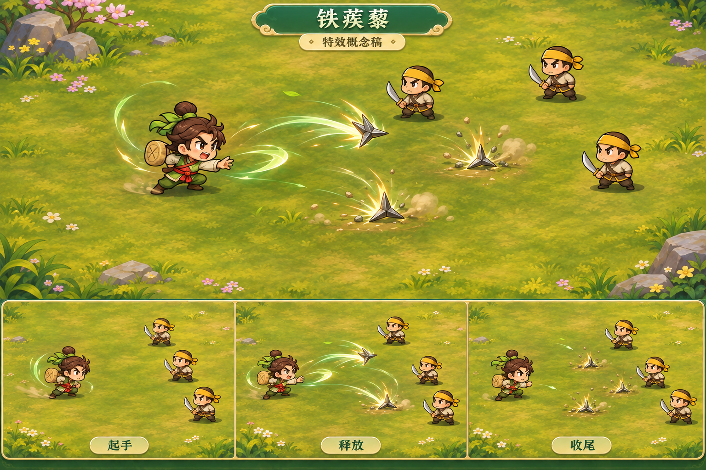

**视觉设计：** 小型实体棱角、落地翻滚、轻尘；命中和升阶：地面布置稀疏可辨，不给整片区域铺厚亮底；触发后短金属接触

**材料色板：** 金属/实体：细赭金背沿 #997139 / 金白主体 #F4C56D / 象牙白锋面 #FFF5DA；黑白棋/铜印/木器保留实体本色

**动作阶段：** 起手蓄势→主体运动与真实接触→回正与余波衰减

**机制与判定：** 白I默认：自动铺设3秒陷阱，每武器最多3枚、全场12枚；同敌每武器每秒至多1D。 基础射程260／扫角0°／爆散半径35。 红IV追加效果仅在真实触发时表现：自动铺设3秒陷阱，每武器最多6枚、全场12枚；同敌每武器每秒至多1D。

**层级：** 地面预告/痕迹→后侧主体→人物→前侧主体/接触→敌方危险提示；脸部留白

**实现映射：** GameBootstrap实际武器出手/追加段/命中 → combat-effects与原武器trail → 公共主体/轨迹/接触层。

**源码核对：** `assets/scripts/weapons.ts`、`assets/scripts/extra-weapons.ts`、`assets/scripts/GameBootstrap.ts`。

| 品质 | 基础显示伤害 | 间隔秒 | 射程 | 爆散半径 | 实际机制 |
| --- | --- | --- | --- | --- | --- |
| 1 | 10 | 1.2 | 260 | 35 | 自动铺设3秒陷阱，每武器最多3枚、全场12枚；同敌每武器每秒至多1D。 |
| 2 | 13.5 | 1.15 | 270 | 35 | 自动铺设3秒陷阱，每武器最多4枚、全场12枚；同敌每武器每秒至多1D。 |
| 3 | 18 | 1.1 | 280 | 35 | 自动铺设3秒陷阱，每武器最多5枚、全场12枚；同敌每武器每秒至多1D。 |
| 4 | 24 | 1.06 | 290 | 35 | 自动铺设3秒陷阱，每武器最多6枚、全场12枚；同敌每武器每秒至多1D。 |

**逐项验收：** 先检查主体轮廓与原身份，再按本条真实范围/时钟检查起手、峰值、接触和收尾；范围外无伪命中、暂停不推进、清场无残影，密集叠加仍看清危险。概念透视/夸张退姿不作为判伤或新增控制依据。

### W24-repeater · 诸葛连弩

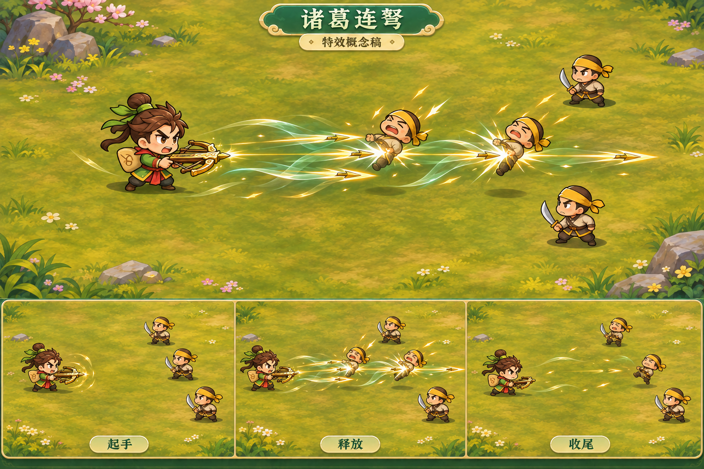

**视觉设计：** 细长箭体、金白箭尖、同批连射形成有节拍的掠线；命中和升阶：穿透后的箭尖继续清楚可见，连发声与真实释放同步

**材料色板：** 金属/实体：细赭金背沿 #997139 / 金白主体 #F4C56D / 象牙白锋面 #FFF5DA；黑白棋/铜印/木器保留实体本色

**动作阶段：** 起手蓄势→主体运动与真实接触→回正与余波衰减

**机制与判定：** 白I默认：每轮3矢，同敌最多2矢；穿透1人，组内间隔随攻速压缩。 基础射程430／扫角0°／爆散半径0。 红IV追加效果仅在真实触发时表现：每轮6矢，同敌最多3矢；穿透2人，组内间隔随攻速压缩。

**层级：** 地面预告/痕迹→后侧主体→人物→前侧主体/接触→敌方危险提示；脸部留白

**实现映射：** GameBootstrap实际武器出手/追加段/命中 → combat-effects与原武器trail → 公共主体/轨迹/接触层。

**源码核对：** `assets/scripts/weapons.ts`、`assets/scripts/extra-weapons.ts`、`assets/scripts/GameBootstrap.ts`。

| 品质 | 基础显示伤害 | 间隔秒 | 射程 | 爆散半径 | 实际机制 |
| --- | --- | --- | --- | --- | --- |
| 1 | 8 | 0.65 | 430 | 0 | 每轮3矢，同敌最多2矢；穿透1人，组内间隔随攻速压缩。 |
| 2 | 10.8 | 0.624 | 440 | 0 | 每轮4矢，同敌最多2矢；穿透2人，组内间隔随攻速压缩。 |
| 3 | 14.4 | 0.598 | 450 | 0 | 每轮5矢，同敌最多3矢；穿透2人，组内间隔随攻速压缩。 |
| 4 | 19.2 | 0.572 | 460 | 0 | 每轮6矢，同敌最多3矢；穿透2人，组内间隔随攻速压缩。 |

**逐项验收：** 先检查主体轮廓与原身份，再按本条真实范围/时钟检查起手、峰值、接触和收尾；范围外无伪命中、暂停不推进、清场无残影，密集叠加仍看清危险。概念透视/夸张退姿不作为判伤或新增控制依据。

### W25-phoenix-bow · 麒麟弓

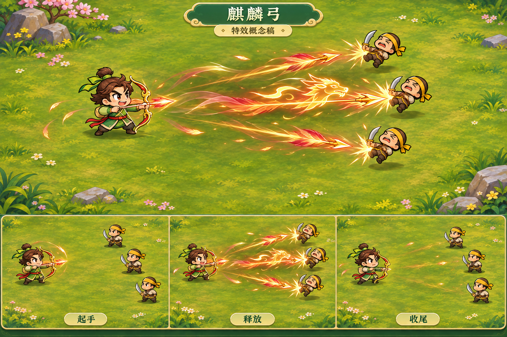

**视觉设计：** 红金羽箭、火纹包裹箭头、细而长的羽流；命中和升阶：真正分裂/穿透按机制展示，高阶箭头短暂呈麒麟纹光影

**材料色板：** 火焰：低亮赤底 #8F3029 / 橙红主体 #EF5C2E / 金橙翻焰 #FFB63C / 短白热芯 #FFF6CB

**动作阶段：** 起手蓄势→主体运动与真实接触→回正与余波衰减

**机制与判定：** 白I默认：1箭扇射，同敌每轮最多1箭；高阶增加覆盖。 基础射程540／扫角0°／爆散半径0。 红IV追加效果仅在真实触发时表现：3箭扇射，同敌每轮最多1箭；暴击率额外+3个百分点。

**层级：** 地面预告/痕迹→后侧主体→人物→前侧主体/接触→敌方危险提示；脸部留白

**实现映射：** GameBootstrap实际武器出手/追加段/命中 → combat-effects与原武器trail → 公共主体/轨迹/接触层。

**源码核对：** `assets/scripts/weapons.ts`、`assets/scripts/extra-weapons.ts`、`assets/scripts/GameBootstrap.ts`。

| 品质 | 基础显示伤害 | 间隔秒 | 射程 | 爆散半径 | 实际机制 |
| --- | --- | --- | --- | --- | --- |
| 1 | 30 | 0.95 | 540 | 0 | 1箭扇射，同敌每轮最多1箭；高阶增加覆盖。 |
| 2 | 40.5 | 0.912 | 550 | 0 | 1箭扇射，同敌每轮最多1箭；暴击率额外+3个百分点。 |
| 3 | 54 | 0.874 | 560 | 0 | 2箭扇射，同敌每轮最多1箭；暴击率额外+3个百分点。 |
| 4 | 72 | 0.836 | 570 | 0 | 3箭扇射，同敌每轮最多1箭；暴击率额外+3个百分点。 |

**逐项验收：** 先检查主体轮廓与原身份，再按本条真实范围/时钟检查起手、峰值、接触和收尾；范围外无伪命中、暂停不推进、清场无残影，密集叠加仍看清危险。概念透视/夸张退姿不作为判伤或新增控制依据。

### W26-heavy-crossbow · 贯石弩

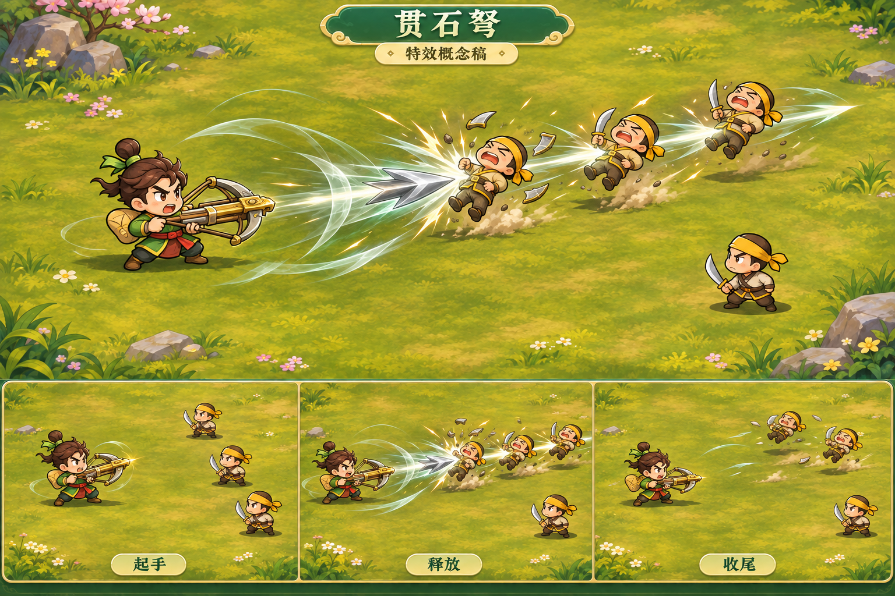

**视觉设计：** 粗重弩箭、银白硬芯、明显的近箭头压缩气流；命中和升阶：击中重尘/碎甲，视觉强调贯穿方向，不变成火箭爆炸

**材料色板：** 火焰：低亮赤底 #8F3029 / 橙红主体 #EF5C2E / 金橙翻焰 #FFB63C / 短白热芯 #FFF6CB

**动作阶段：** 起手蓄势→主体运动与真实接触→回正与余波衰减

**机制与判定：** 白I默认：单矢最多穿过3名敌人；首敌1D，后续各0.85D。 基础射程650／扫角0°／爆散半径0。 红IV追加效果仅在真实触发时表现：单矢最多穿过6名敌人；首敌1D，后续各0.85D。

**层级：** 地面预告/痕迹→后侧主体→人物→前侧主体/接触→敌方危险提示；脸部留白

**实现映射：** GameBootstrap实际武器出手/追加段/命中 → combat-effects与原武器trail → 公共主体/轨迹/接触层。

**源码核对：** `assets/scripts/weapons.ts`、`assets/scripts/extra-weapons.ts`、`assets/scripts/GameBootstrap.ts`。

| 品质 | 基础显示伤害 | 间隔秒 | 射程 | 爆散半径 | 实际机制 |
| --- | --- | --- | --- | --- | --- |
| 1 | 55 | 1.6 | 650 | 0 | 单矢最多穿过3名敌人；首敌1D，后续各0.85D。 |
| 2 | 74.2 | 1.54 | 660 | 0 | 单矢最多穿过4名敌人；首敌1D，后续各0.85D。 |
| 3 | 99 | 1.47 | 670 | 0 | 单矢最多穿过5名敌人；首敌1D，后续各0.85D。 |
| 4 | 132 | 1.41 | 680 | 0 | 单矢最多穿过6名敌人；首敌1D，后续各0.85D。 |

**逐项验收：** 先检查主体轮廓与原身份，再按本条真实范围/时钟检查起手、峰值、接触和收尾；范围外无伪命中、暂停不推进、清场无残影，密集叠加仍看清危险。概念透视/夸张退姿不作为判伤或新增控制依据。

### W27-hand-halberd · 手戟

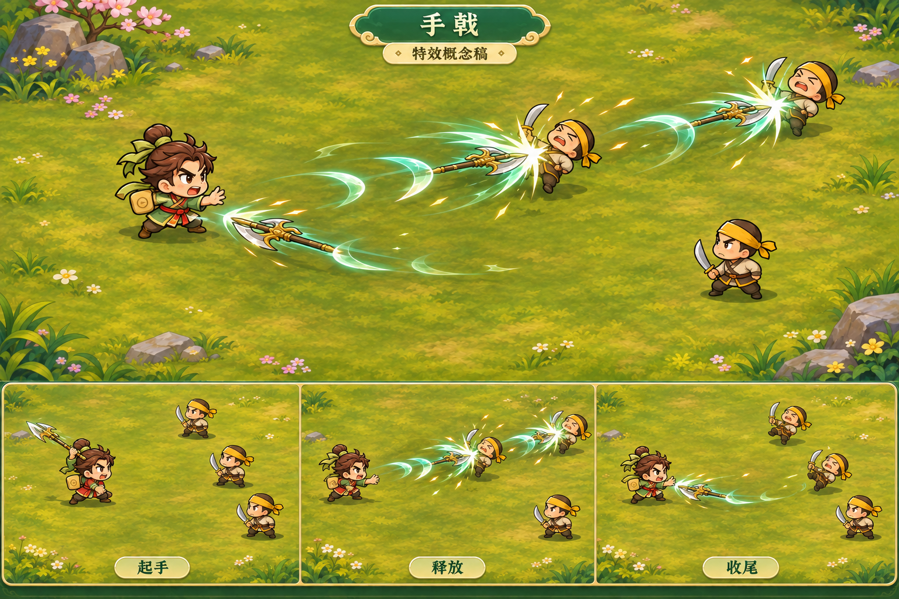

**视觉设计：** 实体戟身旋转，青白弧尾短而分段；命中和升阶：返回路径与实际回收一致，真实两次接触分别反馈

**材料色板：** 金属/实体：细赭金背沿 #997139 / 金白主体 #F4C56D / 象牙白锋面 #FFF5DA；黑白棋/铜印/木器保留实体本色

**动作阶段：** 起手蓄势→主体运动与真实接触→回正与余波衰减

**机制与判定：** 白I默认：飞出与回程各0.55D，同敌每程一次；回程沿真实路径。 基础射程340／扫角0°／爆散半径0。 红IV追加效果仅在真实触发时表现：飞出与回程各0.7D，同敌每程一次；回程沿真实路径。

**层级：** 地面预告/痕迹→后侧主体→人物→前侧主体/接触→敌方危险提示；脸部留白

**实现映射：** GameBootstrap实际武器出手/追加段/命中 → combat-effects与原武器trail → 公共主体/轨迹/接触层。

**源码核对：** `assets/scripts/weapons.ts`、`assets/scripts/extra-weapons.ts`、`assets/scripts/GameBootstrap.ts`。

| 品质 | 基础显示伤害 | 间隔秒 | 射程 | 爆散半径 | 实际机制 |
| --- | --- | --- | --- | --- | --- |
| 1 | 22 | 0.62 | 340 | 0 | 飞出与回程各0.55D，同敌每程一次；回程沿真实路径。 |
| 2 | 29.7 | 0.595 | 350 | 0 | 飞出与回程各0.6D，同敌每程一次；回程沿真实路径。 |
| 3 | 39.6 | 0.57 | 360 | 0 | 飞出与回程各0.65D，同敌每程一次；回程沿真实路径。 |
| 4 | 52.8 | 0.546 | 370 | 0 | 飞出与回程各0.7D，同敌每程一次；回程沿真实路径。 |

**逐项验收：** 先检查主体轮廓与原身份，再按本条真实范围/时钟检查起手、峰值、接触和收尾；范围外无伪命中、暂停不推进、清场无残影，密集叠加仍看清危险。概念透视/夸张退姿不作为判伤或新增控制依据。

### W28-chain-hook · 锁链钩

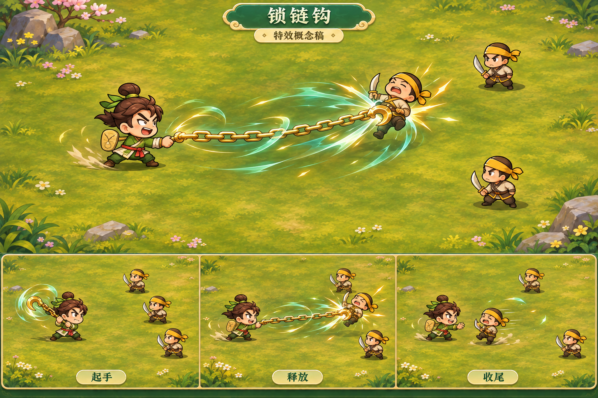

**视觉设计：** 钩头清楚、链条分节，有张力的窄拖带；命中和升阶：拐向与拉扯读得到钩头位置；接触用金属顿点，不用粗光束遮链

**材料色板：** 金属/实体：细赭金背沿 #997139 / 金白主体 #F4C56D / 象牙白锋面 #FFF5DA；黑白棋/铜印/木器保留实体本色

**动作阶段：** 起手蓄势→主体运动与真实接触→回正与余波衰减

**机制与判定：** 白I默认：最多连1名敌人，拉近90；距离90内不拉，Boss只受6%拉力。 基础射程320／扫角0°／爆散半径0。 红IV追加效果仅在真实触发时表现：最多连4名敌人，拉近135；距离90内不拉，Boss只受6%拉力。

**层级：** 地面预告/痕迹→后侧主体→人物→前侧主体/接触→敌方危险提示；脸部留白

**实现映射：** GameBootstrap实际武器出手/追加段/命中 → combat-effects与原武器trail → 公共主体/轨迹/接触层。

**源码核对：** `assets/scripts/weapons.ts`、`assets/scripts/extra-weapons.ts`、`assets/scripts/GameBootstrap.ts`。

| 品质 | 基础显示伤害 | 间隔秒 | 射程 | 爆散半径 | 实际机制 |
| --- | --- | --- | --- | --- | --- |
| 1 | 20 | 0.9 | 320 | 0 | 最多连1名敌人，拉近90；距离90内不拉，Boss只受6%拉力。 |
| 2 | 27 | 0.864 | 330 | 0 | 最多连2名敌人，拉近105；距离90内不拉，Boss只受6%拉力。 |
| 3 | 36 | 0.828 | 340 | 0 | 最多连3名敌人，拉近120；距离90内不拉，Boss只受6%拉力。 |
| 4 | 48 | 0.792 | 350 | 0 | 最多连4名敌人，拉近135；距离90内不拉，Boss只受6%拉力。 |

**逐项验收：** 先检查主体轮廓与原身份，再按本条真实范围/时钟检查起手、峰值、接触和收尾；范围外无伪命中、暂停不推进、清场无残影，密集叠加仍看清危险。概念透视/夸张退姿不作为判伤或新增控制依据。

### W29-oil-jar · 火油壶

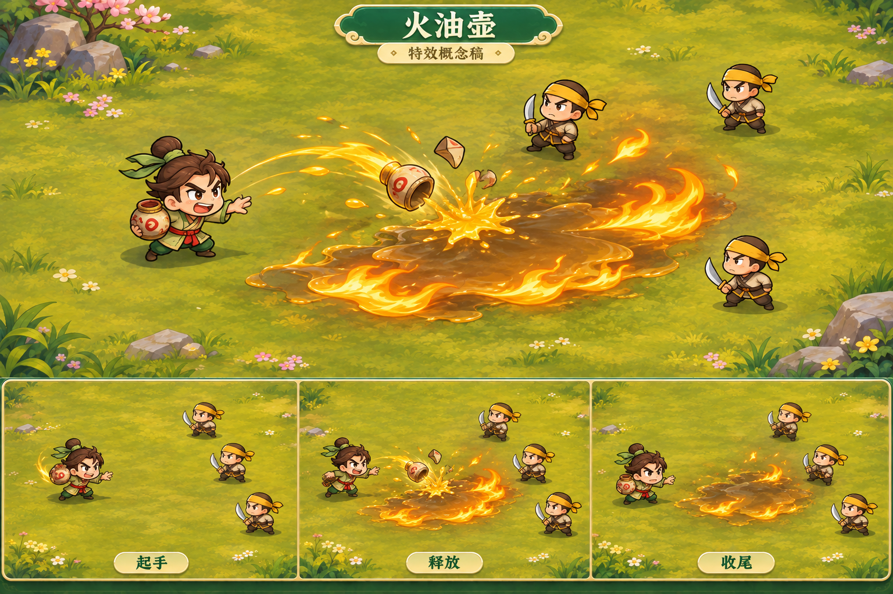

**视觉设计：** 瓶体带液体晃动感，破裂有飞散油滴和小火芯；命中和升阶：油迹先铺地、火焰在其上流动，中心低、边缘卷；持续反馈按真实tick

**材料色板：** 火焰：低亮赤底 #8F3029 / 橙红主体 #EF5C2E / 金橙翻焰 #FFB63C / 短白热芯 #FFF6CB

**动作阶段：** 起手蓄势→主体运动与真实接触→回正与余波衰减

**机制与判定：** 白I默认：火场1.2秒，每0.5秒0.4D；全队同敌每0.5秒最多2次油火，六壶共享上限。 基础射程360／扫角0°／爆散半径85。 红IV追加效果仅在真实触发时表现：火场1.2秒，每0.5秒0.4D；全队同敌每0.5秒最多2次油火，六壶共享上限。

**层级：** 地面预告/痕迹→后侧主体→人物→前侧主体/接触→敌方危险提示；脸部留白

**实现映射：** GameBootstrap实际武器出手/追加段/命中 → combat-effects与原武器trail → 公共主体/轨迹/接触层。

**源码核对：** `assets/scripts/weapons.ts`、`assets/scripts/extra-weapons.ts`、`assets/scripts/GameBootstrap.ts`。

| 品质 | 基础显示伤害 | 间隔秒 | 射程 | 爆散半径 | 实际机制 |
| --- | --- | --- | --- | --- | --- |
| 1 | 18 | 1.8 | 360 | 85 | 火场1.2秒，每0.5秒0.4D；全队同敌每0.5秒最多2次油火，六壶共享上限。 |
| 2 | 24.3 | 1.73 | 370 | 95 | 火场1.2秒，每0.5秒0.4D；全队同敌每0.5秒最多2次油火，六壶共享上限。 |
| 3 | 32.4 | 1.66 | 380 | 105 | 火场1.2秒，每0.5秒0.4D；全队同敌每0.5秒最多2次油火，六壶共享上限。 |
| 4 | 43.2 | 1.58 | 390 | 115 | 火场1.2秒，每0.5秒0.4D；全队同敌每0.5秒最多2次油火，六壶共享上限。 |

**逐项验收：** 先检查主体轮廓与原身份，再按本条真实范围/时钟检查起手、峰值、接触和收尾；范围外无伪命中、暂停不推进、清场无残影，密集叠加仍看清危险。概念透视/夸张退姿不作为判伤或新增控制依据。

### W30-thunder-bomb · 震天雷

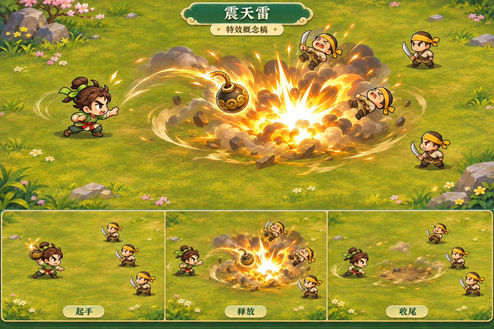

**视觉设计：** 厚重圆雷、引线噼啪、短灰烟；命中和升阶：锐利白芯＋橙金翻焰＋稍重的碎石尘浪，与爆竹的碎纸区分

**材料色板：** 火焰：低亮赤底 #8F3029 / 橙红主体 #EF5C2E / 金橙翻焰 #FFB63C / 短白热芯 #FFF6CB

**动作阶段：** 起手蓄势→主体运动与真实接触→回正与余波衰减

**机制与判定：** 白I默认：直击与爆炸共享一次命中；外圈默认55%伤害，可受道具改变；不再生子炸弹。 基础射程400／扫角0°／爆散半径115。 红IV追加效果仅在真实触发时表现：直击与爆炸共享一次命中；外圈默认55%伤害，可受道具改变；不再生子炸弹。

**层级：** 地面预告/痕迹→后侧主体→人物→前侧主体/接触→敌方危险提示；脸部留白

**实现映射：** GameBootstrap实际武器出手/追加段/命中 → combat-effects与原武器trail → 公共主体/轨迹/接触层。

**源码核对：** `assets/scripts/weapons.ts`、`assets/scripts/extra-weapons.ts`、`assets/scripts/GameBootstrap.ts`。

| 品质 | 基础显示伤害 | 间隔秒 | 射程 | 爆散半径 | 实际机制 |
| --- | --- | --- | --- | --- | --- |
| 1 | 60 | 2.1 | 400 | 115 | 直击与爆炸共享一次命中；外圈默认55%伤害，可受道具改变；不再生子炸弹。 |
| 2 | 81 | 2.02 | 410 | 130 | 直击与爆炸共享一次命中；外圈默认55%伤害，可受道具改变；不再生子炸弹。 |
| 3 | 108 | 1.93 | 420 | 145 | 直击与爆炸共享一次命中；外圈默认55%伤害，可受道具改变；不再生子炸弹。 |
| 4 | 144 | 1.85 | 430 | 165 | 直击与爆炸共享一次命中；外圈默认55%伤害，可受道具改变；不再生子炸弹。 |

**逐项验收：** 先检查主体轮廓与原身份，再按本条真实范围/时钟检查起手、峰值、接触和收尾；范围外无伪命中、暂停不推进、清场无残影，密集叠加仍看清危险。概念透视/夸张退姿不作为判伤或新增控制依据。

### W31-feather-fan · 白羽扇

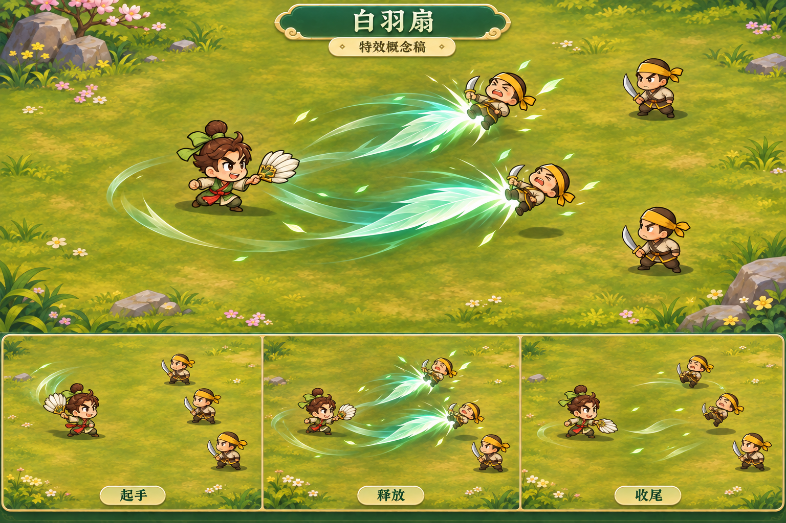

**视觉设计：** 青白风刃，透明玉色主面与弯曲收尖尾流；命中和升阶：命中为薄风切与叶状碎光；实际多刃按真实弹数显示

**材料色板：** 金属/实体：细赭金背沿 #997139 / 金白主体 #F4C56D / 象牙白锋面 #FFF5DA；黑白棋/铜印/木器保留实体本色

**动作阶段：** 起手蓄势→主体运动与真实接触→回正与余波衰减

**机制与判定：** 白I默认：2片风羽，同敌每轮1次；增加扇面覆盖。 基础射程380／扫角0°／爆散半径0。 红IV追加效果仅在真实触发时表现：5片风羽，同敌每轮1次；击退额外+25%。

**层级：** 地面预告/痕迹→后侧主体→人物→前侧主体/接触→敌方危险提示；脸部留白

**实现映射：** GameBootstrap实际武器出手/追加段/命中 → combat-effects与原武器trail → 公共主体/轨迹/接触层。

**源码核对：** `assets/scripts/weapons.ts`、`assets/scripts/extra-weapons.ts`、`assets/scripts/GameBootstrap.ts`。

| 品质 | 基础显示伤害 | 间隔秒 | 射程 | 爆散半径 | 实际机制 |
| --- | --- | --- | --- | --- | --- |
| 1 | 18 | 0.75 | 380 | 0 | 2片风羽，同敌每轮1次；增加扇面覆盖。 |
| 2 | 24.3 | 0.72 | 390 | 0 | 3片风羽，同敌每轮1次；增加扇面覆盖。 |
| 3 | 32.4 | 0.69 | 400 | 0 | 3片风羽，同敌每轮1次；击退额外+15%。 |
| 4 | 43.2 | 0.66 | 410 | 0 | 5片风羽，同敌每轮1次；击退额外+25%。 |

**逐项验收：** 先检查主体轮廓与原身份，再按本条真实范围/时钟检查起手、峰值、接触和收尾；范围外无伪命中、暂停不推进、清场无残影，密集叠加仍看清危险。概念透视/夸张退姿不作为判伤或新增控制依据。

### W32-taiping-book · 太平要术

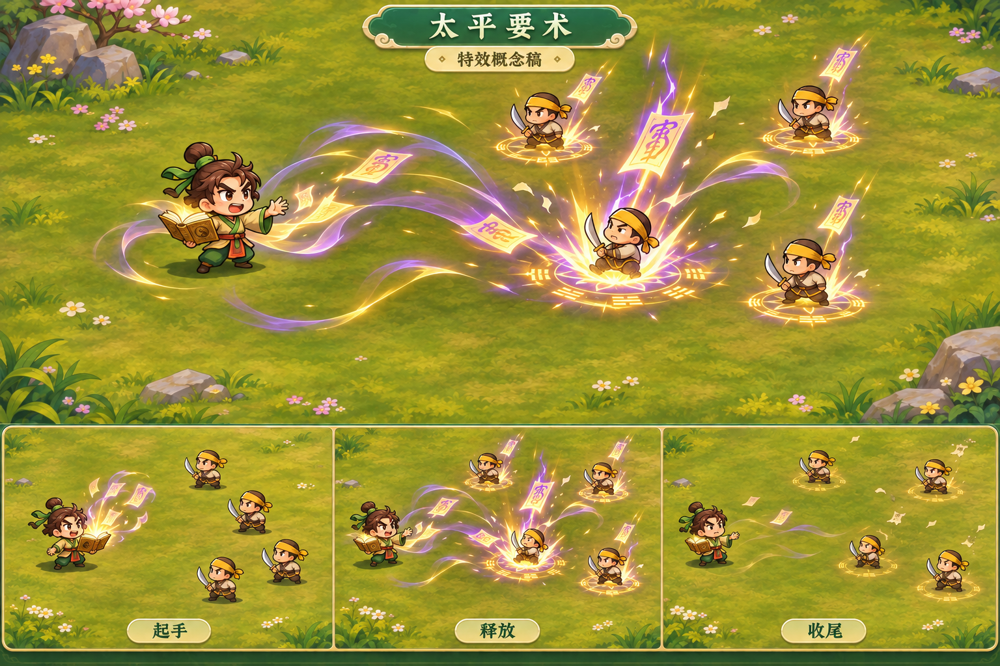

**视觉设计：** 浮起书页/图形符印，金紫法能沿页纹聚起；命中和升阶：实际落点出现符印骤亮、雷芯与轻纸灰，区别于五雷符的跳链

**材料色板：** 雷能：紫色背晕 #754DC2 / 紫白雷芯 #F8ECFF / 青紫短游电 #B39FFF；张角主体另用金白黄符

**动作阶段：** 起手蓄势→主体运动与真实接触→回正与余波衰减

**机制与判定：** 白I默认：标记1个不同目标，0.25秒后R70落符；同敌本轮符伤和爆散合计一次。 基础射程420／扫角0°／爆散半径70。 红IV追加效果仅在真实触发时表现：标记4个不同目标，0.25秒后R70落符；同敌本轮符伤和爆散合计一次。

**层级：** 地面预告/痕迹→后侧主体→人物→前侧主体/接触→敌方危险提示；脸部留白

**实现映射：** GameBootstrap实际武器出手/追加段/命中 → combat-effects与原武器trail → 公共主体/轨迹/接触层。

**源码核对：** `assets/scripts/weapons.ts`、`assets/scripts/extra-weapons.ts`、`assets/scripts/GameBootstrap.ts`。

| 品质 | 基础显示伤害 | 间隔秒 | 射程 | 爆散半径 | 实际机制 |
| --- | --- | --- | --- | --- | --- |
| 1 | 38 | 1.3 | 420 | 70 | 标记1个不同目标，0.25秒后R70落符；同敌本轮符伤和爆散合计一次。 |
| 2 | 51.3 | 1.25 | 430 | 70 | 标记2个不同目标，0.25秒后R70落符；同敌本轮符伤和爆散合计一次。 |
| 3 | 68.4 | 1.2 | 440 | 70 | 标记3个不同目标，0.25秒后R70落符；同敌本轮符伤和爆散合计一次。 |
| 4 | 91.2 | 1.14 | 450 | 70 | 标记4个不同目标，0.25秒后R70落符；同敌本轮符伤和爆散合计一次。 |

**逐项验收：** 先检查主体轮廓与原身份，再按本条真实范围/时钟检查起手、峰值、接触和收尾；范围外无伪命中、暂停不推进、清场无残影，密集叠加仍看清危险。概念透视/夸张退姿不作为判伤或新增控制依据。

### W33-star-lamps · 七星灯

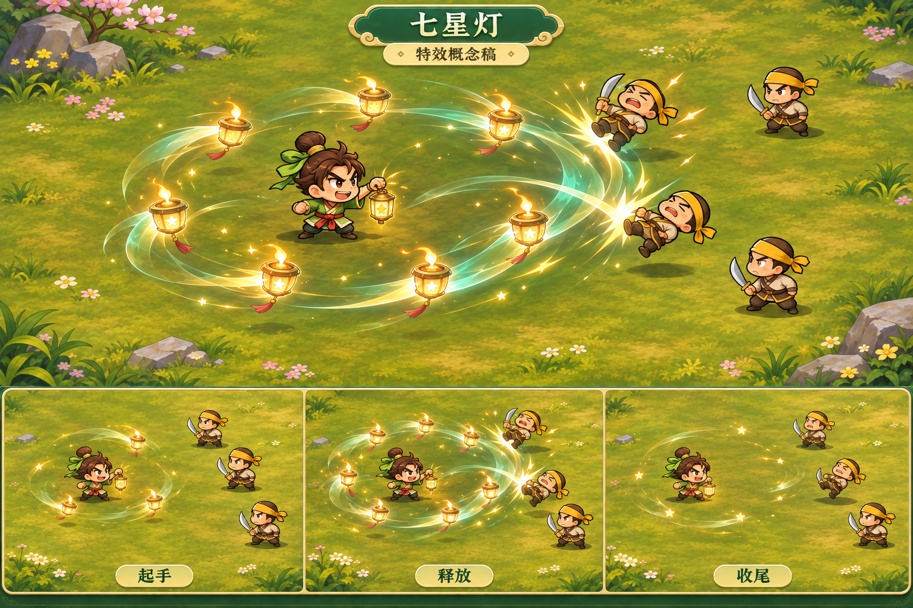

**视觉设计：** 小灯实体与灯芯短焰，星力在真实轨道上流动；命中和升阶：实际脉冲才有短星纹扩散，持续驻留亮度较低

**材料色板：** 金属/实体：细赭金背沿 #997139 / 金白主体 #F4C56D / 象牙白锋面 #FFF5DA；黑白棋/铜印/木器保留实体本色

**动作阶段：** 起手蓄势→主体运动与真实接触→回正与余波衰减

**机制与判定：** 白I默认：3盏灯环绕；每轮同敌一次1D，不按灯数叠伤。半径160。 基础射程160／扫角0°／爆散半径0。 红IV追加效果仅在真实触发时表现：7盏灯环绕；每轮同敌一次1D，不按灯数叠伤。半径210。

**层级：** 地面预告/痕迹→后侧主体→人物→前侧主体/接触→敌方危险提示；脸部留白

**实现映射：** GameBootstrap实际武器出手/追加段/命中 → combat-effects与原武器trail → 公共主体/轨迹/接触层。

**源码核对：** `assets/scripts/weapons.ts`、`assets/scripts/extra-weapons.ts`、`assets/scripts/GameBootstrap.ts`。

| 品质 | 基础显示伤害 | 间隔秒 | 射程 | 爆散半径 | 实际机制 |
| --- | --- | --- | --- | --- | --- |
| 1 | 12 | 0.5 | 160 | 0 | 3盏灯环绕；每轮同敌一次1D，不按灯数叠伤。半径160。 |
| 2 | 16.2 | 0.48 | 175 | 0 | 4盏灯环绕；每轮同敌一次1D，不按灯数叠伤。半径175。 |
| 3 | 21.6 | 0.46 | 190 | 0 | 6盏灯环绕；每轮同敌一次1D，不按灯数叠伤。半径190。 |
| 4 | 28.8 | 0.44 | 210 | 0 | 7盏灯环绕；每轮同敌一次1D，不按灯数叠伤。半径210。 |

**逐项验收：** 先检查主体轮廓与原身份，再按本条真实范围/时钟检查起手、峰值、接触和收尾；范围外无伪命中、暂停不推进、清场无残影，密集叠加仍看清危险。概念透视/夸张退姿不作为判伤或新增控制依据。

### W34-bagua · 八阵图

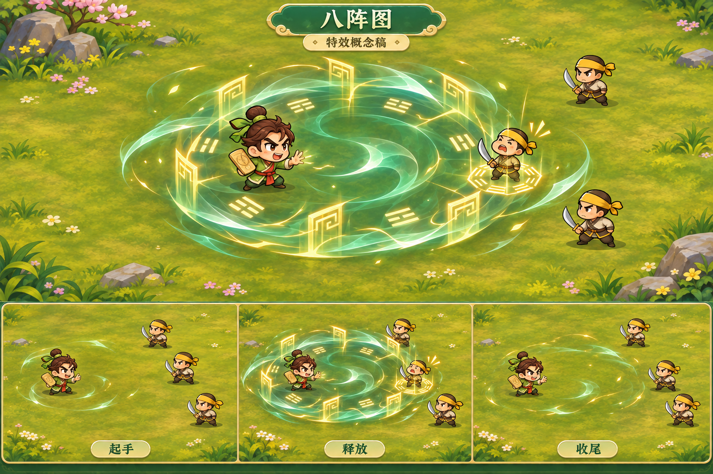

**视觉设计：** 青玉/金色阵纹有细小流动，中心通透；命中和升阶：每次真实触发有门纹收束或短锁印，地面主体不遮脚

**材料色板：** 青玉：细暗背沿 #226F6E / 实体玉青 #42CDB2 / 流纹 #A3F2D3 / 白玉锋面 #FFF9DE

**动作阶段：** 起手蓄势→主体运动与真实接触→回正与余波衰减

**机制与判定：** 白I默认：阵地1秒，进入伤害一次；减速20%，Boss最多10%；每武器2阵，全场8阵。 基础射程400／扫角0°／爆散半径100。 红IV追加效果仅在真实触发时表现：阵地1秒，进入伤害一次；减速35%，Boss最多10%；每武器2阵，全场8阵。

**层级：** 地面预告/痕迹→后侧主体→人物→前侧主体/接触→敌方危险提示；脸部留白

**实现映射：** GameBootstrap实际武器出手/追加段/命中 → combat-effects与原武器trail → 公共主体/轨迹/接触层。

**源码核对：** `assets/scripts/weapons.ts`、`assets/scripts/extra-weapons.ts`、`assets/scripts/GameBootstrap.ts`。

| 品质 | 基础显示伤害 | 间隔秒 | 射程 | 爆散半径 | 实际机制 |
| --- | --- | --- | --- | --- | --- |
| 1 | 25 | 1.4 | 400 | 100 | 阵地1秒，进入伤害一次；减速20%，Boss最多10%；每武器2阵，全场8阵。 |
| 2 | 33.8 | 1.34 | 410 | 100 | 阵地1秒，进入伤害一次；减速25%，Boss最多10%；每武器2阵，全场8阵。 |
| 3 | 45 | 1.29 | 420 | 100 | 阵地1秒，进入伤害一次；减速30%，Boss最多10%；每武器2阵，全场8阵。 |
| 4 | 60 | 1.23 | 430 | 100 | 阵地1秒，进入伤害一次；减速35%，Boss最多10%；每武器2阵，全场8阵。 |

**逐项验收：** 先检查主体轮廓与原身份，再按本条真实范围/时钟检查起手、峰值、接触和收尾；范围外无伪命中、暂停不推进、清场无残影，密集叠加仍看清危险。概念透视/夸张退姿不作为判伤或新增控制依据。

### W35-wood-ox · 木牛机关

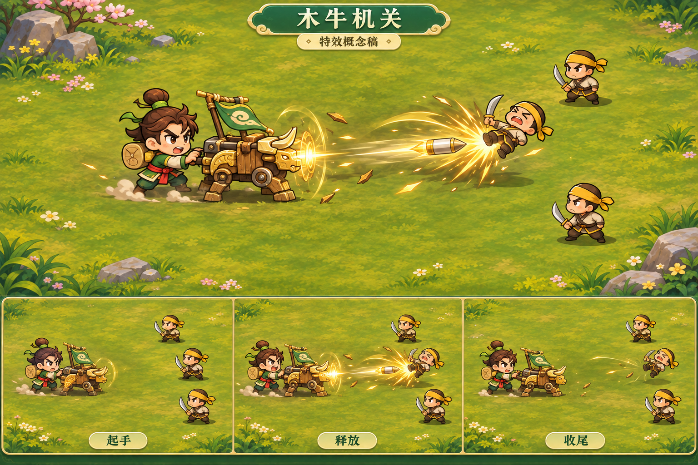

**视觉设计：** 清楚的木牛本体/机关出手，小型白金弹芯和机械后坐；命中和升阶：射击脉冲偏金属/木屑，保留实体喜剧感，避免画成法球

**材料色板：** 金属/实体：细赭金背沿 #997139 / 金白主体 #F4C56D / 象牙白锋面 #FFF5DA；黑白棋/铜印/木器保留实体本色

**动作阶段：** 起手蓄势→主体运动与真实接触→回正与余波衰减

**机制与判定：** 白I默认：1台木牛，每台每轮1D；全场最多12台。 基础射程350／扫角0°／爆散半径0。 红IV追加效果仅在真实触发时表现：3台木牛，每台每轮0.45D；全场最多12台。

**层级：** 地面预告/痕迹→后侧主体→人物→前侧主体/接触→敌方危险提示；脸部留白

**实现映射：** GameBootstrap实际武器出手/追加段/命中 → combat-effects与原武器trail → 公共主体/轨迹/接触层。

**源码核对：** `assets/scripts/weapons.ts`、`assets/scripts/extra-weapons.ts`、`assets/scripts/GameBootstrap.ts`。

| 品质 | 基础显示伤害 | 间隔秒 | 射程 | 爆散半径 | 实际机制 |
| --- | --- | --- | --- | --- | --- |
| 1 | 9 | 0.3 | 350 | 0 | 1台木牛，每台每轮1D；全场最多12台。 |
| 2 | 12.2 | 0.288 | 360 | 0 | 2台木牛，每台每轮0.55D；全场最多12台。 |
| 3 | 16.2 | 0.276 | 370 | 0 | 2台木牛，每台每轮0.6D；全场最多12台。 |
| 4 | 21.6 | 0.264 | 380 | 0 | 3台木牛，每台每轮0.45D；全场最多12台。 |

**逐项验收：** 先检查主体轮廓与原身份，再按本条真实范围/时钟检查起手、峰值、接触和收尾；范围外无伪命中、暂停不推进、清场无残影，密集叠加仍看清危险。概念透视/夸张退姿不作为判伤或新增控制依据。

### W36-wood-kite · 木鸢飞翼

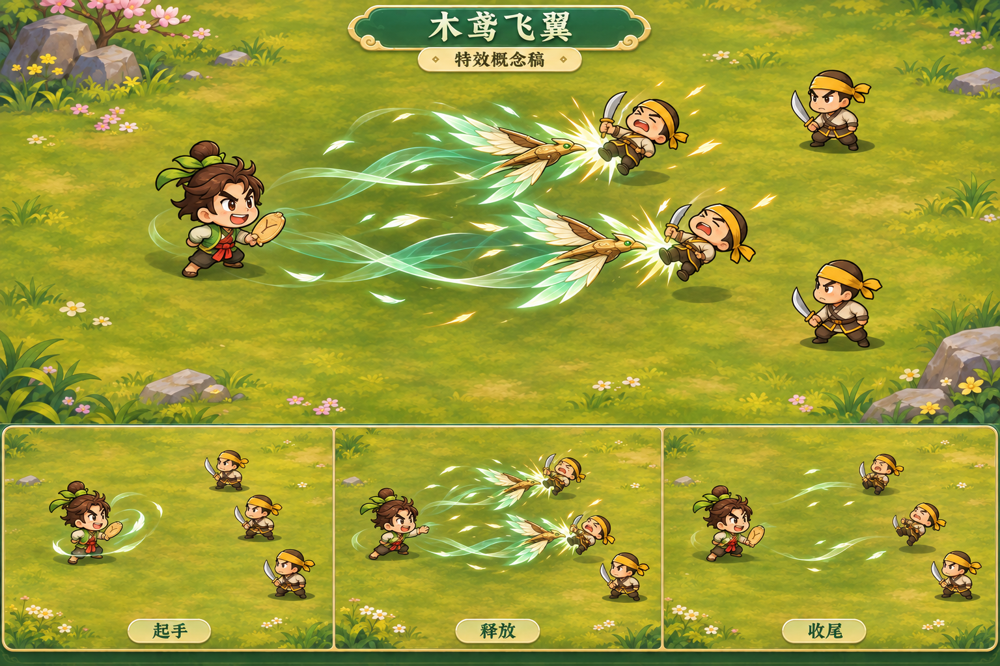

**视觉设计：** 木翼实体有轻微俯仰，羽片形青白飞行线；命中和升阶：实际齐射采用展开结构与短收束风尾，复用有限弹体槽

**材料色板：** 金属/实体：细赭金背沿 #997139 / 金白主体 #F4C56D / 象牙白锋面 #FFF5DA；黑白棋/铜印/木器保留实体本色

**动作阶段：** 起手蓄势→主体运动与真实接触→回正与余波衰减

**机制与判定：** 白I默认：1只木鸢，每只1D；各穿透4名敌人，同敌单鸢一次。 基础射程450／扫角0°／爆散半径0。 红IV追加效果仅在真实触发时表现：2只木鸢，每只0.75D；各穿透4名敌人，同敌单鸢一次。

**层级：** 地面预告/痕迹→后侧主体→人物→前侧主体/接触→敌方危险提示；脸部留白

**实现映射：** GameBootstrap实际武器出手/追加段/命中 → combat-effects与原武器trail → 公共主体/轨迹/接触层。

**源码核对：** `assets/scripts/weapons.ts`、`assets/scripts/extra-weapons.ts`、`assets/scripts/GameBootstrap.ts`。

| 品质 | 基础显示伤害 | 间隔秒 | 射程 | 爆散半径 | 实际机制 |
| --- | --- | --- | --- | --- | --- |
| 1 | 16 | 0.9 | 450 | 0 | 1只木鸢，每只1D；各穿透4名敌人，同敌单鸢一次。 |
| 2 | 21.6 | 0.864 | 460 | 0 | 1只木鸢，每只1D；各穿透4名敌人，同敌单鸢一次。 |
| 3 | 28.8 | 0.828 | 470 | 0 | 2只木鸢，每只0.6D；各穿透4名敌人，同敌单鸢一次。 |
| 4 | 38.4 | 0.792 | 480 | 0 | 2只木鸢，每只0.75D；各穿透4名敌人，同敌单鸢一次。 |

**逐项验收：** 先检查主体轮廓与原身份，再按本条真实范围/时钟检查起手、峰值、接触和收尾；范围外无伪命中、暂停不推进、清场无残影，密集叠加仍看清危险。概念透视/夸张退姿不作为判伤或新增控制依据。

## 主动技能

### G08 · 百步穿杨

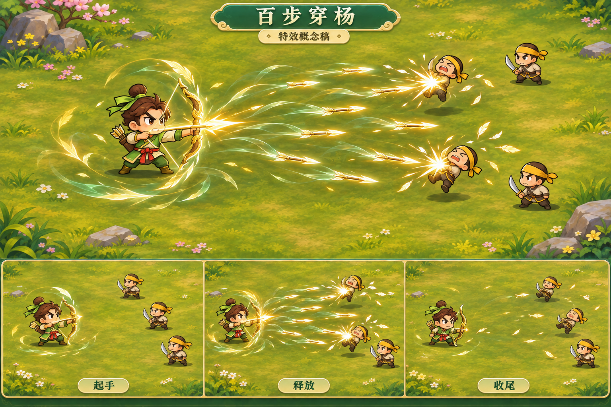

**视觉设计：** 弓形光影瞬间拉满，8支金白实体羽箭依次射出；每箭有轻微螺旋羽流，命中出现集中穿刺爆点和向前散开的碎羽

**材料色板：** 金属/实体：细赭金背沿 #997139 / 金白主体 #F4C56D / 象牙白锋面 #FFF5DA；黑白棋/铜印/木器保留实体本色

**动作阶段：** 起手蓄势→主体运动与真实接触→回正与余波衰减

**机制与判定：** 连续射出8支实体箭，每箭最多1敌，同一敌最多4箭；箭抵达时命中。；仍8箭，按真实弹体抵达伤害；尾迹不产生额外命中；15真实普通兵击杀充能，图中不新增伤害/控制。

**层级：** 地面预告/痕迹→后侧主体→人物→前侧主体/接触→敌方危险提示；脸部留白

**实现映射：** CommonSkillRuntime真实任务/命中 → CommonSkillEffects → skill-vfx-art / sweep-effects及新材质层。

**源码核对：** `assets/scripts/chronicles-data.ts`、`assets/scripts/CommonSkillRuntime.ts`、`assets/scripts/CommonSkillEffects.ts`。

**逐项验收：** 先检查主体轮廓与原身份，再按本条真实范围/时钟检查起手、峰值、接触和收尾；范围外无伪命中、暂停不推进、清场无残影，密集叠加仍看清危险。概念透视/夸张退姿不作为判伤或新增控制依据。

### G01 · 冲锋破阵

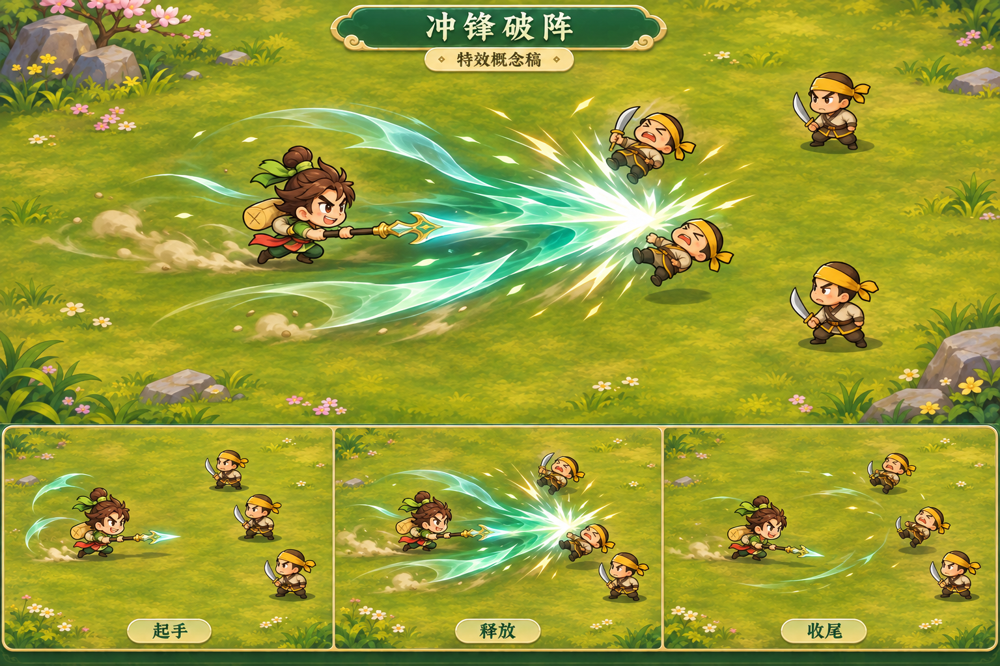

**视觉设计：** 人物前方形成青白枪锋，侧后两束宽尾收尖；终点气流展开、擦地尘向后散开

**材料色板：** 金属/实体：细赭金背沿 #997139 / 金白主体 #F4C56D / 象牙白锋面 #FFF5DA；黑白棋/铜印/木器保留实体本色

**动作阶段：** 起手蓄势→主体运动与真实接触→回正与余波衰减

**机制与判定：** 沿移动方向突进，0.25秒保护，路径最多命中8敌一次。；真正位移路径/端点一致，不给站在路径之外的敌人画受击；15真实普通兵击杀充能，图中不新增伤害/控制。

**层级：** 地面预告/痕迹→后侧主体→人物→前侧主体/接触→敌方危险提示；脸部留白

**实现映射：** CommonSkillRuntime真实任务/命中 → CommonSkillEffects → skill-vfx-art / sweep-effects及新材质层。

**源码核对：** `assets/scripts/chronicles-data.ts`、`assets/scripts/CommonSkillRuntime.ts`、`assets/scripts/CommonSkillEffects.ts`。

**逐项验收：** 先检查主体轮廓与原身份，再按本条真实范围/时钟检查起手、峰值、接触和收尾；范围外无伪命中、暂停不推进、清场无残影，密集叠加仍看清危险。概念透视/夸张退姿不作为判伤或新增控制依据。

### G03 · 横扫六合

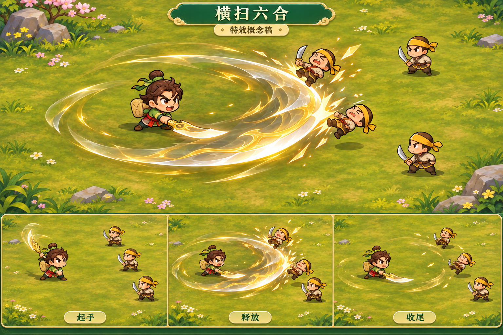

**视觉设计：** 保留A版金白厚刃与旋向，提升为有通透刃身、流动金纹和锐利锋面的实体回旋；双段刀尾错位消失，真实命中有独立碎锋

**材料色板：** 金属/实体：细赭金背沿 #997139 / 金白主体 #F4C56D / 象牙白锋面 #FFF5DA；黑白棋/铜印/木器保留实体本色

**动作阶段：** 起手蓄势→主体运动与真实接触→回正与余波衰减

**机制与判定：** 一圈金刃横扫，最多10敌，击退300。；保留当前0.4秒主体、真实瞬发/目标/伤害契约；漂亮的后续刀尾不新增一次横扫；15真实普通兵击杀充能，图中不新增伤害/控制。

**层级：** 地面预告/痕迹→后侧主体→人物→前侧主体/接触→敌方危险提示；脸部留白

**实现映射：** CommonSkillRuntime真实任务/命中 → CommonSkillEffects → skill-vfx-art / sweep-effects及新材质层。

**源码核对：** `assets/scripts/chronicles-data.ts`、`assets/scripts/CommonSkillRuntime.ts`、`assets/scripts/CommonSkillEffects.ts`。

**逐项验收：** 先检查主体轮廓与原身份，再按本条真实范围/时钟检查起手、峰值、接触和收尾；范围外无伪命中、暂停不推进、清场无残影，密集叠加仍看清危险。概念透视/夸张退姿不作为判伤或新增控制依据。

### G18 · 八门金锁

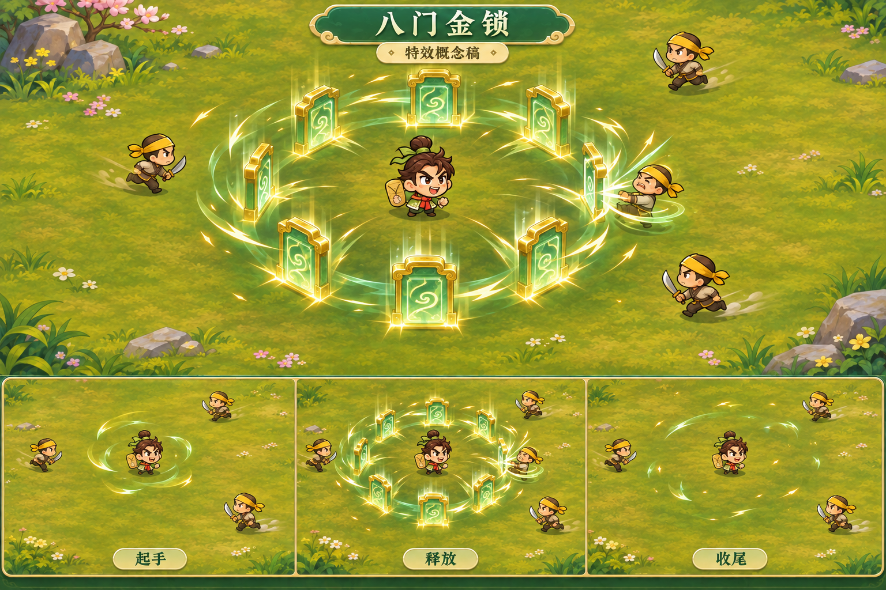

**视觉设计：** 八座有正侧面的玉金门印错相升起，阵线有方向性流光，入阵命中时门纹短促收束

**材料色板：** 金属/实体：细赭金背沿 #997139 / 金白主体 #F4C56D / 象牙白锋面 #FFF5DA；黑白棋/铜印/木器保留实体本色

**动作阶段：** 起手蓄势→主体运动与真实接触→回正与余波衰减

**机制与判定：** 固定八门阵持续2秒，入阵一次伤害和减速，最多18敌；Boss仅减速10%。；固定阵地、入阵判定与减速不变；边界从实际生效起可辨；15真实普通兵击杀充能，图中不新增伤害/控制。

**层级：** 地面预告/痕迹→后侧主体→人物→前侧主体/接触→敌方危险提示；脸部留白

**实现映射：** CommonSkillRuntime真实任务/命中 → CommonSkillEffects → skill-vfx-art / sweep-effects及新材质层。

**源码核对：** `assets/scripts/chronicles-data.ts`、`assets/scripts/CommonSkillRuntime.ts`、`assets/scripts/CommonSkillEffects.ts`。

**逐项验收：** 先检查主体轮廓与原身份，再按本条真实范围/时钟检查起手、峰值、接触和收尾；范围外无伪命中、暂停不推进、清场无残影，密集叠加仍看清危险。概念透视/夸张退姿不作为判伤或新增控制依据。

### G10 · 火烧连营

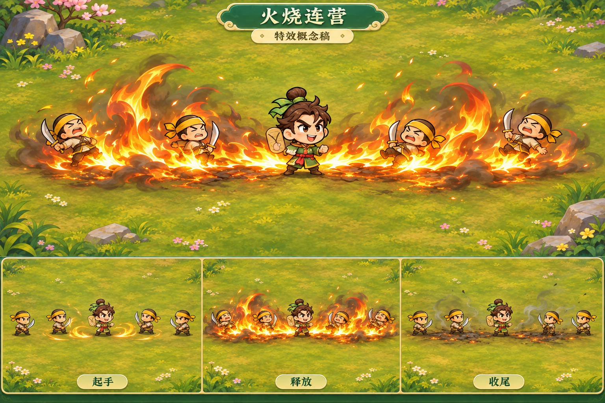

**视觉设计：** 施法点向左右卷出连续火线，底部油烟低伏，上部有不同高度的翻卷火舌；每次灼烧火芯翻亮，结束化成炭屑与薄烟

**材料色板：** 火焰：低亮赤底 #8F3029 / 橙红主体 #EF5C2E / 金橙翻焰 #FFB63C / 短白热芯 #FFF6CB

**动作阶段：** 起手蓄势→主体运动与真实接触→回正与余波衰减

**机制与判定：** 在施法位置展开水平火线，长6身位、宽1身位，持续3秒；4次灼烧，同敌最多4次，最多18敌。；水平480×80、3秒/原4次灼烧保持，地面焦痕在失去伤害后明确变暗；15真实普通兵击杀充能，图中不新增伤害/控制。

**层级：** 地面预告/痕迹→后侧主体→人物→前侧主体/接触→敌方危险提示；脸部留白

**实现映射：** CommonSkillRuntime真实任务/命中 → CommonSkillEffects → skill-vfx-art / sweep-effects及新材质层。

**源码核对：** `assets/scripts/chronicles-data.ts`、`assets/scripts/CommonSkillRuntime.ts`、`assets/scripts/CommonSkillEffects.ts`。

**逐项验收：** 先检查主体轮廓与原身份，再按本条真实范围/时钟检查起手、峰值、接触和收尾；范围外无伪命中、暂停不推进、清场无残影，密集叠加仍看清危险。概念透视/夸张退姿不作为判伤或新增控制依据。

### G12 · 水淹七军

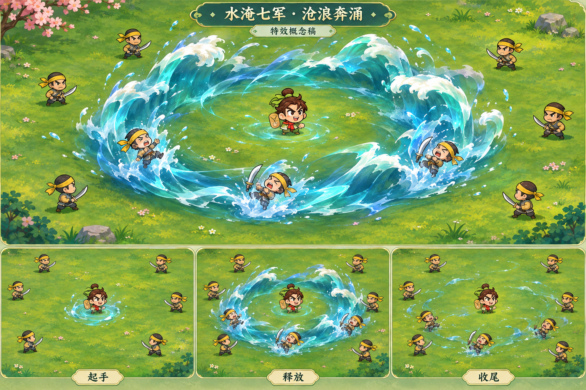

**视觉设计：** 蓝青连续浪墙向外展开，有厚水体、翻卷白浪冠和层层透明水裙；接触飞起短水花，波后迅速下落散水

**材料色板：** 水体：深蓝青背面 #17687C / 青蓝水体 #24BBD1 / 薄青透光 #94EDDE / 暖白浪冠 #FFF9DF

**动作阶段：** 起手蓄势→主体运动与真实接触→回正与余波衰减

**机制与判定：** 水浪扩散命中一次，最多18敌，减速2秒：普通兵30%，Boss10%。；扩散前缘取真实半径，实际扫到才伤害；不以一圈装饰泡泡表示整招；15真实普通兵击杀充能，图中不新增伤害/控制。

**层级：** 地面预告/痕迹→后侧主体→人物→前侧主体/接触→敌方危险提示；脸部留白

**实现映射：** CommonSkillRuntime真实任务/命中 → CommonSkillEffects → skill-vfx-art / sweep-effects及新材质层。

**源码核对：** `assets/scripts/chronicles-data.ts`、`assets/scripts/CommonSkillRuntime.ts`、`assets/scripts/CommonSkillEffects.ts`。

**逐项验收：** 先检查主体轮廓与原身份，再按本条真实范围/时钟检查起手、峰值、接触和收尾；范围外无伪命中、暂停不推进、清场无残影，密集叠加仍看清危险。概念透视/夸张退姿不作为判伤或新增控制依据。

### G20 · 星落五丈原

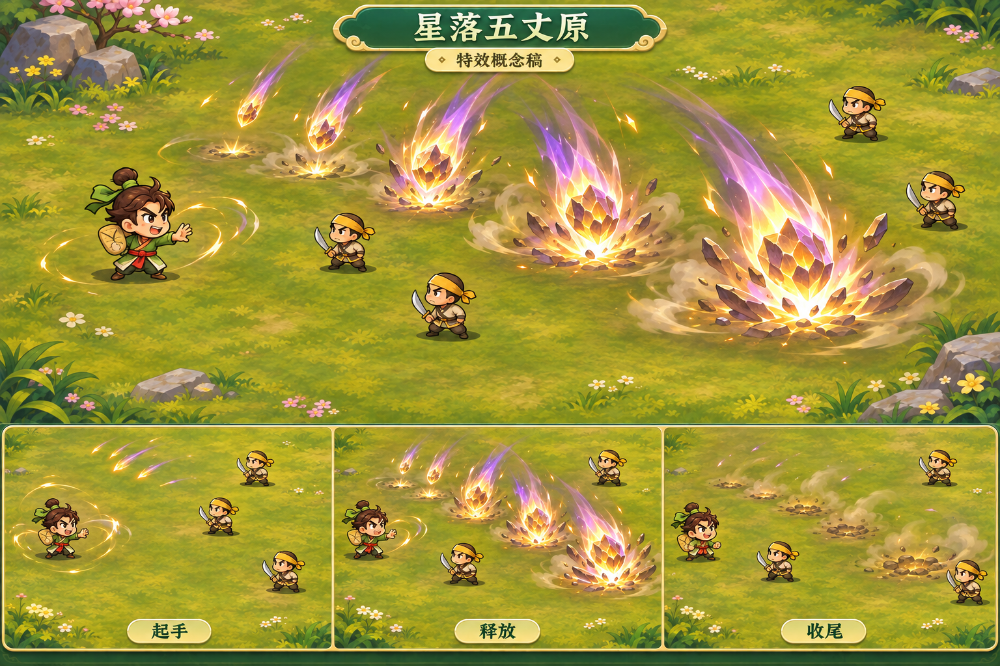

**视觉设计：** 五颗带岩核的金紫彗星依次坠落，接近落点时尾迹拉长；各自落地爆芯、碎石、尘裙分段展开

**材料色板：** 金属/实体：细赭金背沿 #997139 / 金白主体 #F4C56D / 象牙白锋面 #FFF5DA；黑白棋/铜印/木器保留实体本色

**动作阶段：** 起手蓄势→主体运动与真实接触→回正与余波衰减

**机制与判定：** 五颗流星依次坠落；同一敌最多3次，整次最多20个不同目标。；五落点/既定时序/单敌次数不变，预落点和实际落点同源；15真实普通兵击杀充能，图中不新增伤害/控制。

**层级：** 地面预告/痕迹→后侧主体→人物→前侧主体/接触→敌方危险提示；脸部留白

**实现映射：** CommonSkillRuntime真实任务/命中 → CommonSkillEffects → skill-vfx-art / sweep-effects及新材质层。

**源码核对：** `assets/scripts/chronicles-data.ts`、`assets/scripts/CommonSkillRuntime.ts`、`assets/scripts/CommonSkillEffects.ts`。

**逐项验收：** 先检查主体轮廓与原身份，再按本条真实范围/时钟检查起手、峰值、接触和收尾；范围外无伪命中、暂停不推进、清场无残影，密集叠加仍看清危险。概念透视/夸张退姿不作为判伤或新增控制依据。

### G07 · 背水一战

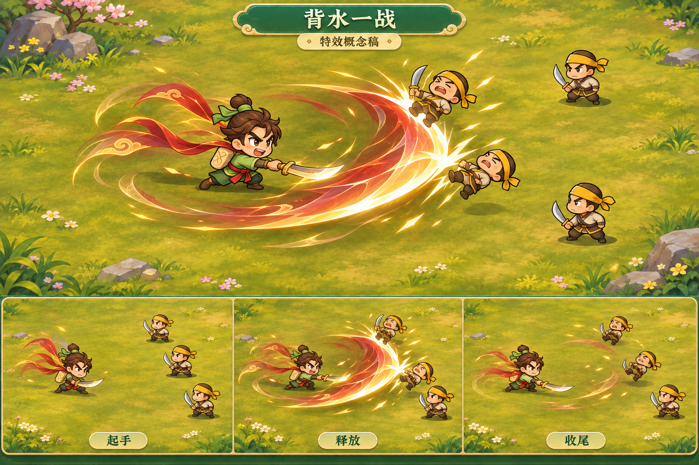

**视觉设计：** 赤旗/短战纹起势，人物肩侧与武器形成向后的红金气流；真正出手带短促金白刃闪，结束气流收回

**材料色板：** 金属/实体：细赭金背沿 #997139 / 金白主体 #F4C56D / 象牙白锋面 #FFF5DA；黑白棋/铜印/木器保留实体本色

**动作阶段：** 起手蓄势→主体运动与真实接触→回正与余波衰减

**机制与判定：** 5秒内武器攻击频率达到原来的5倍，攻击间隔缩短到20%；不增加单次伤害，不扣心，同名不叠加。；攻速×5持续5秒；不画常驻高亮罩，不额外生成攻击；同帧高频表现合并；15真实普通兵击杀充能，图中不新增伤害/控制。

**层级：** 地面预告/痕迹→后侧主体→人物→前侧主体/接触→敌方危险提示；脸部留白

**实现映射：** CommonSkillRuntime真实任务/命中 → CommonSkillEffects → skill-vfx-art / sweep-effects及新材质层。

**源码核对：** `assets/scripts/chronicles-data.ts`、`assets/scripts/CommonSkillRuntime.ts`、`assets/scripts/CommonSkillEffects.ts`。

**逐项验收：** 先检查主体轮廓与原身份，再按本条真实范围/时钟检查起手、峰值、接触和收尾；范围外无伪命中、暂停不推进、清场无残影，密集叠加仍看清危险。概念透视/夸张退姿不作为判伤或新增控制依据。

### G25 · 护体剑阵

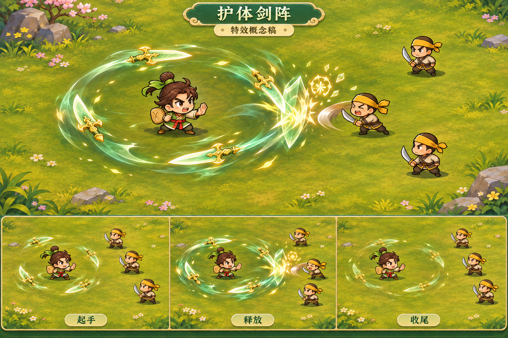

**视觉设计：** 四柄有玉金刃面的飞剑沿清晰轨道旋转，前后层交替，短剑尾相接；格挡时对应位置爆出盾形折光与一枚印记碎裂

**材料色板：** 青玉：细暗背沿 #226F6E / 实体玉青 #42CDB2 / 流纹 #A3F2D3 / 白玉锋面 #FFF9DE

**动作阶段：** 起手蓄势→主体运动与真实接触→回正与余波衰减

**机制与判定：** 4柄飞剑环绕6秒，接触攻击敌军；同敌最多4次、最多20敌，并抵挡最多3次攻击或飞行弹体。；原6秒/4剑/3格挡和攻击上限保持；防御耗尽后剑仍攻击、格挡标记清空；15真实普通兵击杀充能，图中不新增伤害/控制。

**层级：** 地面预告/痕迹→后侧主体→人物→前侧主体/接触→敌方危险提示；脸部留白

**实现映射：** CommonSkillRuntime真实任务/命中 → CommonSkillEffects → skill-vfx-art / sweep-effects及新材质层。

**源码核对：** `assets/scripts/chronicles-data.ts`、`assets/scripts/CommonSkillRuntime.ts`、`assets/scripts/CommonSkillEffects.ts`。

**逐项验收：** 先检查主体轮廓与原身份，再按本条真实范围/时钟检查起手、峰值、接触和收尾；范围外无伪命中、暂停不推进、清场无残影，密集叠加仍看清危险。概念透视/夸张退姿不作为判伤或新增控制依据。

### G26 · 震军号令

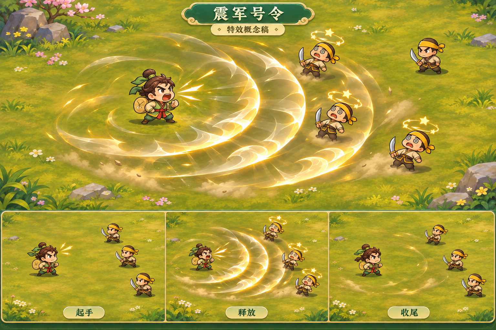

**视觉设计：** 战吼起势，三层错峰的厚金白声浪快速扩散，地面扬起薄尘；敌军出现与真实控制时长对应的清楚眩晕星标

**材料色板：** 金属/实体：细赭金背沿 #997139 / 金白主体 #F4C56D / 象牙白锋面 #FFF5DA；黑白棋/铜印/木器保留实体本色

**动作阶段：** 起手蓄势→主体运动与真实接触→回正与余波衰减

**机制与判定：** 震慑周围5身位内已出生的敌军（含Boss），眩晕5秒；停止行动和攻击，不清除已发射弹体或地面危险。；半径400、5秒控制、无新增伤害；已发出的危险保留，不做假清屏；15真实普通兵击杀充能，图中不新增伤害/控制。

**层级：** 地面预告/痕迹→后侧主体→人物→前侧主体/接触→敌方危险提示；脸部留白

**实现映射：** CommonSkillRuntime真实任务/命中 → CommonSkillEffects → skill-vfx-art / sweep-effects及新材质层。

**源码核对：** `assets/scripts/chronicles-data.ts`、`assets/scripts/CommonSkillRuntime.ts`、`assets/scripts/CommonSkillEffects.ts`。

**逐项验收：** 先检查主体轮廓与原身份，再按本条真实范围/时钟检查起手、峰值、接触和收尾；范围外无伪命中、暂停不推进、清场无残影，密集叠加仍看清危险。概念透视/夸张退姿不作为判伤或新增控制依据。

### G19 · 雷霆万钧

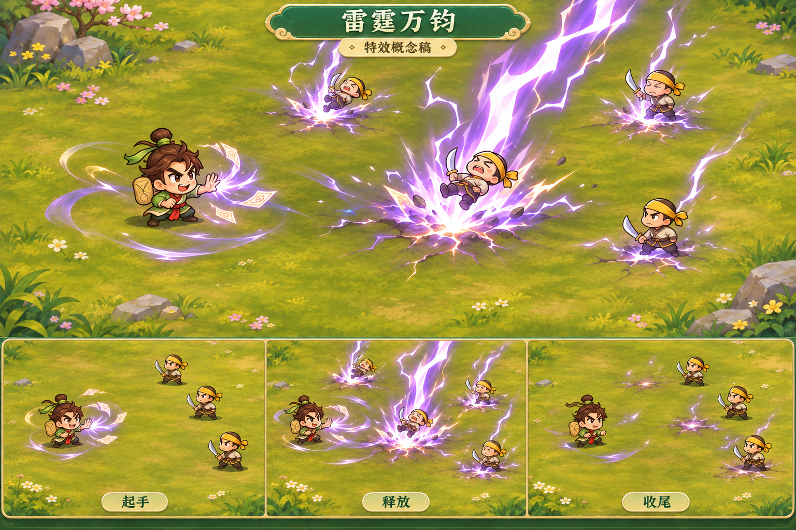

**视觉设计：** 落雷前符能压亮，紫白粗雷柱带短分叉劈入，落地电冠/焦裂/细游电错开衰减，数雷有明确强弱节拍

**材料色板：** 雷能：紫色背晕 #754DC2 / 紫白雷芯 #F8ECFF / 青紫短游电 #B39FFF；张角主体另用金白黄符

**动作阶段：** 起手蓄势→主体运动与真实接触→回正与余波衰减

**机制与判定：** 4处依次落雷，间隔0.3秒；同一敌最多2雷，整次最多18个不同目标。；原4处落雷/真实时间和目标上限保持，不加全屏白闪或延长原前摇；15真实普通兵击杀充能，图中不新增伤害/控制。

**层级：** 地面预告/痕迹→后侧主体→人物→前侧主体/接触→敌方危险提示；脸部留白

**实现映射：** CommonSkillRuntime真实任务/命中 → CommonSkillEffects → skill-vfx-art / sweep-effects及新材质层。

**源码核对：** `assets/scripts/chronicles-data.ts`、`assets/scripts/CommonSkillRuntime.ts`、`assets/scripts/CommonSkillEffects.ts`。

**逐项验收：** 先检查主体轮廓与原身份，再按本条真实范围/时钟检查起手、峰值、接触和收尾；范围外无伪命中、暂停不推进、清场无残影，密集叠加仍看清危险。概念透视/夸张退姿不作为判伤或新增控制依据。

### G22 · 万箭齐发

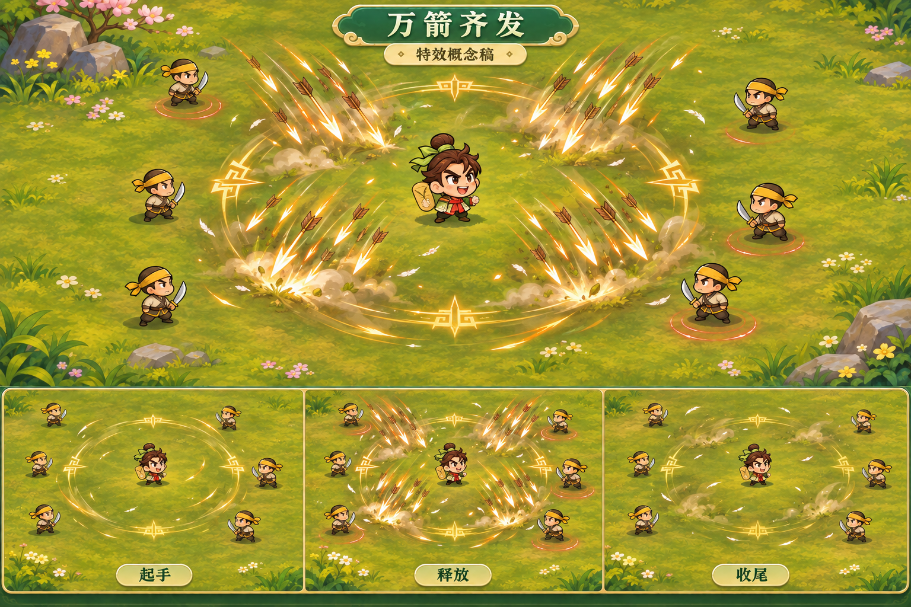

**视觉设计：** 边界短暂军阵纹显形，四轮斜落的实体羽箭形成阵列；箭尖白热、箭尾短金红流光，地面按轮次出现尘幕和碎羽

**材料色板：** 金属/实体：细赭金背沿 #997139 / 金白主体 #F4C56D / 象牙白锋面 #FFF5DA；黑白棋/铜印/木器保留实体本色

**动作阶段：** 起手蓄势→主体运动与真实接触→回正与余波衰减

**机制与判定：** 以施法位置为中心，半径5身位被4轮箭雨覆盖；同敌最多4次，最多24敌。；半径400/原4轮命中，装饰箭不逐支叠伤；中心可见敌人和真实敌方预警；15真实普通兵击杀充能，图中不新增伤害/控制。

**层级：** 地面预告/痕迹→后侧主体→人物→前侧主体/接触→敌方危险提示；脸部留白

**实现映射：** CommonSkillRuntime真实任务/命中 → CommonSkillEffects → skill-vfx-art / sweep-effects及新材质层。

**源码核对：** `assets/scripts/chronicles-data.ts`、`assets/scripts/CommonSkillRuntime.ts`、`assets/scripts/CommonSkillEffects.ts`。

**逐项验收：** 先检查主体轮廓与原身份，再按本条真实范围/时钟检查起手、峰值、接触和收尾；范围外无伪命中、暂停不推进、清场无残影，密集叠加仍看清危险。概念透视/夸张退姿不作为判伤或新增控制依据。

## Boss招式

### B01-1 · 张角 · 黄符定雷

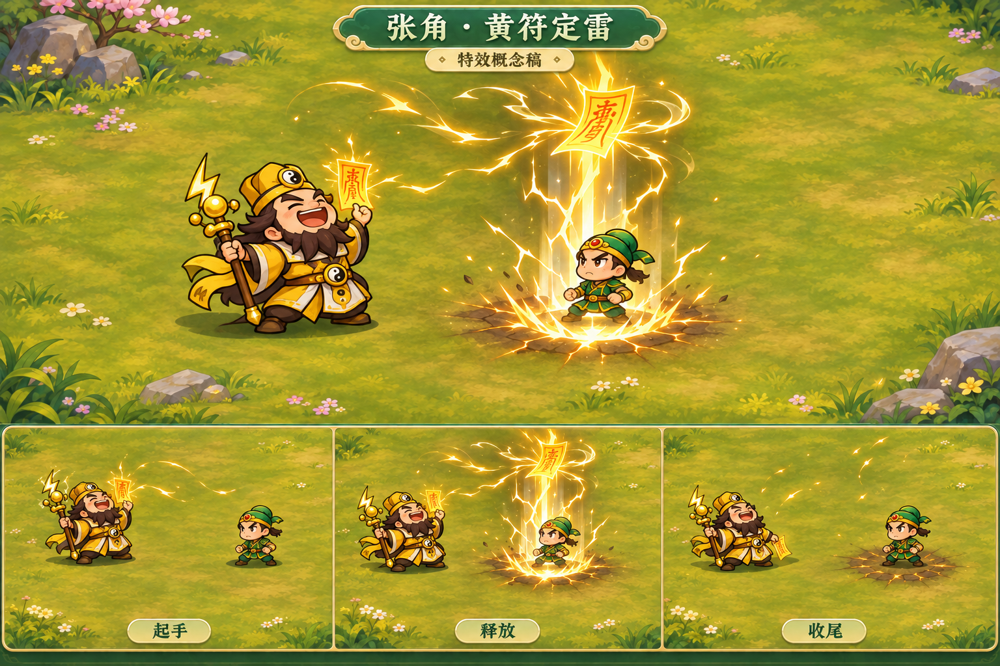

**视觉设计：** 黄符先聚在落点上方，细电向符心吸入；原释放时刻落下金白雷柱，雷芯、短分叉、电冠、焦痕分层消退

**材料色板：** 雷能：紫色背晕 #754DC2 / 紫白雷芯 #F8ECFF / 青紫短游电 #B39FFF；张角主体另用金白黄符

**动作阶段：** 起手蓄势→主体运动与真实接触→回正与余波衰减

**机制与判定：** R76与原0.85秒起手保持；落点固定后不追脚；玩家必须有清晰安全空间，地面预告与实体范围一致，不新增技能段数。

**层级：** 地面预告/痕迹→后侧主体→人物→前侧主体/接触→敌方危险提示；脸部留白

**实现映射：** 首领/精英状态机 → 实际危险物/弹体/随从 → boss-effects / lvbu-effects / 共享危险提示。

**源码核对：** `assets/scripts/boss-roster.ts`、`assets/scripts/boss-battle.ts`、`assets/scripts/boss-effects.ts`。

**逐项验收：** 先检查主体轮廓与原身份，再按本条真实范围/时钟检查起手、峰值、接触和收尾；范围外无伪命中、暂停不推进、清场无残影，密集叠加仍看清危险。概念透视/夸张退姿不作为判伤或新增控制依据。

### B01-2 · 张角 · 三才雷阵

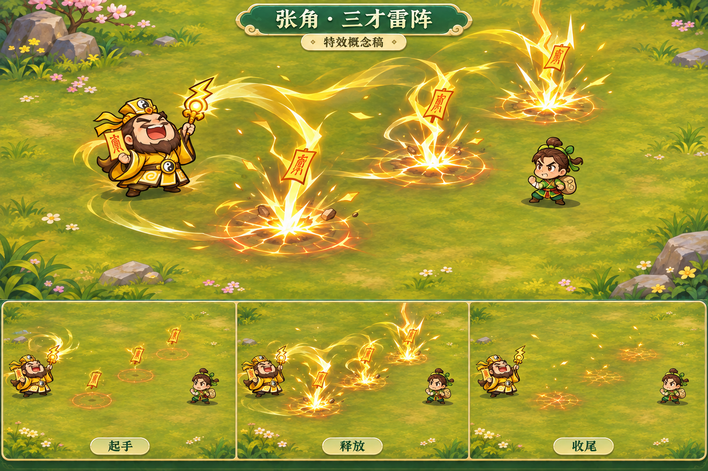

**视觉设计：** 三枚符印带不同聚能相位，按真实间隔递进爆亮；连续三雷的雷形略有变化，形成清楚节拍

**材料色板：** 雷能：紫色背晕 #754DC2 / 紫白雷芯 #F8ECFF / 青紫短游电 #B39FFF；张角主体另用金白黄符

**动作阶段：** 起手蓄势→主体运动与真实接触→回正与余波衰减

**机制与判定：** R70/原0.45秒间隔保持，前后走位空间可读；玩家必须有清晰安全空间，地面预告与实体范围一致，不新增技能段数。

**层级：** 地面预告/痕迹→后侧主体→人物→前侧主体/接触→敌方危险提示；脸部留白

**实现映射：** 首领/精英状态机 → 实际危险物/弹体/随从 → boss-effects / lvbu-effects / 共享危险提示。

**源码核对：** `assets/scripts/boss-roster.ts`、`assets/scripts/boss-battle.ts`、`assets/scripts/boss-effects.ts`。

**逐项验收：** 先检查主体轮廓与原身份，再按本条真实范围/时钟检查起手、峰值、接触和收尾；范围外无伪命中、暂停不推进、清场无残影，密集叠加仍看清危险。概念透视/夸张退姿不作为判伤或新增控制依据。

### B01-3 · 张角 · 太平雷狱

**视觉设计：** 三枚实体雷符绕点轻摆，连接的粗细电链沿边流动；起手有链路聚能，断符时电链反卷熄灭并飞纸灰

**材料色板：** 雷能：紫色背晕 #754DC2 / 紫白雷芯 #F8ECFF / 青紫短游电 #B39FFF；张角主体另用金白黄符

**动作阶段：** 起手蓄势→主体运动与真实接触→回正与余波衰减

**机制与判定：** 可拆符、真实链边/安全区域、各边预告与7秒存留保持；玩家必须有清晰安全空间，地面预告与实体范围一致，不新增技能段数。

**层级：** 地面预告/痕迹→后侧主体→人物→前侧主体/接触→敌方危险提示；脸部留白

**实现映射：** 首领/精英状态机 → 实际危险物/弹体/随从 → boss-effects / lvbu-effects / 共享危险提示。

**源码核对：** `assets/scripts/boss-roster.ts`、`assets/scripts/boss-battle.ts`、`assets/scripts/boss-effects.ts`。

**逐项验收：** 先检查主体轮廓与原身份，再按本条真实范围/时钟检查起手、峰值、接触和收尾；范围外无伪命中、暂停不推进、清场无残影，密集叠加仍看清危险。概念透视/夸张退姿不作为判伤或新增控制依据。

### B02-1 · 吕布 · 赤兔破军

**视觉设计：** 刨蹄扬尘、戟尖聚白热朱红光；冲锋中戟形实体前锋和贴身旋纹随马运动，后方短赤焰尾；勒马有向前翻卷的尘裙

**材料色板：** 赤锋：暗朱背面 #A53331 / 鲜朱主体 #F25D47 / 金色旋纹 #FFC45E / 白热前锋 #FFF5D2

**动作阶段：** 起手蓄势→主体运动与真实接触→回正与余波衰减

**机制与判定：** 原锁向/480冲程/碰撞保持，主体头部跟随真正危险位置；玩家必须有清晰安全空间，地面预告与实体范围一致，不新增技能段数。

**层级：** 地面预告/痕迹→后侧主体→人物→前侧主体/接触→敌方危险提示；脸部留白

**实现映射：** 首领/精英状态机 → 实际危险物/弹体/随从 → boss-effects / lvbu-effects / 共享危险提示。

**源码核对：** `assets/scripts/lvbu-boss.ts`、`assets/scripts/boss-battle.ts`、`assets/scripts/boss-effects.ts`。

**逐项验收：** 先检查主体轮廓与原身份，再按本条真实范围/时钟检查起手、峰值、接触和收尾；范围外无伪命中、暂停不推进、清场无残影，密集叠加仍看清危险。概念透视/夸张退姿不作为判伤或新增控制依据。

### B02-2 · 吕布 · 画戟回旋

**视觉设计：** 戟刃先有压紧的赤金刃面，释放形成厚大的红金月牙、短螺旋纹与飞散碎锋；刃后两段透明尾迹随扫过角度衰退

**材料色板：** 赤锋：暗朱背面 #A53331 / 鲜朱主体 #F25D47 / 金色旋纹 #FFC45E / 白热前锋 #FFF5D2

**动作阶段：** 起手蓄势→主体运动与真实接触→回正与余波衰减

**机制与判定：** R300、300°与身后60°缺口保持，刃锋和实际扫角同步；玩家必须有清晰安全空间，地面预告与实体范围一致，不新增技能段数。

**层级：** 地面预告/痕迹→后侧主体→人物→前侧主体/接触→敌方危险提示；脸部留白

**实现映射：** 首领/精英状态机 → 实际危险物/弹体/随从 → boss-effects / lvbu-effects / 共享危险提示。

**源码核对：** `assets/scripts/lvbu-boss.ts`、`assets/scripts/boss-battle.ts`、`assets/scripts/boss-effects.ts`。

**逐项验收：** 先检查主体轮廓与原身份，再按本条真实范围/时钟检查起手、峰值、接触和收尾；范围外无伪命中、暂停不推进、清场无残影，密集叠加仍看清危险。概念透视/夸张退姿不作为判伤或新增控制依据。

### B02-3 · 吕布 · 无双三连冲

**视觉设计：** 三次冲锋分别有新锁向聚能；每次朱红枪戟核心更饱满，转向处残影断开，最后一冲以重尘收尾

**材料色板：** 赤锋：暗朱背面 #A53331 / 鲜朱主体 #F25D47 / 金色旋纹 #FFC45E / 白热前锋 #FFF5D2

**动作阶段：** 起手蓄势→主体运动与真实接触→回正与余波衰减

**机制与判定：** 不用一条长特效覆盖三段轨迹，保留每次独立蓄力/转向/可躲时机；玩家必须有清晰安全空间，地面预告与实体范围一致，不新增技能段数。

**层级：** 地面预告/痕迹→后侧主体→人物→前侧主体/接触→敌方危险提示；脸部留白

**实现映射：** 首领/精英状态机 → 实际危险物/弹体/随从 → boss-effects / lvbu-effects / 共享危险提示。

**源码核对：** `assets/scripts/lvbu-boss.ts`、`assets/scripts/boss-battle.ts`、`assets/scripts/boss-effects.ts`。

**逐项验收：** 先检查主体轮廓与原身份，再按本条真实范围/时钟检查起手、峰值、接触和收尾；范围外无伪命中、暂停不推进、清场无残影，密集叠加仍看清危险。概念透视/夸张退姿不作为判伤或新增控制依据。

### B03-1 · 董卓 · 金印镇地

**视觉设计：** 有顶面和侧面的金印升起，投下收紧阴影；落下有短金白冲击、篆纹印痕与向外弹开的碎石

**材料色板：** 金属/实体：细赭金背沿 #997139 / 金白主体 #F4C56D / 象牙白锋面 #FFF5DA；黑白棋/铜印/木器保留实体本色

**动作阶段：** 起手蓄势→主体运动与真实接触→回正与余波衰减

**机制与判定：** R135/原1.1秒起手与真实落印伤害保持，阴影和落点同源；玩家必须有清晰安全空间，地面预告与实体范围一致，不新增技能段数。

**层级：** 地面预告/痕迹→后侧主体→人物→前侧主体/接触→敌方危险提示；脸部留白

**实现映射：** 首领/精英状态机 → 实际危险物/弹体/随从 → boss-effects / lvbu-effects / 共享危险提示。

**源码核对：** `assets/scripts/boss-roster.ts`、`assets/scripts/boss-battle.ts`、`assets/scripts/boss-effects.ts`。

**逐项验收：** 先检查主体轮廓与原身份，再按本条真实范围/时钟检查起手、峰值、接触和收尾；范围外无伪命中、暂停不推进、清场无残影，密集叠加仍看清危险。概念透视/夸张退姿不作为判伤或新增控制依据。

### B03-2 · 董卓 · 赤铜横财

**视觉设计：** 厚铜钱转动时有明暗面、孔中透光；滚动接地处短火星/尘线，撞击有硬金属爆点

**材料色板：** 火焰：低亮赤底 #8F3029 / 橙红主体 #EF5C2E / 金橙翻焰 #FFB63C / 短白热芯 #FFF6CB

**动作阶段：** 起手蓄势→主体运动与真实接触→回正与余波衰减

**机制与判定：** 四枚真实铜钱和中间通道保持，不加尾迹填满安全通道；玩家必须有清晰安全空间，地面预告与实体范围一致，不新增技能段数。

**层级：** 地面预告/痕迹→后侧主体→人物→前侧主体/接触→敌方危险提示；脸部留白

**实现映射：** 首领/精英状态机 → 实际危险物/弹体/随从 → boss-effects / lvbu-effects / 共享危险提示。

**源码核对：** `assets/scripts/boss-roster.ts`、`assets/scripts/boss-battle.ts`、`assets/scripts/boss-effects.ts`。

**逐项验收：** 先检查主体轮廓与原身份，再按本条真实范围/时钟检查起手、峰值、接触和收尾；范围外无伪命中、暂停不推进、清场无残影，密集叠加仍看清危险。概念透视/夸张退姿不作为判伤或新增控制依据。

### B03-3 · 董卓 · 酒池焚阵

**视觉设计：** 酒坛带液体/坛体碎片，落地先铺湿润酒迹；随后橙金火焰翻起，烟/火/地面残留分层

**材料色板：** 火焰：低亮赤底 #8F3029 / 橙红主体 #EF5C2E / 金橙翻焰 #FFB63C / 短白热芯 #FFF6CB

**动作阶段：** 起手蓄势→主体运动与真实接触→回正与余波衰减

**机制与判定：** 原延迟起火、R78、存留与tick保持，熄火后残迹不冒充伤害区；玩家必须有清晰安全空间，地面预告与实体范围一致，不新增技能段数。

**层级：** 地面预告/痕迹→后侧主体→人物→前侧主体/接触→敌方危险提示；脸部留白

**实现映射：** 首领/精英状态机 → 实际危险物/弹体/随从 → boss-effects / lvbu-effects / 共享危险提示。

**源码核对：** `assets/scripts/boss-roster.ts`、`assets/scripts/boss-battle.ts`、`assets/scripts/boss-effects.ts`。

**逐项验收：** 先检查主体轮廓与原身份，再按本条真实范围/时钟检查起手、峰值、接触和收尾；范围外无伪命中、暂停不推进、清场无残影，密集叠加仍看清危险。概念透视/夸张退姿不作为判伤或新增控制依据。

### B04-1 · 袁绍 · 四世箭阵

**视觉设计：** 指挥起势有短军旗光影，弓手同时拉弓，实体箭形成有密有疏的银金阵列，羽尾与命中尘点统一方向

**材料色板：** 金属/实体：细赭金背沿 #997139 / 金白主体 #F4C56D / 象牙白锋面 #FFF5DA；黑白棋/铜印/木器保留实体本色

**动作阶段：** 起手蓄势→主体运动与真实接触→回正与余波衰减

**机制与判定：** 本体/随从真实箭数、可拆弓手和缺口保持；玩家必须有清晰安全空间，地面预告与实体范围一致，不新增技能段数。

**层级：** 地面预告/痕迹→后侧主体→人物→前侧主体/接触→敌方危险提示；脸部留白

**实现映射：** 首领/精英状态机 → 实际危险物/弹体/随从 → boss-effects / lvbu-effects / 共享危险提示。

**源码核对：** `assets/scripts/boss-roster.ts`、`assets/scripts/boss-battle.ts`、`assets/scripts/boss-effects.ts`。

**逐项验收：** 先检查主体轮廓与原身份，再按本条真实范围/时钟检查起手、峰值、接触和收尾；范围外无伪命中、暂停不推进、清场无残影，密集叠加仍看清危险。概念透视/夸张退姿不作为判伤或新增控制依据。

### B04-2 · 袁绍 · 官渡弩阵

**视觉设计：** 弩车绷弦聚能、粗弩箭有白热尖芯和空气压缩纹，三连后坐清楚；配套箭雨按真实圈落下

**材料色板：** 金属/实体：细赭金背沿 #997139 / 金白主体 #F4C56D / 象牙白锋面 #FFF5DA；黑白棋/铜印/木器保留实体本色

**动作阶段：** 起手蓄势→主体运动与真实接触→回正与余波衰减

**机制与判定：** 仍可拆车、交替三连和原箭雨落点，重弩与普通箭用粗细区分；玩家必须有清晰安全空间，地面预告与实体范围一致，不新增技能段数。

**层级：** 地面预告/痕迹→后侧主体→人物→前侧主体/接触→敌方危险提示；脸部留白

**实现映射：** 首领/精英状态机 → 实际危险物/弹体/随从 → boss-effects / lvbu-effects / 共享危险提示。

**源码核对：** `assets/scripts/boss-roster.ts`、`assets/scripts/boss-battle.ts`、`assets/scripts/boss-effects.ts`。

**逐项验收：** 先检查主体轮廓与原身份，再按本条真实范围/时钟检查起手、峰值、接触和收尾；范围外无伪命中、暂停不推进、清场无残影，密集叠加仍看清危险。概念透视/夸张退姿不作为判伤或新增控制依据。

### B04-3 · 袁绍 · 万军齐射

**视觉设计：** 三轮箭墙有不同方向的阵列主体，箭羽残影形成短平行带；错时箭雨带落地尘幕

**材料色板：** 金属/实体：细赭金背沿 #997139 / 金白主体 #F4C56D / 象牙白锋面 #FFF5DA；黑白棋/铜印/木器保留实体本色

**动作阶段：** 起手蓄势→主体运动与真实接触→回正与余波衰减

**机制与判定：** 真实缺口贯穿所有材质层，不能只留在薄预警上而被箭尾盖住；玩家必须有清晰安全空间，地面预告与实体范围一致，不新增技能段数。

**层级：** 地面预告/痕迹→后侧主体→人物→前侧主体/接触→敌方危险提示；脸部留白

**实现映射：** 首领/精英状态机 → 实际危险物/弹体/随从 → boss-effects / lvbu-effects / 共享危险提示。

**源码核对：** `assets/scripts/boss-roster.ts`、`assets/scripts/boss-battle.ts`、`assets/scripts/boss-effects.ts`。

**逐项验收：** 先检查主体轮廓与原身份，再按本条真实范围/时钟检查起手、峰值、接触和收尾；范围外无伪命中、暂停不推进、清场无残影，密集叠加仍看清危险。概念透视/夸张退姿不作为判伤或新增控制依据。

### B05-1 · 曹操 · 倚天连刃

**视觉设计：** 三拍银蓝实体剑锋，第一拍窄、交叉拍层次更厚，尾部有冷白细流纹；每次接触是短切爆

**材料色板：** 金属/实体：细赭金背沿 #997139 / 金白主体 #F4C56D / 象牙白锋面 #FFF5DA；黑白棋/铜印/木器保留实体本色

**动作阶段：** 起手蓄势→主体运动与真实接触→回正与余波衰减

**机制与判定：** 三拍五道真实银锋、锁向与原间隔保持；玩家必须有清晰安全空间，地面预告与实体范围一致，不新增技能段数。

**层级：** 地面预告/痕迹→后侧主体→人物→前侧主体/接触→敌方危险提示；脸部留白

**实现映射：** 首领/精英状态机 → 实际危险物/弹体/随从 → boss-effects / lvbu-effects / 共享危险提示。

**源码核对：** `assets/scripts/boss-roster.ts`、`assets/scripts/boss-battle.ts`、`assets/scripts/boss-effects.ts`。

**逐项验收：** 先检查主体轮廓与原身份，再按本条真实范围/时钟检查起手、峰值、接触和收尾；范围外无伪命中、暂停不推进、清场无残影，密集叠加仍看清危险。概念透视/夸张退姿不作为判伤或新增控制依据。

### B05-2 · 曹操 · 疑兵换影

**视觉设计：** 纸影出现时从折纸轮廓展开，动作带轻微纸边残片；本体横移留下短剪影，地面剑阵逐锋亮起

**材料色板：** 金属/实体：细赭金背沿 #997139 / 金白主体 #F4C56D / 象牙白锋面 #FFF5DA；黑白棋/铜印/木器保留实体本色

**动作阶段：** 起手蓄势→主体运动与真实接触→回正与余波衰减

**机制与判定：** 原纸影可拆/横移/剑阵范围保持，纸影不增加假碰撞；玩家必须有清晰安全空间，地面预告与实体范围一致，不新增技能段数。

**层级：** 地面预告/痕迹→后侧主体→人物→前侧主体/接触→敌方危险提示；脸部留白

**实现映射：** 首领/精英状态机 → 实际危险物/弹体/随从 → boss-effects / lvbu-effects / 共享危险提示。

**源码核对：** `assets/scripts/boss-roster.ts`、`assets/scripts/boss-battle.ts`、`assets/scripts/boss-effects.ts`。

**逐项验收：** 先检查主体轮廓与原身份，再按本条真实范围/时钟检查起手、峰值、接触和收尾；范围外无伪命中、暂停不推进、清场无残影，密集叠加仍看清危险。概念透视/夸张退姿不作为判伤或新增控制依据。

### B05-3 · 曹操 · 虎豹合围

**视觉设计：** 虎豹骑起势有马蹄尘与金属锋，冲锋为贴身银锋和窄白尘尾；本体剑气与落剑按各自节拍分层

**材料色板：** 赤锋：暗朱背面 #A53331 / 鲜朱主体 #F25D47 / 金色旋纹 #FFC45E / 白热前锋 #FFF5D2

**动作阶段：** 起手蓄势→主体运动与真实接触→回正与余波衰减

**机制与判定：** 错开冲锋、三段剑气与落点仍可分辨，首领主效果不掩盖骑兵起手；玩家必须有清晰安全空间，地面预告与实体范围一致，不新增技能段数。

**层级：** 地面预告/痕迹→后侧主体→人物→前侧主体/接触→敌方危险提示；脸部留白

**实现映射：** 首领/精英状态机 → 实际危险物/弹体/随从 → boss-effects / lvbu-effects / 共享危险提示。

**源码核对：** `assets/scripts/boss-roster.ts`、`assets/scripts/boss-battle.ts`、`assets/scripts/boss-effects.ts`。

**逐项验收：** 先检查主体轮廓与原身份，再按本条真实范围/时钟检查起手、峰值、接触和收尾；范围外无伪命中、暂停不推进、清场无残影，密集叠加仍看清危险。概念透视/夸张退姿不作为判伤或新增控制依据。

### B06-1 · 孟获 · 猪突猛进

**视觉设计：** 战猪刨地、低头压身，冲锋有短金色前弧、侧向速度纹与连续土尘，獠牙/四肢保留

**材料色板：** 金属/实体：细赭金背沿 #997139 / 金白主体 #F4C56D / 象牙白锋面 #FFF5DA；黑白棋/铜印/木器保留实体本色

**动作阶段：** 起手蓄势→主体运动与真实接触→回正与余波衰减

**机制与判定：** 仅冲锋阶段无敌，收招金弧熄灭，原速度/路线保持；玩家必须有清晰安全空间，地面预告与实体范围一致，不新增技能段数。

**层级：** 地面预告/痕迹→后侧主体→人物→前侧主体/接触→敌方危险提示；脸部留白

**实现映射：** 首领/精英状态机 → 实际危险物/弹体/随从 → boss-effects / lvbu-effects / 共享危险提示。

**源码核对：** `assets/scripts/boss-roster.ts`、`assets/scripts/boss-battle.ts`、`assets/scripts/boss-effects.ts`。

**逐项验收：** 先检查主体轮廓与原身份，再按本条真实范围/时钟检查起手、峰值、接触和收尾；范围外无伪命中、暂停不推进、清场无残影，密集叠加仍看清危险。概念透视/夸张退姿不作为判伤或新增控制依据。

### B06-2 · 孟获 · 群狼围猎

**视觉设计：** 狼沿侧面接近时尾部轻尘，伏身蓄力清楚；扑击有细长青白爪锋和短拉伸尾迹，落地擦出爪痕

**材料色板：** 金属/实体：细赭金背沿 #997139 / 金白主体 #F4C56D / 象牙白锋面 #FFF5DA；黑白棋/铜印/木器保留实体本色

**动作阶段：** 起手蓄势→主体运动与真实接触→回正与余波衰减

**机制与判定：** 原独立锁向/扑击时机与冲锋无敌阶段保持，不画成无主体的能量球；玩家必须有清晰安全空间，地面预告与实体范围一致，不新增技能段数。

**层级：** 地面预告/痕迹→后侧主体→人物→前侧主体/接触→敌方危险提示；脸部留白

**实现映射：** 首领/精英状态机 → 实际危险物/弹体/随从 → boss-effects / lvbu-effects / 共享危险提示。

**源码核对：** `assets/scripts/boss-roster.ts`、`assets/scripts/boss-battle.ts`、`assets/scripts/boss-effects.ts`。

**逐项验收：** 先检查主体轮廓与原身份，再按本条真实范围/时钟检查起手、峰值、接触和收尾；范围外无伪命中、暂停不推进、清场无残影，密集叠加仍看清危险。概念透视/夸张退姿不作为判伤或新增控制依据。

### B06-3 · 孟获 · 万象开道

**视觉设计：** 战象重踏有压地尘浪，鼻/象牙带短金光；冲锋时侧尘更宽，刹停时碎土前翻

**材料色板：** 金属/实体：细赭金背沿 #997139 / 金白主体 #F4C56D / 象牙白锋面 #FFF5DA；黑白棋/铜印/木器保留实体本色

**动作阶段：** 起手蓄势→主体运动与真实接触→回正与余波衰减

**机制与判定：** 两象错时、原冲程/真实碰撞保持，体型与地面阴影一眼可读；玩家必须有清晰安全空间，地面预告与实体范围一致，不新增技能段数。

**层级：** 地面预告/痕迹→后侧主体→人物→前侧主体/接触→敌方危险提示；脸部留白

**实现映射：** 首领/精英状态机 → 实际危险物/弹体/随从 → boss-effects / lvbu-effects / 共享危险提示。

**源码核对：** `assets/scripts/boss-roster.ts`、`assets/scripts/boss-battle.ts`、`assets/scripts/boss-effects.ts`。

**逐项验收：** 先检查主体轮廓与原身份，再按本条真实范围/时钟检查起手、峰值、接触和收尾；范围外无伪命中、暂停不推进、清场无残影，密集叠加仍看清危险。概念透视/夸张退姿不作为判伤或新增控制依据。

### B07-1 · 司马懿 · 落子成灾

**视觉设计：** 黑白棋子有玉石/黑曜石质感，接近地面时有短重影；落子瞬间棋纹沿地面闪开，碎屑迅速消退

**材料色板：** 金属/实体：细赭金背沿 #997139 / 金白主体 #F4C56D / 象牙白锋面 #FFF5DA；黑白棋/铜印/木器保留实体本色

**动作阶段：** 起手蓄势→主体运动与真实接触→回正与余波衰减

**机制与判定：** 维持v9.16后的出手速度，不为蓄大招再拖慢落子；玩家必须有清晰安全空间，地面预告与实体范围一致，不新增技能段数。

**层级：** 地面预告/痕迹→后侧主体→人物→前侧主体/接触→敌方危险提示；脸部留白

**实现映射：** 首领/精英状态机 → 实际危险物/弹体/随从 → boss-effects / lvbu-effects / 共享危险提示。

**源码核对：** `assets/scripts/boss-roster.ts`、`assets/scripts/boss-battle.ts`、`assets/scripts/boss-effects.ts`。

**逐项验收：** 先检查主体轮廓与原身份，再按本条真实范围/时钟检查起手、峰值、接触和收尾；范围外无伪命中、暂停不推进、清场无残影，密集叠加仍看清危险。概念透视/夸张退姿不作为判伤或新增控制依据。

### B07-2 · 司马懿 · 阴阳双龙

**视觉设计：** 龙首、连续躯干和收尖龙尾有不同明暗，黑龙紫白内芯、白龙青白内芯；沿真实中心线移动，带少量流纹和须尾

**材料色板：** 金属/实体：细赭金背沿 #997139 / 金白主体 #F4C56D / 象牙白锋面 #FFF5DA；黑白棋/铜印/木器保留实体本色

**动作阶段：** 起手蓄势→主体运动与真实接触→回正与余波衰减

**机制与判定：** 龙身在真实碰撞包络内，不把装饰弯曲伸出实体判定；玩家必须有清晰安全空间，地面预告与实体范围一致，不新增技能段数。

**层级：** 地面预告/痕迹→后侧主体→人物→前侧主体/接触→敌方危险提示；脸部留白

**实现映射：** 首领/精英状态机 → 实际危险物/弹体/随从 → boss-effects / lvbu-effects / 共享危险提示。

**源码核对：** `assets/scripts/boss-roster.ts`、`assets/scripts/boss-battle.ts`、`assets/scripts/boss-effects.ts`。

**逐项验收：** 先检查主体轮廓与原身份，再按本条真实范围/时钟检查起手、峰值、接触和收尾；范围外无伪命中、暂停不推进、清场无残影，密集叠加仍看清危险。概念透视/夸张退姿不作为判伤或新增控制依据。

### B07-3 · 司马懿 · 五丈星劫

**视觉设计：** 星石下坠先见岩核与长短不同的彗尾，落地有棋盘裂光和短碎石裙；格线只在局部随波亮起

**材料色板：** 金属/实体：细赭金背沿 #997139 / 金白主体 #F4C56D / 象牙白锋面 #FFF5DA；黑白棋/铜印/木器保留实体本色

**动作阶段：** 起手蓄势→主体运动与真实接触→回正与余波衰减

**机制与判定：** 原落点/间隔/速度保持，不铺整屏棋盘光导致看不到安全格；玩家必须有清晰安全空间，地面预告与实体范围一致，不新增技能段数。

**层级：** 地面预告/痕迹→后侧主体→人物→前侧主体/接触→敌方危险提示；脸部留白

**实现映射：** 首领/精英状态机 → 实际危险物/弹体/随从 → boss-effects / lvbu-effects / 共享危险提示。

**源码核对：** `assets/scripts/boss-roster.ts`、`assets/scripts/boss-battle.ts`、`assets/scripts/boss-effects.ts`。

**逐项验收：** 先检查主体轮廓与原身份，再按本条真实范围/时钟检查起手、峰值、接触和收尾；范围外无伪命中、暂停不推进、清场无残影，密集叠加仍看清危险。概念透视/夸张退姿不作为判伤或新增控制依据。

## 小兵攻击

### E01 · 黄巾农兵

**视觉设计：** 黄巾结农兵，镰刀金白短弯刃/锄头木金拍击两外观并列小示意，抬肘锁向后短挥，落地短尘。

**材料色板：** 金属/实体：细赭金背沿 #997139 / 金白主体 #F4C56D / 象牙白锋面 #FFF5DA；黑白棋/铜印/木器保留实体本色

**动作阶段：** 起手蓄势→主体运动与真实接触→回正与余波衰减

**机制与判定：** 镰刀／锄头两外观；抬手蓄力0.48秒后锁向扇斩；仅挥击命中，不造成接触伤害 既有起手0.48秒、周期1.3秒；普通兵特效规模小于主动技能。

**层级：** 地面预告/痕迹→后侧主体→人物→前侧主体/接触→敌方危险提示；脸部留白

**实现映射：** updateChronicleEnemy真实attack → NpcActionRig原抬手/出手/收招 → enemy-action-effects / enemy-spell-effects。

**源码核对：** `assets/scripts/chronicles-data.ts`、`assets/scripts/enemy-actions.ts`、`assets/scripts/enemy-action-effects.ts`、`assets/scripts/GameBootstrap.ts`。

**逐项验收：** 先检查主体轮廓与原身份，再按本条真实范围/时钟检查起手、峰值、接触和收尾；范围外无伪命中、暂停不推进、清场无残影，密集叠加仍看清危险。概念透视/夸张退姿不作为判伤或新增控制依据。

### E02 · 朴刀兵

**视觉设计：** 绿头巾朴刀兵前跨短斩，刀刃暖白锐边与窄金尾，只在刀尖接触处碎锋，侧后留空。

**材料色板：** 金属/实体：细赭金背沿 #997139 / 金白主体 #F4C56D / 象牙白锋面 #FFF5DA；黑白棋/铜印/木器保留实体本色

**动作阶段：** 起手蓄势→主体运动与真实接触→回正与余波衰减

**机制与判定：** 前跨18后短刀110°，一次伤害 既有起手0.44秒、周期1.15秒；普通兵特效规模小于主动技能。

**层级：** 地面预告/痕迹→后侧主体→人物→前侧主体/接触→敌方危险提示；脸部留白

**实现映射：** updateChronicleEnemy真实attack → NpcActionRig原抬手/出手/收招 → enemy-action-effects / enemy-spell-effects。

**源码核对：** `assets/scripts/chronicles-data.ts`、`assets/scripts/enemy-actions.ts`、`assets/scripts/enemy-action-effects.ts`、`assets/scripts/GameBootstrap.ts`。

**逐项验收：** 先检查主体轮廓与原身份，再按本条真实范围/时钟检查起手、峰值、接触和收尾；范围外无伪命中、暂停不推进、清场无残影，密集叠加仍看清危险。概念透视/夸张退姿不作为判伤或新增控制依据。

### E03 · 长枪兵

**视觉设计：** 银盔红缨长枪兵低身收枪、定向细长银白枪锋、枪尖压缩气流与短穿刺爆点，直刺不是大扇扫。

**材料色板：** 金属/实体：细赭金背沿 #997139 / 金白主体 #F4C56D / 象牙白锋面 #FFF5DA；黑白棋/铜印/木器保留实体本色

**动作阶段：** 起手蓄势→主体运动与真实接触→回正与余波衰减

**机制与判定：** 窄直刺宽45，锁向后不追踪 既有起手0.48秒、周期1.8秒；普通兵特效规模小于主动技能。

**层级：** 地面预告/痕迹→后侧主体→人物→前侧主体/接触→敌方危险提示；脸部留白

**实现映射：** updateChronicleEnemy真实attack → NpcActionRig原抬手/出手/收招 → enemy-action-effects / enemy-spell-effects。

**源码核对：** `assets/scripts/chronicles-data.ts`、`assets/scripts/enemy-actions.ts`、`assets/scripts/enemy-action-effects.ts`、`assets/scripts/GameBootstrap.ts`。

**逐项验收：** 先检查主体轮廓与原身份，再按本条真实范围/时钟检查起手、峰值、接触和收尾；范围外无伪命中、暂停不推进、清场无残影，密集叠加仍看清危险。概念透视/夸张退姿不作为判伤或新增控制依据。

### E04 · 大盾兵

**视觉设计：** 蓝金甲大盾兵举盾护住正面，正面盾沿短铜金折光，身侧/后背无护盾壳，近距盾击短尘，无反弹弹体。

**材料色板：** 金属/实体：细赭金背沿 #997139 / 金白主体 #F4C56D / 象牙白锋面 #FFF5DA；黑白棋/铜印/木器保留实体本色

**动作阶段：** 起手蓄势→主体运动与真实接触→回正与余波衰减

**机制与判定：** 前方120°减伤40%，侧后无减伤；不反伤 既有起手0.5秒、周期2秒；普通兵特效规模小于主动技能。

**层级：** 地面预告/痕迹→后侧主体→人物→前侧主体/接触→敌方危险提示；脸部留白

**实现映射：** updateChronicleEnemy真实attack → NpcActionRig原抬手/出手/收招 → enemy-action-effects / enemy-spell-effects。

**源码核对：** `assets/scripts/chronicles-data.ts`、`assets/scripts/enemy-actions.ts`、`assets/scripts/enemy-action-effects.ts`、`assets/scripts/GameBootstrap.ts`。

**逐项验收：** 先检查主体轮廓与原身份，再按本条真实范围/时钟检查起手、峰值、接触和收尾；范围外无伪命中、暂停不推进、清场无残影，密集叠加仍看清危险。概念透视/夸张退姿不作为判伤或新增控制依据。

### E05 · 双刀斥候

**视觉设计：** 黑衣双刀斥候两道窄银刃错位出手，横移用短黑金残影，横移阶段无命中火花。

**材料色板：** 火焰：低亮赤底 #8F3029 / 橙红主体 #EF5C2E / 金橙翻焰 #FFB63C / 短白热芯 #FFF6CB

**动作阶段：** 起手蓄势→主体运动与真实接触→回正与余波衰减

**机制与判定：** 每2.8秒横移70；横移0.3秒不攻击 既有起手0.44秒、周期1.4秒；普通兵特效规模小于主动技能。

**层级：** 地面预告/痕迹→后侧主体→人物→前侧主体/接触→敌方危险提示；脸部留白

**实现映射：** updateChronicleEnemy真实attack → NpcActionRig原抬手/出手/收招 → enemy-action-effects / enemy-spell-effects。

**源码核对：** `assets/scripts/chronicles-data.ts`、`assets/scripts/enemy-actions.ts`、`assets/scripts/enemy-action-effects.ts`、`assets/scripts/GameBootstrap.ts`。

**逐项验收：** 先检查主体轮廓与原身份，再按本条真实范围/时钟检查起手、峰值、接触和收尾；范围外无伪命中、暂停不推进、清场无残影，密集叠加仍看清危险。概念透视/夸张退姿不作为判伤或新增控制依据。

### E06 · 重斧兵

**视觉设计：** 红头巾重斧兵高举实体重斧，斧刃橙白锋面，下砸地面有集中碎石和扁尘裙，不铺持续燃烧。

**材料色板：** 金属/实体：细赭金背沿 #997139 / 金白主体 #F4C56D / 象牙白锋面 #FFF5DA；黑白棋/铜印/木器保留实体本色

**动作阶段：** 起手蓄势→主体运动与真实接触→回正与余波衰减

**机制与判定：** 以GameBootstrap.updateChronicleEnemy实际参数为准：R85地面砸击、0.75秒起手、0.65秒收招，原HP/速度/周期保留；目录旧机制文字R100不作为判定源。

**层级：** 地面预告/痕迹→后侧主体→人物→前侧主体/接触→敌方危险提示；脸部留白

**实现映射：** updateChronicleEnemy真实attack → NpcActionRig原抬手/出手/收招 → enemy-action-effects / enemy-spell-effects。

**源码核对：** `assets/scripts/chronicles-data.ts`、`assets/scripts/enemy-actions.ts`、`assets/scripts/enemy-action-effects.ts`、`assets/scripts/GameBootstrap.ts`。

**逐项验收：** 先检查主体轮廓与原身份，再按本条真实范围/时钟检查起手、峰值、接触和收尾；范围外无伪命中、暂停不推进、清场无残影，密集叠加仍看清危险。概念透视/夸张退姿不作为判伤或新增控制依据。

### E07 · 巨锤兵

**视觉设计：** 铁盔巨锤兵抬锤压身，锤头聚土金短光，下砸一段厚尘浪与三条短地裂，裂缝很快暗去。

**材料色板：** 金属/实体：细赭金背沿 #997139 / 金白主体 #F4C56D / 象牙白锋面 #FFF5DA；黑白棋/铜印/木器保留实体本色

**动作阶段：** 起手蓄势→主体运动与真实接触→回正与余波衰减

**机制与判定：** 以GameBootstrap.updateChronicleEnemy实际参数为准：R95爆发地裂、0.9秒起手，只有一段伤害；目录旧机制文字R130不作为判定源。

**层级：** 地面预告/痕迹→后侧主体→人物→前侧主体/接触→敌方危险提示；脸部留白

**实现映射：** updateChronicleEnemy真实attack → NpcActionRig原抬手/出手/收招 → enemy-action-effects / enemy-spell-effects。

**源码核对：** `assets/scripts/chronicles-data.ts`、`assets/scripts/enemy-actions.ts`、`assets/scripts/enemy-action-effects.ts`、`assets/scripts/GameBootstrap.ts`。

**逐项验收：** 先检查主体轮廓与原身份，再按本条真实范围/时钟检查起手、峰值、接触和收尾；范围外无伪命中、暂停不推进、清场无残影，密集叠加仍看清危险。概念透视/夸张退姿不作为判伤或新增控制依据。

### E08 · 戟卫

**视觉设计：** 紫甲戟卫明确收戟锁向，有限100度铜白宽刃，背后保持干净，短厚刃尾不绕成360度。

**材料色板：** 金属/实体：细赭金背沿 #997139 / 金白主体 #F4C56D / 象牙白锋面 #FFF5DA；黑白棋/铜印/木器保留实体本色

**动作阶段：** 起手蓄势→主体运动与真实接触→回正与余波衰减

**机制与判定：** 110距离／100°锁向横扫，抬手0.8秒，背面及后撤是安全区 既有起手0.8秒、周期2.8秒；普通兵特效规模小于主动技能。

**层级：** 地面预告/痕迹→后侧主体→人物→前侧主体/接触→敌方危险提示；脸部留白

**实现映射：** updateChronicleEnemy真实attack → NpcActionRig原抬手/出手/收招 → enemy-action-effects / enemy-spell-effects。

**源码核对：** `assets/scripts/chronicles-data.ts`、`assets/scripts/enemy-actions.ts`、`assets/scripts/enemy-action-effects.ts`、`assets/scripts/GameBootstrap.ts`。

**逐项验收：** 先检查主体轮廓与原身份，再按本条真实范围/时钟检查起手、峰值、接触和收尾；范围外无伪命中、暂停不推进、清场无残影，密集叠加仍看清危险。概念透视/夸张退姿不作为判伤或新增控制依据。

### E09 · 旗手

**视觉设计：** 黄衣旗手抖开小军旗，低亮暖金风纹沿地面向友兵传递，受益兵脚边短加速小羽纹，不伪造伤害爆点。

**材料色板：** 金属/实体：细赭金背沿 #997139 / 金白主体 #F4C56D / 象牙白锋面 #FFF5DA；黑白棋/铜印/木器保留实体本色

**动作阶段：** 起手蓄势→主体运动与真实接触→回正与余波衰减

**机制与判定：** R180友军移速＋10%，同种光环不叠；不加强Boss 既有起手0.7秒、周期4秒；普通兵特效规模小于主动技能。

**层级：** 地面预告/痕迹→后侧主体→人物→前侧主体/接触→敌方危险提示；脸部留白

**实现映射：** updateChronicleEnemy真实attack → NpcActionRig原抬手/出手/收招 → enemy-action-effects / enemy-spell-effects。

**源码核对：** `assets/scripts/chronicles-data.ts`、`assets/scripts/enemy-actions.ts`、`assets/scripts/enemy-action-effects.ts`、`assets/scripts/GameBootstrap.ts`。

**逐项验收：** 先检查主体轮廓与原身份，再按本条真实范围/时钟检查起手、峰值、接触和收尾；范围外无伪命中、暂停不推进、清场无残影，密集叠加仍看清危险。概念透视/夸张退姿不作为判伤或新增控制依据。

### E10 · 军医

**视觉设计：** 绿帽军医抬药箱聚玉绿小滴，三条短而细治疗丝接普通兵，结束是小叶片和回收玉滴，不盖满绿罩。

**材料色板：** 金属/实体：细赭金背沿 #997139 / 金白主体 #F4C56D / 象牙白锋面 #FFF5DA；黑白棋/铜印/木器保留实体本色

**动作阶段：** 起手蓄势→主体运动与真实接触→回正与余波衰减

**机制与判定：** 治疗R200内最多3名普通兵，各回复4%最大HP；不治Boss／器械 既有起手0.6秒、周期4秒；普通兵特效规模小于主动技能。

**层级：** 地面预告/痕迹→后侧主体→人物→前侧主体/接触→敌方危险提示；脸部留白

**实现映射：** updateChronicleEnemy真实attack → NpcActionRig原抬手/出手/收招 → enemy-action-effects / enemy-spell-effects。

**源码核对：** `assets/scripts/chronicles-data.ts`、`assets/scripts/enemy-actions.ts`、`assets/scripts/enemy-action-effects.ts`、`assets/scripts/GameBootstrap.ts`。

**逐项验收：** 先检查主体轮廓与原身份，再按本条真实范围/时钟检查起手、峰值、接触和收尾；范围外无伪命中、暂停不推进、清场无残影，密集叠加仍看清危险。概念透视/夸张退姿不作为判伤或新增控制依据。

### E11 · 弓手

**视觉设计：** 黄巾弓手短抬弓，弦回弹、单支清楚箭头、短红白箭尾，收手利落，没有瞄准线。

**材料色板：** 金属/实体：细赭金背沿 #997139 / 金白主体 #F4C56D / 象牙白锋面 #FFF5DA；黑白棋/铜印/木器保留实体本色

**动作阶段：** 起手蓄势→主体运动与真实接触→回正与余波衰减

**机制与判定：** 单箭，弹速330；没有瞄准线；0.28秒抬弓＋0.16秒放箭收势＋0.85秒间歇 既有起手0.28秒、周期1.29秒；普通兵特效规模小于主动技能。

**层级：** 地面预告/痕迹→后侧主体→人物→前侧主体/接触→敌方危险提示；脸部留白

**实现映射：** updateChronicleEnemy真实attack → NpcActionRig原抬手/出手/收招 → enemy-action-effects / enemy-spell-effects。

**源码核对：** `assets/scripts/chronicles-data.ts`、`assets/scripts/enemy-actions.ts`、`assets/scripts/enemy-action-effects.ts`、`assets/scripts/GameBootstrap.ts`。

**逐项验收：** 先检查主体轮廓与原身份，再按本条真实范围/时钟检查起手、峰值、接触和收尾；范围外无伪命中、暂停不推进、清场无残影，密集叠加仍看清危险。概念透视/夸张退姿不作为判伤或新增控制依据。

### E12 · 弩手

**视觉设计：** 灰衣弩手驻足扣弩，一支细硬银白弩矢及短金属锐点，装填胸前动作看得见。

**材料色板：** 金属/实体：细赭金背沿 #997139 / 金白主体 #F4C56D / 象牙白锋面 #FFF5DA；黑白棋/铜印/木器保留实体本色

**动作阶段：** 起手蓄势→主体运动与真实接触→回正与余波衰减

**机制与判定：** 单矢，弹速420；装填露出胸口 既有起手0.5秒、周期2秒；普通兵特效规模小于主动技能。

**层级：** 地面预告/痕迹→后侧主体→人物→前侧主体/接触→敌方危险提示；脸部留白

**实现映射：** updateChronicleEnemy真实attack → NpcActionRig原抬手/出手/收招 → enemy-action-effects / enemy-spell-effects。

**源码核对：** `assets/scripts/chronicles-data.ts`、`assets/scripts/enemy-actions.ts`、`assets/scripts/enemy-action-effects.ts`、`assets/scripts/GameBootstrap.ts`。

**逐项验收：** 先检查主体轮廓与原身份，再按本条真实范围/时钟检查起手、峰值、接触和收尾；范围外无伪命中、暂停不推进、清场无残影，密集叠加仍看清危险。概念透视/夸张退姿不作为判伤或新增控制依据。

### E13 · 连弩手

**视觉设计：** 紫衣连弩手三连弦震动、三支平行短红白箭尾分拍经过，不能画成散弹扇射。

**材料色板：** 金属/实体：细赭金背沿 #997139 / 金白主体 #F4C56D / 象牙白锋面 #FFF5DA；黑白棋/铜印/木器保留实体本色

**动作阶段：** 起手蓄势→主体运动与真实接触→回正与余波衰减

**机制与判定：** 3矢，每0.13秒一支，弹速380，射击角度在开射时锁定 既有起手0.65秒、周期3秒；普通兵特效规模小于主动技能。

**层级：** 地面预告/痕迹→后侧主体→人物→前侧主体/接触→敌方危险提示；脸部留白

**实现映射：** updateChronicleEnemy真实attack → NpcActionRig原抬手/出手/收招 → enemy-action-effects / enemy-spell-effects。

**源码核对：** `assets/scripts/chronicles-data.ts`、`assets/scripts/enemy-actions.ts`、`assets/scripts/enemy-action-effects.ts`、`assets/scripts/GameBootstrap.ts`。

**逐项验收：** 先检查主体轮廓与原身份，再按本条真实范围/时钟检查起手、峰值、接触和收尾；范围外无伪命中、暂停不推进、清场无残影，密集叠加仍看清危险。概念透视/夸张退姿不作为判伤或新增控制依据。

### E14 · 重弩手

**视觉设计：** 蓝金重弩手弩臂局部聚亮，粗矢银白实体锋和压缩风套，沉稳后坐及短尘，非巨大激光。

**材料色板：** 金属/实体：细赭金背沿 #997139 / 金白主体 #F4C56D / 象牙白锋面 #FFF5DA；黑白棋/铜印/木器保留实体本色

**动作阶段：** 起手蓄势→主体运动与真实接触→回正与余波衰减

**机制与判定：** 单支亮矢，弹速560；弩机发光蓄力，不铺长瞄准线 既有起手0.9秒、周期3.8秒；普通兵特效规模小于主动技能。

**层级：** 地面预告/痕迹→后侧主体→人物→前侧主体/接触→敌方危险提示；脸部留白

**实现映射：** updateChronicleEnemy真实attack → NpcActionRig原抬手/出手/收招 → enemy-action-effects / enemy-spell-effects。

**源码核对：** `assets/scripts/chronicles-data.ts`、`assets/scripts/enemy-actions.ts`、`assets/scripts/enemy-action-effects.ts`、`assets/scripts/GameBootstrap.ts`。

**逐项验收：** 先检查主体轮廓与原身份，再按本条真实范围/时钟检查起手、峰值、接触和收尾；范围外无伪命中、暂停不推进、清场无残影，密集叠加仍看清危险。概念透视/夸张退姿不作为判伤或新增控制依据。

### E15 · 投矛手

**视觉设计：** 绿衣投矛手手臂后展，矛尖暖白，单矛清楚木杆+收尖窄尾，落点短刺痕。

**材料色板：** 金属/实体：细赭金背沿 #997139 / 金白主体 #F4C56D / 象牙白锋面 #FFF5DA；黑白棋/铜印/木器保留实体本色

**动作阶段：** 起手蓄势→主体运动与真实接触→回正与余波衰减

**机制与判定：** 单矛，弹速360，蓄势后锁角 既有起手0.45秒、周期2秒；普通兵特效规模小于主动技能。

**层级：** 地面预告/痕迹→后侧主体→人物→前侧主体/接触→敌方危险提示；脸部留白

**实现映射：** updateChronicleEnemy真实attack → NpcActionRig原抬手/出手/收招 → enemy-action-effects / enemy-spell-effects。

**源码核对：** `assets/scripts/chronicles-data.ts`、`assets/scripts/enemy-actions.ts`、`assets/scripts/enemy-action-effects.ts`、`assets/scripts/GameBootstrap.ts`。

**逐项验收：** 先检查主体轮廓与原身份，再按本条真实范围/时钟检查起手、峰值、接触和收尾；范围外无伪命中、暂停不推进、清场无残影，密集叠加仍看清危险。概念透视/夸张退姿不作为判伤或新增控制依据。

### E16 · 标枪兵

**视觉设计：** 紫衣标枪兵两支分开10度的白金矛锋，手臂起势可见，同轮同玩家只显示一次受伤反应。

**材料色板：** 金属/实体：细赭金背沿 #997139 / 金白主体 #F4C56D / 象牙白锋面 #FFF5DA；黑白棋/铜印/木器保留实体本色

**动作阶段：** 起手蓄势→主体运动与真实接触→回正与余波衰减

**机制与判定：** 双矛±10°，弹速390；同轮对玩家仍最多扣一心 既有起手0.6秒、周期2.3秒；普通兵特效规模小于主动技能。

**层级：** 地面预告/痕迹→后侧主体→人物→前侧主体/接触→敌方危险提示；脸部留白

**实现映射：** updateChronicleEnemy真实attack → NpcActionRig原抬手/出手/收招 → enemy-action-effects / enemy-spell-effects。

**源码核对：** `assets/scripts/chronicles-data.ts`、`assets/scripts/enemy-actions.ts`、`assets/scripts/enemy-action-effects.ts`、`assets/scripts/GameBootstrap.ts`。

**逐项验收：** 先检查主体轮廓与原身份，再按本条真实范围/时钟检查起手、峰值、接触和收尾；范围外无伪命中、暂停不推进、清场无残影，密集叠加仍看清危险。概念透视/夸张退姿不作为判伤或新增控制依据。

### E17 · 飞刀兵

**视觉设计：** 红衣飞刀兵从腕部甩三柄银白小刀，清楚15度扇形轨迹及刀身转面，非整片填满扇形。

**材料色板：** 金属/实体：细赭金背沿 #997139 / 金白主体 #F4C56D / 象牙白锋面 #FFF5DA；黑白棋/铜印/木器保留实体本色

**动作阶段：** 起手蓄势→主体运动与真实接触→回正与余波衰减

**机制与判定：** 3刀扇射，弹速420，夹角各15° 既有起手0.4秒、周期1.7秒；普通兵特效规模小于主动技能。

**层级：** 地面预告/痕迹→后侧主体→人物→前侧主体/接触→敌方危险提示；脸部留白

**实现映射：** updateChronicleEnemy真实attack → NpcActionRig原抬手/出手/收招 → enemy-action-effects / enemy-spell-effects。

**源码核对：** `assets/scripts/chronicles-data.ts`、`assets/scripts/enemy-actions.ts`、`assets/scripts/enemy-action-effects.ts`、`assets/scripts/GameBootstrap.ts`。

**逐项验收：** 先检查主体轮廓与原身份，再按本条真实范围/时钟检查起手、峰值、接触和收尾；范围外无伪命中、暂停不推进、清场无残影，密集叠加仍看清危险。概念透视/夸张退姿不作为判伤或新增控制依据。

### E18 · 飞斧手

**视觉设计：** 绿帽飞斧手实体斧慢旋翻面，短弧尾和接地金属尘，落地消失没有第二次回旋伤害。

**材料色板：** 金属/实体：细赭金背沿 #997139 / 金白主体 #F4C56D / 象牙白锋面 #FFF5DA；黑白棋/铜印/木器保留实体本色

**动作阶段：** 起手蓄势→主体运动与真实接触→回正与余波衰减

**机制与判定：** 一斧飞行310；落地后消失，不暗中回旋再伤 既有起手0.65秒、周期2.7秒；普通兵特效规模小于主动技能。

**层级：** 地面预告/痕迹→后侧主体→人物→前侧主体/接触→敌方危险提示；脸部留白

**实现映射：** updateChronicleEnemy真实attack → NpcActionRig原抬手/出手/收招 → enemy-action-effects / enemy-spell-effects。

**源码核对：** `assets/scripts/chronicles-data.ts`、`assets/scripts/enemy-actions.ts`、`assets/scripts/enemy-action-effects.ts`、`assets/scripts/GameBootstrap.ts`。

**逐项验收：** 先检查主体轮廓与原身份，再按本条真实范围/时钟检查起手、峰值、接触和收尾；范围外无伪命中、暂停不推进、清场无残影，密集叠加仍看清危险。概念透视/夸张退姿不作为判伤或新增控制依据。

### E19 · 轻骑兵

**视觉设计：** 黄巾轻骑兵压身低枪、白金枪尖与短蹄尘，锁向直冲后勒马回正，无路径色块。

**材料色板：** 金属/实体：细赭金背沿 #997139 / 金白主体 #F4C56D / 象牙白锋面 #FFF5DA；黑白棋/铜印/木器保留实体本色

**动作阶段：** 起手蓄势→主体运动与真实接触→回正与余波衰减

**机制与判定：** 触发距260，冲锋540×0.62秒，收招0.4，冷却2.2；沿用现版 既有起手0.45秒、周期3.67秒；普通兵特效规模小于主动技能。

**层级：** 地面预告/痕迹→后侧主体→人物→前侧主体/接触→敌方危险提示；脸部留白

**实现映射：** updateChronicleEnemy真实attack → NpcActionRig原抬手/出手/收招 → enemy-action-effects / enemy-spell-effects。

**源码核对：** `assets/scripts/chronicles-data.ts`、`assets/scripts/enemy-actions.ts`、`assets/scripts/enemy-action-effects.ts`、`assets/scripts/GameBootstrap.ts`。

**逐项验收：** 先检查主体轮廓与原身份，再按本条真实范围/时钟检查起手、峰值、接触和收尾；范围外无伪命中、暂停不推进、清场无残影，密集叠加仍看清危险。概念透视/夸张退姿不作为判伤或新增控制依据。

### E20 · 重骑兵

**视觉设计：** 重甲红缨骑兵铁灰金白前锋，较沉重侧尘和后坐刹停，厚甲反光，不给无敌球。

**材料色板：** 金属/实体：细赭金背沿 #997139 / 金白主体 #F4C56D / 象牙白锋面 #FFF5DA；黑白棋/铜印/木器保留实体本色

**动作阶段：** 起手蓄势→主体运动与真实接触→回正与余波衰减

**机制与判定：** 冲锋480×0.75秒；常态35%击退，冲锋中10% 既有起手0.65秒、周期4.6秒；普通兵特效规模小于主动技能。

**层级：** 地面预告/痕迹→后侧主体→人物→前侧主体/接触→敌方危险提示；脸部留白

**实现映射：** updateChronicleEnemy真实attack → NpcActionRig原抬手/出手/收招 → enemy-action-effects / enemy-spell-effects。

**源码核对：** `assets/scripts/chronicles-data.ts`、`assets/scripts/enemy-actions.ts`、`assets/scripts/enemy-action-effects.ts`、`assets/scripts/GameBootstrap.ts`。

**逐项验收：** 先检查主体轮廓与原身份，再按本条真实范围/时钟检查起手、峰值、接触和收尾；范围外无伪命中、暂停不推进、清场无残影，密集叠加仍看清危险。概念透视/夸张退姿不作为判伤或新增控制依据。

### E21 · 虎豹骑

**视觉设计：** 虎豹骑红金甲/红披风，银白双细速度带、短爪纹点缀，转折/冲锋阶段清楚，保持马主体。

**材料色板：** 赤锋：暗朱背面 #A53331 / 鲜朱主体 #F25D47 / 金色旋纹 #FFC45E / 白热前锋 #FFF5D2

**动作阶段：** 起手蓄势→主体运动与真实接触→回正与余波衰减

**机制与判定：** 冲锋580×0.60秒；与其他骑兵共享同时2只冲锋上限 既有起手0.65秒、周期4.2秒；普通兵特效规模小于主动技能。

**层级：** 地面预告/痕迹→后侧主体→人物→前侧主体/接触→敌方危险提示；脸部留白

**实现映射：** updateChronicleEnemy真实attack → NpcActionRig原抬手/出手/收招 → enemy-action-effects / enemy-spell-effects。

**源码核对：** `assets/scripts/chronicles-data.ts`、`assets/scripts/enemy-actions.ts`、`assets/scripts/enemy-action-effects.ts`、`assets/scripts/GameBootstrap.ts`。

**逐项验收：** 先检查主体轮廓与原身份，再按本条真实范围/时钟检查起手、峰值、接触和收尾；范围外无伪命中、暂停不推进、清场无残影，密集叠加仍看清危险。概念透视/夸张退姿不作为判伤或新增控制依据。

### E22 · 弓骑

**视觉设计：** 蓝衣弓骑绕行时鬃尾跟随，骑手抬弓三支并列箭离弦，马无额外冲锋光效。

**材料色板：** 金属/实体：细赭金背沿 #997139 / 金白主体 #F4C56D / 象牙白锋面 #FFF5DA；黑白棋/铜印/木器保留实体本色

**动作阶段：** 起手蓄势→主体运动与真实接触→回正与余波衰减

**机制与判定：** 绕行射3支并列箭，弹速350，不额外冲锋 既有起手0.45秒、周期3秒；普通兵特效规模小于主动技能。

**层级：** 地面预告/痕迹→后侧主体→人物→前侧主体/接触→敌方危险提示；脸部留白

**实现映射：** updateChronicleEnemy真实attack → NpcActionRig原抬手/出手/收招 → enemy-action-effects / enemy-spell-effects。

**源码核对：** `assets/scripts/chronicles-data.ts`、`assets/scripts/enemy-actions.ts`、`assets/scripts/enemy-action-effects.ts`、`assets/scripts/GameBootstrap.ts`。

**逐项验收：** 先检查主体轮廓与原身份，再按本条真实范围/时钟检查起手、峰值、接触和收尾；范围外无伪命中、暂停不推进、清场无残影，密集叠加仍看清危险。概念透视/夸张退姿不作为判伤或新增控制依据。

### E23 · 西凉骑射

**视觉设计：** 红甲西凉骑射短移扬尘后两箭依次放出，移动尾迹很短，射击方向与手中弓一致。

**材料色板：** 金属/实体：细赭金背沿 #997139 / 金白主体 #F4C56D / 象牙白锋面 #FFF5DA；黑白棋/铜印/木器保留实体本色

**动作阶段：** 起手蓄势→主体运动与真实接触→回正与余波衰减

**机制与判定：** 短移120后射两箭，间隔0.2，弹速380；短移不碰撞伤害 既有起手0.65秒、周期3.6秒；普通兵特效规模小于主动技能。

**层级：** 地面预告/痕迹→后侧主体→人物→前侧主体/接触→敌方危险提示；脸部留白

**实现映射：** updateChronicleEnemy真实attack → NpcActionRig原抬手/出手/收招 → enemy-action-effects / enemy-spell-effects。

**源码核对：** `assets/scripts/chronicles-data.ts`、`assets/scripts/enemy-actions.ts`、`assets/scripts/enemy-action-effects.ts`、`assets/scripts/GameBootstrap.ts`。

**逐项验收：** 先检查主体轮廓与原身份，再按本条真实范围/时钟检查起手、峰值、接触和收尾；范围外无伪命中、暂停不推进、清场无残影，密集叠加仍看清危险。概念透视/夸张退姿不作为判伤或新增控制依据。

### E24 · 狼骑

**视觉设计：** 绿衣狼骑灰狼伏身伸展，四肢/尖耳/獠牙可见，扑冲有细长青白爪尾与擦地爪痕，无火马替代。

**材料色板：** 火焰：低亮赤底 #8F3029 / 橙红主体 #EF5C2E / 金橙翻焰 #FFB63C / 短白热芯 #FFF6CB

**动作阶段：** 起手蓄势→主体运动与真实接触→回正与余波衰减

**机制与判定：** 冲锋620×0.45秒，同屏最多1只；战术架空兵种 既有起手0.7秒、周期4.1秒；普通兵特效规模小于主动技能。

**层级：** 地面预告/痕迹→后侧主体→人物→前侧主体/接触→敌方危险提示；脸部留白

**实现映射：** updateChronicleEnemy真实attack → NpcActionRig原抬手/出手/收招 → enemy-action-effects / enemy-spell-effects。

**源码核对：** `assets/scripts/chronicles-data.ts`、`assets/scripts/enemy-actions.ts`、`assets/scripts/enemy-action-effects.ts`、`assets/scripts/GameBootstrap.ts`。

**逐项验收：** 先检查主体轮廓与原身份，再按本条真实范围/时钟检查起手、峰值、接触和收尾；范围外无伪命中、暂停不推进、清场无残影，密集叠加仍看清危险。概念透视/夸张退姿不作为判伤或新增控制依据。

### E25 · 南中象兵

**视觉设计：** 南中象兵大灰象短鼻与两牙、绿金乘员，重踏土尘及短象牙金光，冲锋侧尘更宽，结束落脚尘圈。

**材料色板：** 金属/实体：细赭金背沿 #997139 / 金白主体 #F4C56D / 象牙白锋面 #FFF5DA；黑白棋/铜印/木器保留实体本色

**动作阶段：** 起手蓄势→主体运动与真实接触→回正与余波衰减

**机制与判定：** 冲锋420×0.9秒，落脚R100；两段共用一次受击保护 既有起手0.95秒、周期5秒；普通兵特效规模小于主动技能。

**层级：** 地面预告/痕迹→后侧主体→人物→前侧主体/接触→敌方危险提示；脸部留白

**实现映射：** updateChronicleEnemy真实attack → NpcActionRig原抬手/出手/收招 → enemy-action-effects / enemy-spell-effects。

**源码核对：** `assets/scripts/chronicles-data.ts`、`assets/scripts/enemy-actions.ts`、`assets/scripts/enemy-action-effects.ts`、`assets/scripts/GameBootstrap.ts`。

**逐项验收：** 先检查主体轮廓与原身份，再按本条真实范围/时钟检查起手、峰值、接触和收尾；范围外无伪命中、暂停不推进、清场无残影，密集叠加仍看清危险。概念透视/夸张退姿不作为判伤或新增控制依据。

### E26 · 南中蛮兵

**视觉设计：** 南中蛮兵绿叶腰裙、粗木棒，木色实体拖影/金白薄边，120度短横扫和接触木屑，不加毒气。

**材料色板：** 金属/实体：细赭金背沿 #997139 / 金白主体 #F4C56D / 象牙白锋面 #FFF5DA；黑白棋/铜印/木器保留实体本色

**动作阶段：** 起手蓄势→主体运动与真实接触→回正与余波衰减

**机制与判定：** 宽木棒120°横扫；不额外加持续中毒 既有起手0.6秒、周期1.7秒；普通兵特效规模小于主动技能。

**层级：** 地面预告/痕迹→后侧主体→人物→前侧主体/接触→敌方危险提示；脸部留白

**实现映射：** updateChronicleEnemy真实attack → NpcActionRig原抬手/出手/收招 → enemy-action-effects / enemy-spell-effects。

**源码核对：** `assets/scripts/chronicles-data.ts`、`assets/scripts/enemy-actions.ts`、`assets/scripts/enemy-action-effects.ts`、`assets/scripts/GameBootstrap.ts`。

**逐项验收：** 先检查主体轮廓与原身份，再按本条真实范围/时钟检查起手、峰值、接触和收尾；范围外无伪命中、暂停不推进、清场无残影，密集叠加仍看清危险。概念透视/夸张退姿不作为判伤或新增控制依据。

### E27 · 藤甲兵

**视觉设计：** 藤甲兵斗笠与编藤盾，受击藤纤维碎片/局部铜绿折光，火焰接触时焦边和小火屑，正常可被物理命中。

**材料色板：** 火焰：低亮赤底 #8F3029 / 橙红主体 #EF5C2E / 金橙翻焰 #FFB63C / 短白热芯 #FFF6CB

**动作阶段：** 起手蓄势→主体运动与真实接触→回正与余波衰减

**机制与判定：** 物理减伤30%；受到火油／爆炸类伤害×1.25；不免疫物理 既有起手0.5秒、周期2秒；普通兵特效规模小于主动技能。

**层级：** 地面预告/痕迹→后侧主体→人物→前侧主体/接触→敌方危险提示；脸部留白

**实现映射：** updateChronicleEnemy真实attack → NpcActionRig原抬手/出手/收招 → enemy-action-effects / enemy-spell-effects。

**源码核对：** `assets/scripts/chronicles-data.ts`、`assets/scripts/enemy-actions.ts`、`assets/scripts/enemy-action-effects.ts`、`assets/scripts/GameBootstrap.ts`。

**逐项验收：** 先检查主体轮廓与原身份，再按本条真实范围/时钟检查起手、峰值、接触和收尾；范围外无伪命中、暂停不推进、清场无残影，密集叠加仍看清危险。概念透视/夸张退姿不作为判伤或新增控制依据。

### E28 · 吹箭兵

**视觉设计：** 白羽头饰吹箭兵鼓腮举竹管，细墨绿飞镖有短浅绿尾，真实命中脚边一圈极短减速叶纹，无持续毒跳伤。

**材料色板：** 金属/实体：细赭金背沿 #997139 / 金白主体 #F4C56D / 象牙白锋面 #FFF5DA；黑白棋/铜印/木器保留实体本色

**动作阶段：** 起手蓄势→主体运动与真实接触→回正与余波衰减

**机制与判定：** 单弹速300；命中1心并减速10%持续1秒，不追加毒跳伤 既有起手0.5秒、周期2.5秒；普通兵特效规模小于主动技能。

**层级：** 地面预告/痕迹→后侧主体→人物→前侧主体/接触→敌方危险提示；脸部留白

**实现映射：** updateChronicleEnemy真实attack → NpcActionRig原抬手/出手/收招 → enemy-action-effects / enemy-spell-effects。

**源码核对：** `assets/scripts/chronicles-data.ts`、`assets/scripts/enemy-actions.ts`、`assets/scripts/enemy-action-effects.ts`、`assets/scripts/GameBootstrap.ts`。

**逐项验收：** 先检查主体轮廓与原身份，再按本条真实范围/时钟检查起手、峰值、接触和收尾；范围外无伪命中、暂停不推进、清场无残影，密集叠加仍看清危险。概念透视/夸张退姿不作为判伤或新增控制依据。

### E29 · 火油兵

**视觉设计：** 红衣火油兵抛出小陶壶，液滴和转体清楚，落地酒油高光→低矮橙火舌→薄烟焦痕，预告边界可见。

**材料色板：** 火焰：低亮赤底 #8F3029 / 橙红主体 #EF5C2E / 金橙翻焰 #FFB63C / 短白热芯 #FFF6CB

**动作阶段：** 起手蓄势→主体运动与真实接触→回正与余波衰减

**机制与判定：** 抛罐，落点R80预告0.8秒，火场2秒；共用受击保护 既有起手0.8秒、周期4秒；普通兵特效规模小于主动技能。

**层级：** 地面预告/痕迹→后侧主体→人物→前侧主体/接触→敌方危险提示；脸部留白

**实现映射：** updateChronicleEnemy真实attack → NpcActionRig原抬手/出手/收招 → enemy-action-effects / enemy-spell-effects。

**源码核对：** `assets/scripts/chronicles-data.ts`、`assets/scripts/enemy-actions.ts`、`assets/scripts/enemy-action-effects.ts`、`assets/scripts/GameBootstrap.ts`。

**逐项验收：** 先检查主体轮廓与原身份，再按本条真实范围/时钟检查起手、峰值、接触和收尾；范围外无伪命中、暂停不推进、清场无残影，密集叠加仍看清危险。概念透视/夸张退姿不作为判伤或新增控制依据。

### E30 · 纵火兵

**视觉设计：** 红巾纵火兵俯身推出近距卷火，多个连续橙金火舌组成100度短火扇，有暗红底和白热局部，不是平涂扇形。

**材料色板：** 火焰：低亮赤底 #8F3029 / 橙红主体 #EF5C2E / 金橙翻焰 #FFB63C / 短白热芯 #FFF6CB

**动作阶段：** 起手蓄势→主体运动与真实接触→回正与余波衰减

**机制与判定：** 近距100°火扇，预告0.6、持续0.8秒；每次最多一心 既有起手0.6秒、周期3.5秒；普通兵特效规模小于主动技能。

**层级：** 地面预告/痕迹→后侧主体→人物→前侧主体/接触→敌方危险提示；脸部留白

**实现映射：** updateChronicleEnemy真实attack → NpcActionRig原抬手/出手/收招 → enemy-action-effects / enemy-spell-effects。

**源码核对：** `assets/scripts/chronicles-data.ts`、`assets/scripts/enemy-actions.ts`、`assets/scripts/enemy-action-effects.ts`、`assets/scripts/GameBootstrap.ts`。

**逐项验收：** 先检查主体轮廓与原身份，再按本条真实范围/时钟检查起手、峰值、接触和收尾；范围外无伪命中、暂停不推进、清场无残影，密集叠加仍看清危险。概念透视/夸张退姿不作为判伤或新增控制依据。

### E31 · 火枪手

**视觉设计：** 青衣火枪手火绳先有小烟星，枪口窄白橙焰、一发细亮弹芯、短回卷烟；装填不被烟挡住。

**材料色板：** 火焰：低亮赤底 #8F3029 / 橙红主体 #EF5C2E / 金橙翻焰 #FFB63C / 短白热芯 #FFF6CB

**动作阶段：** 起手蓄势→主体运动与真实接触→回正与余波衰减

**机制与判定：** 一发弹速650；火绳冒烟提示，装填1.5秒；架空科技 既有起手0.7秒、周期3秒；普通兵特效规模小于主动技能。

**层级：** 地面预告/痕迹→后侧主体→人物→前侧主体/接触→敌方危险提示；脸部留白

**实现映射：** updateChronicleEnemy真实attack → NpcActionRig原抬手/出手/收招 → enemy-action-effects / enemy-spell-effects。

**源码核对：** `assets/scripts/chronicles-data.ts`、`assets/scripts/enemy-actions.ts`、`assets/scripts/enemy-action-effects.ts`、`assets/scripts/GameBootstrap.ts`。

**逐项验收：** 先检查主体轮廓与原身份，再按本条真实范围/时钟检查起手、峰值、接触和收尾；范围外无伪命中、暂停不推进、清场无残影，密集叠加仍看清危险。概念透视/夸张退姿不作为判伤或新增控制依据。

### E32 · 三眼铳兵

**视觉设计：** 蓝金三眼铳兵三个铳口短亮，三弹分50度扇形离膛，各自小尾，近处短后坐，无满屏火带。

**材料色板：** 火焰：低亮赤底 #8F3029 / 橙红主体 #EF5C2E / 金橙翻焰 #FFB63C / 短白热芯 #FFF6CB

**动作阶段：** 起手蓄势→主体运动与真实接触→回正与余波衰减

**机制与判定：** 三弹50°扇射，弹速520；同轮对玩家最多一心 既有起手0.8秒、周期3.6秒；普通兵特效规模小于主动技能。

**层级：** 地面预告/痕迹→后侧主体→人物→前侧主体/接触→敌方危险提示；脸部留白

**实现映射：** updateChronicleEnemy真实attack → NpcActionRig原抬手/出手/收招 → enemy-action-effects / enemy-spell-effects。

**源码核对：** `assets/scripts/chronicles-data.ts`、`assets/scripts/enemy-actions.ts`、`assets/scripts/enemy-action-effects.ts`、`assets/scripts/GameBootstrap.ts`。

**逐项验收：** 先检查主体轮廓与原身份，再按本条真实范围/时钟检查起手、峰值、接触和收尾；范围外无伪命中、暂停不推进、清场无残影，密集叠加仍看清危险。概念透视/夸张退姿不作为判伤或新增控制依据。

### E33 · 爆破兵

**视觉设计：** 红衣爆破兵抛单枚圆弹，转动引线与小烟尾，落点白热爆芯/橙焰/短尘三阶段，只爆一次。

**材料色板：** 火焰：低亮赤底 #8F3029 / 橙红主体 #EF5C2E / 金橙翻焰 #FFB63C / 短白热芯 #FFF6CB

**动作阶段：** 起手蓄势→主体运动与真实接触→回正与余波衰减

**机制与判定：** 抛一弹R90，落点预告0.9秒；爆发一次 既有起手0.8秒、周期4.5秒；普通兵特效规模小于主动技能。

**层级：** 地面预告/痕迹→后侧主体→人物→前侧主体/接触→敌方危险提示；脸部留白

**实现映射：** updateChronicleEnemy真实attack → NpcActionRig原抬手/出手/收招 → enemy-action-effects / enemy-spell-effects。

**源码核对：** `assets/scripts/chronicles-data.ts`、`assets/scripts/enemy-actions.ts`、`assets/scripts/enemy-action-effects.ts`、`assets/scripts/GameBootstrap.ts`。

**逐项验收：** 先检查主体轮廓与原身份，再按本条真实范围/时钟检查起手、峰值、接触和收尾；范围外无伪命中、暂停不推进、清场无残影，密集叠加仍看清危险。概念透视/夸张退姿不作为判伤或新增控制依据。

### E34 · 爆竹运兵

**视觉设计：** 红巾爆竹运兵背着小爆竹架，停步点火时火星逐段变亮，完成时碎纸爆芯与短翻焰；提前击杀的阶段图应哑火。

**材料色板：** 火焰：低亮赤底 #8F3029 / 橙红主体 #EF5C2E / 金橙翻焰 #FFB63C / 短白热芯 #FFF6CB

**动作阶段：** 起手蓄势→主体运动与真实接触→回正与余波衰减

**机制与判定：** 停步点火0.9秒后R95自爆；提前击杀则哑火，不死亡炸人 既有起手0.9秒、周期2.8秒；普通兵特效规模小于主动技能。

**层级：** 地面预告/痕迹→后侧主体→人物→前侧主体/接触→敌方危险提示；脸部留白

**实现映射：** updateChronicleEnemy真实attack → NpcActionRig原抬手/出手/收招 → enemy-action-effects / enemy-spell-effects。

**源码核对：** `assets/scripts/chronicles-data.ts`、`assets/scripts/enemy-actions.ts`、`assets/scripts/enemy-action-effects.ts`、`assets/scripts/GameBootstrap.ts`。

**逐项验收：** 先检查主体轮廓与原身份，再按本条真实范围/时钟检查起手、峰值、接触和收尾；范围外无伪命中、暂停不推进、清场无残影，密集叠加仍看清危险。概念透视/夸张退姿不作为判伤或新增控制依据。

### E35 · 井阑弩车

**视觉设计：** 蓝衣井阑弩车驻车绷弦，木弩臂分层弹回，三箭10度扇射，金白箭芯与车底短尘，轮组清晰。

**材料色板：** 金属/实体：细赭金背沿 #997139 / 金白主体 #F4C56D / 象牙白锋面 #FFF5DA；黑白棋/铜印/木器保留实体本色

**动作阶段：** 起手蓄势→主体运动与真实接触→回正与余波衰减

**机制与判定：** 3箭±10°，弹速420；慢移后驻车射击；后坐与装填可读 既有起手0.75秒、周期2.6秒；普通兵特效规模小于主动技能。

**层级：** 地面预告/痕迹→后侧主体→人物→前侧主体/接触→敌方危险提示；脸部留白

**实现映射：** updateChronicleEnemy真实attack → NpcActionRig原抬手/出手/收招 → enemy-action-effects / enemy-spell-effects。

**源码核对：** `assets/scripts/chronicles-data.ts`、`assets/scripts/enemy-actions.ts`、`assets/scripts/enemy-action-effects.ts`、`assets/scripts/GameBootstrap.ts`。

**逐项验收：** 先检查主体轮廓与原身份，再按本条真实范围/时钟检查起手、峰值、接触和收尾；范围外无伪命中、暂停不推进、清场无残影，密集叠加仍看清危险。概念透视/夸张退姿不作为判伤或新增控制依据。

### E36 · 投石车

**视觉设计：** 蓝衣投石车投臂先拉紧，石弹有真实岩核、短灰白风尾和收紧落影，落地碎石/尘裙而非火球。

**材料色板：** 火焰：低亮赤底 #8F3029 / 橙红主体 #EF5C2E / 金橙翻焰 #FFB63C / 短白热芯 #FFF6CB

**动作阶段：** 起手蓄势→主体运动与真实接触→回正与余波衰减

**机制与判定：** 单石抛射0.8秒，R110，落点预告1.0秒 既有起手0.95秒、周期5秒；普通兵特效规模小于主动技能。

**层级：** 地面预告/痕迹→后侧主体→人物→前侧主体/接触→敌方危险提示；脸部留白

**实现映射：** updateChronicleEnemy真实attack → NpcActionRig原抬手/出手/收招 → enemy-action-effects / enemy-spell-effects。

**源码核对：** `assets/scripts/chronicles-data.ts`、`assets/scripts/enemy-actions.ts`、`assets/scripts/enemy-action-effects.ts`、`assets/scripts/GameBootstrap.ts`。

**逐项验收：** 先检查主体轮廓与原身份，再按本条真实范围/时钟检查起手、峰值、接触和收尾；范围外无伪命中、暂停不推进、清场无残影，密集叠加仍看清危险。概念透视/夸张退姿不作为判伤或新增控制依据。

### E37 · 神威炮车

**视觉设计：** 神威炮车铜金炮管、有木轮，炮口白橙短焰/后坐烟套，实体黑铁炮弹，落点爆芯、橙火及尘浪。

**材料色板：** 火焰：低亮赤底 #8F3029 / 橙红主体 #EF5C2E / 金橙翻焰 #FFB63C / 短白热芯 #FFF6CB

**动作阶段：** 起手蓄势→主体运动与真实接触→回正与余波衰减

**机制与判定：** 弹速340，爆炸R100；落点至少0.9秒预告；架空科技 既有起手0.95秒、周期4.8秒；普通兵特效规模小于主动技能。

**层级：** 地面预告/痕迹→后侧主体→人物→前侧主体/接触→敌方危险提示；脸部留白

**实现映射：** updateChronicleEnemy真实attack → NpcActionRig原抬手/出手/收招 → enemy-action-effects / enemy-spell-effects。

**源码核对：** `assets/scripts/chronicles-data.ts`、`assets/scripts/enemy-actions.ts`、`assets/scripts/enemy-action-effects.ts`、`assets/scripts/GameBootstrap.ts`。

**逐项验收：** 先检查主体轮廓与原身份，再按本条真实范围/时钟检查起手、峰值、接触和收尾；范围外无伪命中、暂停不推进、清场无残影，密集叠加仍看清危险。概念透视/夸张退姿不作为判伤或新增控制依据。

### E38 · 抛油车

**视觉设计：** 蓝衣抛油车抛臂先后甩两坛火油，间隔轨迹清楚，两处低矮卷火与油迹，不把两火场连成整屏火墙。

**材料色板：** 火焰：低亮赤底 #8F3029 / 橙红主体 #EF5C2E / 金橙翻焰 #FFB63C / 短白热芯 #FFF6CB

**动作阶段：** 起手蓄势→主体运动与真实接触→回正与余波衰减

**机制与判定：** 两罐依次投放，相隔0.5；R90、火场3秒、预告1.0 既有起手0.95秒、周期5.6秒；普通兵特效规模小于主动技能。

**层级：** 地面预告/痕迹→后侧主体→人物→前侧主体/接触→敌方危险提示；脸部留白

**实现映射：** updateChronicleEnemy真实attack → NpcActionRig原抬手/出手/收招 → enemy-action-effects / enemy-spell-effects。

**源码核对：** `assets/scripts/chronicles-data.ts`、`assets/scripts/enemy-actions.ts`、`assets/scripts/enemy-action-effects.ts`、`assets/scripts/GameBootstrap.ts`。

**逐项验收：** 先检查主体轮廓与原身份，再按本条真实范围/时钟检查起手、峰值、接触和收尾；范围外无伪命中、暂停不推进、清场无残影，密集叠加仍看清危险。概念透视/夸张退姿不作为判伤或新增控制依据。

### E39 · 黄巾道士

**视觉设计：** 黄袍黄巾道士拈小黄符，金白细雷芯落入一个短电冠，焦痕迅速暗下；比张角简洁小一档。

**材料色板：** 雷能：紫色背晕 #754DC2 / 紫白雷芯 #F8ECFF / 青紫短游电 #B39FFF；张角主体另用金白黄符

**动作阶段：** 起手蓄势→主体运动与真实接触→回正与余波衰减

**机制与判定：** 单雷圈R80，预告0.85秒；首章第3战段最多1位，先教躲圈 既有起手0.9秒、周期3.8秒；普通兵特效规模小于主动技能。

**层级：** 地面预告/痕迹→后侧主体→人物→前侧主体/接触→敌方危险提示；脸部留白

**实现映射：** updateChronicleEnemy真实attack → NpcActionRig原抬手/出手/收招 → enemy-action-effects / enemy-spell-effects。

**源码核对：** `assets/scripts/chronicles-data.ts`、`assets/scripts/enemy-actions.ts`、`assets/scripts/enemy-action-effects.ts`、`assets/scripts/GameBootstrap.ts`。

**逐项验收：** 先检查主体轮廓与原身份，再按本条真实范围/时钟检查起手、峰值、接触和收尾；范围外无伪命中、暂停不推进、清场无残影，密集叠加仍看清危险。概念透视/夸张退姿不作为判伤或新增控制依据。

### E40 · 军师

**视觉设计：** 蓝白军师羽扇聚起两枚青紫法印，白紫细雷芯先后落在两处小地面符纹，雷冠与少量纸灰收尾；两圈外草地可见，重叠处仍有危险，无整屏棋盘。

**材料色板：** 雷能：紫色背晕 #754DC2 / 紫白雷芯 #F8ECFF / 青紫短游电 #B39FFF；张角主体另用金白黄符

**动作阶段：** 起手蓄势→主体运动与真实接触→回正与余波衰减

**机制与判定：** 普通E40军师为两处R70雷术落点、间隔120、1秒预告，按GameBootstrap.updateChronicleEnemy；第6关中Boss棋阵是独立变体，另见X06/X07，不混作普通兵技能。

**层级：** 地面预告/痕迹→后侧主体→人物→前侧主体/接触→敌方危险提示；脸部留白

**实现映射：** updateChronicleEnemy真实attack → NpcActionRig原抬手/出手/收招 → enemy-action-effects / enemy-spell-effects。

**源码核对：** `assets/scripts/chronicles-data.ts`、`assets/scripts/enemy-actions.ts`、`assets/scripts/enemy-action-effects.ts`、`assets/scripts/GameBootstrap.ts`。

**逐项验收：** 先检查主体轮廓与原身份，再按本条真实范围/时钟检查起手、峰值、接触和收尾；范围外无伪命中、暂停不推进、清场无残影，密集叠加仍看清危险。概念透视/夸张退姿不作为判伤或新增控制依据。

## 本命连招

### C01 · 小刘 · 双剑三连

**视觉设计：** 金白左斩→反向右斩→独立交叉X剑气，宽窄和方向清楚，第三击两刃相交处最亮，短金纹随尾消散。

**材料色板：** 金属/实体：细赭金背沿 #997139 / 金白主体 #F4C56D / 象牙白锋面 #FFF5DA；黑白棋/铜印/木器保留实体本色

**动作阶段：** 左手首斩→右手反斩→交叉剑气终结

**机制与判定：** 第三击1.5倍，交叉剑气最多穿透3敌；品质额外段被本命规则替代，不双播。

**层级：** 地面预告/痕迹→后侧主体→人物→前侧主体/接触→敌方危险提示；脸部留白

**实现映射：** 个人成长状态/当前本命标记/实际位移 → growth-effects/原trail；不改武器槽/位移/充能。

**源码核对：** `assets/scripts/hero-growth.ts`、`assets/scripts/growth-effects.ts`。

**逐项验收：** 先检查主体轮廓与原身份，再按本条真实范围/时钟检查起手、峰值、接触和收尾；范围外无伪命中、暂停不推进、清场无残影，密集叠加仍看清危险。概念透视/夸张退姿不作为判伤或新增控制依据。

### C02 · 小关 · 青龙三连

**视觉设计：** 青玉正横扫→反向青白刃→较厚青龙重斩，第三击刃前短龙首/鳞纹，随后收尖，不生常驻大龙。

**材料色板：** 青玉：细暗背沿 #226F6E / 实体玉青 #42CDB2 / 流纹 #A3F2D3 / 白玉锋面 #FFF9DE

**动作阶段：** 横斩→反斩→青龙重斩

**机制与判定：** 第三击1.5倍，扇内各命中一次，三次是实际三次出手，不在同一次凭空播放全连。

**层级：** 地面预告/痕迹→后侧主体→人物→前侧主体/接触→敌方危险提示；脸部留白

**实现映射：** 个人成长状态/当前本命标记/实际位移 → growth-effects/原trail；不改武器槽/位移/充能。

**源码核对：** `assets/scripts/hero-growth.ts`、`assets/scripts/growth-effects.ts`。

**逐项验收：** 先检查主体轮廓与原身份，再按本条真实范围/时钟检查起手、峰值、接触和收尾；范围外无伪命中、暂停不推进、清场无残影，密集叠加仍看清危险。概念透视/夸张退姿不作为判伤或新增控制依据。

### C03 · 小张 · 震地三连

**视觉设计：** 白亮窄矛快刺→朱金短回扫→震地的集中土金锋爆和三条短裂纹，枪体真实压下，尘裙不盖脸。

**材料色板：** 金属/实体：细赭金背沿 #997139 / 金白主体 #F4C56D / 象牙白锋面 #FFF5DA；黑白棋/铜印/木器保留实体本色

**动作阶段：** 快刺→回扫→震地

**机制与判定：** 第三击1.5倍近身范围伤害；不得增加全屏震地、持续火场或新眩晕。

**层级：** 地面预告/痕迹→后侧主体→人物→前侧主体/接触→敌方危险提示；脸部留白

**实现映射：** 个人成长状态/当前本命标记/实际位移 → growth-effects/原trail；不改武器槽/位移/充能。

**源码核对：** `assets/scripts/hero-growth.ts`、`assets/scripts/growth-effects.ts`。

**逐项验收：** 先检查主体轮廓与原身份，再按本条真实范围/时钟检查起手、峰值、接触和收尾；范围外无伪命中、暂停不推进、清场无残影，密集叠加仍看清危险。概念透视/夸张退姿不作为判伤或新增控制依据。

## 坐骑冲刺

### M01 · 踏云闪

**视觉设计：** 白马与小刘压身，白金两束收尖掠尾，蹄边短云尘，终点勒马尘花；尾迹前后有粗细变化。

**材料色板：** 金属/实体：细赭金背沿 #997139 / 金白主体 #F4C56D / 象牙白锋面 #FFF5DA；黑白棋/铜印/木器保留实体本色

**动作阶段：** 白马压身起势→实际高速冲刺→勒马、白金尾迹收回

**机制与判定：** 白马基础移速+30%，冲程420/0.28秒、冷却6秒；只沿实际移动路线显示，不画危险路框。

**层级：** 地面预告/痕迹→后侧主体→人物→前侧主体/接触→敌方危险提示；脸部留白

**实现映射：** 个人成长状态/当前本命标记/实际位移 → growth-effects/原trail；不改武器槽/位移/充能。

**源码核对：** `assets/scripts/hero-growth.ts`、`assets/scripts/growth-effects.ts`。

**逐项验收：** 先检查主体轮廓与原身份，再按本条真实范围/时钟检查起手、峰值、接触和收尾；范围外无伪命中、暂停不推进、清场无残影，密集叠加仍看清危险。概念透视/夸张退姿不作为判伤或新增控制依据。

### M02 · 赤兔冲刺

**视觉设计：** 小关与小赤兔，朱红蹄焰/金白短前锋，赤色尾随马后收束，青龙刀仍在手，刹停侧尘。

**材料色板：** 青玉：细暗背沿 #226F6E / 实体玉青 #42CDB2 / 流纹 #A3F2D3 / 白玉锋面 #FFF9DE

**动作阶段：** 赤兔压身刨蹄→实际高速冲刺→勒马、朱红蹄焰消退

**机制与判定：** 基础移速+30%，冲程420/0.28秒、冷却6秒；装饰不延长冲程。

**层级：** 地面预告/痕迹→后侧主体→人物→前侧主体/接触→敌方危险提示；脸部留白

**实现映射：** 个人成长状态/当前本命标记/实际位移 → growth-effects/原trail；不改武器槽/位移/充能。

**源码核对：** `assets/scripts/hero-growth.ts`、`assets/scripts/growth-effects.ts`。

**逐项验收：** 先检查主体轮廓与原身份，再按本条真实范围/时钟检查起手、峰值、接触和收尾；范围外无伪命中、暂停不推进、清场无残影，密集叠加仍看清危险。概念透视/夸张退姿不作为判伤或新增控制依据。

### M03 · 猪突猛进 · 小张

**视觉设计：** 黑猪短腿高速踏地、金棕弧形冲击前缘、碎土向后飞，小张蛇矛朝前，刹停是低尘滚动。

**材料色板：** 金属/实体：细赭金背沿 #997139 / 金白主体 #F4C56D / 象牙白锋面 #FFF5DA；黑白棋/铜印/木器保留实体本色

**动作阶段：** 黑猪低身蓄势→实际高速推进→刹停、短土尘散去

**机制与判定：** 黑猪基础移速+30%，冲程360/0.32秒、冷却6秒；不是孟获召唤战猪。

**层级：** 地面预告/痕迹→后侧主体→人物→前侧主体/接触→敌方危险提示；脸部留白

**实现映射：** 个人成长状态/当前本命标记/实际位移 → growth-effects/原trail；不改武器槽/位移/充能。

**源码核对：** `assets/scripts/hero-growth.ts`、`assets/scripts/growth-effects.ts`。

**逐项验收：** 先检查主体轮廓与原身份，再按本条真实范围/时钟检查起手、峰值、接触和收尾；范围外无伪命中、暂停不推进、清场无残影，密集叠加仍看清危险。概念透视/夸张退姿不作为判伤或新增控制依据。

## 灵宠

### P01 · 桃桃兔 · 飞桃

**视觉设计：** 白色粉耳小兔投一枚粉白桃弹，桃弹有果实实体和两条粉色细收尖尾，触敌碎瓣/短桃印，再弹向次目标。

**材料色板：** 桃花：浅粉薄面 #FFC0CF / 桃红背面 #DB6C93 / 白粉高光 #FFF2E9 / 玉绿辅助 #79C493

**动作阶段：** 小兔抬手→实体飞桃触敌/真实弹射→碎瓣和桃印消退

**机制与判定：** 1.2秒周期，首击42/弹射25基础伤害、至多一次弹射，按关倍率；不能被攻击/挡弹，不占武器槽。

**层级：** 地面预告/痕迹→后侧主体→人物→前侧主体/接触→敌方危险提示；脸部留白

**实现映射：** PetRuntime真实strike/shot/impact → pet-art与共享材质；不新增可受击实体。

**源码核对：** `assets/scripts/pets.ts`、`assets/scripts/pet-art.ts`。

**逐项验收：** 先检查主体轮廓与原身份，再按本条真实范围/时钟检查起手、峰值、接触和收尾；范围外无伪命中、暂停不推进、清场无残影，密集叠加仍看清危险。概念透视/夸张退姿不作为判伤或新增控制依据。

### P02 · 小青蛟 · 青玉斩

**视觉设计：** 小巧青绿幼蛟摆身放出一段青玉薄刃，白亮前锋/短水纹尾，接触时几片鳞状碎光，快速消退。

**材料色板：** 青玉：细暗背沿 #226F6E / 实体玉青 #42CDB2 / 流纹 #A3F2D3 / 白玉锋面 #FFF9DE

**动作阶段：** 幼蛟摆身蓄势→青玉短刃接触→刃尾与水纹收回

**机制与判定：** 1.5秒周期/基础54伤，140度165范围至多6敌；按关倍率，不发全屏龙冲。

**层级：** 地面预告/痕迹→后侧主体→人物→前侧主体/接触→敌方危险提示；脸部留白

**实现映射：** PetRuntime真实strike/shot/impact → pet-art与共享材质；不新增可受击实体。

**源码核对：** `assets/scripts/pets.ts`、`assets/scripts/pet-art.ts`。

**逐项验收：** 先检查主体轮廓与原身份，再按本条真实范围/时钟检查起手、峰值、接触和收尾；范围外无伪命中、暂停不推进、清场无残影，密集叠加仍看清危险。概念透视/夸张退姿不作为判伤或新增控制依据。

### P03 · 橘虎崽 · 扑击

**视觉设计：** 小橘虎先伏身，短跃扑时橙金三爪锋收尖，落地短土尘和小爪印，眩晕目标才见单颗小星。

**材料色板：** 金属/实体：细赭金背沿 #997139 / 金白主体 #F4C56D / 象牙白锋面 #FFF5DA；黑白棋/铜印/木器保留实体本色

**动作阶段：** 幼虎伏身→短跃扑击→落爪尘散、回位

**机制与判定：** 1.8秒周期；主目标基础60/附近24、按关倍率；真实目标与非Boss控制资格，宠物不可受击。

**层级：** 地面预告/痕迹→后侧主体→人物→前侧主体/接触→敌方危险提示；脸部留白

**实现映射：** PetRuntime真实strike/shot/impact → pet-art与共享材质；不新增可受击实体。

**源码核对：** `assets/scripts/pets.ts`、`assets/scripts/pet-art.ts`。

**逐项验收：** 先检查主体轮廓与原身份，再按本条真实范围/时钟检查起手、峰值、接触和收尾；范围外无伪命中、暂停不推进、清场无残影，密集叠加仍看清危险。概念透视/夸张退姿不作为判伤或新增控制依据。

## 通用反馈

### F01 · 受击反馈

**视觉设计：** 真实伤害接触处短白金楔形，人物瞬间压缩闪红、短退和恢复，脸部仍可读，护身短保护用低亮细边，不画长红罩。

**材料色板：** 金属/实体：细赭金背沿 #997139 / 金白主体 #F4C56D / 象牙白锋面 #FFF5DA；黑白棋/铜印/木器保留实体本色

**动作阶段：** 起手蓄势→主体运动与真实接触→回正与余波衰减

**机制与判定：** 正常只一次一心；演武接受命中仍演闪红/退/音效但不扣血，护盾/保护阻挡不得伪造掉心。

**层级：** 地面预告/痕迹→后侧主体→人物→前侧主体/接触→敌方危险提示；脸部留白

**实现映射：** 既有确认的命中/出生/死亡/格挡/拾取/状态事件 → 对应共享反馈槽；渲染失败不改结算。

**源码核对：** `assets/scripts/GameBootstrap.ts`、`assets/scripts/CommonSkillRuntime.ts`。

**逐项验收：** 先检查主体轮廓与原身份，再按本条真实范围/时钟检查起手、峰值、接触和收尾；范围外无伪命中、暂停不推进、清场无残影，密集叠加仍看清危险。概念透视/夸张退姿不作为判伤或新增控制依据。

### F02 · 敌军出生

**视觉设计：** 地面紧凑尘旋与短影先出现，选定同一兵种的剪影由低到高显形，粒屑散尽后进入正常站姿。

**材料色板：** 金属/实体：细赭金背沿 #997139 / 金白主体 #F4C56D / 象牙白锋面 #FFF5DA；黑白棋/铜印/木器保留实体本色

**动作阶段：** 起手蓄势→主体运动与真实接触→回正与余波衰减

**机制与判定：** 出生前确定身份，同一张板只展示同一农兵，不先变成另一个兵种；出生阶段不可受击/攻击不改。

**层级：** 地面预告/痕迹→后侧主体→人物→前侧主体/接触→敌方危险提示；脸部留白

**实现映射：** 既有确认的命中/出生/死亡/格挡/拾取/状态事件 → 对应共享反馈槽；渲染失败不改结算。

**源码核对：** `assets/scripts/GameBootstrap.ts`、`assets/scripts/CommonSkillRuntime.ts`。

**逐项验收：** 先检查主体轮廓与原身份，再按本条真实范围/时钟检查起手、峰值、接触和收尾；范围外无伪命中、暂停不推进、清场无残影，密集叠加仍看清危险。概念透视/夸张退姿不作为判伤或新增控制依据。

### F03 · 敌军退场

**视觉设计：** 被击中兵短受力压缩，向外倒退/落地后薄尘与很少碎片散开，钱币原位显现，最终草地恢复。

**材料色板：** 金属/实体：细赭金背沿 #997139 / 金白主体 #F4C56D / 象牙白锋面 #FFF5DA；黑白棋/铜印/木器保留实体本色

**动作阶段：** 起手蓄势→主体运动与真实接触→回正与余波衰减

**机制与判定：** 不加血腥、爆尸伤害或新金币；不可见尸体回收与现行掉落保持，不生成长留地面尸山。

**层级：** 地面预告/痕迹→后侧主体→人物→前侧主体/接触→敌方危险提示；脸部留白

**实现映射：** 既有确认的命中/出生/死亡/格挡/拾取/状态事件 → 对应共享反馈槽；渲染失败不改结算。

**源码核对：** `assets/scripts/GameBootstrap.ts`、`assets/scripts/CommonSkillRuntime.ts`。

**逐项验收：** 先检查主体轮廓与原身份，再按本条真实范围/时钟检查起手、峰值、接触和收尾；范围外无伪命中、暂停不推进、清场无残影，密集叠加仍看清危险。概念透视/夸张退姿不作为判伤或新增控制依据。

### F04 · 格挡碎印

**视觉设计：** 敌方箭准确接触一柄环身飞剑，局部金白折光成小盾片后裂成三四短片，相应格挡印记消失，四柄剑始终继续旋转，消耗的是独立格挡印记。

**材料色板：** 青玉：细暗背沿 #226F6E / 实体玉青 #42CDB2 / 流纹 #A3F2D3 / 白玉锋面 #FFF9DE

**动作阶段：** 起手蓄势→主体运动与真实接触→回正与余波衰减

**机制与判定：** 只来自护体剑阵真实接受的格挡，3次额定/0.18秒保护；不作为新被动护盾。

**层级：** 地面预告/痕迹→后侧主体→人物→前侧主体/接触→敌方危险提示；脸部留白

**实现映射：** 既有确认的命中/出生/死亡/格挡/拾取/状态事件 → 对应共享反馈槽；渲染失败不改结算。

**源码核对：** `assets/scripts/GameBootstrap.ts`、`assets/scripts/CommonSkillRuntime.ts`。

**逐项验收：** 先检查主体轮廓与原身份，再按本条真实范围/时钟检查起手、峰值、接触和收尾；范围外无伪命中、暂停不推进、清场无残影，密集叠加仍看清危险。概念透视/夸张退姿不作为判伤或新增控制依据。

### F05 · 拾桃回血

**视觉设计：** 小桃子向人物吸附，触身短桃瓣/玉绿亮滴沿身体边缘上升，一颗小心变亮后光点回收，不盖面孔。

**材料色板：** 桃花：浅粉薄面 #FFC0CF / 桃红背面 #DB6C93 / 白粉高光 #FFF2E9 / 玉绿辅助 #79C493

**动作阶段：** 起手蓄势→主体运动与真实接触→回正与余波衰减

**机制与判定：** 满心仍能消耗掉落物但不增加心，不添经验条；无金币拾取声音。

**层级：** 地面预告/痕迹→后侧主体→人物→前侧主体/接触→敌方危险提示；脸部留白

**实现映射：** 既有确认的命中/出生/死亡/格挡/拾取/状态事件 → 对应共享反馈槽；渲染失败不改结算。

**源码核对：** `assets/scripts/GameBootstrap.ts`、`assets/scripts/CommonSkillRuntime.ts`。

**逐项验收：** 先检查主体轮廓与原身份，再按本条真实范围/时钟检查起手、峰值、接触和收尾；范围外无伪命中、暂停不推进、清场无残影，密集叠加仍看清危险。概念透视/夸张退姿不作为判伤或新增控制依据。

### F06 · 穿透与弹射

**视觉设计：** 对照同一真实草鞋/箭弹在接触处的窄透射锐点和方向改变的短折尾，主弹头始终清楚，转向瞬间局部闪亮。

**材料色板：** 金属/实体：细赭金背沿 #997139 / 金白主体 #F4C56D / 象牙白锋面 #FFF5DA；黑白棋/铜印/木器保留实体本色

**动作阶段：** 起手蓄势→主体运动与真实接触→回正与余波衰减

**机制与判定：** 只在真实穿透/弹射事件可见，不画不存在的第二弹，不改变3次草鞋弹射等上限。

**层级：** 地面预告/痕迹→后侧主体→人物→前侧主体/接触→敌方危险提示；脸部留白

**实现映射：** 既有确认的命中/出生/死亡/格挡/拾取/状态事件 → 对应共享反馈槽；渲染失败不改结算。

**源码核对：** `assets/scripts/GameBootstrap.ts`、`assets/scripts/CommonSkillRuntime.ts`。

**逐项验收：** 先检查主体轮廓与原身份，再按本条真实范围/时钟检查起手、峰值、接触和收尾；范围外无伪命中、暂停不推进、清场无残影，密集叠加仍看清危险。概念透视/夸张退姿不作为判伤或新增控制依据。

### F07 · 桃花次生爆散

**视觉设计：** 粉白花瓣击杀点先有紧凑花芯爆亮，再以很短粉色碎瓣裙展开，尾瓣旋散；邻近真实受伤目标有独立接触。

**材料色板：** 桃花：浅粉薄面 #FFC0CF / 桃红背面 #DB6C93 / 白粉高光 #FFF2E9 / 玉绿辅助 #79C493

**动作阶段：** 起手蓄势→主体运动与真实接触→回正与余波衰减

**机制与判定：** 仅E06连环桃签等真实触发；原次生60%和非递归/限频保持；无无限连锁爆炸。

**层级：** 地面预告/痕迹→后侧主体→人物→前侧主体/接触→敌方危险提示；脸部留白

**实现映射：** 既有确认的命中/出生/死亡/格挡/拾取/状态事件 → 对应共享反馈槽；渲染失败不改结算。

**源码核对：** `assets/scripts/GameBootstrap.ts`、`assets/scripts/CommonSkillRuntime.ts`。

**逐项验收：** 先检查主体轮廓与原身份，再按本条真实范围/时钟检查起手、峰值、接触和收尾；范围外无伪命中、暂停不推进、清场无残影，密集叠加仍看清危险。概念透视/夸张退姿不作为判伤或新增控制依据。

### F08 · 控制与减速状态

**视觉设计：** 小兵头旁三颗小金星按清晰轨道转动，脚边短冷青叶纹表示减速，分别展示开始/持续/到期恢复；人物轮廓可读。

**材料色板：** 金属/实体：细赭金背沿 #997139 / 金白主体 #F4C56D / 象牙白锋面 #FFF5DA；黑白棋/铜印/木器保留实体本色

**动作阶段：** 起手蓄势→主体运动与真实接触→回正与余波衰减

**机制与判定：** 只有实际stunUntil/slow状态显示；不同状态可并存不共享假时长，不删已发射敌弹。

**层级：** 地面预告/痕迹→后侧主体→人物→前侧主体/接触→敌方危险提示；脸部留白

**实现映射：** 既有确认的命中/出生/死亡/格挡/拾取/状态事件 → 对应共享反馈槽；渲染失败不改结算。

**源码核对：** `assets/scripts/GameBootstrap.ts`、`assets/scripts/CommonSkillRuntime.ts`。

**逐项验收：** 先检查主体轮廓与原身份，再按本条真实范围/时钟检查起手、峰值、接触和收尾；范围外无伪命中、暂停不推进、清场无残影，密集叠加仍看清危险。概念透视/夸张退姿不作为判伤或新增控制依据。

## 中Boss变体

### X01 · 黄巾冲锋三将

**视觉设计：** 三个黄巾精英一只压身聚短金白锋时另两只保持追击，当前一只直冲有贴地窄尘/短残影，结束脚尖擦地；无长路线框。

**材料色板：** 金属/实体：细赭金背沿 #997139 / 金白主体 #F4C56D / 象牙白锋面 #FFF5DA；黑白棋/铜印/木器保留实体本色

**动作阶段：** 起手蓄势→主体运动与真实接触→回正与余波衰减

**机制与判定：** 三只2400HP依次0.7秒锁向起势/速度760冲锋；共用轮流冲锋守卫；实际受击/结束按yellow-charge.ts。

**层级：** 地面预告/痕迹→后侧主体→人物→前侧主体/接触→敌方危险提示；脸部留白

**实现映射：** 首领/精英状态机 → 实际危险物/弹体/随从 → boss-effects / lvbu-effects / 共享危险提示。

**源码核对：** `assets/scripts/GameBootstrap.ts`、`assets/scripts/boss-battle.ts`、`assets/scripts/yellow-chargers.ts`。

**逐项验收：** 先检查主体轮廓与原身份，再按本条真实范围/时钟检查起手、峰值、接触和收尾；范围外无伪命中、暂停不推进、清场无残影，密集叠加仍看清危险。概念透视/夸张退姿不作为判伤或新增控制依据。

### X02 · 河北戟将 · 三连刺

**视觉设计：** 紫甲精英依三拍递进推出白金长戟锋，银白前缘、铜金刃体与短透亮尾，最后一拍接触厚一点；侧边安全区干净，可拆弩兵在其后。

**材料色板：** 金属/实体：细赭金背沿 #997139 / 金白主体 #F4C56D / 象牙白锋面 #FFF5DA；黑白棋/铜印/木器保留实体本色

**动作阶段：** 起手蓄势→主体运动与真实接触→回正与余波衰减

**机制与判定：** 150长/18半宽三次直线、0.85/1.35/1.85秒，2.8秒回正；偶数轮最多2弩兵，不能变成大扇扫。

**层级：** 地面预告/痕迹→后侧主体→人物→前侧主体/接触→敌方危险提示；脸部留白

**实现映射：** 首领/精英状态机 → 实际危险物/弹体/随从 → boss-effects / lvbu-effects / 共享危险提示。

**源码核对：** `assets/scripts/GameBootstrap.ts`、`assets/scripts/boss-battle.ts`。

**逐项验收：** 先检查主体轮廓与原身份，再按本条真实范围/时钟检查起手、峰值、接触和收尾；范围外无伪命中、暂停不推进、清场无残影，密集叠加仍看清危险。概念透视/夸张退姿不作为判伤或新增控制依据。

### X03 · 虎豹先锋 · 合围突进

**视觉设计：** 红金骑兵统领压枪，主体银白窄枪锋和赤金侧尘；两名支援轻骑从两侧错时前压，统领与随从起手各自看得清。

**材料色板：** 赤锋：暗朱背面 #A53331 / 鲜朱主体 #F25D47 / 金色旋纹 #FFC45E / 白热前锋 #FFF5D2

**动作阶段：** 起手蓄势→主体运动与真实接触→回正与余波衰减

**机制与判定：** 先锋0.9秒起手、528速度×0.72秒冲锋；偶数轮召2轻骑，出手延时0.9/1.9秒，不增额外冲锋/同屏数量。

**层级：** 地面预告/痕迹→后侧主体→人物→前侧主体/接触→敌方危险提示；脸部留白

**实现映射：** 首领/精英状态机 → 实际危险物/弹体/随从 → boss-effects / lvbu-effects / 共享危险提示。

**源码核对：** `assets/scripts/GameBootstrap.ts`、`assets/scripts/boss-battle.ts`。

**逐项验收：** 先检查主体轮廓与原身份，再按本条真实范围/时钟检查起手、峰值、接触和收尾；范围外无伪命中、暂停不推进、清场无残影，密集叠加仍看清危险。概念透视/夸张退姿不作为判伤或新增控制依据。

### X04 · 象兵统领 · 重骑冲锋

**视觉设计：** 一大两小三象体型层次明显，灰象象牙暖白金锋、两侧厚低尘；同时只有一只蓄势推进，其余仍跟进，冲后勒停碎土。

**材料色板：** 金属/实体：细赭金背沿 #997139 / 金白主体 #F4C56D / 象牙白锋面 #FFF5DA；黑白棋/铜印/木器保留实体本色

**动作阶段：** 起手蓄势→主体运动与真实接触→回正与余波衰减

**机制与判定：** 南中统领及双护卫按现行错时守卫；奇数轮0.9秒起手、528×0.72秒冲锋；非孟获战兽，不新增冲锋无敌。

**层级：** 地面预告/痕迹→后侧主体→人物→前侧主体/接触→敌方危险提示；脸部留白

**实现映射：** 首领/精英状态机 → 实际危险物/弹体/随从 → boss-effects / lvbu-effects / 共享危险提示。

**源码核对：** `assets/scripts/GameBootstrap.ts`、`assets/scripts/boss-battle.ts`。

**逐项验收：** 先检查主体轮廓与原身份，再按本条真实范围/时钟检查起手、峰值、接触和收尾；范围外无伪命中、暂停不推进、清场无残影，密集叠加仍看清危险。概念透视/夸张退姿不作为判伤或新增控制依据。

### X05 · 象兵统领 · 震地

**视觉设计：** 大灰象抬起前足，象鼻上扬，落地土金爆芯、环形短尘裙与少量沿外侧翻出的碎石，随后尘与裂纹变暗。

**材料色板：** 金属/实体：细赭金背沿 #997139 / 金白主体 #F4C56D / 象牙白锋面 #FFF5DA；黑白棋/铜印/木器保留实体本色

**动作阶段：** 起手蓄势→主体运动与真实接触→回正与余波衰减

**机制与判定：** 偶数轮R110、0.95秒蓄势后一次震地；其余动作不叠加伤害，不铺持续伤害场。

**层级：** 地面预告/痕迹→后侧主体→人物→前侧主体/接触→敌方危险提示；脸部留白

**实现映射：** 首领/精英状态机 → 实际危险物/弹体/随从 → boss-effects / lvbu-effects / 共享危险提示。

**源码核对：** `assets/scripts/GameBootstrap.ts`、`assets/scripts/boss-battle.ts`。

**逐项验收：** 先检查主体轮廓与原身份，再按本条真实范围/时钟检查起手、峰值、接触和收尾；范围外无伪命中、暂停不推进、清场无残影，密集叠加仍看清危险。概念透视/夸张退姿不作为判伤或新增控制依据。

### X06 · 阵法军师 · 三子追身

**视觉设计：** 蓝白军师扇起三枚黑白实体棋子，棋子逐个在玩家移动后的位置锁定，落地前收紧阴影/薄红边，玉石脆亮撞击和短棋纹裂光。

**材料色板：** 金属/实体：细赭金背沿 #997139 / 金白主体 #F4C56D / 象牙白锋面 #FFF5DA；黑白棋/铜印/木器保留实体本色

**动作阶段：** 起手蓄势→主体运动与真实接触→回正与余波衰减

**机制与判定：** 每子锁定后完整0.85秒预告，三子0.7秒错时，R76；锁定后不追脚；共用6危险位。

**层级：** 地面预告/痕迹→后侧主体→人物→前侧主体/接触→敌方危险提示；脸部留白

**实现映射：** 首领/精英状态机 → 实际危险物/弹体/随从 → boss-effects / lvbu-effects / 共享危险提示。

**源码核对：** `assets/scripts/GameBootstrap.ts`、`assets/scripts/boss-battle.ts`。

**逐项验收：** 先检查主体轮廓与原身份，再按本条真实范围/时钟检查起手、峰值、接触和收尾；范围外无伪命中、暂停不推进、清场无残影，密集叠加仍看清危险。概念透视/夸张退姿不作为判伤或新增控制依据。

### X07 · 阵法军师 · 十字棋阵

**视觉设计：** 中心加上下左右四枚黑白玉子形成十字，离地阴影收紧，五点错亮后落地，棋纹沿各点短促绽开，斜向四块安全草地清楚。

**材料色板：** 金属/实体：细赭金背沿 #997139 / 金白主体 #F4C56D / 象牙白锋面 #FFF5DA；黑白棋/铜印/木器保留实体本色

**动作阶段：** 起手蓄势→主体运动与真实接触→回正与余波衰减

**机制与判定：** 5个固定落点R78，中心与四向各偏155，1秒预告，危险池不足整招延后；装饰棋纹不填满斜向缺口。

**层级：** 地面预告/痕迹→后侧主体→人物→前侧主体/接触→敌方危险提示；脸部留白

**实现映射：** 首领/精英状态机 → 实际危险物/弹体/随从 → boss-effects / lvbu-effects / 共享危险提示。

**源码核对：** `assets/scripts/GameBootstrap.ts`、`assets/scripts/boss-battle.ts`。

**逐项验收：** 先检查主体轮廓与原身份，再按本条真实范围/时钟检查起手、峰值、接触和收尾；范围外无伪命中、暂停不推进、清场无残影，密集叠加仍看清危险。概念透视/夸张退姿不作为判伤或新增控制依据。
