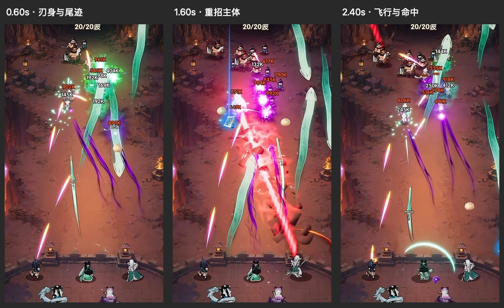

# 《桃园小英雄》战斗特效全面升级方案

状态：待确认的美术与工程方案。2026-11-20。当前运行基线仍为 v9.22；本文不代表已经制作素材或实现代码，不改变技能、武器、伤害与解锁规则。

## 1. 升级目标

保留少年Q版角色、明亮战场、搞笑三国和六武器构筑，特效提升到“有实体主体、有流动材质、有完整运动和命中收尾”的国风动漫表现。普通攻击持续好看，主动技能有明显的高潮，Boss每一招都有自己的轮廓和节奏。

覆盖范围：36个武器目录条目及四品质视觉、12通用主动、7Boss的21招、普通兵攻击反馈、三英雄本命成长连招、坐骑冲刺与宠物攻击。预留和未解锁条目只补表现设计，不改变可获得资格。

本轮重做特效载体、材质、运动和反馈。现有伤害、范围、弹速、段数、攻击频率、前摇、控制、15击杀充能与碰撞契约保持。若后续需要扩大真正的伤害范围或增加招式，另列平衡变更，不能混在美术升级中。

## 2. 参考视频拆解

用户视频长约2.80秒，1290×2796。按0.2秒提取15个有序样本，并查看完整尺寸画面；该短片可用于飞行/命中/大招片段的美术参考，不能证明对方技能完整机制、技术实现或长时间手机性能。来源与SHA256见[reference/source.json](reference/source.json)。

| 片段 | 可以直接观察到的特点 | 本项目采用方式 |
| --- | --- | --- |
| 约0.2–0.8秒，青白长剑气 | 白玉色实体刃头、半透明青色刃身、宽而弯曲的尾部；前后轮廓厚薄不一 | 青龙刀、白羽扇、飞剑借鉴实体刃身与流动宽尾；按各自实际攻击方向运动 |
| 多处紫色飞行物 | 亮头部＋成束、收尖的细长拖带，尾部有弯曲摆动 | 葫芦、符书、法术飞行物建立“核心＋流动拖带”的连续运动 |
| 连续小弹和命中 | 小弹亮芯清楚，命中有短白爆点、彩色散片与迅速衰减的光 | 枪弩保留清晰弹头和短而密的真实命中，普通反馈不抢主技能 |
| 约1.4–2.2秒，红色重招 | 巨大的尖锐主体冲出，带贴身旋纹、碎块和拉长尾迹，随后退出画面 | 吕布冲锋、方天画戟重击借鉴厚重主体、旋纹和余波；不新增真实攻击段数 |
| 整体混战 | 青、紫、红几类效果的主轮廓仍可区分，亮度集中在局部 | 统一材质语言，同时让武器、主动与Boss保留各自身份 |

参考画面是固定阵地向上射击，有较长的空白通道。本作四向自由走位、敌我贴近，采用更短、更贴合判定的主体和尾迹；华丽程度通过材质和运动获得，不依赖贯穿整屏的常驻光带。视频深色背景的对比度也不能直接照搬：六张明亮地图上要靠深色薄背沿、明亮主体和局部阴影把形状立住。

## 3. 当前表现需要补齐的部分

结合现有 `combat-effects / skill-vfx-art / sweep-effects / boss-effects / lvbu-effects` 及历史实装画面：

1. **主体材质。** 目前大量刃光、火焰、雷电靠纯色多边形/线段，缺少通透刃身、炽热内芯、能量纹理、湿润水体等区别。
2. **连续运动。** 需要攻击头部、主体和尾部沿运动方向连续变化，减少“图形出现→缩放→淡出”的统一节奏。
3. **起承转合。** 抬手、聚能、主效果、接触爆点、余波要围绕同一实际出招事件组织，高潮短而明确，持续技有呼吸与流动。
4. **命中反馈。** 斩、刺、拍、弹、爆、灼烧与法术命中需要不同形状和声音，受击压缩、闪色和击退沿用真实命中。
5. **空间层次。** 地面阴影/裂纹在脚下，主体与人物分前后，火星与落尘按高度运动；大效果始终保留角色脸、危险边界和安全缺口。
6. **成长可读性。** 品质提升通过材质饱满度、真实追加段的轮廓、特殊触发的强调体现，不把每件IV武器都变成常驻大光圈。

## 4. 统一美术标准

### 4.1 八类基础材质

| 材质 | 视觉标准 | 主要复用对象 |
| --- | --- | --- |
| 金白刀锋 | 象牙白锐边、金色实体刃身、深金薄背沿，边缘首尾收尖 | 双股剑、横扫六合、金属近战 |
| 青玉剑气 | 半透明青玉主体、白热前缘、内部流纹与窄暗边 | 青龙刀、银枪、羽扇、飞剑 |
| 赤焰爆破 | 红色低亮底层、橙金翻焰、短白热核心、炭屑与稀薄烟 | 爆竹、火箭、火油、火烧连营 |
| 雷电符能 | 有粗细变化的雷芯、短分叉、电晕、纸符燃边和焦痕 | 五雷符、太平要术、张角、雷霆万钧 |
| 水浪 | 连续有厚度的蓝青水体、卷起浪冠、断开的白沫和短水花 | 水淹七军 |
| 紫色法力 | 明亮核心、丝带状流纹、细小星屑和轻薄余光 | 葫芦、星落、部分阵法 |
| 玉石与金属实体 | 有前后面、局部反光和落地重量的印玺/棋子/门印 | 董卓、司马懿、八门、七星灯 |
| 尘土与碎屑 | 棕灰薄尘、定向地面擦痕、少量有重力的颗粒 | 近战重击、骑兵、孟获、陨星 |

材质可以复用，主轮廓、运动轨迹和配色必须按技能区分。符印优先使用经过设计的图形纹样；确需汉字时人工校对，避免将生成乱码烘焙到素材中。

### 4.2 每招的完整结构

**动作/聚能 → 主体释放 → 真实接触 → 余波回收。**

- 普通攻击强调0.06–0.22秒内的主体和接触；这是视觉参考区间，不替换实际出手时钟。
- 主动技能有短而集中的视觉峰值，持续部分跟随原1.3/3/5/6秒等机制时长，收尾迅速让出战场。
- Boss在原前摇内逐步增强，危险边界从原预警时刻起可见；释放后主体、命中、尘烟分段衰减。
- 关键主形体使用连续位移/旋转/UV流动，爆点与火焰等局部可用12–24fps帧动画；角色、弹体和轨迹仍随引擎显示帧平滑更新。不能用低帧率整块动画代替整个战场的运动。
- 现有瞬发扇区在真实伤害帧获得刃闪/接触反馈，后续运动尾迹只装饰；逐角度扫过判伤的吕布回旋则让刀锋角度与真实扫掠同步。视觉节奏不偷偷更换命中方式。
- 空放保留主体运动；接触爆点、受击形变和命中声音只在真实命中时出现。

### 4.3 战场清晰度

友方以各武器本色表现。敌方危险使用统一的薄朱红边与收缩刻度，主体仍保留各Boss配色；判定边界和主效果各司其职。安全缺口内不能溅入高亮实体火墙或大刀锋。

六武器中，普通弹和刀光偏紧凑，主动技负责大高潮，Boss招式负责战场空间变化。高光集中在前缘和接触点，宽尾迹透明衰减，角色脸和脚下走位区域保持可读。冲击震动只作用战场，普通轻击不震、重击短震，移动输入与真实位移不中断。

## 5. 36武器升级清单

所有品级先达到新的基础材质标准；升阶再增加层次和真实机制触发的表现。以下装饰不增加伤害、射程、穿透、分裂数或命中次数。

| 武器 | 普通攻击的新表现 | 命中/升阶表现 |
| --- | --- | --- |
| 草鞋 | 保留红绳草鞋实体，抛出有加速感，短金纤维掠尾和轻微翻转 | 拍击用扁平白金爆点、草屑和短鞋形压印；真实弹射时再加拐向掠尾 |
| 扁担 | 前段木色实体影、金白薄刃扫过、短气流拖带 | 木片/尘点向击退方向散开；高阶重击刃身更厚，仍保持木器感觉 |
| 杀猪尖刀 | 象牙白锐利短刃，细红橙背沿，快进快收 | 接触用窄切痕与金属星火，暴击强调爆点，不套大范围震地 |
| 桃花枝 | 木枝起势，粉白花瓣有卷曲薄面、柔和粉尾 | 落点展开短桃花瓣爆散；品质真正变多瓣时按实际弹数展示 |
| 爆竹 | 明确爆竹本体、跳动引线、收尖火星尾 | 白热爆芯→橙红火团→碎纸/淡烟，范围轮廓按真实爆炸半径 |
| 桃园突突枪 | 枪口双片短焰、细金白弹芯、短曳光 | 高频小火花按射击簇合并；品质用弹芯和真实机制区分，控制弹壳量 |
| 村口霰弹枪 | 宽而短的枪口喷发、每颗真实弹丸各自短尾 | 一轮齐射保留清楚的散开结构，近距离命中更饱满；实际发数保持 |
| 二踢脚火箭筒 | 有体积的弹头、橙白喷口、分段衰减烟尾 | 三段爆破：爆芯、外翻焰、地面尘环；高阶只按真实范围/追加效果强化 |
| 青莲飞剑 | 剑体带青玉材质，运动方向上有短连续剑尾，剑尖更亮 | 周身轨迹有前后遮挡；实际接触生成小刃爆点，避免常驻厚光环 |
| 五雷符 | 先见符能连起目标，再见有粗细变化的紫白电弧 | 每个真实跳链点单独电爆/短电晕；v9.16减半伤害保持 |
| 吞天葫芦 | 葫芦口旋涡与收束气流，敌人到瓶口的法力带连续向内流 | 吸入端有短紫白亮核与碎屑；按原吸附段数/目标上限，不扩大范围 |
| 双股剑 | 金白交错双刃，一左一右形成清楚的两条运动轨迹 | 成长第三击出现完整X形刃闪与短金色剑纹；仍占一个武器槽 |
| 青龙偃月刀 | 青玉大刃身、暖白刃锋、顺运动方向的宽收尖尾迹 | 真实重击/成长第三击带短青龙首与鳞纹散开；不让每次挥刀都常驻一条龙 |
| 丈八蛇矛 | 白亮矛尖、朱红/金色窄锋，蛇形气流贴着真正刺击方向 | 实际重段附分叉地裂/短蛇纹，命中点厚重，普通快刺保持干净 |
| 方天画戟 | 朱红金白的大戟刃影，主刃外有短旋纹 | 真实追加段有第二条错位戟光；重击落点有定向碎石和尘浪 |
| 龙胆银枪 | 银蓝枪锋、透明青色尖锥和短平行速度纹 | 连刺依真实段数逐次点亮，接触用集中白蓝爆点 |
| 青釭剑 | 冷青窄锋、较锐利的白色切面 | 穿甲感通过碎甲片/尖锐接触形状体现，不额外扣甲或改伤害 |
| 倚天剑 | 银蓝厚剑气、窄金边，主体端部清晰收尖 | 真正追加剑气有独立飞行主体；普通斩与远程追加明显可区分 |
| 七星宝刀 | 金白刃面内嵌细小星纹，星光沿刀背流动 | 第七次等真实触发事件才出现星芒列斩/飞刃，不逐刀满屏撒星 |
| 古锭刀 | 铜金实体刀光、橙白短刃锋 | 首击/重击使用短铜甲破裂反馈，刀面质感偏沉稳 |
| 双铁戟 | 两道有错位的铁灰金白刃光，方向与双击对应 | 连段逐次有单独接触，尾部短而有金属重量 |
| 三尖刀 | 三叉锐锋合成一个清楚的主体，背沿青金 | 品质触发侧锋时再显示真实侧向追加，主尖接触最亮 |
| 铁蒺藜 | 小型实体棱角、落地翻滚、轻尘 | 地面布置稀疏可辨，不给整片区域铺厚亮底；触发后短金属接触 |
| 诸葛连弩 | 细长箭体、金白箭尖、同批连射形成有节拍的掠线 | 穿透后的箭尖继续清楚可见，连发声与真实释放同步 |
| 麒麟弓 | 红金羽箭、火纹包裹箭头、细而长的羽流 | 真正分裂/穿透按机制展示，高阶箭头短暂呈麒麟纹光影 |
| 贯石弩 | 粗重弩箭、银白硬芯、明显的近箭头压缩气流 | 击中重尘/碎甲，视觉强调贯穿方向，不变成火箭爆炸 |
| 手戟 | 实体戟身旋转，青白弧尾短而分段 | 返回路径与实际回收一致，真实两次接触分别反馈 |
| 锁链钩 | 钩头清楚、链条分节，有张力的窄拖带 | 拐向与拉扯读得到钩头位置；接触用金属顿点，不用粗光束遮链 |
| 火油壶 | 瓶体带液体晃动感，破裂有飞散油滴和小火芯 | 油迹先铺地、火焰在其上流动，中心低、边缘卷；持续反馈按真实tick |
| 震天雷 | 厚重圆雷、引线噼啪、短灰烟 | 锐利白芯＋橙金翻焰＋稍重的碎石尘浪，与爆竹的碎纸区分 |
| 白羽扇 | 青白风刃，透明玉色主面与弯曲收尖尾流 | 命中为薄风切与叶状碎光；实际多刃按真实弹数显示 |
| 太平要术 | 浮起书页/图形符印，金紫法能沿页纹聚起 | 实际落点出现符印骤亮、雷芯与轻纸灰，区别于五雷符的跳链 |
| 七星灯 | 小灯实体与灯芯短焰，星力在真实轨道上流动 | 实际脉冲才有短星纹扩散，持续驻留亮度较低 |
| 八阵图 | 青玉/金色阵纹有细小流动，中心通透 | 每次真实触发有门纹收束或短锁印，地面主体不遮脚 |
| 木牛机关 | 清楚的木牛本体/机关出手，小型白金弹芯和机械后坐 | 射击脉冲偏金属/木屑，保留实体喜剧感，避免画成法球 |
| 木鸢飞翼 | 木翼实体有轻微俯仰，羽片形青白飞行线 | 实际齐射采用展开结构与短收束风尾，复用有限弹体槽 |

品质表现：I级主体已经完整；II级细化边带/流纹；III级在真实特殊触发上增加识别；IV级加强主轮廓与短暂图腾。品质没有新增段数的武器不能靠装饰制造多次命中的错觉。本命成长连招优先，不能把品质追加连段和成长三连重复叠画。

## 6. 12个主动技能

| 技能 | 新主体与完整过程 | 必须保持的可读性/机制 |
| --- | --- | --- |
| 百步穿杨 | 弓形光影瞬间拉满，8支金白实体羽箭依次射出；每箭有轻微螺旋羽流，命中出现集中穿刺爆点和向前散开的碎羽 | 仍8箭，按真实弹体抵达伤害；尾迹不产生额外命中 |
| 冲锋破阵 | 人物前方形成青白枪锋，侧后两束宽尾收尖；终点气流展开、擦地尘向后散开 | 真正位移路径/端点一致，不给站在路径之外的敌人画受击 |
| 横扫六合 | 保留A版金白厚刃与旋向，提升为有通透刃身、流动金纹和锐利锋面的实体回旋；双段刀尾错位消失，真实命中有独立碎锋 | 保留当前0.4秒主体、真实瞬发/目标/伤害契约；漂亮的后续刀尾不新增一次横扫 |
| 八门金锁 | 八座有正侧面的玉金门印错相升起，阵线有方向性流光，入阵命中时门纹短促收束 | 固定阵地、入阵判定与减速不变；边界从实际生效起可辨 |
| 火烧连营 | 施法点向左右卷出连续火线，底部油烟低伏，上部有不同高度的翻卷火舌；每次灼烧火芯翻亮，结束化成炭屑与薄烟 | 水平480×80、3秒/原4次灼烧保持，地面焦痕在失去伤害后明确变暗 |
| 水淹七军 | 蓝青连续浪墙向外展开，有厚水体、翻卷白浪冠和层层透明水裙；接触飞起短水花，波后迅速下落散水 | 扩散前缘取真实半径，实际扫到才伤害；不以一圈装饰泡泡表示整招 |
| 星落五丈原 | 五颗带岩核的金紫彗星依次坠落，接近落点时尾迹拉长；各自落地爆芯、碎石、尘裙分段展开 | 五落点/既定时序/单敌次数不变，预落点和实际落点同源 |
| 背水一战 | 赤旗/短战纹起势，人物肩侧与武器形成向后的红金气流；真正出手带短促金白刃闪，结束气流收回 | 攻速×5持续5秒；不画常驻高亮罩，不额外生成攻击；同帧高频表现合并 |
| 护体剑阵 | 四柄有玉金刃面的飞剑沿清晰轨道旋转，前后层交替，短剑尾相接；格挡时对应位置爆出盾形折光与一枚印记碎裂 | 原6秒/4剑/3格挡和攻击上限保持；防御耗尽后剑仍攻击、格挡标记清空 |
| 震军号令 | 战吼起势，三层错峰的厚金白声浪快速扩散，地面扬起薄尘；敌军出现与真实控制时长对应的清楚眩晕星标 | 半径400、5秒控制、无新增伤害；已发出的危险保留，不做假清屏 |
| 雷霆万钧 | 落雷前符能压亮，紫白粗雷柱带短分叉劈入，落地电冠/焦裂/细游电错开衰减，数雷有明确强弱节拍 | 原4处落雷/真实时间和目标上限保持，不加全屏白闪或延长原前摇 |
| 万箭齐发 | 边界短暂军阵纹显形，四轮斜落的实体羽箭形成阵列；箭尖白热、箭尾短金红流光，地面按轮次出现尘幕和碎羽 | 半径400/原4轮命中，装饰箭不逐支叠伤；中心可见敌人和真实敌方预警 |

所有技能统一15个真实普通兵击杀重置。威力I–VI的视觉差别体现在主体规模、高潮密度和材质饱满度，不只依靠亮度；控制/防御技能也有完整主体，不能因其无伤害就缩成一个小图标。

## 7. 七Boss、21招升级

### 张角：黄符、金雷与有压迫感的雷狱

| 招式 | 视觉升级 | 判定与躲避 |
| --- | --- | --- |
| 黄符定雷 | 黄符先聚在落点上方，细电向符心吸入；原释放时刻落下金白雷柱，雷芯、短分叉、电冠、焦痕分层消退 | R76与原0.85秒起手保持；落点固定后不追脚 |
| 三才雷阵 | 三枚符印带不同聚能相位，按真实间隔递进爆亮；连续三雷的雷形略有变化，形成清楚节拍 | R70/原0.45秒间隔保持，前后走位空间可读 |
| 太平雷狱 | 三枚实体雷符绕点轻摆，连接的粗细电链沿边流动；起手有链路聚能，断符时电链反卷熄灭并飞纸灰 | 可拆符、真实链边/安全区域、各边预告与7秒存留保持 |

### 吕布：赤兔速度、朱红戟光与沉重刹停

| 招式 | 视觉升级 | 判定与躲避 |
| --- | --- | --- |
| 赤兔破军 | 刨蹄扬尘、戟尖聚白热朱红光；冲锋中戟形实体前锋和贴身旋纹随马运动，后方短赤焰尾；勒马有向前翻卷的尘裙 | 原锁向/480冲程/碰撞保持，主体头部跟随真正危险位置 |
| 画戟回旋 | 戟刃先有压紧的赤金刃面，释放形成厚大的红金月牙、短螺旋纹与飞散碎锋；刃后两段透明尾迹随扫过角度衰退 | R300、300°与身后60°缺口保持，刃锋和实际扫角同步 |
| 无双三连冲 | 三次冲锋分别有新锁向聚能；每次朱红枪戟核心更饱满，转向处残影断开，最后一冲以重尘收尾 | 不用一条长特效覆盖三段轨迹，保留每次独立蓄力/转向/可躲时机 |

第3波吕布小Boss沿现行两招限制，不因全套素材完成而提前开放第三招。

### 董卓：金属重量与酒火反差

| 招式 | 视觉升级 | 判定与躲避 |
| --- | --- | --- |
| 金印镇地 | 有顶面和侧面的金印升起，投下收紧阴影；落下有短金白冲击、篆纹印痕与向外弹开的碎石 | R135/原1.1秒起手与真实落印伤害保持，阴影和落点同源 |
| 赤铜横财 | 厚铜钱转动时有明暗面、孔中透光；滚动接地处短火星/尘线，撞击有硬金属爆点 | 四枚真实铜钱和中间通道保持，不加尾迹填满安全通道 |
| 酒池焚阵 | 酒坛带液体/坛体碎片，落地先铺湿润酒迹；随后橙金火焰翻起，烟/火/地面残留分层 | 原延迟起火、R78、存留与tick保持，熄火后残迹不冒充伤害区 |

### 袁绍：成阵的箭势与重弩压迫

| 招式 | 视觉升级 | 判定与躲避 |
| --- | --- | --- |
| 四世箭阵 | 指挥起势有短军旗光影，弓手同时拉弓，实体箭形成有密有疏的银金阵列，羽尾与命中尘点统一方向 | 本体/随从真实箭数、可拆弓手和缺口保持 |
| 官渡弩阵 | 弩车绷弦聚能、粗弩箭有白热尖芯和空气压缩纹，三连后坐清楚；配套箭雨按真实圈落下 | 仍可拆车、交替三连和原箭雨落点，重弩与普通箭用粗细区分 |
| 万军齐射 | 三轮箭墙有不同方向的阵列主体，箭羽残影形成短平行带；错时箭雨带落地尘幕 | 真实缺口贯穿所有材质层，不能只留在薄预警上而被箭尾盖住 |

### 曹操：银锋节拍、纸影与骑兵合围

| 招式 | 视觉升级 | 判定与躲避 |
| --- | --- | --- |
| 倚天连刃 | 三拍银蓝实体剑锋，第一拍窄、交叉拍层次更厚，尾部有冷白细流纹；每次接触是短切爆 | 三拍五道真实银锋、锁向与原间隔保持 |
| 疑兵换影 | 纸影出现时从折纸轮廓展开，动作带轻微纸边残片；本体横移留下短剪影，地面剑阵逐锋亮起 | 原纸影可拆/横移/剑阵范围保持，纸影不增加假碰撞 |
| 虎豹合围 | 虎豹骑起势有马蹄尘与金属锋，冲锋为贴身银锋和窄白尘尾；本体剑气与落剑按各自节拍分层 | 错开冲锋、三段剑气与落点仍可分辨，首领主效果不掩盖骑兵起手 |

### 孟获：真正看得清的兽群冲锋

| 招式 | 视觉升级 | 判定与躲避 |
| --- | --- | --- |
| 猪突猛进 | 战猪刨地、低头压身，冲锋有短金色前弧、侧向速度纹与连续土尘，獠牙/四肢保留 | 仅冲锋阶段无敌，收招金弧熄灭，原速度/路线保持 |
| 群狼围猎 | 狼沿侧面接近时尾部轻尘，伏身蓄力清楚；扑击有细长青白爪锋和短拉伸尾迹，落地擦出爪痕 | 原独立锁向/扑击时机与冲锋无敌阶段保持，不画成无主体的能量球 |
| 万象开道 | 战象重踏有压地尘浪，鼻/象牙带短金光；冲锋时侧尘更宽，刹停时碎土前翻 | 两象错时、原冲程/真实碰撞保持，体型与地面阴影一眼可读 |

### 司马懿：黑白棋石、实体双龙与星坠

| 招式 | 视觉升级 | 判定与躲避 |
| --- | --- | --- |
| 落子成灾 | 黑白棋子有玉石/黑曜石质感，接近地面时有短重影；落子瞬间棋纹沿地面闪开，碎屑迅速消退 | 维持v9.16后的出手速度，不为蓄大招再拖慢落子 |
| 阴阳双龙 | 龙首、连续躯干和收尖龙尾有不同明暗，黑龙紫白内芯、白龙青白内芯；沿真实中心线移动，带少量流纹和须尾 | 龙身在真实碰撞包络内，不把装饰弯曲伸出实体判定 |
| 五丈星劫 | 星石下坠先见岩核与长短不同的彗尾，落地有棋盘裂光和短碎石裙；格线只在局部随波亮起 | 原落点/间隔/速度保持，不铺整屏棋盘光导致看不到安全格 |

## 8. 普通兵、成长、坐骑与宠物

- 40兵按斩/刺/锤击/射击/投射/施法/冲锋/器械复用材质家族，保留已做好的抬手、锁向、释放、收招。普通兵特效规模低于英雄主动，近战锋面贴着真实武器，箭与炮弹的头部位置清楚。
- 中Boss在原招式上增强聚能和命中重量，不用不断放大的光圈代替动作；黄巾三冲锋精英仍清楚地各自蓄力/冲出/收招。
- 小刘本命交错金白双锋，小关青玉大刃与真实第三击龙纹，小张白亮枪尖＋朱红重刺/短裂地；成长连招与其他环绕武器不会互相接管视觉身份。
- 白马冲刺为白金掠尾、赤兔为短朱红蹄焰、黑猪为棕金土尘和短前锋。按真实420/420/360冲程与原时长，不靠画得更长伪造距离。
- 桃桃兔为短粉白飞桃/碎瓣，小青蛟为青玉短刃/水纹，橘虎崽为金橙爪锋/小扑尘；使用普通攻击级别反馈，不抢英雄技能。
- 被动词缀仅在实际分裂/爆炸/格挡等触发时强化对应材质。无限叠加被动不代表无限叠加常驻光效。

## 9. 实现方式：素材和程序分工

| 载体 | 负责内容 | 工程边界 |
| --- | --- | --- |
| 手绘透明纹理/少量帧动画 | 刃身流纹、火焰翻卷、水浪冠、雷芯爆点、碎石烟尘 | 素材主形状决定质量，先建立统一色板/轮廓/Alpha标准；不能把概念海报当整块游戏特效 |
| 带UV的轻量轨迹/分段四边形 | 刀尾、剑气、法力带、箭尾、冲锋尾迹 | 根据实际轨迹生成，连续更新宽度/透明度/UV流动；头部与真实运动同源 |
| 共享Sprite与统一材质 | 主体、柔和外晕、落地印痕、序列动画 | 复用有上限的槽位，按图集和混合方式组织批次；不为每个目标新建Graphics |
| 现有Graphics | 必要判定边界、少量精确轮廓/连接线 | 维持共享层与空清理，不继续承担所有复杂火焰、水纹和烟气 |
| Runtime事件 | 起手/释放/命中/格挡/到期/中断 | 伤害、控制和充能独立于装饰是否成功显示；动画跳帧不跳伤害 |

新材质只考虑少量UV流动、渐隐/溶解和局部亮芯，优先在主体贴图里做出光感；首版不引入全屏Bloom/多级模糊/屏幕扭曲。这一选择是具体的性能方案，不降低主效果的美术标准。

每个特效交付：透明主体/尾迹/命中/收尾素材、尺寸与握点/落点锚、色板、时间曲线、前后层、真实事件映射、低负载与满负载显示规则。帧动画统一注册，边缘留间隔，纹理Alpha与混合管线匹配；避免黑底素材、闪动边缘和忽大忽小的序列帧。

## 10. 包体和性能预算（设计目标，待样板实测）

沿现有CDN不可变版本/合法域名/按需Bundle加载，不把全量特效塞进首屏。

| 项目 | 提议预算/规则 |
| --- | --- |
| 公共材质 | 最多2张1024² RGBA，约8MiB驻留；覆盖普通武器的通用刃、弹、火、电、尘等 |
| 所选主动 | 默认1张1024²，约4MiB；只装载当前携带技能，不把12张全留内存 |
| Boss特效 | 默认每位1张1024²、约4MiB；无尽最多两Boss约8MiB，未引用资源在合适边界释放 |
| 增量纹理目标 | 常态按最坏组合约20MiB，资源准备/切换含短暂解码峰值争取≤24MiB；达不到先调整打包和同源材质复用，不能拿压缩文件大小冒充显存 |
| 游戏实体上限 | 保留80敌/160友弹/80敌方移动物/6危险区/4Boss主招与现有召唤、280粒子上限 |
| 视觉状态 | 保留CommonSkillEffects32状态、Boss现有有界状态与材质池，逐项迁移，禁止新旧完整效果同时播放 |
| 新增装饰渲染片 | 独立统一预算，建议常态≤64、短峰≤96个四边形；不含原弹体/角色/粒子，不作为新增物理攻击对象 |
| 弹体尾迹 | 挂在既有弹体槽中复用，不新增物理弹；普通尾迹1条，重要法术至多2条，屏外不提交装饰 |
| 透明覆盖 | 关键位置通常≤3层软透明叠加，极短爆点可更多；宽尾迹降透明、范围技中心保持通透 |
| 合批目标 | 新材质/贴图分组后，特效Draw Call增量常态争取≤20、爆发≤35，具体以原机与实际引擎对照为准 |
| 降级顺序 | 远处尾屑→二级光晕→余烟；保留攻击主体、真实危险边界、落点和接触反馈，不减少敌军或伤害 |

加载时解析并绑定帧/材质引用，战斗中使用固定槽与数组索引；禁止命中时创建Canvas、下载素材、生成文字图或不断拼装大缓存键。伤害数字继续使用v9.22共享图集；不新增音频播放器或逐粒子声音，沿原6音效＋1音乐与限频。

流畅度验收建议：以用户iPhone15ProMax为首个基准，六武器、多弹体、双Boss、5倍攻速和跨商店循环共同测量；高性能档目标接近60fps，低档目标稳定30fps。新增纹理/缓冲应在预热后形成有界平台；进行至少15分钟及30分钟的分段长会话检查。以上均为未来实施验收计划，本轮未跑测试，也不保证新方案天然解决已有原生闪退。

## 11. 制作与验收顺序

| 批次 | 交付 | 通过条件 |
| --- | --- | --- |
| A：统一质感样板 | 青龙刀普攻、火箭筒、水淹七军、横扫六合、张角黄符定雷、吕布赤兔破军，6段真实Cocos动态小样 | 能看到完整动作/主体/接触/收尾，普通与大招形成层次，明亮草地上同样清楚 |
| B：玩家构筑 | 36武器按家族铺开、12主动全量；三英雄本命/三骑/三宠同步 | 每个目录条目有身份，每品级差异与实际机制对应，6武器和背水5倍频率仍可读 |
| C：七Boss | 21招逐招完成，同时适配精英/普通兵同源反馈 | 每招有特定轮廓与节奏，原预警/缺口/可拆物/免伤阶段可正确读懂 |
| D：整局质量与稳定性 | 所有关卡、菜单/商店/暂停/后台/死亡/重开/资源失败及原机压力验证 | 无残留效果/资源持续增长，命中与视觉同步，危险提示清楚，原设备长局达标 |

先用6个样板校准质感与性能，再批量铺开，避免69项全部完成后才发现风格和参考仍有距离。用户本轮只要求方案，批次A尚未制作。

验收按真实移动视角连续录像，至少覆盖：普通攻击、攻击命中/空放、四向/斜向、静止/移动、骑乘、地图边缘、暗亮六主题、不同技能叠加、Boss被控/被击杀打断，以及离店重新进入战斗。静态概念图、关键帧和循环动画各自标明性质，不能用海报证明实际游戏已还原。

## 12. 本轮交付边界

本轮完成视频拆解和全量升级方案。仅新增本方案、参考截帧/来源记录，并在项目skill中登记“待确认”；没有修改assets、现有运行代码、数值、解锁、包或CDN资源。确认方向后再进入动态样板、生产素材和实现。

## 13. 后续补充：首批静态概念demo

同日用户要求先出几组设计demo，已新增[青龙刀、水淹七军、吕布冲锋三张概念板](concepts/README.md)，各含峰值与起手/释放/收尾关键帧。它们是内置image_gen生成的待审图，未制作连续动画或进入批次A真实Cocos样板；原36武器/12主动/21Boss招式的机制与预算仍按前文，未获得实现授权。

## 14. 全量设计交接

用户随后认可三张先导稿的美术方向，并要求完整方案与每项独立设计稿。全量入口为[133项设计册](full/README.md)，其中36武器/12主动/21Boss招式为核心69项，另覆盖40兵、9本命骑宠、8共通反馈和7中Boss变体。新稿逐项待审，尚未进入真实动态样板或代码实现。完整逐项机制、四档武器、色板/层级、来源提示和PDF/可检索图册一并归档。
